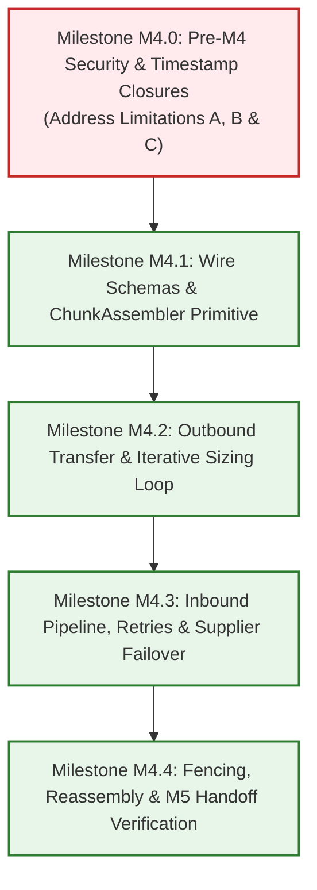

# Phase 7.5 Milestone M4 — Snapshot Transfer Implementation Roadmap

**Status:** APPROVED FOR PLANNING (DOCUMENTATION-ONLY)  
**Date:** 2026-11-19  
**Refinement Date:** 2026-11-19  
**Branch Baseline:** `main` at `3b90116`  
**Parent Implementation Baseline:** `6fddcf90de5d4cb0e82bd711e7e217cd570c88a4`  
**Specification Baseline:** `119da194c3feb883cfd61b6928cb81d4b200ac5d`  

---

## 1. Roadmap Overview & Phasing Strategy

Milestone M4 implements the chunked snapshot transfer protocol across WebRTC DataChannels. To ensure rigorous verification, risk isolation, and clean git history, M4 is partitioned into five sequential, independently testable sub-milestones (M4.0 through M4.4).

---

## 2. Sub-Milestone Breakdown

### Milestone M4.0: Pre-M4 Correctness, Security & Compaction Closures (Prerequisite)
- **Objective:** Address mandatory M3 audit limitations A, B, and C in existing infrastructure prior to introducing recovery transfer wire traffic.
- **Scope:**
  - **M4.0a (`STATE_DIGEST` Identity Binding):** In `TrustedTransportAdapter.handleTransportMessage()`, verify `msg.payload.senderPeerId === inbound.fromPeerId` and `msg.payload.connectionGeneration === peerStatus.generation`. Drop and reject any identity or generation mismatches.
  - **M4.0b (Exact Timestamp Resolution):** In `OrderedOperationLog.getOriginFrontierTimestamps()`, eliminate loose fallback to non-sequence-specific `originFrontierTimestamps`. Return exact sequence timestamps or report metadata unavailable.
  - **M4.0c (Facade Gating):** Restrict `LeaderlessSyncEngine.recordPeerDigest()` to internal/capability-authorized registration.
  - **M4.0d (Compaction Exception Staging & 8-Component Mutation Inventory):** In `OrderedOperationLog.compactAtFrontier()`, execute candidate base snapshot reduction across the complete 8-component mutation inventory (`baseSnapshot` via `structuredClone`, `operations` via shallow filter, `idIndex` and `originSeqIndex` via reconstruction, `compactedCheckpoints` and `originFrontierTimestamps` via shallow map clones with FIFO policies, `baseSnapshotFrontier` via shallow record copy, and `hasPrunedOperations`) out-of-band before mutating any active log structures. If the reducer throws or candidate staging fails, candidate objects are discarded, the exception propagates, and active engine state remains 100% untouched (`CandidateConstructionFailure => ActiveStateAfter === ActiveStateBefore`). (Note: Reducer is contracted to be pure; external reducer side effects cannot be rolled back by the runtime.)
- **Deliverables:**
  - Code changes in `packages/sync-engine/src/engine/leaderless-sync-engine.ts` and `packages/sync-engine/src/log/ordered-operation-log.ts`.
  - Targeted unit tests in `packages/sync-engine/src/__tests__/closure-m4-0.test.ts`.
- **Exit Condition:** All existing 995 tests pass plus new M4.0 security tests.

---

### Milestone M4.1: Wire Protocol Schemas & Chunk Assembler Primitives
- **Objective:** Implement all recovery wire message contracts in `@syncplay/protocol` and the in-memory chunk tracking, deduplication, and failover assembly engine in `@syncplay/sync-engine`.
- **Scope:**
  - Add schemas to `@syncplay/protocol`: `SnapshotOfferPayloadSchema`, `SnapshotRequestPayloadSchema`, `SnapshotChunkPayloadSchema`, `SnapshotChunkRequestPayloadSchema`, `SnapshotAbortPayloadSchema` (including `CHUNK_COUNT_EXCEEDED` and `OFFER_INCONSISTENT` reasons).
  - Export schemas and TypeScript types in `@syncplay/protocol/index.ts`.
  - Implement `calculateChunkCapacity(effectiveLimit)` and `calculateSnapshotAdmission(totalSizeBytes, sctpLimit, advertisedTotalChunks)` in `@syncplay/protocol` enforcing `offer.totalChunks === calculatedRequiredChunks` invariant.
  - Implement `ChunkAssembler` in `packages/sync-engine/src/recovery/chunk-assembler.ts`:
    - Fixed pre-allocation bounded to $\le 128$ chunks.
    - Base64 binary decoding and per-chunk `chunkSha256` verification.
    - Idempotent duplicate chunk suppression (no re-verification or memory expansion).
    - Missing index computation (`getMissingChunkIndices`) with validation.
    - Failover chunk preservation (`prepareForFailover`): preserves verified chunks if snapshot ID and digest match bit-exact; purges all chunks on mismatch.
    - Copy-minimizing `finalizeAssembly()`: immediately sets `this.chunks = null` upon creating contiguous buffer, parses UTF-8 JSON, and verifies canonical RFC 8785 SHA-256 digest.
    - Explicit `dispose()` dereferencing all sparse arrays and assembled buffer (documenting asynchronous GC behavior).
- **Deliverables:**
  - `@syncplay/protocol` schema updates.
  - `packages/sync-engine/src/recovery/chunk-assembler.ts`.
  - Unit test suite: `packages/sync-engine/src/__tests__/chunk-assembler.test.ts`.
- **Exit Condition:** `ChunkAssembler` handles out-of-order, duplicate, corrupt, and failover-preserved chunks; 100% test pass rate.

---

### Milestone M4.2: Outbound Transfer Pipeline & Iterative Sizing Loop
- **Objective:** Implement the supplier-side transfer pipeline with normative 7-step iterative send-boundary sizing, operational bounds, and termination guarantees.
- **Scope:**
  - Implement `SnapshotTransferManager` (Supplier Role):
    - Validate incoming `SNAPSHOT_REQUEST` against active epoch, supplier identity, and snapshot availability.
    - Defer transfer initiation if SCTP parameters are not yet negotiated.
    - Enforce upfront admission gate: evaluate `calculateSnapshotAdmission()`; reject if required chunks $> 128$.
    - Slice binary snapshot into chunks using `calculateChunkCapacity()`.
    - Execute normative 7-step iterative sizing loop: serialize `SNAPSHOT_CHUNK`, measure exact UTF-8 bytes via `TextEncoder`, reduce binary slice by $\Delta = \lceil \text{overshoot} \times 0.75 \rceil + 32$ if exceeding negotiated SCTP limit.
    - Enforce hard operational bound: maximum 5 sizing attempts per chunk (`MAX_SIZING_ITERATIONS = 5`); abort with `TRANSPORT_LIMIT_EXCEEDED` if exceeded or if slice $< 256$ bytes.
    - Synchronous send error handling: If `sendSerialized()` returns `{ ok: false }`, chunk is NOT marked as transmitted; retry counters are incremented without desynchronization; failure policy is enforced.
    - Pass exact tested serialized string unchanged to `PeerManager.sendSerialized()`.
    - Handle `SNAPSHOT_CHUNK_REQUEST` retransmissions.
    - Bound concurrent outbound transfers to at most 2 per supplier (`MAX_SUPPLIER_CONCURRENT_TRANSFERS = 2`).
- **Deliverables:**
  - `packages/sync-engine/src/recovery/snapshot-transfer-manager.ts` (Supplier components).
  - Unit test suite: `packages/sync-engine/src/__tests__/snapshot-transfer-supplier.test.ts`.
- **Exit Condition:** Chunks generated under simulated SCTP limits of 64 KB, 32 KB, 16 KB, and 2 KB strictly never exceed the limit at `sendSerialized()`, converging in $\le 5$ iterations.

---

### Milestone M4.3: Inbound Transfer Pipeline, Retries & Supplier Failover
- **Objective:** Implement the requester-side transfer pipeline with admission gating, pipelining, bounded retry budgets, wall-clock deadlines, and supplier failover.
- **Scope:**
  - Implement `SnapshotTransferManager` (Requester Role):
    - Enforce single active inbound transfer invariant per node.
    - Defer transfer initiation until transport SCTP negotiation is complete.
    - Enforce upfront admission gate on incoming `SNAPSHOT_OFFER`: calculate expected chunks and reject if required chunks $> 128$ or `offer.totalChunks !== calculatedRequiredChunks` before allocating reassembly buffers.
    - Conservative memory management bounded within theoretical envelope ($\approx 28\text{–}32\text{ MiB}$).
    - Sliding-window flow control: pipeline up to 4 concurrent chunk requests (`MAX_CONCURRENT_CHUNK_REQUESTS = 4`).
    - Ingest incoming `SNAPSHOT_CHUNK` into `ChunkAssembler`.
    - Dual-level retry policy: max 3 retries per chunk, max 10 total transfer retransmissions.
    - Chunk request timer (5,000ms) and overall transfer wall-clock deadline (60,000ms).
    - Supplier failover: on supplier disconnect or generation change, transition to alternate eligible supplier offering the identical snapshot ID and digest, retaining verified chunks and issuing a new `transferId`.
    - Explicit disposal of all timers, buffers, and retry counters upon transfer termination.
- **Deliverables:**
  - `packages/sync-engine/src/recovery/snapshot-transfer-manager.ts` (Requester components).
  - Unit test suite: `packages/sync-engine/src/__tests__/snapshot-transfer-requester.test.ts`.
- **Exit Condition:** Transfers complete successfully under simulated 10% packet drop, reordering links, and mid-transfer supplier failover.

---

### Milestone M4.4: Fencing, Abort Lifecycle, and M5 Handoff Verification
- **Objective:** Implement lifecycle fencing, abort handling, memory dereferencing, and seamless handoff of verified snapshots to Milestone M5.
- **Scope:**
  - Wire transport status listeners:
    - On supplier peer disconnect: failover if eligible replacement exists; otherwise abort with `SUPPLIER_DISCONNECTED`.
    - On supplier generation change: abort/failover.
    - On membership epoch increment: abort with `EPOCH_MISMATCH` and purge partial buffers.
  - Handle inbound and outbound `SNAPSHOT_ABORT` messages.
  - Implement memory dereferencing on cancellation, timeout, and completion.
  - Implement `SnapshotTransferResult` handoff callback to M5 without executing snapshot installation.
  - Wire `TrustedTransportAdapter` message routing for all 5 recovery messages.
  - End-to-end integration tests between two simulated peers over WebRTC mock channels.
- **Deliverables:**
  - Complete `SnapshotTransferManager` integration.
  - End-to-end test suite: `packages/sync-engine/src/__tests__/snapshot-transfer-integration.test.ts`.
  - M4 completion report.
- **Exit Condition:** End-to-end snapshot transfer of 4 MB snapshots succeeds, aborts correctly on peer drop/epoch change, and handoff callback delivers verified payload. Zero M5 engine state modification occurs.

---

## 3. Strict Milestone Boundaries and Prohibited Work in M4.1–M4.4

To maintain architectural integrity across the milestone progression:
- **Milestone Scope Clarification:** M4.0 modifies `OrderedOperationLog.compactAtFrontier()` exclusively as a prerequisite correctness fix for M3 infrastructure. In contrast, Milestones M4.1–M4.4 implement snapshot transfer over WebRTC DataChannels and operate strictly outside the engine.
- **PROHIBITED in M4.1–M4.4:** Calling `engine.importSnapshot()`, `engine.importSnapshotV2()`, or modifying engine state.
- **PROHIBITED in M4.1–M4.4:** Touching `PlaybackState`, `replicationVector`, or `OrderedOperationLog`.
- **PROHIBITED in M4.1–M4.4:** Reseeding the Lamport logical clock or modifying `LogicalClockManager`.
- **PROHIBITED in M4.1–M4.4:** Implementing quarantine event buffering or draining (deferred to M5).
- **PROHIBITED in M4.1–M4.4:** Transitioning recovery state machine to `ACTIVE` or `RECONCILING` (deferred to M6).
