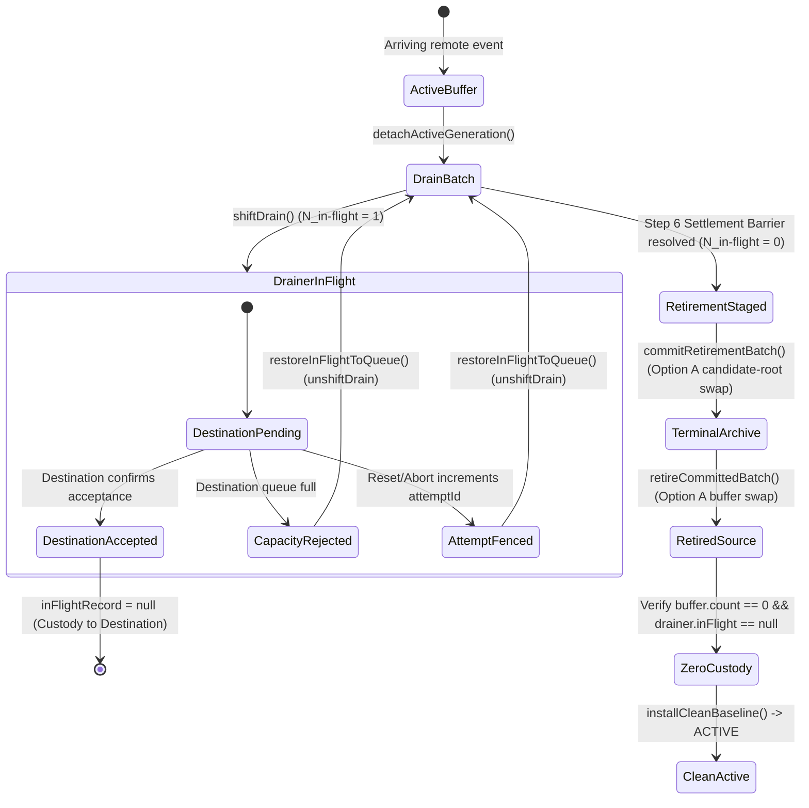

# Phase 7.5 Milestone M5.0-R16 — Correction & Architectural Closure Report

**Sub-Milestone Title:** Root Ownership, Reservation Linearization & Drainer Custody Closure
**Role:** Senior TypeScript Distributed-Systems Architect
**Mode:** STRICTLY DOCUMENTATION-ONLY CORRECTION AND SOURCE AUDIT
**Target Milestone:** Phase 7.5 Sub-Milestone M5.0-R16
**Starting Baseline Commit:** `32203a3df4c70b379fc6cb4ba0dbc335de8858b6` (M5.0-R15)
**Direct Parent Commit:** `67ef4f372c4b49b8fab4dcf390a7c9906974fcb1` (M5.0-R14)
**Authoritative Accepted Baselines:**
- M4.3b: `f3c29b62eea63f6b06647218e4485eacba86fb50`
- M4.3c: `eab2428681eb8a05b1c6e71906a932f671730fc8`
- M4.3d: `40b11fdafcd247c7a289723f90ec0e2029c94f64`
- Approved M4.3 Architecture: `2bb117c5db474a13307be65c6f68845f2bd74720`
- Frozen M4.2d Baseline: `aafa366cc48fdb2b83940f00e80d92d813e7c52e`

**Implementation Status: Milestone M5.1 remains STRICTLY UNAUTHORIZED AND UNSTARTED.**

---

## 1. Executive Summary & Objective

Milestone M5.0-R16 resolves the four specific architectural gaps identified in the Engineering Authority's review of Milestone M5.0-R15:

1. **R16-A — Candidate Root Exclusive Ownership:** Establishes the Six Inviolable Exclusive Ownership Rules across `TerminalArchiveCoreState` and `QuarantineBufferCoreState`. Clarifies that TypeScript compile-time annotations (`readonly`, `ReadonlyArray`, `ReadonlyMap`) provide zero runtime immutability against aliasing mutations, enforcing builder isolation, runtime `Object.freeze`, public getter isolation, and detached `Uint8Array` cloning.
2. **R16-B — Archive Reservation Linearization (Option A Selected):** Formally places `activeReservations` directly inside `TerminalArchiveCoreState`, establishing a single atomic linearization point (`this._core = candidateCore;`) where entry publication, transaction recording, and reservation consumption execute together.
3. **R16-C — QuarantineBuffer & QuarantineDrainer Ownership Reconciliation:** Audits the accepted source code (`quarantine-buffer.ts:243-271` and `quarantine-drainer.ts:119-215, 381-392`), proving physical custody transfer when dequeued via `shiftDrain()` ($N_{\text{in-flight}} = 1$) and restoration via `unshiftDrain()`. Mandates the Step 6 settlement barrier pre-condition and dual zero-custody verification (`quarantineBuffer.totalRetainedCount === 0` AND `quarantineDrainer.inFlightRecord === null`).
4. **R16-D — Portable Composite Identity Encoding & Full Matching:** Standardizes UTF-8 byte length calculation via `TextEncoder`, enforces strict safe integer checks on `sequenceNumber` and `membershipEpoch`, grounds identifiers in the protocol's ASCII identifier schema (`constants.ts:87`), and defines the exact 4-field comparison procedure required after a quarantine index hit.

---

## 2. Technical Resolutions & Specification Amendments

### 2.1 R16-A — Candidate Root Exclusive Ownership

#### Runtime Immutability vs. TypeScript Compile-Time Annotations
In JavaScript, `readonly`, `ReadonlyArray`, and `ReadonlyMap` are erased at compile time. At runtime in V8, arrays and objects remain fully mutable. If a construction builder retains a reference to an internal Map or Array and pushes to it after publication, or if a getter returns a mutable backing collection, the published authoritative root can be corrupted by external callers.

#### The Six Inviolable Exclusive Ownership Rules:
1. **Builder Isolation:**
   All candidate arrays, maps, and records are allocated fresh in local lexical scope. Once `this._core = candidateCore;` executes, builder variables go out of scope and cannot be retained, exported, or mutated.
2. **Runtime Deep & Shallow Freezing:**
   Every candidate object (`candidateCore`, entry array, transaction map, reservation map) is explicitly frozen with `Object.freeze()` before publication.
3. **No Retained Construction Aliases:**
   No mutable reference or construction handle survives beyond the publication turn.
4. **Public Getter Isolation:**
   Public getters (e.g. `archive.getEntries()`) return fresh defensive detached copies (`Object.freeze([...this._core.entries])`). Internal backing collections are never exposed to callers.
5. **Canonical Wire Byte Accessor Cloning:**
   `entry.canonicalWireBytes` returns a defensive detached copy (`new Uint8Array(entry.canonicalWireBytes)`). External mutation of the returned buffer cannot alter archived bytes.
6. **Pre-Publication Invariant Verification:**
   All validation, size checks, and allocations occur *prior* to publication. If any check throws, publication never happens.

```typescript
export interface TerminalArchiveCoreState {
  readonly entries: ReadonlyArray<TerminalQuarantineEntry>;
  readonly committedTransactions: ReadonlyMap<string, QuarantineRetirementTransactionRecord>;
  readonly activeReservations: ReadonlyMap<string, ArchiveReservationRecord>;
  readonly totalBytes: number;
  readonly size: number;
  readonly archiveGeneration: number;
}

export interface QuarantineBufferCoreState {
  readonly activeQueue: ReadonlyArray<QuarantinedOperation>;
  readonly drainBatch: ReadonlyArray<QuarantinedOperation>;
  readonly identityIndex: ReadonlyMap<string, number>;
  readonly activeBytes: number;
  readonly drainBytes: number;
  readonly generationId: number;
  readonly drainGenerationId: number | null;
}
```

---

### 2.2 R16-B — Archive Reservation Linearization (Option A Selected)

#### Option A: Candidate-Root Reservation Integration
In R15, `activeReservations` was maintained in an external Map, leaving an observable gap between root pointer assignment and reservation deletion.

M5.0-R16 formally selects **Option A**: `activeReservations` is placed directly inside `TerminalArchiveCoreState`.

```typescript
export interface ArchiveReservationRecord {
  readonly reservationId: string;
  readonly reservedCount: number;
  readonly reservedBytes: number;
  readonly archiveGeneration: number;
  readonly createdAtMs: number;
  readonly expiresAtMs: number;
}
```

#### Linearization Point:
When `commitRetirementBatch` executes:
1. Authoritative lookup in `this._core.committedTransactions.get(transactionId)`: if matching digest exists, returns existing receipt immediately (`alreadyCommitted: true`).
2. Validates reservation in `this._core.activeReservations.get(reservationId)`.
3. Validates staged batch integrity and exact counts.
4. Constructs candidate root:
   - `entries`: `[...this._core.entries, ...stagedBatch]`
   - `committedTransactions`: new Map with added transaction record.
   - `activeReservations`: new Map with `reservationId` deleted (**consumed**).
   - `totalBytes`, `size`, `archiveGeneration` updated.
5. **LINEARIZATION POINT:** Single synchronous pointer swap:
   ```typescript
   this._core = candidateCore;
   ```
   At this exact instruction, entry publication, transaction recording, and reservation consumption execute together atomically.

#### Invariant Guarantees:
- **No Dangling Reservations:** A committed transaction cannot retain an active reservation because the reservation is removed in the exact same pointer assignment.
- **Atomic Failure Unwind:** If candidate construction or validation throws, `this._core` is completely untouched. The reservation remains active and unconsumed, entries are uncommitted, and transaction count is un-incremented.
- **Uncertain Commit Reconciliation:** An uncertain transaction outcome is queried via `this._core.committedTransactions.get(txId)`. If absent, the reservation remains intact in `this._core.activeReservations` and can be cancelled via `cancelReservation(reservationId, capability)` or retried cleanly.

---

### 2.3 R16-C — QuarantineBuffer & QuarantineDrainer Ownership Reconciliation

#### Source Audit Findings
An audit of accepted source code (`packages/sync-engine/src/recovery/quarantine-buffer.ts:243-271` and `packages/sync-engine/src/recovery/quarantine-drainer.ts:119-215, 381-392`) establishes the exact physical custody transitions across the recovery lifecycle:

1. **Where `_inFlightRecord` is Stored:**
   - Exclusively in `QuarantineDrainer` (`quarantine-drainer.ts:119`).
2. **Physical Custody Separation:**
   - When `quarantineDrainer.drainBatch()` calls `op = this.quarantineBuffer.shiftDrain()` (`quarantine-buffer.ts:248-251`), the operation is **physically dequeued from `QuarantineBuffer.drainBatch`**, `_drainBytes` is decremented, and the identity is deleted from `identityIndex`.
   - The operation is held **strictly and exclusively in `QuarantineDrainer._inFlightRecord`** ($N_{\text{in-flight}} = 1$). It is **NOT** present in `QuarantineBuffer` while in flight.
3. **Restoration Mechanics:**
   - When an in-flight operation is rejected with `CAPACITY_REJECTED` or fenced by attempt invalidation, `quarantineDrainer.restoreInFlightToQueue()` calls `quarantineBuffer.unshiftDrain(op)` (`quarantine-buffer.ts:268-271`).
   - `unshiftDrain()` prepends the operation back to `QuarantineBuffer.drainBatch`, restores byte accounting, re-indexes the identity, and sets `_inFlightRecord = null`.
4. **Mandatory Invariants for Atomic Retirement:**
   - **No Dual Mutable Custody:** An operation is owned either by `QuarantineBuffer` (queued) or by `QuarantineDrainer` (in flight), never simultaneously by both.
   - **Settlement Barrier Pre-Condition:** Retirement (Stage 3 discovery and Stage 11 execution) begins strictly **AFTER** Step 6 confirms `quarantineDrainer.inFlightRecord === null` ($N_{\text{in-flight}} == 0$) and `quarantineDrainer.isDraining === false`.
   - **No Stale Drainer Resurrection:** Stale drainer callbacks attempting destination admission are rejected with `ATTEMPT_INVALIDATED` (`STALE_ATTEMPT_FENCED`) via attempt-ID fencing. Stale callbacks cannot restore retired operations to `QuarantineBuffer`.
   - **Dual Zero-Custody Verification:** Upon completion of Stage 11 source retirement, the coordinator asserts BOTH:
     ```typescript
     if (this.quarantineBuffer.totalRetainedCount !== 0 || this.quarantineDrainer.inFlightRecord !== null) {
       throw new SyncEngineError('CUSTODY_LEAK_DETECTED', 'Zero-custody verification failed after retirement');
     }
     ```
   - **Watchdog Timeout Fencing:** If Step 4 settlement barrier does not resolve within `SETTLEMENT_BARRIER_TIMEOUT_MS = 5000`, attempt is permanently latched to `TIMED_OUT`, clean reset aborts to `DEGRADED`, and clean-root installation is blocked.

#### Custody Lifecycle State Machine



---

### 2.4 R16-D — Portable Composite Identity Encoding & Full Matching

#### Schema Reconciliation with Accepted Source
In accepted source code (`quarantine-buffer.ts:43-50` and `leaderless-sync-engine.ts:982-995`), operations are defined by:
- `op.originPeerId: string`
- `op.sequenceNumber: number`
- `op.membershipEpoch: number`
- `op.event.message.logicalEventId: string`

The property is named `sequenceNumber` (directly preserved from `op.sequenceNumber`):

```typescript
export interface CompositeOperationIdentity {
  readonly originPeerId: string;    // Generating peer domain identifier (op.originPeerId)
  readonly sequenceNumber: number;  // Strictly monotonic sequence counter for originPeerId (op.sequenceNumber)
  readonly membershipEpoch: number; // Membership configuration epoch (op.membershipEpoch)
  readonly logicalEventId: string;  // Unique logical event identifier (op.event.message.logicalEventId)
}
```

#### Length-Prefixed Canonical Key Encoding:
```typescript
export function canonicalOperationIdentityKey(id: CompositeOperationIdentity): string {
  // 1. Strict numeric integer validation
  if (!Number.isSafeInteger(id.sequenceNumber) || id.sequenceNumber <= 0) {
    throw new SyncEngineError('INVALID_IDENTITY', `Invalid sequenceNumber: ${id.sequenceNumber}`);
  }
  if (!Number.isSafeInteger(id.membershipEpoch) || id.membershipEpoch < 0) {
    throw new SyncEngineError('INVALID_IDENTITY', `Invalid membershipEpoch: ${id.membershipEpoch}`);
  }

  // 2. Strict non-empty string validation
  if (!id.originPeerId || typeof id.originPeerId !== 'string' || !id.originPeerId.trim()) {
    throw new SyncEngineError('INVALID_IDENTITY', 'originPeerId must be a non-empty string');
  }
  if (!id.logicalEventId || typeof id.logicalEventId !== 'string' || !id.logicalEventId.trim()) {
    throw new SyncEngineError('INVALID_IDENTITY', 'logicalEventId must be a non-empty string');
  }

  // 3. UTF-8 byte length computation
  const peerIdBytes = new TextEncoder().encode(id.originPeerId).length;
  const eventIdBytes = new TextEncoder().encode(id.logicalEventId).length;

  return `opid:${peerIdBytes}:${id.originPeerId}/${id.sequenceNumber}/${id.membershipEpoch}/${eventIdBytes}:${id.logicalEventId}`;
}
```

#### Full 4-Field Identity Comparison After Quarantine Index Hit:
`QuarantineBuffer` indexes retained operations by `${op.originPeerId}:${op.sequenceNumber}` in `this.identityIndex`.
When matching a composite identity:
1. Query `this.identityIndex.has(`${id.originPeerId}:${id.sequenceNumber}`)`.
2. If index misses $\to$ rejected fail-closed with `SyncEngineError('RETIREMENT_SOURCE_MISMATCH')`.
3. If index hits $\to$ retrieve the operation envelope and compare all 4 fields:
   - `op.originPeerId === id.originPeerId`
   - `op.sequenceNumber === id.sequenceNumber`
   - `op.membershipEpoch === id.membershipEpoch`
   - `op.event.message.logicalEventId === id.logicalEventId`
4. If all 4 match: exact identity hit $\to$ processed idempotently.
5. If origin and sequence match, but epoch or logicalEventId differ: **REJECTS FAIL-CLOSED** with `SyncEngineError('RETIREMENT_BATCH_CONFLICT')`. Quarantine custody is retained, clean reset aborts immediately.

---

## 3. Failure Recovery Matrix (R16 Comprehensive)

| Failure Scenario | Engine State | QuarantineBuffer Custody | TerminalQuarantineArchive Custody | Coordinator Transaction State | Recovery Action |
|:---|:---|:---|:---|:---|:---|
| **1. Reservation capacity insufficient ($> 500$ entries or $> 2$ MiB)** | Untouched | Retains operations ($N$) | Rejects reservation | `FAILED` (`CAPACITY_INSUFFICIENT`) | Aborts clean reset; enters `DEGRADED` (`RESET_PREREQUISITE_FAILED`); zero loss |
| **2. Oversized entry ($> 4096$ canonical bytes)** | Untouched | Retains operations ($N$) | Rejects batch staging | `FAILED` (`ENTRY_SIZE_EXCEEDED`) | Aborts clean reset; enters `DEGRADED` (`RESET_PREREQUISITE_FAILED`); entry never truncated |
| **3. Generation mismatch at reservation commit** | Untouched | Retains operations ($N$) | Rejects commit | `FAILED` (`GENERATION_MISMATCH`) | Cancels reservation; re-reads generation; re-stages batch |
| **4. Exception during candidate root construction** | Untouched | Retains operations ($N$) | Old root remains authoritative; zero entries added; reservation unconsumed | `PREPARING` / `FAILED` | Old archive root intact; reservation preserved for retry or cancellation |
| **5. Archive commit succeeds but source retirement throws (Option A validation failure)** | Untouched | Retains operations ($N$) | Batch committed under `retirementTxId`; reservation consumed | `COMMITTED_SOURCE_RETIREMENT_PENDING` | Source buffer untouched; coordinator queries `getTransaction()`; skips archive commit; retries Stage 11 source retirement |
| **6. Duplicate transaction submission** | Untouched | Intact | Returns existing receipt via Step 1 lookup | `COMPLETED` | Idempotent; zero duplicate entries; returns success receipt |
| **7. Transaction ID reused with different digest** | Untouched | Retains operations ($N$) | Rejects with conflict | `FAILED` (`TRANSACTION_ID_DIGEST_MISMATCH`) | Throws error; preserves archive and buffer; prevents corruption |
| **8. Uncertain commit outcome (timeout/exception)** | Untouched | Retains operations ($N$) | Query via `getTransaction()` | `COMMIT_OUTCOME_UNKNOWN` | 3-way query: if committed $\to$ retires source; if absent $\to$ cancels reservation; if fails $\to$ remains unknown |
| **9. Attempt invalidation during preparation** | Untouched | Retains operations ($N$) | Reservation cancelled | `FAILED` (`ATTEMPT_FENCED`) | Stale continuation aborts immediately; zero mutations |
| **10. Conflicting composite identity in batch** | Untouched | Retains operations ($N$) | Untouched | `FAILED` (`RETIREMENT_BATCH_CONFLICT`) | Rejects batch fail-closed; preserves buffer; halts reset |
| **11. Settlement watchdog timeout during Step 4** | Untouched | Retains operations ($N$) | Untouched | `TIMED_OUT` | Attempt latched to `TIMED_OUT`; clean reset aborts to `DEGRADED`; zero corruption |
| **12. Dual zero-custody verification failure** | Untouched | Detected leak | Committed | `FAILED` (`CUSTODY_LEAK_DETECTED`) | Aborts clean-root install; enters `DEGRADED`; prevents uncommitted operation loss |

---

## 4. Source Code Audit Grounding

| Subsystem Component | File Path | Line Range | Existing Behavior in Accepted Source | Proposed M5 Invariant |
|:---|:---|:---|:---|:---|
| **In-Flight Record Storage** | `packages/sync-engine/src/recovery/quarantine-drainer.ts` | 119, 292–305 | `private _inFlightRecord: DrainedInFlightRecord \| null = null;`. Sets record on dequeue. | In-flight operation owned exclusively by drainer ($N_{\text{in-flight}} = 1$); not present in buffer. |
| **Dequeuing from QuarantineBuffer** | `packages/sync-engine/src/recovery/quarantine-buffer.ts` | 243–257 | `shiftDrain()` removes operation from `drainBatch`, decrements `_drainBytes`, deletes from `identityIndex`. | Physical removal from buffer during drain pass. |
| **Restoration to QuarantineBuffer** | `packages/sync-engine/src/recovery/quarantine-drainer.ts` | 381–392 | `restoreInFlightToQueue()` calls `quarantineBuffer.unshiftDrain(op)` and clears `_inFlightRecord`. | Restores physical ownership to buffer upon capacity rejection or attempt invalidation. |
| **QuarantinedOperation Envelope** | `packages/sync-engine/src/recovery/quarantine-buffer.ts` | 43–50 | Defines `originPeerId`, `sequenceNumber`, `membershipEpoch`, `serializedByteLength`, `receivedAtMs`. | Schema property `sequenceNumber` preserved directly without renaming. |
| **Quarantine Buffer Custody Index** | `packages/sync-engine/src/recovery/quarantine-buffer.ts` | 167–172 | Indexes retained operations via `${op.originPeerId}:${op.sequenceNumber}` in `this.identityIndex`. | Option A source retirement validates identities against this index and compares all 4 fields. |
| **Admit Drained Operation Identity** | `packages/sync-engine/src/engine/leaderless-sync-engine.ts` | 982–995 | Extracts `originPeerId`, `originSeq = op.sequenceNumber`, `epoch`, and `logicalEventId = op.event.message.logicalEventId`. | Composite identity tuple matches exact source property names without semantic drift. |
| **Identifier Character Regex** | `packages/protocol/src/constants.ts` | 87 | `ASCII_IDENTIFIER_REGEX = /^[a-zA-Z0-9_.:-]+$/`. | Character domain strictly bounded to printable ASCII; UTF-8 byte length equals ASCII length. |
| **Recovery Transition Graph** | `packages/sync-engine/src/recovery/recovery-state-machine.ts` | 49–54 | Defines legal transitions: `DEGRADED: new Set(['RECOVERING'])`. | Reset operations follow authoritative path `DEGRADED -> RECOVERING -> ACTIVE`. |

---

## 5. Explicit Unresolved Limitations

1. **In-Memory Volatility:** `TerminalQuarantineArchive` is an in-memory ring buffer. Process termination destroys in-memory entries; external durability is deferred to administrative export consumers.
2. **V8 Heap Expansion vs. Wire Bounds:** Serialized byte bounds (2 MiB aggregate wire bytes, 4 KiB per entry) govern transport data. V8 heap allocations for JavaScript object wrappers and closures exceed serialized wire size by approximately $3.5\times$ to $5\times$.
3. **Single Active Export Lease:** Only one export lease can be active at a time (`MAX_OUTSTANDING_EXPORTS = 1`). Concurrent administrative export calls are rejected with `ARCHIVE_EXPORT_IN_PROGRESS`.
4. **Non-Cancelable In-Flight Promises:** When `SETTLEMENT_BARRIER_TIMEOUT_MS = 5000` expires, the reset attempt is latched to `TIMED_OUT`, but the underlying in-flight Promise runs to settlement before the slot can be reclaimed.

---

## 6. Repository Governance & Final Evidence

### 6.1 Baseline Verification
- **Branch:** `main`
- **Starting Baseline Commit (M5.0-R15):** `32203a3df4c70b379fc6cb4ba0dbc335de8858b6`
- **Direct Parent Commit (M5.0-R14):** `67ef4f372c4b49b8fab4dcf390a7c9906974fcb1`

### 6.2 Scope Confirmation
- Strictly documentation-only correction round.
- **Zero** production TypeScript/JavaScript files modified (`packages/*/src/**/*.ts`).
- **Zero** test files modified (`packages/**/__tests__/**`).
- **Zero** package manifests or lockfiles modified (`package.json`, `package-lock.json`).
- **Zero** build configurations modified (`tsconfig*.json`).
- Strictly the six authorized documentation files modified:
  1. `docs/PHASE7_5_M5_ARCHITECTURE.md`
  2. `docs/PHASE7_5_M5_INTERFACE_SPECIFICATION.md`
  3. `docs/PHASE7_5_M5_IMPLEMENTATION_ROADMAP.md`
  4. `docs/PHASE7_5_M5_ACCEPTANCE_CRITERIA.md`
  5. `docs/PHASE7_5_M5_RISK_REGISTER.md`
  6. `docs/PHASE7_5_M5_0_R16_CORRECTION_REPORT.md`

---

## 7. Final Decision Boundary

```
================================================================================
FINAL MILESTONE M5.0-R16 DECISION:
READY FOR FINAL M5.0 ACCEPTANCE REVIEW
================================================================================
```

All four review findings (R16-A through R16-D) have been rigorously resolved and reconciled with accepted source code. The M5 architecture specifications are complete, consistent, and ready for final engineering review.

**Implementation Authorization Notice:**
Milestone M5.1 implementation remains **STRICTLY UNAUTHORIZED AND UNSTARTED** unless separately authorized by the Engineering Authority following formal acceptance of Milestone M5.0.
