# Phase 7.5 M5.0-R18-R5 — Archive Transaction Fencing, Atomic Cancellation & Late-Commit Exclusion

**Role:** Principal TypeScript Distributed-Systems Architect and Recovery-Systems Auditor
**Mode:** STRICTLY DOCUMENTATION-ONLY ARCHITECTURAL CORRECTION
**Target Document:** `docs/PHASE7_5_M5_0_R18_CONCURRENT_RECOVERY_ARBITRATION_DECISION.md`
**Baseline Commit:** `ef1e946ad718117bc8e5c78d19a827e42dec140f`
**Implementation Authorization:** Milestone M5.1 remains **STRICTLY BLOCKED AND UNAUTHORIZED**.

---

## 1. Problem Statement & R18-R5 Objectives

The M5.0-R18-R4 correction resolved the fundamental category confusion between transport, application receipts, and archive transactions by requiring that buffer restoration under Protocol B be gated by Level 3 Authoritative Archive Absence Proof. However, independent recovery-systems review revealed a critical distributed-systems race condition in R18-R4:

1. **Absence at Query Linearization Point $\ne$ Terminal Non-Commit:** In an asynchronous distributed runtime, querying `#committedTransactions` and finding that transaction `txId` is absent (`NOT_FOUND_AT_QUERY`) does not prove that an in-flight destination execution cannot commit the batch one microsecond later. Point-in-time absence is merely an observation of non-commitment up to that instant; it provides zero fencing against late-arriving asynchronous commits.
2. **Query-Then-Cancel Race Condition:** In R18-R4, the sequence `1. Query absence -> 2. Cancel reservation -> 3. Restore to buffer` separated the status check from reservation cancellation. An asynchronous commit executing concurrently could win admission between Step 1 and Step 2, resulting in both a committed archive transaction and a restored buffer operation (the double-replay defect).
3. **Capacity Cancellation $\ne$ Transaction Cancellation:** The existing frozen M5.0 archive method `cancelReservation(reservationId, capability)` releases reserved byte capacity from `this.#core.activeReservations`. It does not record terminal fencing evidence for the transaction ID itself (`retirementTransactionId`), nor does it establish an atomic arbitration decision between in-flight commit operations and administrative cancellations.

### Core Corrections Established in R18-R5:
- **Distinction Between Point-in-Time Absence and Terminal Non-Commit:** Defines five explicit transaction states (`NOT_FOUND_AT_QUERY`, `COMMIT_PENDING`, `COMMITTED`, `ABORTED_FENCED`, `INCONCLUSIVE`). Establishes that `NOT_FOUND_AT_QUERY` **MUST NOT** authorize restoration. Only `ABORTED_FENCED` authorizes Protocol B buffer restoration.
- **Atomic Commit-versus-Cancellation Arbitration:** Specifies an archive-side atomic arbitration protocol ensuring commit and cancellation have exactly one winner, governed by a single atomic candidate-root swap.
- **Transaction Fencing Identity & Late-Commit Rejection:** Defines a complete 6-tuple fencing identity (`retirementTransactionId`, `reservationId`, `fencingGeneration`, `membershipEpoch`, `operationIdentities`, `batchDigest`). Establishes how stale commits carrying obsolete generations or fenced transaction IDs are rejected fail-closed, with bounded tombstone retention backed by monotonic attempt/generation flooring.
- **Rewritten 11-Step Protocol B:** Replaces the vulnerable query-then-cancel sequence with an authoritative transaction-fencing sequence that arbitrates the transaction atomically before buffer restoration.
- **Proposed M5.1 Archive Fencing Interface Dependency:** Explicitly designates `archive.arbitrateOrFenceTransaction(...)` and `ArchiveArbitrationReceipt` as a proposed M5.1 interface dependency, acknowledging that frozen M5.0 `cancelReservation` only manages capacity.
- **Expanded Failure Matrix (12 Explicit Fencing Cases + Operational Failure Cases):** Evaluates all 12 mandatory fencing race scenarios across 13 operational properties.
- **Twelve Future Deterministic Test Requirements:** Codifies exact test scenarios for future M5.1 test suites.

---

## 2. Three Independent Ownership Concepts

To ensure distributed consistency, the recovery architecture rigorously separates three independent ownership boundaries:

1. **Quarantine-Buffer Ownership:** Operations resided in `QuarantineBuffer._queue` with composite identities in `_identityIndex`. An operation is buffer-owned if and only if it is present in `_queue` and accounted for in `retainedBytes` / `retainedCount`.
2. **Drainer In-Flight Custody:** A dequeued operation held exclusively in `QuarantineDrainer._inFlightRecord`. The drainer possesses sole execution custody. It is not owned by the buffer, nor is it owned by the archive.
3. **Terminal Archive Representation:** Operations immutably recorded in `TerminalArchiveCoreState.#committedTransactions` and appended to `#entries`.

```
┌────────────────────────┐      drainNext()      ┌─────────────────────────┐   Commit + Retirement   ┌───────────────────────────┐
│ QuarantineBuffer       │ ────────────────────► │ QuarantineDrainer       │ ──────────────────────► │ TerminalArchive           │
│ (Buffer Ownership)     │                       │ (In-Flight Custody)     │                         │ (Terminal Representation) │
│                        │ ◄──────────────────── │                         │                         │                           │
└────────────────────────┘     Protocol B        └─────────────────────────┘                         └───────────────────────────┘
                           (ABORTED_FENCED Only)
```

### Accounting of Intermediate States:
During the custody lifecycle, an operation transitions through well-defined intermediate states:
- **Dequeued ($N=1$):** Removed from buffer queue; held exclusively in `_inFlightRecord`.
- **Transitional Dual Representation (Commit Stage):** Transaction is committed in `TerminalArchiveCoreState.#committedTransactions`, but source retirement in `QuarantineBuffer` is pending. During this transient microtask, the destination owns terminal representation while the drainer retains in-flight custody until source retirement confirms disjointness.
- **Transitional Dual Representation (Restoration Stage):** Operation is restored to `QuarantineBuffer` head via `unshiftDrain(op)`, but drainer has not yet cleared `_inFlightRecord`. The drainer retains custody until buffer verification succeeds.
- **Relinquishment Point:** The single synchronous JavaScript turn in which the drainer executes:
  ```typescript
  this._inFlightRecord = null;
  this._isDraining = false;
  ```
  Only after this point does $N_{\text{in-flight}} = 0$.

---

## 3. Separation of the Three Evidence Levels

To prevent category confusion between transport, local application state, and authoritative storage, the architecture enforces three isolated evidence levels:

```
┌─────────────────────────────────────────────────────────────────────────────────┐
│                          THREE EVIDENCE LEVELS                                  │
├─────────────────────────────────────────────────────────────────────────────────┤
│ LEVEL 1: TRANSPORT-LEVEL OUTCOME                                                │
│ Evaluates transport frames over WebRTC DataChannel, local loop, or pipes.       │
│ Signals: DELIVERED, TRANSPORT_REJECTED, CHANNEL_CLOSED, TIMEOUT.                │
│ Invariant: Transport drop does NOT prove destination produced no side effect!   │
├─────────────────────────────────────────────────────────────────────────────────┤
│ LEVEL 2: DESTINATION APPLICATION-LEVEL OUTCOME                                  │
│ Evaluates application admission controller responses.                          │
│ Signals: ACCEPTED_REDUCED, ATTEMPT_INVALIDATED, TERMINALLY_REJECTED, etc.       │
│ Invariant: ATTEMPT_INVALIDATED proves attempt fencing, NOT archive absence!     │
├─────────────────────────────────────────────────────────────────────────────────┤
│ LEVEL 3: AUTHORITATIVE ARCHIVE TRANSACTION OUTCOME                              │
│ Direct atomic arbitration against TerminalArchiveCoreState.                     │
│ Signals: COMMITTED, ABORTED_FENCED, NOT_FOUND_AT_QUERY, INCONCLUSIVE.            │
│ Invariant: Authoritative state is governed SOLELY by Level 3 atomic decisions.  │
└─────────────────────────────────────────────────────────────────────────────────┘
```

### Strict Non-Equivalence Rules:
1. **Promise Rejection $\ne$ Archive Absence:** A rejected destination Promise indicates an uncaught error or transport drop; it does not prove the archive transaction was not linearized.
2. **Transport Failure $\ne$ Archive Absence:** Transport send failure does not prove the dispatch never reached the destination engine.
3. **`ATTEMPT_INVALIDATED` $\ne$ Archive Absence:** An invalidated attempt receipt indicates local attempt fencing; it does not establish whether an archive commit occurred.
4. **Watchdog Timeout $\ne$ Destination Cancellation:** Timeout expiration is strictly coordinator-scoped; the destination Promise and remote mutations remain active on the event loop.
5. **Missing Response $\ne$ Uncommitted Transaction:** A missing or dropped response packet does not establish that the transaction failed to commit.
6. **`NOT_FOUND_AT_QUERY` $\ne$ Terminal Non-Commit:** A query observing absence at its linearization point does not prove a pending asynchronous commit will not commit subsequently.

---

## 4. Transaction Absence vs. Terminal Non-Commit

To eliminate the point-in-time absence race condition, the architecture establishes five strictly distinct transaction states:

```
┌────────────────────────────────────────────────────────────────────────────────────────┐
│                      TRANSACTION OUTCOME TAXONOMY                                      │
├────────────────────────┬───────────────────────────────────────────────────────────────┤
│ State                  │ Definition & Architectural Operational Meaning                │
├────────────────────────┼───────────────────────────────────────────────────────────────┤
│ 1. NOT_FOUND_AT_QUERY  │ The transaction ID is absent from #committedTransactions      │
│                        │ at the query's linearization point. Asynchronous commit may   │
│                        │ still be executing. MUST NOT authorize buffer restoration!    │
├────────────────────────┼───────────────────────────────────────────────────────────────┤
│ 2. COMMIT_PENDING      │ The transaction has registered reservation or staged batch,   │
│                        │ and its commit operation is actively executing. Non-terminal. │
├────────────────────────┼───────────────────────────────────────────────────────────────┤
│ 3. COMMITTED           │ The transaction has committed via atomic root replacement     │
│                        │ into #committedTransactions. Irrevocable terminal success.    │
├────────────────────────┼───────────────────────────────────────────────────────────────┤
│ 4. ABORTED_FENCED      │ The archive has atomically recorded terminal cancellation and │
│                        │ fencing evidence. Any subsequent commit attempt is rejected.  │
│                        │ Irrevocable terminal abort. SOLE authorizer of Protocol B!    │
├────────────────────────┼───────────────────────────────────────────────────────────────┤
│ 5. INCONCLUSIVE        │ Archive state cannot be established (e.g. query failure,      │
│                        │ memory corruption, timeout). Preserves fail-closed custody.   │
└────────────────────────┴───────────────────────────────────────────────────────────────┘
```

### Consistency Contract for Level 3 Queries and State Transitions:
1. **Linearizable Against Archive Core Root:** Every query and state transition must linearize against the private atomic reference swap of `TerminalArchiveCoreState` (`this.#core = candidateRoot`).
2. **Prohibition of Blind Restoration on `NOT_FOUND_AT_QUERY`:** Reading `#committedTransactions.has(txId) === false` establishes only that the transaction was not committed up to that microsecond. It does **not** terminate pending asynchronous execution. Protocol B restoration is strictly prohibited under `NOT_FOUND_AT_QUERY`.
3. **Sole Authorization by `ABORTED_FENCED`:** Protocol B restoration may proceed if and only if the archive has entered `ABORTED_FENCED` and generated a verified `ArchiveFencingReceipt`.

---

## 5. Commit-versus-Cancellation Arbitration & Fencing Identity

### 5.1 Atomic Commit-versus-Cancellation Arbitration
To eliminate the race between destination commits and recovery cancellations, the archive must implement an atomic arbitration protocol for every retirement transaction.

```
                     ┌─────────────────────────────────────────┐
                     │ Atomic Candidate-Root Linearization     │
                     │ (Single Microtask JavaScript Turn)      │
                     └────────────────────┬────────────────────┘
                                          │
                 ┌────────────────────────┴────────────────────────┐
                 ▼                                                 ▼
     ┌───────────────────────┐                         ┌───────────────────────┐
     │      COMMIT WINS      │                         │   CANCELLATION WINS   │
     ├───────────────────────┤                         ├───────────────────────┤
     │ Candidate includes:   │                         │ Candidate includes:   │
     │ - Transaction commit  │                         │ - Fenced transaction  │
     │ - Entry appends       │                         │ - Released capacity   │
     │ - Reservation consumed│                         │ - Advanced generation │
     │ - Root swap committed │                         │ - Root swap committed │
     └───────────┬───────────┘                         └───────────┬───────────┘
                 │                                                 │
                 ▼                                                 ▼
      Protocol A Required                               Protocol B Permitted
     (Source Retirement)                                 (Buffer Restoration)
```

#### Operational Arbitration Rules:
- **Rule A (Commit Wins):**
  If `commitRetirementBatch` linearizes before an arbitration/cancellation request:
  1. The transaction transitions to `COMMITTED` in `#committedTransactions`.
  2. Any concurrent or subsequent cancellation request targeting this transaction/reservation detects the committed status, consumes/clears the reservation, and returns `{ status: 'COMMITTED', receipt }`.
  3. Protocol B restoration is **strictly prohibited**.
  4. Protocol A source quarantine retirement is **strictly required**.
- **Rule B (Cancellation Wins):**
  If `arbitrateOrFenceTransaction` linearizes before the commit:
  1. The transaction transitions to `ABORTED_FENCED` in `#fencedTransactions`.
  2. The archive records terminal fencing evidence (`txId`, `resId`, `fencingGeneration`, `fencingToken`).
  3. The reservation is atomically removed and reserved byte capacity is released.
  4. The archive's monotonic `fencingGeneration` is incremented.
  5. Any subsequent or in-flight `commitRetirementBatch` carrying this transaction ID or an obsolete generation is rejected with `TRANSACTION_ABORTED_FENCED`.
  6. Protocol B may proceed only after the fencing receipt is verified.
- **Rule C (Arbitration Unresolved / Inconclusive):**
  If the arbitration call throws, times out, or reports `INCONCLUSIVE` / `COMMIT_PENDING`:
  1. Drainer in-flight custody is strictly retained ($N_{\text{in-flight}} = 1$).
  2. Settlement barrier remains **PENDING**.
  3. Restoration, source retirement, new drains, resets, and root swaps are **strictly prohibited**.

### 5.2 Transaction Fencing Identity 6-Tuple
To ensure definitive fencing across distributed boundaries and asynchronous microtasks, every transaction is bound to a strict 6-tuple identity:
$$\mathcal{I}_{\text{tx}} = \langle \text{txId},\; \text{reservationId},\; \text{fencingGeneration},\; \text{membershipEpoch},\; \text{operationIdentities},\; \text{batchDigest} \rangle$$

Where:
1. `txId` (`retirementTransactionId`): Monotonic, deterministic string formatted as `txPrefix:attemptId:reservationId:digestPrefix`.
2. `reservationId`: Monotonic reservation token issued during capacity allocation.
3. `fencingGeneration`: Monotonic archive fencing generation ($\	ext{fencingGeneration} \in \mathbb{N}$).
4. `membershipEpoch`: Session identifier and membership epoch ensuring cross-session fencing.
5. `operationIdentities`: Frozen array of composite string IDs (`streamId:sequenceNumber`).
6. `batchDigest`: SHA-256 canonical byte digest of the staged payload.

### 5.3 Late-Commit Rejection Mechanism
When `commitRetirementBatch` executes, it evaluates the candidate state under inverted validation ordering:
```typescript
// Proposed M5.1 Inverted Validation & Late-Commit Rejection Sequence:
if (this.#core.fencedTransactions.has(retirementTransactionId)) {
  throw new Error(`TRANSACTION_ABORTED_FENCED: Transaction ${retirementTransactionId} was permanently cancelled and fenced.`);
}
if (stagedGeneration < this.#core.fencingGeneration) {
  throw new Error(`GENERATION_OBSOLETE: Staged fencing generation ${stagedGeneration} is obsolete (current: ${this.#core.fencingGeneration}).`);
}
if (this.#core.committedTransactions.has(retirementTransactionId)) {
  return this.#core.committedTransactions.get(retirementTransactionId)!.receipt; // Idempotent replay
}
if (!this.#core.activeReservations.has(reservationId)) {
  throw new Error(`RESERVATION_NOT_FOUND_OR_FENCED: Active reservation ${reservationId} does not exist.`);
}
```

### 5.4 Fencing Evidence Retention & Safe Eviction Contract
1. **Bounded Tombstone Collection:** `#fencedTransactions` is maintained as a bounded FIFO Map in `TerminalArchiveCoreState` with `MAX_FENCED_TRANSACTIONS = 1000`, matching `MAX_COMMITTED_TRANSACTIONS = 1000`.
2. **Safe Eviction Contract (Generation & Attempt Flooring):**
   - Eviction of an old transaction ID from the 1,000-entry map **CANNOT** make an old transaction ID reusable while delayed work could arrive.
   - Every transaction carries the recovery `attemptId` and `stagedGeneration`.
   - When an entry is evicted, the archive's baseline generation floor is advanced:
     $$\text{tx.stagedGeneration} < \text{archive.fencingGenerationFloor} \implies \text{REJECTED (GENERATION\_EXPIRED)}$$
   - Furthermore, transaction IDs are monotonic and tied to an immutable recovery attempt:
     $$\text{tx.attemptId} < \text{coordinator.currentAttemptId} \implies \text{REJECTED (ATTEMPT\_SUPERSEDED)}$$
   - Therefore, delayed or replayed commit attempts carrying an aged-out transaction ID are unconditionally rejected even after tombstone eviction.

### 5.5 Proposed M5.1 Archive Fencing Interface Dependency
The frozen M5.0 archive interface (`cancelReservation(reservationId, capability): void`) manages capacity reservations only; it possesses no transaction-fencing semantics. The atomic arbitration protocol requires the following interface extension, explicitly designated as a **proposed M5.1 dependency**:

```typescript
// Proposed M5.1 Archive Fencing & Arbitration Interface Extension:
export type ArchiveArbitrationReceipt =
  | { readonly status: 'COMMITTED'; readonly receipt: TerminalBatchCommitReceipt }
  | { readonly status: 'ABORTED_FENCED'; readonly fencingToken: string; readonly fencingGeneration: number; readonly cancelledBytes: number };

export interface ITerminalQuarantineArchiveFenced {
  /**
   * Atomically arbitrates between in-flight commit and administrative cancellation.
   * Linearization Point: Atomic reference swap of TerminalArchiveCoreState.
   * If commit already linearized: returns status 'COMMITTED'.
   * If commit not linearized: records transaction in #fencedTransactions, releases reservation,
   * increments fencingGeneration, and returns status 'ABORTED_FENCED'.
   */
  arbitrateOrFenceTransaction(
    retirementTransactionId: string,
    reservationId: string,
    capability: RecoveryInstallationCapability,
  ): ArchiveArbitrationReceipt;

  /**
   * Queries terminal transaction disposition, distinguishing point-in-time absence
   * from terminal commit or terminal fencing.
   */
  getTransactionDisposition(
    retirementTransactionId: string,
  ): 'COMMITTED' | 'ABORTED_FENCED' | 'NOT_FOUND_AT_QUERY';
}
```

---

## 6. Destination Outcome Classification

Every runtime signal is classified into an explicit operational category:

### A. Confirmed Committed (Level 3 Proof)
- **Condition:** Authoritative lookup `archive.getTransactionDisposition(txId) === 'COMMITTED'` confirms exact `txId`, matching `stagedBatchDigest`, and composite operation identities.
- **Required Action:** Execute Protocol A: retire source operations from `QuarantineBuffer`, verify buffer disjointness, relinquish drainer custody (`_inFlightRecord = null; _isDraining = false`), transition gate to `CUSTODY_SETTLED`, and resolve the settlement barrier.

### B. Aborted Fenced (Level 3 Proof)
- **Condition:** Atomic arbitration confirms `archive.arbitrateOrFenceTransaction(...)` returned `ABORTED_FENCED`, or `getTransactionDisposition(txId) === 'ABORTED_FENCED'`.
- **Guarantees:** Late commits carrying this transaction ID or generation are permanently rejected; reservation capacity is released.
- **Required Action:** Execute rewritten Protocol B: restore operation to `QuarantineBuffer` head via `unshiftDrain(op)`, verify buffer representation, relinquish drainer custody, transition gate to `CUSTODY_SETTLED`, and resolve the barrier.

### C. Inconclusive or Commit Pending (Level 3 Ambiguity)
- **Condition:** Arbitration throws, times out, or reports `NOT_FOUND_AT_QUERY` without fencing confirmation.
- **Required Action:** Drainer in-flight custody is **strictly retained** ($N_{\text{in-flight}} = 1$). Gate transitions to `CUSTODY_RECONCILIATION_BLOCKED`. Settlement barrier remains **PENDING**. Both restoration and source retirement are **strictly prohibited**. No new drains, resets, or root replacements are permitted.

### D. Promise Rejected (Level 1/2 Reconciliation Trigger)
- **Condition:** The destination Promise rejects with an error (e.g. transport drop, unhandled exception).
- **Required Action:** Treat as a **reconciliation trigger**, NOT as an absence proof! The drainer initiates atomic arbitration (`archive.arbitrateOrFenceTransaction(txId, resId, cap)`). If committed $\to$ Protocol A. If aborted/fenced $\to$ Protocol B. If inconclusive $\to$ Category C (Blocked).

### E. ATTEMPT_INVALIDATED (Level 2 Fencing Signal)
- **Condition:** Destination returns `{ status: 'ATTEMPT_INVALIDATED', vectorAdvanced: false, attemptId, reason }`.
- **Required Action:** Treat as an **attempt fencing signal**, NOT as an absence proof! The drainer initiates atomic arbitration. If aborted/fenced $\to$ Protocol B. If committed $\to$ Protocol A. If inconclusive $\to$ Category C (Blocked).

### F. Watchdog Timeout (Coordinator-Level Termination)
- **Condition:** Elapsed monotonic duration reaches `SETTLEMENT_BARRIER_TIMEOUT_MS = 5000` in Step 4.
- **Required Action:** Coordinator marks active attempt `status = 'TIMED_OUT'` and transitions to `DEGRADED`. Drainer in-flight custody is **untouched**; settlement barrier remains **PENDING**. Reconciliation is deferred until destination settles or atomic arbitration completes.

---

## 7. Two Formal Custody-Transfer Protocols

### 7.1 Protocol A: Drainer $\to$ Terminal Archive

```
[Level 3 Authoritative Commit Confirmed]
                 │
                 ▼
1. Authoritative Archive Lookup (archive.getTransactionDisposition(txId) === 'COMMITTED')
                 │
                 ▼
2. Verify Commit Digest & Composite Operation Identities (1-to-1 match)
                 │
                 ▼
3. Source Quarantine Retirement (quarantineBuffer.retireCommittedBatch(identities, cap))
                 │
                 ▼
4. Verify Source Buffer Disjointness (hasOperation(...) === false for all identities)
                 │
                 ▼
5. LINEARIZATION POINT: Drainer Relinquishes In-Flight Custody
   [Synchronous Turn: this._inFlightRecord = null; this._isDraining = false]
                 │
                 ▼
6. Transition Gate to CUSTODY_SETTLED
                 │
                 ▼
7. Resolve Settlement Barrier (drainSettledBarrier() Promise RESOLVES)
```

- **Linearization Point:** The synchronous instruction: `this._inFlightRecord = null; this._isDraining = false;`.
- **Failure Behavior:** If Step 3 throws or reports partial progress, gate transitions to `CUSTODY_RECONCILIATION_BLOCKED`; slot is retained; barrier remains pending; retry is idempotent using candidate-root CoW.

---

### 7.2 Protocol B: Drainer $\to$ Quarantine Buffer (Rewritten 11-Step Fencing Sequence)

```
[Settlement / Fencing Trigger (Promise Completed / Rejected / Invalidation Received)]
                 │
                 ▼
1. Identify Exact Transaction & Reservation (txId, reservationId, batchDigest, opIdentities)
                 │
                 ▼
2. Request Atomic Commit-versus-Cancellation Arbitration:
   archive.arbitrateOrFenceTransaction(txId, reservationId, capability)
   ├─ If COMMITTED ────────────────────────► DIVERT TO PROTOCOL A (Source Retirement)
   ├─ If INCONCLUSIVE / ERROR ─────────────► TRANSITION TO CUSTODY_RECONCILIATION_BLOCKED (Halt)
   └─ If ABORTED_FENCED ───────────────────▼
3. Obtain Authoritative Terminal Outcome (Verify ArchiveArbitrationReceipt.status === 'ABORTED_FENCED')
                 │
                 ▼
4. Verify Fencing Identity & Cancellation Evidence (fencingToken, released capacity confirmed)
                 │
                 ▼
5. Verify Late-Commit Exclusion (Assert stale commits with txId or obsolete generation will reject)
                 │
                 ▼
6. Safe Idempotent Buffer Head Restoration (quarantineBuffer.unshiftDrain(op))
                 │
                 ▼
7. Verify Buffer Representation (hasOperation(...) === true & retainedCount++)
                 │
                 ▼
8. LINEARIZATION POINT: Drainer Relinquishes In-Flight Custody
   [Synchronous Turn: this._inFlightRecord = null; this._isDraining = false]
                 │
                 ▼
9. Transition Gate to CUSTODY_SETTLED
                 │
                 ▼
10. Resolve Settlement Barrier (drainSettledBarrier() Promise RESOLVES)
```

#### Protocol B Operational Guarantees:
- **Mandatory Pre-Condition:** Step 2 is mandatory. Buffer restoration **cannot begin** merely because a query returned `NOT_FOUND_AT_QUERY`, a Promise rejected, or an attempt was invalidated. The transaction must be atomically arbitrated to `ABORTED_FENCED`.
- **Linearization Point:** The synchronous instruction: `this._inFlightRecord = null; this._isDraining = false;`.
- **Failure Behavior:**
  - If Step 2 returns `COMMITTED`: Diverts immediately to Protocol A. Zero buffer restoration!
  - If Step 2 returns `INCONCLUSIVE` or throws: Gate transitions to `CUSTODY_RECONCILIATION_BLOCKED`. Restoration is **strictly prohibited**.
  - If Step 6 throws: Buffer representation is unconfirmed; gate transitions to `CUSTODY_RECONCILIATION_BLOCKED`; slot retained; barrier remains pending.
  - If Step 6 succeeds but slot release throws: Operation is in buffer; slot remains occupied; idempotent retry verifies presence and completes slot release.

---

## 8. The Custody-Reconciliation Gate State Machine

```mermaid
stateDiagram-v2
    [*] --> CUSTODY_SETTLED: Initial Engine Startup (N=0)

    CUSTODY_SETTLED --> SETTLEMENT_PENDING: drainNext() dequeues op (N=1)

    SETTLEMENT_PENDING --> CUSTODY_RECONCILIATION_REQUIRED: Destination Promise settles or Fencing Trigger fired

    CUSTODY_RECONCILIATION_REQUIRED --> CUSTODY_SETTLED: Protocol A (Committed) or Protocol B (Fenced) Complete (N=0)
    CUSTODY_RECONCILIATION_REQUIRED --> CUSTODY_RECONCILIATION_BLOCKED: Arbitration Inconclusive / Step Threw

    CUSTODY_RECONCILIATION_BLOCKED --> CUSTODY_RECONCILIATION_REQUIRED: Verified query / Idempotent retry initiated
    CUSTODY_RECONCILIATION_BLOCKED --> [*]: Reset strictly BLOCKED; No automated root swap
```



### State Operational Rules

| Gate State | Operational Meaning | Reset Request Admission | Drainer Dequeue Permitted? | Candidate Root Staging Permitted? | Root Replacement Permitted? | Barrier Status | Next Action Owner | Transition Conditions |
|:---|:---|:---|:---|:---|:---|:---|:---|:---|
| **`CUSTODY_SETTLED`** | Operation has exactly one established terminal or recoverable owner. In-flight slot empty ($N_{\text{in-flight}} = 0$). | **PERMITTED** from `DEGRADED`. | **YES**, if buffer non-empty. | **PERMITTED** by active attempt. | **PERMITTED** after Step 7 zero-custody verification. | **RESOLVED** (Idle). | Recovery Coordinator / Drainer loop. | Transitions to `SETTLEMENT_PENDING` when `drainNext()` dequeues an operation. |
| **`SETTLEMENT_PENDING`** | Destination Promise has not settled. Drainer retains in-flight record ($N_{\text{in-flight}} = 1$). | **PERMITTED** from `DEGRADED` strictly into Step 4 barrier wait. | **STRICTLY PROHIBITED** ($N_{\text{in-flight}} \le 1$). | **STRICTLY PROHIBITED.** | **STRICTLY PROHIBITED.** | **PENDING** (Unresolved). | Asynchronous Destination Promise. | Transitions to `CUSTODY_RECONCILIATION_REQUIRED` when destination Promise completes. Watchdog timeout does NOT change gate. |
| **`CUSTODY_RECONCILIATION_REQUIRED`** | Settlement trigger fired; atomic arbitration or custody transfer active (e.g. arbitration call, unshift, source retirement). | **REJECTED** fail-closed (`RECOVERY_ALREADY_IN_PROGRESS`). | **STRICTLY PROHIBITED.** | **STRICTLY PROHIBITED.** | **STRICTLY PROHIBITED.** | **PENDING** (Unresolved). | Drainer Reconciliation Handler. | Transitions to `CUSTODY_SETTLED` upon verified disposition and source retirement; transitions to `CUSTODY_RECONCILIATION_BLOCKED` on failure. |
| **`CUSTODY_RECONCILIATION_BLOCKED`** | Arbitration or reconciliation threw or produced an inconclusive result that cannot safely be resolved automatically. | **STRICTLY REJECTED** (`CUSTODY_RECONCILIATION_BLOCKED`). | **STRICTLY PROHIBITED.** | **STRICTLY PROHIBITED.** | **STRICTLY PROHIBITED.** | **PENDING** (Blocked). | Administrative Investigation / Retry API. | Can transition to `CUSTODY_RECONCILIATION_REQUIRED` ONLY through a verified query or successful idempotent reconciliation retry. |

---

## 9. Comprehensive Analysis of Cases A through H Across Operational States

| Operational State Case | Archive Transaction Status | Source Quarantine Status | Reservation Status | Drainer In-Flight Slot ($N_{\text{in-flight}}$) | Settlement Barrier Status | Custody Gate Status | Reset Admission Result | Outstanding Disposition | Condition Permitting Slot Release |
|:---|:---|:---|:---|:---|:---|:---|:---|:---|:---|
| **Case A: Watchdog timeout; destination Promise pending** | N/A (Not reached) | Retained in buffer / in-flight | None | 1 (Occupied by `op1`) | Pending (Unresolved) | `SETTLEMENT_PENDING` | **ACCEPTED into Step 4.** Awaits barrier under new Attempt 2. | Awaiting destination Promise resolution. | Promise settles AND Level 3 reconciliation finishes. |
| **Case B: Destination Promise settled; normal reconciliation** | Staging / Querying | Retained until Step 4 | Active | 1 (Reconciling) | Pending (Resolving) | `CUSTODY_RECONCILIATION_REQUIRED` | **REJECTED.** Throws `RECOVERY_ALREADY_IN_PROGRESS`. | Reconciliation in flight. | Protocol A or B completes fully. |
| **Case C: Destination settled; `unshiftDrain()` threw error** | `ABORTED_FENCED` | Restoration failed; stranded | Cancelled | 1 (Occupied) | Pending (Blocked) | `CUSTODY_RECONCILIATION_BLOCKED` | **STRICTLY REJECTED.** Throws `CUSTODY_RECONCILIATION_BLOCKED`. | Buffer restoration unconfirmed. | Successful unshiftDrain retry confirms buffer custody. |
| **Case D: Archive commit outcome inconclusive** | Inconclusive (Arbitration required) | Retained in buffer / in-flight | Active / Unconsumed | 1 (Occupied) | Pending (Blocked) | `CUSTODY_RECONCILIATION_REQUIRED` | **STRICTLY REJECTED.** Throws `CUSTODY_RECONCILIATION_REQUIRED`. | Level 3 archive query not yet resolved. | Level 3 arbitration confirms status AND disposition completes. |
| **Case E: Archive query confirms committed (Transitional)** | Confirmed Committed | **Source retirement pending** | Consumed | 1 (Occupied) | Pending (Resolving) | `CUSTODY_RECONCILIATION_REQUIRED` (Transitional) | **REJECTED** while retiring; **ACCEPTED** once settled. | Source retirement in `QuarantineBuffer`. | `retireCommittedBatch()` completes AND confirms zero source ownership. |
| **Case F: Archive query confirms absent (Transitional)** | `ABORTED_FENCED` | Restoration in progress | Safely Cancelled | 1 (Occupied) | Resolves post-unshift | `CUSTODY_RECONCILIATION_REQUIRED` (Transitional) | **ACCEPTED** once unshift completed. | Source restoration via `unshiftDrain(op)`. | Fencing verified AND `unshiftDrain(op)` verified. |
| **Case G: Archive query remains inconclusive** | Permanently Inconclusive | Retained in drainer | Active / Orphaned | 1 (Occupied) | Pending (Blocked) | `CUSTODY_RECONCILIATION_BLOCKED` | **STRICTLY REJECTED.** Throws `CUSTODY_RECONCILIATION_BLOCKED`. | Transaction state unknown. | Verified Level 3 query succeeds; blind re-publish/restore is prohibited. |
| **Case H: Permanent custody fault / unrecoverable failure** | Inconclusive / Failed | Stranded in drainer | Faulted | 1 (Occupied) | Permanently Pending | `CUSTODY_RECONCILIATION_BLOCKED` | **STRICTLY REJECTED.** Throws `CUSTODY_RECONCILIATION_BLOCKED`. | Unresolved custody fault. | **No automated root replacement.** Emergency abandonment requires a separate unapproved authority. |

---

## 10. Exhaustive Failure and Retry Matrix (16 Cases)

This matrix evaluates all 12 mandatory transaction-fencing race cases (Cases 1–12) alongside operational failure cases (Cases 13–16):

| Case # | Scenario Description | Archive Transaction State | Commit-vs-Cancel Winner | Fencing Token / Generation | Reservation State | Buffer Representation | Drainer Custody | In-Flight Slot | Settlement Barrier | Custody Gate State | Restoration Permitted? | Source Retirement Required? | Late Commit Possible? | Permitted Next Action |
|:---|:---|:---|:---|:---|:---|:---|:---|:---|:---|:---|:---|:---|:---|:---|
| **1** | Query reports absent while commit still pending | `NOT_FOUND_AT_QUERY` | None (Pending) | Active ($G_0$) | Active | In-flight | In-flight | **YES** | **PENDING** | `CUSTODY_RECONCILIATION_REQUIRED` | **NO (Prohibited)** | **NO** | **YES** | Await settlement; request atomic arbitration. Zero blind restore! |
| **2** | Commit wins arbitration immediately before cancellation | `COMMITTED` | **Commit** | $G_0$ | Consumed | Retained in buffer | In-flight | **YES** | **PENDING** | `CUSTODY_RECONCILIATION_REQUIRED` | **NO (Prohibited)** | **YES (Protocol A)** | **NO** (Already committed) | Divert to Protocol A; execute source retirement. |
| **3** | Cancellation wins arbitration immediately before commit | `ABORTED_FENCED` | **Cancellation** | $T_{\text{fence}},\; G_1$ ($G_1 > G_0$) | **Cancelled** | Restoring to head | In-flight $\to$ 0 | Resolves post-relinquish | `CUSTODY_RECONCILIATION_REQUIRED` $\to$ `SETTLED` | **YES (Protocol B)** | **NO** | **NO** (Fenced permanently) | Verify fencing receipt; execute Protocol B restoration. |
| **4** | Delayed commit arrives after `ABORTED_FENCED` | `ABORTED_FENCED` | **Cancellation** | $T_{\text{fence}},\; G_1$ | Cancelled | Restored in buffer | Empty ($N=0$) | **NO** | **RESOLVED** | `CUSTODY_SETTLED` | Already Done | **NO** | **NO** (Rejected fail-closed) | Archive throws `TRANSACTION_ABORTED_FENCED`; drop commit. |
| **5** | Stale commit arrives with obsolete generation ($G_0 < G_1$) | `ABORTED_FENCED` | **Cancellation** | $T_{\text{fence}},\; G_1$ | Cancelled | Restored in buffer | Empty ($N=0$) | **NO** | **RESOLVED** | `CUSTODY_SETTLED` | Already Done | **NO** | **NO** (Rejected fail-closed) | Archive throws `GENERATION_OBSOLETE`; drop commit. |
| **6** | Commit and cancellation race concurrently | `COMMITTED` or `ABORTED_FENCED` | **Single Winner** (Atomic Swap) | Decided by atomic swap | Consumed or Cancelled | Depends on winner | In-flight | **YES** | **PENDING** | `CUSTODY_RECONCILIATION_REQUIRED` | Depends on winner | Depends on winner | **NO** (Single winner) | Whichever linearizes first wins; loser receives conflict. |
| **7** | Cancellation response lost after archive fenced tx | `ABORTED_FENCED` | **Cancellation** | $T_{\text{fence}},\; G_1$ | Cancelled | In-flight | In-flight | **YES** | **PENDING** | `CUSTODY_RECONCILIATION_REQUIRED` | **YES** (Post-reconciliation) | **NO** | **NO** | Retry arbitration; returns cached `ABORTED_FENCED` receipt. |
| **8** | Cancellation outcome is inconclusive | `INCONCLUSIVE` | **Unresolved** | Unknown | Active / Orphaned | Unconfirmed | In-flight | **YES** | **PENDING** | `CUSTODY_RECONCILIATION_BLOCKED` | **NO (Prohibited)** | **NO (Prohibited)** | **UNKNOWN** | Retain custody; barrier blocked; retry query. Resets blocked! |
| **9** | Fencing evidence aged out / expired from FIFO index | Evicted ($G_0 < G_{\text{floor}}$) | **Cancellation** | $G_{\text{floor}} > G_0$ | Cancelled | Restored in buffer | Empty ($N=0$) | **NO** | **RESOLVED** | `CUSTODY_SETTLED` | Already Done | **NO** | **NO** (Rejected by gen floor) | Commit rejected by generation floor check. Zero resurrection! |
| **10** | Duplicate cancellation request for fenced tx | `ABORTED_FENCED` | **Cancellation** | $T_{\text{fence}},\; G_1$ | Cancelled | Restored in buffer | Empty ($N=0$) | **NO** | **RESOLVED** | `CUSTODY_SETTLED` | Already Done | **NO** | **NO** | Archive idempotently returns cached fencing receipt. |
| **11** | Duplicate commit request for committed tx | `COMMITTED` | **Commit** | $G_0$ | Consumed | Retired from buffer | Empty ($N=0$) | **NO** | **RESOLVED** | `CUSTODY_SETTLED` | **NO** | Already Done | **NO** | Archive idempotently returns cached commit receipt. |
| **12** | Archive restarts / loses volatile state (in-memory) | Volatile state lost | **Unresolved** | Reset to 0 | Unknown | Unconfirmed | In-flight | **YES** | **PENDING** | `CUSTODY_RECONCILIATION_BLOCKED` | **NO (Prohibited)** | **NO (Prohibited)** | **UNKNOWN** | Engine halts into fail-closed degradation; operator audit. |
| **13** | Source retirement succeeds; slot release throws | `COMMITTED` | **Commit** | $G_0$ | Consumed | **Retired (Absent)** | In-flight | **YES** | **PENDING** | `CUSTODY_RECONCILIATION_BLOCKED` | **NO** | Already Done | **NO** | Idempotent retry detects zero buffer ops; clears slot. |
| **14** | Source retirement partially succeeds | `COMMITTED` | **Commit** | $G_0$ | Consumed | **Partial** | In-flight | **YES** | **PENDING** | `CUSTODY_RECONCILIATION_BLOCKED` | **NO** | **YES (Retry rest)** | **NO** | Idempotent retry passes remaining identities. |
| **15** | Restoration succeeds; slot release throws | `ABORTED_FENCED` | **Cancellation** | $T_{\text{fence}},\; G_1$ | Cancelled | **Restored** | In-flight | **YES** | **PENDING** | `CUSTODY_RECONCILIATION_BLOCKED` | Already Done | **NO** | **NO** | Idempotent retry confirms presence; clears slot. |
| **16** | Restoration partially succeeds | `ABORTED_FENCED` | **Cancellation** | $T_{\text{fence}},\; G_1$ | Cancelled | **Partial** | In-flight | **YES** | **PENDING** | `CUSTODY_RECONCILIATION_BLOCKED` | **YES (Retry rest)** | **NO** | **NO** | Re-evaluates missing ops; restores unrepresented ops. |

---

## 11. Mandatory Barrier and Drain Invariants

1. **In-Flight Custody Resolution Precedence:** The settlement barrier (`drainSettledBarrier()`) **CANNOT** resolve while `this._inFlightRecord !== null`.
2. **Terminal Commitment Insufficiency:** The settlement barrier **CANNOT** resolve merely because an archive transaction committed. Source retirement must be verified first.
3. **Restoration Verification Precedence:** The settlement barrier **CANNOT** resolve merely because `unshiftDrain()` was invoked; buffer presence must be verified and the drainer must execute slot relinquishment.
4. **Point-in-Time Query Insufficiency:** A query returning `NOT_FOUND_AT_QUERY` **CANNOT** authorize buffer restoration. Only `ABORTED_FENCED` authorizes Protocol B.
5. **Single In-Flight Drain Invariant:** A second drain **CANNOT** dequeue an operation while `this._inFlightRecord !== null` ($N_{\text{in-flight}} \le 1$).
6. **Idempotent Retry Non-Duplication:** Reconciliation retries must be lookup-first and **CANNOT** create duplicate archive entries or duplicate buffer records.
7. **Drainer Custody Immunity to Stale Attempts:** Stale or timed-out administrative recovery attempts **CANNOT** release, mutate, or overwrite custody held by `QuarantineDrainer`.
8. **Watchdog Immunity:** A watchdog timeout (`SETTLEMENT_BARRIER_TIMEOUT_MS = 5000`) **CANNOT** release drainer custody or cancel the destination Promise.

### Strict Ordering of Finalization:
$$\text{1. Verify Level 3 Disposition} \longrightarrow \text{2. } \mathbf{this.\_inFlightRecord = null;} \longrightarrow \text{3. } \mathbf{this.\_isDraining = false;} \longrightarrow \text{4. Gate } \to \mathbf{CUSTODY\_SETTLED} \longrightarrow \text{5. } \mathbf{barrier.resolve()}$$

---

## 12. Removal of Unapproved Emergency Reset Authority

The proposal excises all references to `forceEmergencyReset(capability)`:
- Ordinary recovery APIs cannot bypass `CUSTODY_RECONCILIATION_BLOCKED`.
- No automated root replacement is permitted while custody remains unresolved.
- Emergency data abandonment, if ever required, needs a separate architectural decision defining operator authorization, auditability, late-settling Promise behavior, and data-loss semantics.
- That separate decision is outside the scope of R18-R5 and is **not authorized** by this proposal.

---

## 13. Attempt Overlap Resolution After Watchdog Timeout

1. **Admitted Under New Monotonic Token:** Attempt 2 is admitted from `DEGRADED` when gate status is `SETTLEMENT_PENDING`, incrementing `currentAttemptId = 2`.
2. **Permanent Invalidation of Attempt 1:** Attempt 1 is superseded (`1 !== currentAttemptId (2)`) and latched `TIMED_OUT`. Its continuation is completely fenced and cannot mutate roots or stage batches.
3. **Step 4 Serialized Barrier Wait:** Attempt 2 enters `RECOVERING`, advances to Step 4, and halts at `await drainer.drainSettledBarrier()`. Candidate root staging, archive pre-reservation, and root replacement are strictly prohibited while in Step 4.
4. **Resolution & Exclusive Resumption:** When Attempt 1's destination Promise finishes, the drainer executes Level 3 custody reconciliation (and source retirement if committed), clears `_inFlightRecord = null`, and resolves the barrier. Attempt 2 unblocks with clean custody and proceeds to Step 7 with exclusive authority.

---

## 14. Deterministic Failure Scenarios and Future Test Requirements

Sub-Milestone M5.1 test suites must verify the following twelve deterministic test sequences:

- **Test R18-R5-T1 (Point-in-Time Absence Cannot Authorize Restoration):** Query returns `NOT_FOUND_AT_QUERY` while destination commit is pending; assert `unshiftDrain` is NOT invoked; assert slot remains occupied; assert barrier remains pending.
- **Test R18-R5-T2 (Pending Commit Blocks Cancellation Completion):** Concurrent commit and arbitration request; assert archive serializes requests via atomic swap and prevents dual-winner state.
- **Test R18-R5-T3 (Commit and Cancellation Have Exactly One Winner):** Race commit and cancellation on identical `txId`; assert exactly one receives success; loser receives definitive conflict error.
- **Test R18-R5-T4 (Late Commit After `ABORTED_FENCED` Is Rejected):** Transaction arbitrated to `ABORTED_FENCED`; delayed `commitRetirementBatch` arrives; assert commit throws `TRANSACTION_ABORTED_FENCED`; assert zero archive mutation.
- **Test R18-R5-T5 (Stale Generation Cannot Commit After Fencing):** Attempt commit with $G_0$ after fencing incremented generation to $G_1$; assert commit throws `GENERATION_OBSOLETE`.
- **Test R18-R5-T6 (Lost Cancellation Responses Reconciled by Transaction ID):** Simulate transport drop of cancellation response; repeat `arbitrateOrFenceTransaction(txId)`; assert returns cached `ABORTED_FENCED` receipt idempotently.
- **Test R18-R5-T7 (Repeated Cancellation Is Idempotent):** Issue duplicate cancellation requests for already fenced transaction; assert identical receipt returned with zero secondary side effects.
- **Test R18-R5-T8 (Repeated Commit Is Idempotent):** Issue duplicate commit requests for already committed transaction; assert cached `TerminalBatchCommitReceipt` returned.
- **Test R18-R5-T9 (Fencing Evidence Survives Retention Limit via Generation Floor):** Populate `#fencedTransactions` beyond 1,000 entries; assert evicted transaction rejected by monotonic generation floor check.
- **Test R18-R5-T10 (Buffer Cannot Receive Operation Before Terminal Fencing Confirmed):** Intercept arbitration call; assert `quarantineBuffer.unshiftDrain` cannot execute while arbitration is unresolved.
- **Test R18-R5-T11 (Barrier Cannot Resolve Before Verified Custody Transfer):** Structurally verify barrier resolver cannot execute while `_inFlightRecord !== null`.
- **Test R18-R5-T12 (Inconclusive Arbitration Preserves Drainer Custody):** Mock arbitration call to throw; assert gate transitions to `CUSTODY_RECONCILIATION_BLOCKED`; assert $N_{\text{in-flight}} = 1$.

---

## 15. Updated Formal Approval Questions for Engineering Authority

```
================================================================================
ENGINEERING AUTHORITY APPROVAL QUESTIONS (MILESTONE M5.0-R18-R5):
================================================================================
1. [TERMINAL NON-COMMIT VS ABSENCE]: Does the Engineering Authority approve
   distinguishing NOT_FOUND_AT_QUERY from ABORTED_FENCED, establishing that
   point-in-time absence cannot authorize buffer restoration?

2. [ATOMIC COMMIT-VS-CANCEL ARBITRATION]: Does the Engineering Authority approve
   the archive-side atomic arbitration protocol, ensuring that commit and
   cancellation have exactly one winner via atomic candidate-root swap?

3. [TRANSACTION FENCING & M5.1 DEPENDENCY]: Does the Engineering Authority approve
   designating arbitrateOrFenceTransaction(...) and ArchiveArbitrationReceipt as
   a proposed M5.1 interface dependency to provide true transaction fencing?

4. [LATE-COMMIT EXCLUSION & EVICTION FLOOR]: Does the Engineering Authority approve
   the 6-tuple fencing identity and monotonic generation/attempt flooring, ensuring
   delayed commits are rejected even after tombstone eviction?

5. [16 FAILURE CASES & 11-STEP PROTOCOL B]: Does the Engineering Authority approve
   the rewritten 11-step Protocol B sequence and the expanded 16-case matrix
   governing all fencing race scenarios and operational recovery failures?
================================================================================
```

---

## 16. Final Verdict & Mandatory Authorization Statement

```
================================================================================
M5.0-R18-R5 ARCHITECTURAL DECISION PROPOSAL VERDICT:
DECISION PROPOSAL COMPLETE — AWAITING ENGINEERING AUTHORITY
================================================================================
```

This R18-R5 proposal achieves full distributed systems closure: it eliminates the point-in-time absence race condition, defines atomic commit-versus-cancellation arbitration, specifies the 6-tuple transaction fencing identity with late-commit exclusion, rewrites Protocol B into an authoritative 11-step fencing sequence, explicitly identifies the required archive interface extension as a proposed M5.1 dependency, expands failure governance across 16 exhaustive cases, and codifies 12 deterministic test requirements.

### Mandatory Implementation Authorization Statement
**"M5.0-R18-R5 is an architectural decision proposal only. Engineering Authority approval remains pending. M5.1 implementation, including M5.1a, remains strictly unauthorized. No production implementation has started."**
