```mermaid
stateDiagram-v2
    [*] --> CUSTODY_SETTLED: Initial Engine Startup (N=0)

    CUSTODY_SETTLED --> SETTLEMENT_PENDING: drainNext() dequeues op (N=1)

    SETTLEMENT_PENDING --> CUSTODY_RECONCILIATION_REQUIRED: Destination Promise settles (Resolved/Rejected)

    CUSTODY_RECONCILIATION_REQUIRED --> CUSTODY_SETTLED: Reconciliation & Source Retirement Confirmed (N=0)
    CUSTODY_RECONCILIATION_REQUIRED --> CUSTODY_RECONCILIATION_BLOCKED: Unshift failed / Commit inconclusive / Query failed

    CUSTODY_RECONCILIATION_BLOCKED --> CUSTODY_RECONCILIATION_REQUIRED: Verified query / Idempotent retry initiated
    CUSTODY_RECONCILIATION_BLOCKED --> [*]: Reset strictly BLOCKED; No automated root swap
```

# Phase 7.5 M5.0-R18-R2 — Archive Commit Reconciliation, Source Retirement & Emergency Authority Boundary

**Sub-Milestone Title:** Archive Commit Reconciliation, Source Retirement & Emergency Authority Boundary (R18-R2 Revision)
**Role:** Principal TypeScript Distributed-Systems Architect and Recovery-Systems Auditor
**Mode:** STRICTLY DOCUMENTATION-ONLY ARCHITECTURAL CORRECTION
**Status:** PROPOSED ARCHITECTURAL DECISION AMENDMENT (AWAITING ENGINEERING AUTHORITY APPROVAL)
**Baseline Document:** R18-R1 Commit `61cd74b0da2eb60d01c03ade18ba80f2fde002ed`, Formally Accepted M5.0 Freeze (`b654cd2e5c38440f6c26ff0d827a6fdc9652c378`), and Stage 0-R3 Report (`4175e8930df01bc914be4e0f902f59c8e4fb20a5`)
**Implementation Authorization Status: Milestone M5.1 remains STRICTLY BLOCKED AND UNAUTHORIZED.**

---

## 1. Problem Statement & R18-R2 Objectives

Following the independent R18-R1 review, this R18-R2 correction resolves four fundamental architectural precision gaps in the decision proposal:

1. **Archive Commit Confirmation Must Not Imply Custody Settlement (§4, §5):**
   In R18-R1, Case E stated that confirming an archive commit via 3-way query permits slot release and declares `CUSTODY_SETTLED`. This is architecturally insufficient. Confirming that entries exist in `TerminalQuarantineArchive` does **not** prove that source operations have been retired from `QuarantineBuffer`. Releasing the slot prior to confirmed source retirement creates dual custody (operations simultaneously committed in archive and retained in buffer) or prematurely unblocks the settlement barrier. A strict 7-step reconciliation protocol is now codified.
2. **Reconciliation State Machine Clarification (§3):**
   The four states of the Custody-Reconciliation Gate (`SETTLEMENT_PENDING`, `CUSTODY_RECONCILIATION_REQUIRED`, `CUSTODY_RECONCILIATION_BLOCKED`, `CUSTODY_SETTLED`) are formally defined with their exact operational meanings, legal transitions, root-replacement permissions, and ownership responsibilities.
3. **Correction of Cases D, E, F, and G (§5):**
   All archive-related failure cases in §5 are completely reworked with explicit identification of archive transaction status, source quarantine status, reservation status, drainer in-flight ownership, barrier status, custody gate status, reset admission results, and exact slot release conditions.
4. **Complete Removal of Unapproved Emergency Reset Authority (§5 Case H, §6):**
   The unapproved `forceEmergencyReset(capability)` escape hatch has been completely excised. No emergency bypass or automated data abandonment is authorized by this proposal; ordinary recovery APIs cannot bypass `CUSTODY_RECONCILIATION_BLOCKED`.
5. **Codification of 12 Deterministic Test Requirements (§8):**
   Twelve explicit failure scenarios covering archive commit confirmation, source retirement exceptions, partial retirement progress, absent transaction cancellation, and invalid barrier orderings are specified.

---

## 2. Separation of the Two Independent Ownership Lifecycles

The recovery protocol maintains two strictly decoupled runtime lifecycles coupled exclusively at the Step 4 settlement barrier:

```
┌─────────────────────────────────────────────────────────────────────────────────┐
│              LIFECYCLE 1: ADMINISTRATIVE RECOVERY-ATTEMPT OWNERSHIP             │
│                                                                                 │
│   [DEGRADED] ──resetRecovery()──► [RECOVERING] ──Step 4 await──► [ACTIVE]       │
│        ▲                                │ (Watchdog Expired)                    │
│        └────────────────────────────────┴───────────────────────────────────────┘
│   Authority: Attempt ID, State Machine Transition, Candidate Root Swap          │
└─────────────────────────────────────────────────────────────────────────────────┘
                                         ▲
                         COUPLING POINT: STEP 4 BARRIER
                                         ▼
┌─────────────────────────────────────────────────────────────────────────────────┐
│                 LIFECYCLE 2: DRAINER OPERATION CUSTODY                          │
│                                                                                 │
│   [BUFFER] ──drainNext()──► [IN_FLIGHT (N=1)] ──Reconciliation──► [SETTLED]    │
│                                  │ (Pending Promise)                  │         │
│                                  └────────────────────────────────────┴─────────┤
│   Custody: Physical Operation Record, Drain Promise, Buffer/Archive Transfer    │
└─────────────────────────────────────────────────────────────────────────────────┘
```

### 2.1 Administrative Recovery-Attempt Ownership
- **Owner Component:** `RecoveryCoordinator`.
- **Acquisition:** Acquired when `resetRecovery(capability, action)` is invoked strictly from `DEGRADED` state and the Custody-Reconciliation Gate is in a permitted state (`CUSTODY_SETTLED` or `SETTLEMENT_PENDING`). Mints a monotonic `attemptId = ++this.currentAttemptId`.
- **Exclusive Authority:** Holds sole authority to transition the coordinator state machine, configure recovery admission gating, pre-reserve archive capacity, and commit clean baseline roots via `replaceCoreStateAtomic`.
- **Concurrency Control:** While an administrative attempt is active (`RECOVERING` or `RECONCILING`), all concurrent `resetRecovery` invocations are rejected fail-closed with `SyncEngineError('RECOVERY_ALREADY_IN_PROGRESS')`.
- **Watchdog Invalidation:** When `SETTLEMENT_BARRIER_TIMEOUT_MS = 5000` expires in Step 4, the coordinator latches `attempt.status = 'TIMED_OUT'` and transitions to `DEGRADED`. This invalidates the administrative authority of Attempt 1.
- **Continuation Fencing:** Every asynchronous suspension point (`await`) re-validates `attempt.status !== 'TIMED_OUT'` and `attempt.attemptId === this.currentAttemptId`. If invalidated, the continuation terminates immediately with zero state mutation, zero candidate root replacement, and zero notification flush.

### 2.2 Drainer Operation Custody
- **Owner Component:** `QuarantineDrainer`.
- **Acquisition:** Acquired when `drainer.drainNext()` dequeues an operation from `QuarantineBuffer` and enters in-flight state (`this._inFlightRecord !== null`, $N_{\text{in-flight}} = 1$, `this._isDraining = true`).
- **Persistence Across Attempt Invalidation:** Drainer custody persists through the underlying destination Promise regardless of whether the administrative attempt times out, degrades, or transitions. Administrative attempt termination does **NOT** cancel the Promise, clear `_inFlightRecord`, or release custody.
- **Custody Reconciliation:** Upon actual Promise settlement (resolution or rejection), the drainer executes safe custody disposition:
  - `ATTEMPT_INVALIDATED` or Promise Rejection $\to$ restores to `QuarantineBuffer` head via `unshiftDrain(op)`.
  - `ACCEPTED_REDUCED` / `ACCEPTED_PENDING` $\to$ transfers ownership to destination engine log.
  - `TERMINALLY_REJECTED` $\to$ commits to `TerminalQuarantineArchive` and retires source.
  - `CAPACITY_REJECTED` $\to$ restores to `QuarantineBuffer` head via `unshiftDrain(op)`.
- **Release and Settlement Barrier Resolution:** `this._inFlightRecord = null` and `this._isDraining = false` occur strictly **after** custody disposition and source retirement have been confirmed. The settlement barrier (`drainSettledBarrier(): Promise<void>`) resolves strictly and exclusively upon this condition.

---

## 3. The Custody-Reconciliation Gate State Machine

The coordinator formalizes an explicit four-state Custody-Reconciliation Gate governing reset admission, drainer dequeue, and root replacement:



### Detailed State Specifications

| Gate State | Operational Meaning | Reset Request Admission | Drainer Dequeue Permitted? | Candidate Root Staging Permitted? | Root Replacement Permitted? | Barrier Status | Next Action Owner | Transition Conditions |
|:---|:---|:---|:---|:---|:---|:---|:---|:---|
| **`CUSTODY_SETTLED`** | Operation has exactly one established terminal or recoverable owner. In-flight slot empty ($N_{\text{in-flight}} = 0$). | **PERMITTED** from `DEGRADED`. | **YES**, if buffer non-empty. | **PERMITTED** by active attempt. | **PERMITTED** after Step 7 zero-custody verification. | **RESOLVED** (Idle). | Recovery Coordinator / Drainer loop. | Transitions to `SETTLEMENT_PENDING` when `drainNext()` dequeues an operation. |
| **`SETTLEMENT_PENDING`** | Destination Promise has not settled. Drainer retains in-flight record ($N_{\text{in-flight}} = 1$). | **PERMITTED** from `DEGRADED` strictly into Step 4 barrier wait. | **STRICTLY PROHIBITED** ($N_{\text{in-flight}} \le 1$). | **STRICTLY PROHIBITED.** | **STRICTLY PROHIBITED.** | **PENDING** (Unresolved). | Asynchronous Destination Promise. | Transitions to `CUSTODY_RECONCILIATION_REQUIRED` when destination Promise completes. Watchdog timeout does NOT change gate. |
| **`CUSTODY_RECONCILIATION_REQUIRED`** | Destination Promise settled, but custody disposition is active or pending confirmation (e.g. 3-way query, unshift, source retirement). | **REJECTED** fail-closed (`RECOVERY_ALREADY_IN_PROGRESS`). | **STRICTLY PROHIBITED.** | **STRICTLY PROHIBITED.** | **STRICTLY PROHIBITED.** | **PENDING** (Unresolved). | Drainer Reconciliation Handler. | Transitions to `CUSTODY_SETTLED` upon verified disposition and source retirement; transitions to `CUSTODY_RECONCILIATION_BLOCKED` on failure. |
| **`CUSTODY_RECONCILIATION_BLOCKED`** | Reconciliation operation threw or produced an inconclusive result that cannot safely be resolved automatically. | **STRICTLY REJECTED** (`CUSTODY_RECONCILIATION_BLOCKED`). | **STRICTLY PROHIBITED.** | **STRICTLY PROHIBITED.** | **STRICTLY PROHIBITED.** | **PENDING** (Blocked). | Administrative Investigation / Retry API. | Can transition to `CUSTODY_RECONCILIATION_REQUIRED` ONLY through a verified query or successful idempotent reconciliation retry. |

---

## 4. The 7-Step Archive Commit & Source Retirement Reconciliation Protocol

Under `TERMINALLY_REJECTED` receipts or uncertain archive commit outcomes, confirming that an archive transaction committed is **not** sufficient to clear custody. The coordinator and drainer must execute a strict 7-step sequence:

```
┌─────────────────────────────────────────────────────────────────────────────────┐
│              7-STEP ARCHIVE COMMIT & SOURCE RETIREMENT RECONCILIATION            │
├─────────────────────────────────────────────────────────────────────────────────┤
│ 1. Query Archive State: archive.getTransaction(txId)                            │
│ 2. Confirm Commit Digest: Verify committedTxDigest matches stagedBatchDigest    │
│ 3. Match Operation Identities: Assert composite identities match 1-to-1        │
│ 4. Retire Source Operations: quarantineBuffer.retireCommittedBatch(identities)  │
│ 5. Verify Zero Source Ownership: Assert source buffer no longer holds op        │
│ 6. Release In-Flight Slot: this._inFlightRecord = null; _isDraining = false     │
│ 7. Resolve Settlement Barrier: drainSettledBarrier() Promise RESOLVES           │
└─────────────────────────────────────────────────────────────────────────────────┘
```

### Failure Behavior for Every Intermediate Step:
- **Step 1 (Query Archive State):** If `archive.getTransaction(txId)` throws or times out, outcome is inconclusive $	o$ gate transitions to `CUSTODY_RECONCILIATION_BLOCKED`. Slot retained; barrier remains pending.
- **Step 2 (Confirm Digest):** If `committedTxDigest` does not match staged digest $	o$ throws `TRANSACTION_ID_DIGEST_MISMATCH`. Gate transitions to `CUSTODY_RECONCILIATION_BLOCKED`. Slot retained.
- **Step 3 (Match Identities):** If identity verification fails $	o$ gate transitions to `CUSTODY_RECONCILIATION_BLOCKED`. Slot retained.
- **Step 4 (Retire Source Operations):**
  - If `retireCommittedBatch()` throws: Archive holds committed entries, but buffer still retains source. Gate transitions to `CUSTODY_RECONCILIATION_BLOCKED`. Slot retained; barrier remains pending.
  - If `retireCommittedBatch()` reports partial progress: Gate transitions to `CUSTODY_RECONCILIATION_BLOCKED`.
- **Step 5 (Verify Zero Source Ownership):** If buffer or drainer retains residual ownership $	o$ dual zero-custody assertion fails (`SyncEngineError('CUSTODY_LEAK_DETECTED')`). Gate transitions to `CUSTODY_RECONCILIATION_BLOCKED`.
- **Step 6 & 7 (Slot Release & Barrier Resolution):** Occur strictly after Steps 1–5 succeed. Gate transitions to `CUSTODY_SETTLED`. Barrier resolves.
- **Repeated Reconciliation Retry:** If reconciliation is retried after Step 4 succeeded, archive returns existing receipt idempotently (`lookup-first`), `retireCommittedBatch` confirms operations are already retired (idempotent no-op), and Steps 6–7 complete cleanly.

---

## 5. Comprehensive Analysis of Retry Admission Across Unresolved Custody Cases (Cases A through H)

| Failure Case | Archive Transaction Status | Source Quarantine Status | Reservation Status | Drainer In-Flight Slot ($N_{\text{in-flight}}$) | Settlement Barrier Status | Custody Gate Status | Reset Admission Result | Outstanding Disposition | Condition Permitting Slot Release |
|:---|:---|:---|:---|:---|:---|:---|:---|:---|:---|
| **Case A: Watchdog timeout; destination Promise still pending** | N/A (Not reached) | Retained in buffer / in-flight | None | 1 (Occupied by `op1`) | Pending (Unresolved) | `SETTLEMENT_PENDING` | **ACCEPTED into Step 4.** Awaits barrier under new Attempt 2. | Awaiting destination Promise resolution. | Promise settles AND custody is reconciled. |
| **Case B: Destination Promise settled; normal reconciliation** | Staging / Querying | Retained until Step 4 | Active | 1 (Reconciling) | Pending (Resolving) | `CUSTODY_RECONCILIATION_REQUIRED` | **REJECTED.** Throws `RECOVERY_ALREADY_IN_PROGRESS`. | Reconciliation in flight. | Reconciliation & source retirement complete. |
| **Case C: Destination settled; `unshiftDrain()` threw error** | Absent | Restoration failed; stranded | None | 1 (Occupied) | Pending (Blocked) | `CUSTODY_RECONCILIATION_BLOCKED` | **STRICTLY REJECTED.** Throws `CUSTODY_RECONCILIATION_BLOCKED`. | Buffer restoration unconfirmed. | Successful unshiftDrain retry confirms buffer custody. |
| **Case D: Archive commit outcome inconclusive** | Uncertain (Query required) | Retained in buffer / in-flight | Active / Unconsumed | 1 (Occupied) | Pending (Blocked) | `CUSTODY_RECONCILIATION_REQUIRED` | **STRICTLY REJECTED.** Throws `CUSTODY_RECONCILIATION_REQUIRED`. | 3-way archive query not yet resolved. | Query confirms status AND source retirement completes. |
| **Case E: Archive query confirms committed** | Confirmed Committed | **Source retirement pending** | Consumed | 1 (Occupied) | Pending (Resolving) | `CUSTODY_RECONCILIATION_REQUIRED` $\to$ `CUSTODY_SETTLED` (only post-retirement) | **REJECTED** while retiring; **ACCEPTED** once settled. | Source retirement in `QuarantineBuffer`. | `quarantineBuffer.retireCommittedBatch()` completes AND confirms zero source ownership. |
| **Case F: Archive query confirms absent** | Confirmed Absent | Uncommitted in drainer | Safely Cancelled | 1 $\to$ 0 (Post-unshift) | Resolves post-unshift | `CUSTODY_RECONCILIATION_REQUIRED` $\to$ `CUSTODY_SETTLED` (post-unshift) | **ACCEPTED** once unshift completed. | Source restoration via `unshiftDrain(op)`. | Reservation cancelled AND `unshiftDrain(op)` succeeds. |
| **Case G: Archive query remains inconclusive** | Permanently Inconclusive | Retained in drainer | Active / Orphaned | 1 (Occupied) | Pending (Blocked) | `CUSTODY_RECONCILIATION_BLOCKED` | **STRICTLY REJECTED.** Throws `CUSTODY_RECONCILIATION_BLOCKED`. | Transaction state unknown. | Verified query succeeds; blind re-publish/restore is prohibited. |
| **Case H: Permanent custody fault / unrecoverable failure** | Inconclusive / Failed | Stranded in drainer | Faulted | 1 (Occupied) | Permanently Pending | `CUSTODY_RECONCILIATION_BLOCKED` | **STRICTLY REJECTED.** Throws `CUSTODY_RECONCILIATION_BLOCKED`. | Unresolved custody fault. | **No automated root replacement.** Emergency abandonment requires a separate unapproved authority. |

---

## 6. Removal of Unapproved Emergency Reset Authority

The proposal explicitly removes `forceEmergencyReset(capability)`:

1. **No Automated Root Swap During Blocked Custody:** Under no circumstances may ordinary recovery APIs (`resetRecovery`, `reinitializeClean`, `purgeAndRetry`) replace an engine root or clear in-flight records while gate status is `CUSTODY_RECONCILIATION_BLOCKED`.
2. **Capability Objects Alone Do Not Establish Safety:** Presenting a capability object cannot magically waive distributed data loss risks. Bypassing blocked custody risks irrevocable loss of un-reconciled operations, corrupted causal replication vectors, and split-brain execution.
3. **Emergency Abandonment is Out of Scope:** Any procedure allowing manual abandonment of stranded in-flight operations requires a separate, dedicated architectural decision defining operator authorization, comprehensive audit logging, late-settling Promise suppression, and explicit data-loss acknowledgments. This proposal provides **no such authorization**.

---

## 7. Resolution of Attempt Overlap After Watchdog Timeout

1. **Admitted Under New Monotonic Token:** Attempt 2 is admitted from `DEGRADED` when gate status is `SETTLEMENT_PENDING`, incrementing `currentAttemptId = 2`.
2. **Permanent Invalidation of Attempt 1:** Attempt 1 is superseded (`1 !== currentAttemptId (2)`) and latched `TIMED_OUT`. Its continuation is completely fenced and cannot mutate roots or stage batches.
3. **Step 4 Serialized Barrier Wait:** Attempt 2 enters `RECOVERING`, advances to Step 4, and halts at `await drainer.drainSettledBarrier()`. Candidate root staging, archive pre-reservation, and root replacement are strictly prohibited while in Step 4.
4. **Resolution & Exclusive Resumption:** When Attempt 1's destination Promise finishes, the drainer executes custody reconciliation (and source retirement if committed), clears `_inFlightRecord = null`, and resolves the barrier. Attempt 2 unblocks with clean custody and proceeds to Step 7 with exclusive authority.

---

## 8. Deterministic Failure Scenarios and Test Requirements

Sub-Milestone M5.1 test suites must verify the following twelve deterministic test sequences:

- **Test R18-R2-T1 (Archive Commit Confirmed; Source Retirement Succeeds):** Mock commit to return uncertain; mock `archive.getTransaction` to return committed; assert source retirement is invoked; assert slot released ONLY AFTER source retirement confirms zero ownership; barrier resolves.
- **Test R18-R2-T2 (Archive Commit Confirmed; Source Retirement Throws):** Mock commit confirmed; mock `quarantineBuffer.retireCommittedBatch` to throw; assert in-flight slot remains occupied, gate transitions to `CUSTODY_RECONCILIATION_BLOCKED`, and barrier remains pending.
- **Test R18-R2-T3 (Archive Commit Confirmed; Partial Retirement Progress):** Mock source retirement to return partial progress; assert coordinator locks in `CUSTODY_RECONCILIATION_BLOCKED`; assert no root replacement permitted.
- **Test R18-R2-T4 (Archive Commit Confirmed; Repeated Retirement Reconciliation):** Retry reconciliation for already-retired batch; assert archive returns receipt idempotently; assert source retirement confirms already retired; assert slot released cleanly.
- **Test R18-R2-T5 (Archive Authoritatively Absent; Cancellation & Restoration Succeed):** Mock `archive.getTransaction` to return `undefined`; assert reservation is cancelled; assert `unshiftDrain(op)` succeeds; assert gate transitions to `CUSTODY_SETTLED`; barrier resolves.
- **Test R18-R2-T6 (Archive Absent; Source Restoration Fails):** Mock archive absent; mock `unshiftDrain(op)` to throw; assert in-flight slot remains occupied; gate transitions to `CUSTODY_RECONCILIATION_BLOCKED`; barrier remains pending.
- **Test R18-R2-T7 (Archive Query Remains Inconclusive):** Mock both commit and 3-way query to throw/timeout; assert slot remains occupied; gate locks in `CUSTODY_RECONCILIATION_BLOCKED`; assert reset requests are rejected fail-closed.
- **Test R18-R2-T8 (Destination Promise Pending Beyond Watchdog Timeout):** Advance fake timers past 5,000 ms; assert Attempt 1 transitions to `TIMED_OUT`; coordinator enters `DEGRADED` with gate `SETTLEMENT_PENDING`; slot remains occupied.
- **Test R18-R2-T9 (Old Attempt Settles After New Attempt Admitted):** Admit Attempt 2 from `DEGRADED`; Attempt 2 waits in Step 4; resolve destination Promise; assert Attempt 1 is fenced; assert custody reconciles; barrier resolves; Attempt 2 resumes with clean custody.
- **Test R18-R2-T10 (Stale Continuation Attempts Root Replacement Post-Invalidation):** Attempt 1 wakes up after Attempt 2 admitted; Attempt 1 attempts `replaceCoreStateAtomic`; assert fenced fail-closed; zero state mutation.
- **Test R18-R2-T11 (Invalid Ordering: Barrier Resolves Before Source Retirement):** Assert that settlement barrier Promise resolver is structurally incapable of firing while `_inFlightRecord !== null` or source retirement is unconfirmed.
- **Test R18-R2-T12 (New Drain Blocked While Old In-Flight Owned):** Attempt `drainer.drainNext()` while `_inFlightRecord !== null`; assert drain dequeue fails closed; $N_{\text{in-flight}}$ remains strictly 1.

---

## 9. Updated Formal Approval Questions for Engineering Authority

```
================================================================================
ENGINEERING AUTHORITY APPROVAL QUESTIONS (MILESTONE M5.0-R18-R2):
================================================================================
1. [7-STEP ARCHIVE RECONCILIATION]: Does the Engineering Authority approve the
   7-step reconciliation protocol, establishing that a confirmed archive commit
   does NOT release drainer custody or settle the barrier until source quarantine
   retirement is confirmed?

2. [CUSTODY GATE STATE MACHINE]: Does the Engineering Authority approve the
   four-state Custody-Reconciliation Gate (CUSTODY_SETTLED, SETTLEMENT_PENDING,
   CUSTODY_RECONCILIATION_REQUIRED, CUSTODY_RECONCILIATION_BLOCKED), strictly
   prohibiting root replacement while reconciliation is pending or blocked?

3. [POST-TIMEOUT OVERLAP RE-ENTRY]: Does the Engineering Authority approve that
   a fresh reset from DEGRADED following a watchdog timeout is admitted under a
   new attempt ID and serialized on the pending settlement barrier in Step 4,
   while the timed-out attempt is permanently fenced?

4. [CONCURRENCY REJECTION]: Does the Engineering Authority approve rejecting all
   concurrent reset requests arriving during RECOVERING or RECONCILING fail-closed
   with RECOVERY_ALREADY_IN_PROGRESS, rather than ambient Promise joining?

5. [REMOVAL OF EMERGENCY BYPASS]: Does the Engineering Authority confirm that no
   automated emergency reset bypass (forceEmergencyReset) is authorized, and that
   permanent custody faults remain strictly blocked until a separate authority
   decision is established?
================================================================================
```

---

## 10. Final Verdict & Mandatory Authorization Statement

```
================================================================================
M5.0-R18-R2 ARCHITECTURAL DECISION PROPOSAL VERDICT:
DECISION PROPOSAL COMPLETE — AWAITING ENGINEERING AUTHORITY
================================================================================
```

This R18-R2 proposal delivers complete architectural closure: it enforces that archive confirmation does not imply custody settlement, formalizes the 7-step source retirement sequence, specifies the 4-state custody gate, details failure cases A through H, excises unapproved emergency bypasses, and provides twelve deterministic test scenarios.

### Mandatory Implementation Authorization Statement
**"M5.0-R18-R2 is an architectural decision proposal only. Engineering Authority approval remains pending. M5.1 implementation, including M5.1a, remains strictly unauthorized. No production implementation has started."**
