# Phase 7.5 M5.0-R18-R6 — Settlement Barrier Preservation, Commit-Path Fencing & Transaction Lifecycle Closure

**Role:** Principal TypeScript Distributed-Systems Architect and Recovery-Systems Auditor
**Mode:** STRICTLY DOCUMENTATION-ONLY ARCHITECTURAL CORRECTION
**Target Document:** `docs/PHASE7_5_M5_0_R18_CONCURRENT_RECOVERY_ARBITRATION_DECISION.md`
**Baseline Commit:** `da2e184ee222a703b409774a54f163186fe563db`
**Direct Parent Commit:** `da2e184ee222a703b409774a54f163186fe563db`
**Implementation Authorization:** Milestone M5.1 remains **STRICTLY BLOCKED AND UNAUTHORIZED**.

---

## 1. Problem Statement & R18-R6 Objectives

The M5.0-R18-R5 decision established an atomic arbitration model for terminal non-commit versus commit, distinguishing point-in-time absence (`NOT_FOUND_AT_QUERY`) from terminal abort (`ABORTED_FENCED`). However, rigorous independent distributed-systems review revealed critical lifecycle gaps:

1. **Premature Barrier Resolution on Archive Commitment:** In R18-R5, Protocol A permitted the drainer to relinquish custody and resolve the settlement barrier immediately upon source quarantine retirement, even if the underlying asynchronous destination Promise was still executing. Archive transaction commitment does **not** imply asynchronous destination Promise settlement. Resolving the barrier prematurely permits a subsequent recovery attempt to advance while the previous attempt's destination execution is still active on the event loop.
2. **Missing Commit-Path Fencing at Linearization Point:** While R18-R5 defined late-commit rejection rules, it did not formalize how asynchronous preparation steps prevent delayed continuations from publishing a candidate root validated prior to an `await` boundary. Every archive commit path must enforce transaction fencing synchronously at its actual publication linearization point.
3. **Incomplete Lifecycle & Process Failure Semantics:** The bounded tombstone model (`MAX_FENCED_TRANSACTIONS = 1000`) lacked an explicit proof that generation flooring prevents transaction reuse post-eviction. Furthermore, the volatility of in-memory archive roots across process restarts was not explicitly classified.

### Core Architectural Guarantees Established in R18-R6:
- **Separation of Three Independent Conditions:** Rigorously decouples (1) Destination Transaction Outcome, (2) Underlying Asynchronous Execution Settlement, and (3) Custody Reconciliation.
- **Universal Settlement-Barrier Invariant:**
  $$\mathbf{BARRIER\_RESOLVED} \implies \mathbf{EXECUTION\_SETTLED} \land \mathbf{CUSTODY\_RECONCILED} \land \mathbf{NO\_IN\_FLIGHT\_OWNER}$$
  Neither Protocol A nor Protocol B may release drainer custody or resolve the settlement barrier before actual Promise settlement and complete custody reconciliation.
- **Rewritten Protocol A (12 Steps):** Awaits actual destination Promise settlement before releasing drainer custody or resolving the barrier, even after archive commitment and source retirement are complete.
- **Commit-Path Fencing at Linearization Point:** Establishes a 9-step commit protocol where final disposition, reservation validity, and fencing generation checks execute synchronously with candidate publication in a single, non-interleavable JavaScript turn.
- **Complete Tombstone & Generation Floor Lifecycle:** Formulates generation flooring rules preventing transaction-ID resurrection post-eviction, with strict transaction-ID uniqueness and collision rejection.
- **Explicit In-Process Failure Model:** Formally classifies archive safety as single-runtime memory safety; explicitly declares process restarts as outside M5.1 scope.
- **Authoritative Disposition & Lost-Response Recovery:** Defines exhaustive retry semantics for lost commit, cancellation, and arbitration responses.
- **Eighteen Deterministic Future Test Requirements:** Codifies 18 exhaustive test scenarios for future M5.1 verification suites.

---

## 2. Separation of the Three Independent Conditions

To eliminate premature barrier resolution and prevent split-brain execution, the architecture enforces three strictly independent conditions:

```
┌─────────────────────────────────────────────────────────────────────────────────────────┐
│                        THREE INDEPENDENT LIFECYCLE CONDITIONS                           │
├─────────────────────────────────────────────────────────────────────────────────────────┤
│ CONDITION A: DESTINATION TRANSACTION OUTCOME (Archive State)                            │
│ Authoritative state in TerminalArchiveCoreState:                                        │
│ • COMMITTED: Irrevocably recorded in #committedTransactions via atomic swap.           │
│ • ABORTED_FENCED: Irrevocably recorded in #fencedTransactions; late commits rejected.   │
│ • COMMIT_PENDING: Reservation active; commit operation is executing. Non-terminal.     │
│ • NOT_FOUND_AT_QUERY: Absent at query linearization point. Non-terminal point-in-time!  │
│ • INCONCLUSIVE: Archive query threw, timed out, or memory corrupted. Preserves custody. │
├─────────────────────────────────────────────────────────────────────────────────────────┤
│ CONDITION B: UNDERLYING ASYNCHRONOUS EXECUTION SETTLEMENT (Event Loop State)           │
│ Physical settlement of the original destination Promise:                                │
│ • FULFILLED: Promise settled with success receipt.                                      │
│ • REJECTED: Promise settled with an Error (transport drop, unhandled throw).            │
│ Invariant: Watchdogs, receipts, timeouts, and lookups NEVER prove Promise settlement!   │
├─────────────────────────────────────────────────────────────────────────────────────────┤
│ CONDITION C: CUSTODY RECONCILIATION (Storage Representation)                            │
│ Verified representation in authoritative ownership boundary:                            │
│ • PROTOCOL A: Operation committed in archive AND retired from source buffer.            │
│ • PROTOCOL B: Operation terminally fenced in archive AND restored to buffer head.       │
│ • RECONCILIATION BLOCKED: Unresolved outcome retains drainer custody fail-closed.       │
└─────────────────────────────────────────────────────────────────────────────────────────┘
```

### The Universal Settlement-Barrier Invariant:
$$\mathbf{BARRIER\_RESOLVED} \implies \mathbf{EXECUTION\_SETTLED} \land \mathbf{CUSTODY\_RECONCILED} \land \mathbf{NO\_IN\_FLIGHT\_OWNER}$$

- **`EXECUTION_SETTLED`:** The original destination Promise has physically fulfilled or rejected on the JavaScript event loop.
- **`CUSTODY_RECONCILED`:** The operation is accounted for in exactly one authoritative owner (Terminal Archive under Protocol A, or Quarantine Buffer under Protocol B), with verified source disjointness.
- **`NO_IN_FLIGHT_OWNER`:** `QuarantineDrainer._inFlightRecord === null` and `_isDraining === false` ($N_{\text{in-flight}} = 0$).

Neither Protocol A nor Protocol B may resolve `drainSettledBarrier()` until all three conditions hold simultaneously.

---

## 3. Three Independent Ownership Concepts

The architecture rigorously isolates three ownership boundaries:

1. **Quarantine-Buffer Ownership:** Operations resided in `QuarantineBuffer._queue` with composite identities in `_identityIndex`. An operation is buffer-owned if and only if it is present in `_queue` and accounted for in `retainedBytes` / `retainedCount`.
2. **Drainer In-Flight Custody:** A dequeued operation held exclusively in `QuarantineDrainer._inFlightRecord`. The drainer possesses sole execution custody. It is not owned by the buffer, nor is it owned by the archive.
3. **Terminal Archive Representation:** Operations immutably recorded in `TerminalArchiveCoreState.#committedTransactions` and appended to `#entries`.

```
┌────────────────────────┐      drainNext()      ┌─────────────────────────┐   Commit + Retirement   ┌───────────────────────────┐
│ QuarantineBuffer       │ ────────────────────► │ QuarantineDrainer       │ ──────────────────────► │ TerminalArchive           │
│ (Buffer Ownership)     │                       │ (In-Flight Custody)     │                         │ (Terminal Representation) │
│                        │ ◄──────────────────── │                         │                         │                           │
└────────────────────────┘     Protocol B        └─────────────────────────┘                         └───────────────────────────┘
                           (ABORTED_FENCED + Settlement)
```

### Accounting of Intermediate States:
- **Dequeued ($N=1$):** Removed from buffer queue; held exclusively in `_inFlightRecord`.
- **Transitional Dual Representation (Commit Stage):** Transaction is committed in `TerminalArchiveCoreState.#committedTransactions`, and source retirement in `QuarantineBuffer` is verified, but destination Promise remains pending. Drainer **retains in-flight custody** until Promise settles.
- **Transitional Dual Representation (Restoration Stage):** Operation is restored to `QuarantineBuffer` head via `unshiftDrain(op)`, but destination Promise remains pending or slot unreleased. Drainer retains custody until settlement and buffer verification are both complete.
- **Relinquishment Point:** The single synchronous JavaScript turn in which the drainer executes:
  ```typescript
  this._inFlightRecord = null;
  this._isDraining = false;
  ```
  Only after this point does $N_{\text{in-flight}} = 0$.

---

## 4. Separation of the Three Evidence Levels

```
┌─────────────────────────────────────────────────────────────────────────────────┐
│                          THREE EVIDENCE LEVELS                                  │
├─────────────────────────────────────────────────────────────────────────────────┤
│ LEVEL 1: TRANSPORT-LEVEL OUTCOME                                                │
│ Evaluates transport frames over WebRTC DataChannel, local loop, or pipes.       │
│ Signals: DELIVERED, TRANSPORT_REJECTED, CHANNEL_CLOSED, TIMEOUT.                │
│ Invariant: Transport drop does NOT prove destination produced no side effect!   │
├─────────────────────────────────────────────────────────────────────────────────┤
│ LEVEL 2: DESTINATION APPLICATION-LEVEL OUTCOME                                  │
│ Evaluates application admission controller responses.                          │
│ Signals: ACCEPTED_REDUCED, ATTEMPT_INVALIDATED, TERMINALLY_REJECTED, etc.       │
│ Invariant: ATTEMPT_INVALIDATED proves attempt fencing, NOT archive absence!     │
├─────────────────────────────────────────────────────────────────────────────────┤
│ LEVEL 3: AUTHORITATIVE ARCHIVE TRANSACTION OUTCOME                              │
│ Direct atomic arbitration against TerminalArchiveCoreState.                     │
│ Signals: COMMITTED, ABORTED_FENCED, NOT_FOUND_AT_QUERY, INCONCLUSIVE.            │
│ Invariant: Authoritative state is governed SOLELY by Level 3 atomic decisions.  │
└─────────────────────────────────────────────────────────────────────────────────┘
```

### Strict Non-Equivalence Rules:
1. **Promise Rejection $\ne$ Archive Absence:** A rejected destination Promise indicates an uncaught error or transport drop; it does not prove the archive transaction was not linearized.
2. **Transport Failure $\ne$ Archive Absence:** Transport send failure does not prove the dispatch never reached the destination engine.
3. **`ATTEMPT_INVALIDATED` $\ne$ Archive Absence:** An invalidated attempt receipt indicates local attempt fencing; it does not establish whether an archive commit occurred.
4. **Watchdog Timeout $\ne$ Destination Cancellation:** Timeout expiration is strictly coordinator-scoped; the destination Promise and remote mutations remain active on the event loop.
5. **Missing Response $\ne$ Uncommitted Transaction:** A missing or dropped response packet does not establish that the transaction failed to commit.
6. **`NOT_FOUND_AT_QUERY` $\ne$ Terminal Non-Commit:** A query observing absence at its linearization point does not prove a pending asynchronous commit will not commit subsequently.
7. **Archive Commitment $\ne$ Promise Settlement:** An archive transaction committing does not prove the destination Promise has settled on the event loop.

---

## 5. Transaction Absence vs. Terminal Non-Commit

```
┌────────────────────────────────────────────────────────────────────────────────────────┐
│                      TRANSACTION OUTCOME TAXONOMY                                      │
├────────────────────────┬───────────────────────────────────────────────────────────────┤
│ State                  │ Definition & Architectural Operational Meaning                │
├────────────────────────┼───────────────────────────────────────────────────────────────┤
│ 1. NOT_FOUND_AT_QUERY  │ The transaction ID is absent from #committedTransactions      │
│                        │ at the query's linearization point. Asynchronous commit may   │
│                        │ still be executing. MUST NOT authorize buffer restoration!    │
├────────────────────────┼───────────────────────────────────────────────────────────────┤
│ 2. COMMIT_PENDING      │ The transaction has registered reservation or staged batch,   │
│                        │ and its commit operation is actively executing. Non-terminal. │
├────────────────────────┼───────────────────────────────────────────────────────────────┤
│ 3. COMMITTED           │ The transaction has committed via atomic root replacement     │
│                        │ into #committedTransactions. Irrevocable terminal success.    │
├────────────────────────┼───────────────────────────────────────────────────────────────┤
│ 4. ABORTED_FENCED      │ The archive has atomically recorded terminal cancellation and │
│                        │ fencing evidence. Any subsequent commit attempt is rejected.  │
│                        │ Irrevocable terminal abort. SOLE authorizer of Protocol B!    │
├────────────────────────┼───────────────────────────────────────────────────────────────┤
│ 5. INCONCLUSIVE        │ Archive state cannot be established (e.g. query failure,      │
│                        │ memory corruption, timeout). Preserves fail-closed custody.   │
└────────────────────────┴───────────────────────────────────────────────────────────────┘
```

---

## 6. Commit-Path Fencing at the Linearization Point

The archive's candidate-root swap is safe against late-arriving continuations only if **every** commit path is governed by an atomic, archive-owned arbitration check executed synchronously with candidate publication.

### 6.1 The 9-Step Commit Protocol
Every commit entry point (`commitRetirementBatch`, retries, background flushers) must execute the following sequence:

```
[Asynchronous Payload Preparation & Hashing]
                 │
                 ▼
═════════════════════════════════════════════════════════════════════════════
SYNCHRONOUS ATOMIC PUBLICATION SEGMENT (Single Non-Interleavable Microtask Turn)
═════════════════════════════════════════════════════════════════════════════
1. Read Authoritative Archive Root: const currentRoot = this.#core;
2. Verify Transaction Disposition:
   if (currentRoot.fencedTransactions.has(txId)) throw TRANSACTION_ABORTED_FENCED;
   if (currentRoot.committedTransactions.has(txId)) return cachedReceipt;
3. Verify Fencing Generation:
   if (stagedGeneration <= currentRoot.fencingGenerationFloor ||
       stagedGeneration < currentRoot.fencingGeneration) throw GENERATION_OBSOLETE;
4. Verify Reservation Validity:
   if (!currentRoot.activeReservations.has(reservationId)) throw RESERVATION_NOT_FOUND_OR_FENCED;
5. Verify Immutable Batch Digest & Identity Invariants:
   if (currentRoot.activeReservations.get(reservationId).digest !== stagedDigest) throw DIGEST_MISMATCH;
6. Construct Committed Candidate Root from currentRoot (private Map clones, append entry, consume reservation);
7. Advance Archive Generation: candidateRoot.archiveGeneration = currentRoot.archiveGeneration + 1;
8. LINEARIZATION POINT: this.#core = candidateRoot; (Synchronous Reference Swap)
═════════════════════════════════════════════════════════════════════════════
9. Return Authoritative TerminalBatchCommitReceipt;
```

### 6.2 Prohibited Implementation Anti-Patterns:
- **Eligibility Check Before `await`:** Performing validation before an asynchronous I/O or microtask hop and subsequently publishing without rechecking `this.#core` is **strictly prohibited**.
- **Stale Candidate Reuse:** Constructing a candidate root from a root captured prior to an `await` boundary is **strictly prohibited**.
- **Secondary Commit Bypasses:** Helper routines that append entries without checking `#fencedTransactions` are **strictly prohibited**.
- **Capacity As Fencing Substitute:** Assuming capacity reservation cancellation guarantees transaction cancellation is **strictly prohibited**.

---

## 7. Atomic Commit-versus-Cancellation Arbitration

```
                     ┌─────────────────────────────────────────┐
                     │ Atomic Candidate-Root Linearization     │
                     │ (Single Microtask JavaScript Turn)      │
                     └────────────────────┬────────────────────┘
                                          │
                 ┌────────────────────────┴────────────────────────┐
                 ▼                                                 ▼
     ┌───────────────────────┐                         ┌───────────────────────┐
     │      COMMIT WINS      │                         │   CANCELLATION WINS   │
     ├───────────────────────┤                         ├───────────────────────┤
     │ Candidate includes:   │                         │ Candidate includes:   │
     │ - Transaction commit  │                         │ - Fenced transaction  │
     │ - Entry appends       │                         │ - Released capacity   │
     │ - Reservation consumed│                         │ - Advanced generation │
     │ - Root swap committed │                         │ - Root swap committed │
     └───────────┬───────────┘                         └───────────┬───────────┘
                 │                                                 │
                 ▼                                                 ▼
      Protocol A Required                               Protocol B Permitted
     (Source Retirement +                              (Buffer Restoration +
      Promise Settlement)                               Promise Settlement)
```

### Operational Arbitration Rules:
- **Rule A (Commit Wins):**
  If `commitRetirementBatch` linearizes before an arbitration/cancellation request:
  1. The transaction transitions to `COMMITTED` in `#committedTransactions`.
  2. Any concurrent or subsequent cancellation request targeting this transaction/reservation detects the committed status, consumes/clears the reservation, and returns `{ status: 'COMMITTED', receipt }`.
  3. Protocol B restoration is **strictly prohibited**.
  4. Protocol A source quarantine retirement and execution settlement are **strictly required**.
- **Rule B (Cancellation Wins):**
  If `arbitrateOrFenceTransaction` linearizes before the commit:
  1. The transaction transitions to `ABORTED_FENCED` in `#fencedTransactions`.
  2. The archive records terminal fencing evidence (`txId`, `resId`, `fencingGeneration`, `fencingToken`).
  3. The reservation is atomically removed and reserved byte capacity is released.
  4. The archive's monotonic `fencingGeneration` is incremented.
  5. Any subsequent or in-flight `commitRetirementBatch` carrying this transaction ID or an obsolete generation is rejected with `TRANSACTION_ABORTED_FENCED`.
  6. Protocol B may proceed only after the fencing receipt is verified AND the destination Promise settles.
- **Rule C (Arbitration Unresolved / Inconclusive):**
  If the arbitration call throws, times out, or reports `INCONCLUSIVE` / `COMMIT_PENDING`:
  1. Drainer in-flight custody is strictly retained ($N_{\text{in-flight}} = 1$).
  2. Settlement barrier remains **PENDING**.
  3. Restoration, source retirement, new drains, resets, and root swaps are **strictly prohibited**.

---

## 8. Tombstone, Generation-Floor & Identity Lifecycle

The bounded tombstone model (`MAX_FENCED_TRANSACTIONS = 1000`) provides provable safety against delayed commit replays through monotonic generation flooring.

### 8.1 Transaction Fencing Identity 6-Tuple
$$\mathcal{I}_{\text{tx}} = \langle \text{txId},\; \text{reservationId},\; \text{fencingGeneration},\; \text{membershipEpoch},\; \text{operationIdentities},\; \text{batchDigest} \rangle$$

Where:
1. `txId` (`retirementTransactionId`): Monotonic, deterministic string formatted as `txPrefix:attemptId:reservationId:digestPrefix`. **Transaction ID reuse is strictly prohibited.**
2. `reservationId`: Monotonic reservation token issued during capacity allocation.
3. `fencingGeneration`: Monotonic archive fencing generation ($\	ext{fencingGeneration} \in \mathbb{N}$).
4. `membershipEpoch`: Session identifier and membership epoch ensuring cross-session fencing.
5. `operationIdentities`: Frozen array of composite string IDs (`streamId:sequenceNumber`).
6. `batchDigest`: SHA-256 canonical byte digest of the staged payload.

### 8.2 Bounded Tombstones and the Generation Floor Safety Invariant
```
┌────────────────────────────────────────────────────────────────────────────────┐
│ #fencedTransactions (FIFO Map, Max 1000 Entries)                               │
│ [ Entry 1 (Gen 101) ] [ Entry 2 (Gen 102) ] ... [ Entry 1000 (Gen 1100) ]      │
└────────────────────────────────────────────────────────────────────────────────┘
       ▲ Evicted Oldest Entry (Gen 101)
       │
       ▼
fencingGenerationFloor = max(fencingGenerationFloor, evictedEntry.fencingGeneration)
                       = 101
```

- **Rejection Beyond Tombstone Window:** When an individual transaction tombstone is evicted from `#fencedTransactions`, its `fencingGeneration` is guaranteed to be $\le \text{fencingGenerationFloor}$.
- **Late-Commit Evaluation Rule:**
  $$\text{commit.stagedGeneration} \le \text{currentRoot.fencingGenerationFloor} \implies \mathbf{REJECTED}\text{ (GENERATION\_OBSOLETE\_EVICTED)}$$
- **Floor Monotonicity Invariant:** The generation floor advances monotonically. It can never advance past the generation of any active, validly staged transaction.
- **Ceiling Protection:** Generation counters use standard JavaScript safe integers ($2^{53} - 1$). If the counter approaches $2^{52}$, the engine halts fail-closed (`FENCING_GENERATION_OVERFLOW`).

---

## 9. Process Failure Model

The recovery architecture's safety guarantees are explicitly classified as:

$$\mathbf{IN\-PROCESS,\; SINGLE\-RUNTIME\; MEMORY\; SAFETY\; ONLY}$$

1. **Volatile In-Memory Boundaries:** `TerminalArchiveCoreState` is held exclusively in JavaScript process memory (`this.#core`).
2. **Process Termination Effects:** Process crash, SIGKILL, browser tab closure, or host restart terminates process memory. All in-memory entries, committed transactions, active reservations, and `ABORTED_FENCED` tombstones are cleared.
3. **Restart Durability Disclaimer:** Restart durability is **NOT** claimed. An in-memory `ABORTED_FENCED` record protects against concurrent, delayed, or replayed execution **within the lifetime of the process**. It does not protect against external re-dispatch across process restarts.
4. **Future Architectural Dependency:** Durable persistence across process restarts or machine failures requires write-ahead logging (WAL) or transactional database backends. This is explicitly designated as an external dependency outside Phase 7.5 M5.1.

---

## 10. Disposition & Lost-Response Semantics

The proposed interface method `getTransactionDisposition(txId)` provides linearizable reads against `this.#core`:

```typescript
getTransactionDisposition(
  retirementTransactionId: string,
): 'COMMITTED' | 'ABORTED_FENCED' | 'COMMIT_PENDING' | 'NOT_FOUND_AT_QUERY' | 'INCONCLUSIVE';
```

### Recovery Rules for Ambiguous or Lost Responses:
- **Lost Commit Response:** The client retries `commitRetirementBatch` with the identical immutable transaction 6-tuple. The archive detects `committedTransactions.has(txId)`, validates matching digest, and idempotently returns the cached `TerminalBatchCommitReceipt`.
- **Lost Cancellation Response:** The client retries `arbitrateOrFenceTransaction(txId, resId, cap)`. The archive detects `fencedTransactions.has(txId)` and idempotently returns the cached `{ status: 'ABORTED_FENCED', ... }` receipt.
- **Lost Arbitration Response (Root Changed):** Caller queries `getTransactionDisposition(txId)`. Because the root swap was atomic, the query returns either `COMMITTED` or `ABORTED_FENCED`. The caller reconciles accordingly.
- **Transaction in Preparation:** Returns `COMMIT_PENDING` (if reservation exists) or `NOT_FOUND_AT_QUERY`. Does **NOT** authorize restoration.
- **Source Retirement Incomplete:** Query returns `COMMITTED`. Drainer resumes Protocol A source retirement.

---

## 11. Destination Outcome Classification

Every runtime signal is classified into an explicit operational category:

### A. Confirmed Committed (Level 3 Proof)
- **Condition:** Authoritative lookup `archive.getTransactionDisposition(txId) === 'COMMITTED'` confirms exact `txId`, matching `stagedBatchDigest`, and composite operation identities.
- **Required Action:** Execute Protocol A: retire source operations from `QuarantineBuffer`, verify buffer disjointness, await destination Promise settlement, relinquish drainer custody (`_inFlightRecord = null; _isDraining = false`), transition gate to `CUSTODY_SETTLED`, and resolve the settlement barrier.

### B. Aborted Fenced (Level 3 Proof)
- **Condition:** Atomic arbitration confirms `archive.arbitrateOrFenceTransaction(...)` returned `ABORTED_FENCED`.
- **Guarantees:** Late commits carrying this transaction ID or generation are permanently rejected; reservation capacity is released.
- **Required Action:** Execute Protocol B: await destination Promise settlement, restore operation to `QuarantineBuffer` head via `unshiftDrain(op)`, verify buffer representation, relinquish drainer custody, transition gate to `CUSTODY_SETTLED`, and resolve the barrier.

### C. Inconclusive or Commit Pending (Level 3 Ambiguity)
- **Condition:** Arbitration throws, times out, or reports `NOT_FOUND_AT_QUERY` or `COMMIT_PENDING` without fencing confirmation.
- **Required Action:** Drainer in-flight custody is **strictly retained** ($N_{\text{in-flight}} = 1$). Gate transitions to `CUSTODY_RECONCILIATION_BLOCKED`. Settlement barrier remains **PENDING**. Both restoration and source retirement are **strictly prohibited**. No new drains, resets, or root replacements are permitted.

### D. Promise Rejected (Level 1/2 Reconciliation Trigger)
- **Condition:** The destination Promise rejects with an error (e.g. transport drop, unhandled exception).
- **Required Action:** Treat as a **reconciliation trigger**, NOT as an absence proof! The drainer initiates atomic arbitration (`archive.arbitrateOrFenceTransaction(txId, resId, cap)`). If committed $\to$ Protocol A. If aborted/fenced $\to$ Protocol B. If inconclusive $\to$ Category C (Blocked).

### E. ATTEMPT_INVALIDATED (Level 2 Fencing Signal)
- **Condition:** Destination returns `{ status: 'ATTEMPT_INVALIDATED', vectorAdvanced: false, attemptId, reason }`.
- **Required Action:** Treat as an **attempt fencing signal**, NOT as an absence proof! The drainer initiates atomic arbitration. If aborted/fenced $\to$ Protocol B. If committed $\to$ Protocol A. If inconclusive $\to$ Category C (Blocked).

### F. Watchdog Timeout (Coordinator-Level Termination)
- **Condition:** Elapsed monotonic duration reaches `SETTLEMENT_BARRIER_TIMEOUT_MS = 5000` in Step 4.
- **Required Action:** Coordinator marks active attempt `status = 'TIMED_OUT'` and transitions to `DEGRADED`. Drainer in-flight custody is **untouched**; settlement barrier remains **PENDING**. Reconciliation is deferred until destination settles or atomic arbitration completes.

---

## 12. Two Formal Custody-Transfer Protocols

### 12.1 Protocol A: Drainer $\to$ Terminal Archive (Rewritten for Execution Settlement)

```
[Level 3 Authoritative Commit Confirmed]
                 │
                 ▼
1. Authoritative Archive Lookup (archive.getTransactionDisposition(txId) === 'COMMITTED')
                 │
                 ▼
2. Verify Commit Digest & Composite Operation Identities (1-to-1 match)
                 │
                 ▼
3. Source Quarantine Retirement (quarantineBuffer.retireCommittedBatch(identities, cap))
                 │
                 ▼
4. Verify Source Buffer Disjointness (hasOperation(...) === false for all identities)
                 │
                 ▼
5. RETAIN DRAINER CUSTODY WHILE DESTINATION PROMISE IS PENDING
   [_inFlightRecord remains occupied; settlement barrier remains PENDING]
                 │
                 ▼
6. Await Actual Destination Promise Settlement (Fulfilled or Rejected)
                 │
                 ▼
7. Reconcile Settlement Against Confirmed Commit (Fulfill: ack; Reject: ignore transport drop)
                 │
                 ▼
8. Verify Exact Final Representation (Present in Archive, Absent in Buffer)
                 │
                 ▼
9. LINEARIZATION POINT: Drainer Relinquishes In-Flight Custody
   [Synchronous Turn: this._inFlightRecord = null; this._isDraining = false]
                 │
                 ▼
10. Transition Gate to CUSTODY_SETTLED
                 │
                 ▼
11. Resolve Settlement Barrier (drainSettledBarrier() Promise RESOLVES)
```

#### Protocol A Operational Behavior Rules:
- **Promise Fulfills After Archive Commit:** Expected success path. Advance to Step 8.
- **Promise Rejects After Archive Commit:** Transport error or socket close after commit. Archive commit is authoritative; rejection is suppressed. **Protocol B restoration is strictly prohibited!** Advance to Step 8.
- **Promise Remains Pending Beyond Watchdog Deadline:** Attempt times out into `DEGRADED`. Drainer custody is **strictly retained** ($N_{\text{in-flight}} = 1$). Barrier remains **PENDING**. No slot release until Promise physically settles.
- **Source Retirement Fails:** Gate transitions to `CUSTODY_RECONCILIATION_BLOCKED`. Slot retained; barrier pending; idempotent retry initiated.
- **Final Custody Verification Fails:** Gate transitions to `CUSTODY_RECONCILIATION_BLOCKED`. Slot retained; barrier pending.

---

### 12.2 Protocol B: Drainer $\to$ Quarantine Buffer (Rewritten 12-Step Fencing Sequence)

```
[Settlement / Fencing Trigger (Promise Completed / Rejected / Invalidation Received)]
                 │
                 ▼
1. Identify Exact Transaction & Reservation (txId, reservationId, batchDigest, opIdentities)
                 │
                 ▼
2. Request Atomic Commit-versus-Cancellation Arbitration:
   archive.arbitrateOrFenceTransaction(txId, reservationId, capability)
   ├─ If COMMITTED ────────────────────────► DIVERT TO PROTOCOL A (Source Retirement)
   ├─ If INCONCLUSIVE / ERROR ─────────────► TRANSITION TO CUSTODY_RECONCILIATION_BLOCKED (Halt)
   └─ If ABORTED_FENCED ───────────────────▼
3. Obtain Authoritative Terminal Outcome (Verify ArchiveArbitrationReceipt.status === 'ABORTED_FENCED')
                 │
                 ▼
4. Verify Fencing Identity & Cancellation Evidence (fencingToken, released capacity confirmed)
                 │
                 ▼
5. Await Actual Destination Promise Settlement (Fulfilled or Rejected)
                 │
                 ▼
6. Safe Idempotent Buffer Head Restoration (quarantineBuffer.unshiftDrain(op))
                 │
                 ▼
7. Verify Buffer Representation (hasOperation(...) === true & retainedCount++)
                 │
                 ▼
8. Verify Late-Commit Exclusion (Assert stale commits with txId or obsolete generation will reject)
                 │
                 ▼
9. LINEARIZATION POINT: Drainer Relinquishes In-Flight Custody
   [Synchronous Turn: this._inFlightRecord = null; this._isDraining = false]
                 │
                 ▼
10. Transition Gate to CUSTODY_SETTLED
                 │
                 ▼
11. Resolve Settlement Barrier (drainSettledBarrier() Promise RESOLVES)
```

#### Protocol B Operational Guarantees:
- **Mandatory Dual Pre-Condition:** Requires **both** (1) Level 3 `ABORTED_FENCED` arbitration receipt and (2) Physical settlement of the destination Promise before custody relinquishment.
- **Failure Behavior:** If arbitration throws or reports `INCONCLUSIVE`, gate transitions to `CUSTODY_RECONCILIATION_BLOCKED`; slot retained; barrier remains pending. Restoration is strictly prohibited.

---

## 13. The Custody-Reconciliation Gate State Machine

```mermaid
stateDiagram-v2
    [*] --> CUSTODY_SETTLED: Initial Engine Startup (N=0)

    CUSTODY_SETTLED --> SETTLEMENT_PENDING: drainNext() dequeues op (N=1)

    SETTLEMENT_PENDING --> CUSTODY_RECONCILIATION_REQUIRED: Fencing Trigger fired or Promise Settled

    CUSTODY_RECONCILIATION_REQUIRED --> CUSTODY_SETTLED: Protocol A or Protocol B Complete (N=0)
    CUSTODY_RECONCILIATION_REQUIRED --> CUSTODY_RECONCILIATION_BLOCKED: Arbitration Inconclusive / Step Threw

    CUSTODY_RECONCILIATION_BLOCKED --> CUSTODY_RECONCILIATION_REQUIRED: Verified query / Idempotent retry initiated
    CUSTODY_RECONCILIATION_BLOCKED --> [*]: Reset strictly BLOCKED; No automated root swap
```



### State Operational Rules

| Gate State | Operational Meaning | Reset Request Admission | Drainer Dequeue Permitted? | Candidate Root Staging Permitted? | Root Replacement Permitted? | Barrier Status | Next Action Owner | Transition Conditions |
|:---|:---|:---|:---|:---|:---|:---|:---|:---|
| **`CUSTODY_SETTLED`** | Operation has exactly one established terminal or recoverable owner. In-flight slot empty ($N_{\text{in-flight}} = 0$). | **PERMITTED** from `DEGRADED`. | **YES**, if buffer non-empty. | **PERMITTED** by active attempt. | **PERMITTED** after Step 7 zero-custody verification. | **RESOLVED** (Idle). | Recovery Coordinator / Drainer loop. | Transitions to `SETTLEMENT_PENDING` when `drainNext()` dequeues an operation. |
| **`SETTLEMENT_PENDING`** | Destination Promise has not settled. Drainer retains in-flight record ($N_{\text{in-flight}} = 1$). | **PERMITTED** from `DEGRADED` strictly into Step 4 barrier wait. | **STRICTLY PROHIBITED** ($N_{\text{in-flight}} \le 1$). | **STRICTLY PROHIBITED.** | **STRICTLY PROHIBITED.** | **PENDING** (Unresolved). | Asynchronous Destination Promise. | Transitions to `CUSTODY_RECONCILIATION_REQUIRED` when destination Promise completes. Watchdog timeout does NOT change gate. |
| **`CUSTODY_RECONCILIATION_REQUIRED`** | Settlement trigger fired; atomic arbitration or custody transfer active (e.g. arbitration call, unshift, source retirement). | **REJECTED** fail-closed (`RECOVERY_ALREADY_IN_PROGRESS`). | **STRICTLY PROHIBITED.** | **STRICTLY PROHIBITED.** | **STRICTLY PROHIBITED.** | **PENDING** (Unresolved). | Drainer Reconciliation Handler. | Transitions to `CUSTODY_SETTLED` upon verified disposition, promise settlement, and source retirement; transitions to `CUSTODY_RECONCILIATION_BLOCKED` on failure. |
| **`CUSTODY_RECONCILIATION_BLOCKED`** | Arbitration or reconciliation threw or produced an inconclusive result that cannot safely be resolved automatically. | **STRICTLY REJECTED** (`CUSTODY_RECONCILIATION_BLOCKED`). | **STRICTLY PROHIBITED.** | **STRICTLY PROHIBITED.** | **STRICTLY PROHIBITED.** | **PENDING** (Blocked). | Administrative Investigation / Retry API. | Can transition to `CUSTODY_RECONCILIATION_REQUIRED` ONLY through a verified query or successful idempotent reconciliation retry. |

---

## 14. Comprehensive Analysis of Cases A through H Across Operational States

| Operational State Case | Archive Transaction Status | Source Quarantine Status | Reservation Status | Drainer In-Flight Slot ($N_{\text{in-flight}}$) | Settlement Barrier Status | Custody Gate Status | Reset Admission Result | Outstanding Disposition | Condition Permitting Slot Release |
|:---|:---|:---|:---|:---|:---|:---|:---|:---|:---|
| **Case A: Watchdog timeout; destination Promise pending** | N/A (Not reached) | Retained in buffer / in-flight | None | 1 (Occupied by `op1`) | Pending (Unresolved) | `SETTLEMENT_PENDING` | **ACCEPTED into Step 4.** Awaits barrier under new Attempt 2. | Awaiting destination Promise resolution. | Promise settles AND Level 3 reconciliation finishes. |
| **Case B: Destination Promise settled; normal reconciliation** | Staging / Querying | Retained until Step 4 | Active | 1 (Reconciling) | Pending (Resolving) | `CUSTODY_RECONCILIATION_REQUIRED` | **REJECTED.** Throws `RECOVERY_ALREADY_IN_PROGRESS`. | Reconciliation in flight. | Protocol A or B completes fully. |
| **Case C: Destination settled; `unshiftDrain()` threw error** | `ABORTED_FENCED` | Restoration failed; stranded | Cancelled | 1 (Occupied) | Pending (Blocked) | `CUSTODY_RECONCILIATION_BLOCKED` | **STRICTLY REJECTED.** Throws `CUSTODY_RECONCILIATION_BLOCKED`. | Buffer restoration unconfirmed. | Successful unshiftDrain retry confirms buffer custody. |
| **Case D: Archive commit outcome inconclusive** | Inconclusive (Arbitration required) | Retained in buffer / in-flight | Active / Unconsumed | 1 (Occupied) | Pending (Blocked) | `CUSTODY_RECONCILIATION_REQUIRED` | **STRICTLY REJECTED.** Throws `CUSTODY_RECONCILIATION_REQUIRED`. | Level 3 archive query not yet resolved. | Level 3 arbitration confirms status AND disposition completes. |
| **Case E: Archive query confirms committed (Transitional)** | Confirmed Committed | **Source retirement pending** | Consumed | 1 (Occupied) | Pending (Resolving) | `CUSTODY_RECONCILIATION_REQUIRED` (Transitional) | **REJECTED** while retiring; **ACCEPTED** once settled. | Source retirement in `QuarantineBuffer`. | `retireCommittedBatch()` completes, promise settles, AND zero source ownership confirmed. |
| **Case F: Archive query confirms absent (Transitional)** | `ABORTED_FENCED` | Restoration in progress | Safely Cancelled | 1 (Occupied) | Resolves post-unshift | `CUSTODY_RECONCILIATION_REQUIRED` (Transitional) | **ACCEPTED** once unshift completed. | Source restoration via `unshiftDrain(op)`. | Fencing verified, promise settled, AND `unshiftDrain(op)` verified. |
| **Case G: Archive query remains inconclusive** | Permanently Inconclusive | Retained in drainer | Active / Orphaned | 1 (Occupied) | Pending (Blocked) | `CUSTODY_RECONCILIATION_BLOCKED` | **STRICTLY REJECTED.** Throws `CUSTODY_RECONCILIATION_BLOCKED`. | Transaction state unknown. | Verified Level 3 query succeeds; blind re-publish/restore is prohibited. |
| **Case H: Permanent custody fault / unrecoverable failure** | Inconclusive / Failed | Stranded in drainer | Faulted | 1 (Occupied) | Permanently Pending | `CUSTODY_RECONCILIATION_BLOCKED` | **STRICTLY REJECTED.** Throws `CUSTODY_RECONCILIATION_BLOCKED`. | Unresolved custody fault. | **No automated root replacement.** Emergency abandonment requires a separate unapproved authority. |

---

## 15. Exhaustive Failure and Retry Matrix (18 Deterministic Cases)

| Case # | Scenario Description | Archive Transaction State | Execution Settlement State | Commit-vs-Cancel Winner | Fencing Generation | Buffer Representation | Drainer Custody | In-Flight Slot | Barrier Status | Custody Gate State | Restoration Permitted? | Source Retirement Required? | Late Commit Possible? | Permitted Next Action |
|:---|:---|:---|:---|:---|:---|:---|:---|:---|:---|:---|:---|:---|:---|:---|
| **1** | Archive commits while Promise remains pending | `COMMITTED` | **Pending** | Commit | $G_0$ | Retained $\to$ Retired | In-flight | **YES** | **PENDING** | `CUSTODY_RECONCILIATION_REQUIRED` | **NO** | **YES** | **NO** | Execute retirement; wait for Promise settlement. |
| **2** | Protocol A retains slot until Promise settlement | `COMMITTED` | **Fulfilled** | Commit | $G_0$ | Retired | Relinquished | **NO** | **RESOLVED** | `CUSTODY_SETTLED` | **NO** | Already Done | **NO** | Clear slot; resolve barrier; proceed with recovery. |
| **3** | Promise rejects after archive commit | `COMMITTED` | **Rejected** | Commit | $G_0$ | Retired | Relinquished | **NO** | **RESOLVED** | `CUSTODY_SETTLED` | **NO (Prohibited)** | Already Done | **NO** | Suppress transport error; Protocol B strictly prohibited! |
| **4** | Watchdog timeout occurs while Promise pending | `COMMITTED` or `PENDING` | **Pending** | None / Commit | $G_0$ | Retained | In-flight | **YES** | **PENDING** | `SETTLEMENT_PENDING` | **NO** | Depends on state | **NO** | Mark attempt `TIMED_OUT`; custody strictly retained. |
| **5** | Commit paused before swap; cancellation wins | `ABORTED_FENCED` | Settled | **Cancellation** | $G_1$ ($G_1 > G_0$) | Restored | Relinquished | **NO** | **RESOLVED** | `CUSTODY_SETTLED` | **YES** | **NO** | **NO** (Rejected) | Delayed commit resumes; throws `TRANSACTION_ABORTED_FENCED`. |
| **6** | Commit attempts to publish stale candidate root | Stale root rejected | In flight | **None** | $G_0$ | In-flight | In-flight | **YES** | **PENDING** | `CUSTODY_RECONCILIATION_REQUIRED` | **NO** | **NO** | **NO** | Validation fails; throws `GENERATION_OBSOLETE`. |
| **7** | Commit wins immediately before cancellation | `COMMITTED` | Settled | **Commit** | $G_0$ | Retired | Relinquished | **NO** | **RESOLVED** | `CUSTODY_SETTLED` | **NO** | **YES** | **NO** | Cancellation returns committed receipt; Protocol A executed. |
| **8** | Cancellation wins immediately before commit | `ABORTED_FENCED` | Settled | **Cancellation** | $G_1$ | Restored | Relinquished | **NO** | **RESOLVED** | `CUSTODY_SETTLED` | **YES** | **NO** | **NO** | Commit rejected fail-closed; Protocol B executed. |
| **9** | Cancellation response lost and retried | `ABORTED_FENCED` | Settled | **Cancellation** | $G_1$ | In-flight $\to$ Restored | In-flight | **YES** | **PENDING** | `CUSTODY_RECONCILIATION_REQUIRED` | **YES** | **NO** | **NO** | Retried arbitration returns cached `ABORTED_FENCED`. |
| **10** | Commit response lost and retried | `COMMITTED` | Settled | **Commit** | $G_0$ | In-flight $\to$ Retired | In-flight | **YES** | **PENDING** | `CUSTODY_RECONCILIATION_REQUIRED` | **NO** | **YES** | **NO** | Retried commit returns cached commit receipt. |
| **11** | Tombstone evicted; delayed commit arrives | Evicted ($G_0 \le G_{\text{floor}}$) | Late execution | **Cancellation** | $G_{\text{floor}} \ge G_0$ | Restored | Relinquished | **NO** | **RESOLVED** | `CUSTODY_SETTLED` | Already Done | **NO** | **NO** (Rejected by floor) | Commit rejected: `GENERATION_OBSOLETE_EVICTED`. |
| **12** | Generation floor advances; older commit arrives | Obsolete ($G_0 < G_{\text{floor}}$) | Late execution | **None** | $G_{\text{floor}} > G_0$ | In-flight | In-flight | **YES** | **PENDING** | `CUSTODY_RECONCILIATION_BLOCKED` | **NO** | **NO** | **NO** | Commit rejected: `GENERATION_OBSOLETE`. |
| **13** | Duplicate txId with mismatched batch digest | `COMMITTED` | Attempted | **Commit** | $G_0$ | Unchanged | In-flight | **YES** | **PENDING** | `CUSTODY_RECONCILIATION_BLOCKED` | **NO** | **NO** | **NO** | Throws `TRANSACTION_ID_COLLISION_DIGEST_MISMATCH`. |
| **14** | Source retirement fails after confirmed commit | `COMMITTED` | Settled | **Commit** | $G_0$ | Retained | In-flight | **YES** | **PENDING** | `CUSTODY_RECONCILIATION_BLOCKED` | **NO** | **YES (Retry)** | **NO** | Gate blocked; barrier pending; idempotent retry retirement. |
| **15** | Buffer restoration succeeds; slot release throws | `ABORTED_FENCED` | Settled | **Cancellation** | $G_1$ | **Restored** | In-flight | **YES** | **PENDING** | `CUSTODY_RECONCILIATION_BLOCKED` | Already Done | **NO** | **NO** | Idempotent retry confirms presence; clears slot. |
| **16** | Process restarts (volatile memory destroyed) | Memory reset | Lost | **None** | Reset to 0 | Memory reset | In-flight | **YES** | **PENDING** | `CUSTODY_RECONCILIATION_BLOCKED` | **NO** | **NO** | **UNKNOWN** | Single-runtime safety only; restart requires WAL (future). |
| **17** | Concurrent reset bypass attempted during wait | Pending | Pending | None | $G_0$ | In-flight | In-flight | **YES** | **PENDING** | `SETTLEMENT_PENDING` | **NO** | **NO** | **NO** | Attempt 2 enters Step 4 barrier wait; bypass rejected! |
| **18** | Settlement barrier evaluated before conditions hold | Pending | Any not met | None | Any | Any | In-flight | **YES** | **PENDING** | `SETTLEMENT_PENDING` | **NO** | **NO** | **NO** | Barrier check asserts all 3 conditions; remains pending. |

---

## 16. Mandatory Barrier and Drain Invariants

1. **The Universal Settlement-Barrier Invariant:**
   $$\mathbf{BARRIER\_RESOLVED} \implies \mathbf{EXECUTION\_SETTLED} \land \mathbf{CUSTODY\_RECONCILED} \land \mathbf{NO\_IN\_FLIGHT\_OWNER}$$
2. **Execution Settlement Precedence:** The settlement barrier **CANNOT** resolve while the destination Promise remains pending, even if archive commit is confirmed.
3. **In-Flight Custody Precedence:** The settlement barrier **CANNOT** resolve while `this._inFlightRecord !== null`.
4. **Archive Commitment Insufficiency:** An archive commit alone **CANNOT** resolve the barrier; source retirement, Promise settlement, and custody verification are mandatory prerequisites.
5. **Point-in-Time Query Insufficiency:** A query returning `NOT_FOUND_AT_QUERY` **CANNOT** authorize buffer restoration. Only `ABORTED_FENCED` authorizes Protocol B.
6. **Single In-Flight Drain Invariant:** A second drain **CANNOT** dequeue an operation while `this._inFlightRecord !== null` ($N_{\text{in-flight}} \le 1$).
7. **Idempotent Retry Non-Duplication:** Reconciliation retries must be lookup-first and **CANNOT** create duplicate archive entries or duplicate buffer records.
8. **Watchdog Immunity:** A watchdog timeout (`SETTLEMENT_BARRIER_TIMEOUT_MS = 5000`) **CANNOT** release drainer custody or cancel the destination Promise.

### Strict Ordering of Finalization:
$$\text{1. Settle Promise} \longrightarrow \text{2. Reconcile Custody} \longrightarrow \text{3. } \mathbf{\_inFlightRecord = null;} \longrightarrow \text{4. Gate } \to \mathbf{CUSTODY\_SETTLED} \longrightarrow \text{5. } \mathbf{barrier.resolve()}$$

---

## 17. Removal of Unapproved Emergency Reset Authority

The proposal excises all references to `forceEmergencyReset(capability)`:
- Ordinary recovery APIs cannot bypass `CUSTODY_RECONCILIATION_BLOCKED`.
- No automated root replacement is permitted while custody remains unresolved.
- Emergency data abandonment, if ever required, needs a separate architectural decision defining operator authorization, auditability, late-settling Promise behavior, and data-loss semantics.
- That separate decision is outside the scope of R18-R6 and is **not authorized** by this proposal.

---

## 18. Attempt Overlap Resolution After Watchdog Timeout

1. **Admitted Under New Monotonic Token:** Attempt 2 is admitted from `DEGRADED` when gate status is `SETTLEMENT_PENDING`, incrementing `currentAttemptId = 2`.
2. **Permanent Invalidation of Attempt 1:** Attempt 1 is superseded (`1 !== currentAttemptId (2)`) and latched `TIMED_OUT`. Its continuation is completely fenced and cannot mutate roots or stage batches.
3. **Step 4 Serialized Barrier Wait:** Attempt 2 enters `RECOVERING`, advances to Step 4, and halts at `await drainer.drainSettledBarrier()`. Candidate root staging, archive pre-reservation, and root replacement are strictly prohibited while in Step 4.
4. **Resolution & Exclusive Resumption:** When Attempt 1's destination Promise finishes and Level 3 custody reconciliation completes, the drainer clears `_inFlightRecord = null`, and resolves the barrier. Attempt 2 unblocks with clean custody and proceeds to Step 7 with exclusive authority.

---

## 19. Deterministic Failure Scenarios and Future Test Requirements

Sub-Milestone M5.1 test suites must verify the following eighteen deterministic test sequences:

- **Test R18-R6-T1 (Archive Commits While Promise Pending Retains Custody):** Assert slot remains occupied and barrier remains pending when commit succeeds but destination Promise has not settled.
- **Test R18-R6-T2 (Protocol A Barrier Resolves Post-Promise Settlement):** Assert barrier resolves only after destination Promise settles, source retirement is verified, and slot is cleared.
- **Test R18-R6-T3 (Promise Rejection After Commit Suppressed):** Destination Promise rejects after archive commit; assert Protocol A completes cleanly; assert zero Protocol B restoration.
- **Test R18-R6-T4 (Watchdog Timeout Does Not Release Custody):** Watchdog expires at 5,000 ms; assert slot remains occupied; assert barrier remains pending.
- **Test R18-R6-T5 (Commit Continuation Fenced After Cancellation Wins):** Cancellation wins arbitration; delayed commit continuation resumes; assert throws `TRANSACTION_ABORTED_FENCED`.
- **Test R18-R6-T6 (Stale Candidate Root Publication Prohibited):** Attempt commit with candidate root constructed before `await`; assert validation fails with `GENERATION_OBSOLETE`.
- **Test R18-R6-T7 (Commit Wins Immediately Before Cancellation):** Commit linearizes before cancellation; assert cancellation returns committed receipt; assert Protocol A executes.
- **Test R18-R6-T8 (Cancellation Wins Immediately Before Commit):** Cancellation linearizes before commit; assert commit throws; assert Protocol B executes post-settlement.
- **Test R18-R6-T9 (Lost Cancellation Response Recovered Idempotently):** Drop cancellation response; repeat `arbitrateOrFenceTransaction`; assert identical `ABORTED_FENCED` returned.
- **Test R18-R6-T10 (Lost Commit Response Recovered Idempotently):** Drop commit response; repeat `commitRetirementBatch`; assert identical `TerminalBatchCommitReceipt` returned.
- **Test R18-R6-T11 (Tombstone Eviction Followed by Delayed Commit Rejected):** Evict tombstone from FIFO map; assert delayed commit rejected by `fencingGenerationFloor`.
- **Test R18-R6-T12 (Generation Floor Advancement Rejects Stale Commit):** Advance generation floor; attempt commit with older generation; assert throws `GENERATION_OBSOLETE`.
- **Test R18-R6-T13 (Duplicate Transaction ID With Mismatched Digest Throws):** Attempt commit with existing transaction ID but mismatched digest; assert throws `TRANSACTION_ID_COLLISION_DIGEST_MISMATCH`.
- **Test R18-R6-T14 (Source Retirement Failure Preserves Custody):** Mock source retirement failure; assert gate transitions to `CUSTODY_RECONCILIATION_BLOCKED`; assert barrier pending.
- **Test R18-R6-T15 (Buffer Restoration Slot Release Throw Recovers Idempotently):** Simulate throw during slot release post-unshift; assert idempotent retry verifies presence and clears slot.
- **Test R18-R6-T16 (Process Restart Model Verified as In-Memory Only):** Document and verify in-memory failure boundaries; assert process termination clears volatile archive state without claiming WAL recovery.
- **Test R18-R6-T17 (Concurrent Reset Cannot Bypass Pending Settlement):** Attempt fresh reset while gate is `SETTLEMENT_PENDING`; assert serialized at Step 4 barrier wait.
- **Test R18-R6-T18 (Universal Settlement-Barrier Invariant Enforced):** Structurally verify barrier resolver cannot execute unless `EXECUTION_SETTLED`, `CUSTODY_RECONCILED`, and `_inFlightRecord === null`.

---

## 20. Updated Formal Approval Questions for Engineering Authority

```
================================================================================
ENGINEERING AUTHORITY APPROVAL QUESTIONS (MILESTONE M5.0-R18-R6):
================================================================================
1. [UNIVERSAL SETTLEMENT-BARRIER INVARIANT]: Does the Engineering Authority approve
   enforcing BARRIER_RESOLVED => EXECUTION_SETTLED && CUSTODY_RECONCILED &&
   NO_IN_FLIGHT_OWNER, ensuring neither Protocol A nor Protocol B resolves the
   barrier before actual destination Promise settlement?

2. [SYNCHRONOUS COMMIT-PATH FENCING]: Does the Engineering Authority approve the
   9-step commit protocol requiring disposition, reservation, and generation checks
   to execute synchronously with candidate publication in a single turn?

3. [ATOMIC COMMIT-VS-CANCEL ARBITRATION]: Does the Engineering Authority approve
   the archive-side atomic arbitration protocol ensuring exactly one winner via
   atomic candidate-root reference swap?

4. [GENERATION FLOOR & IDENTITY LIFECYCLE]: Does the Engineering Authority approve
   the 6-tuple fencing identity and generation-floor advancement rules, ensuring
   delayed commits are rejected even after individual tombstone eviction?

5. [IN-PROCESS MEMORY MODEL & M5.1 DEPENDENCY]: Does the Engineering Authority
   confirm the classification of M5.1 archive safety as in-process memory safety only,
   and approve designating arbitrateOrFenceTransaction(...) as an M5.1 dependency?
================================================================================
```

---

## 21. Final Verdict & Mandatory Authorization Statement

```
================================================================================
M5.0-R18-R6 ARCHITECTURAL DECISION PROPOSAL VERDICT:
DECISION PROPOSAL COMPLETE — READY FOR ENGINEERING AUTHORITY REVIEW
================================================================================
```

This R18-R6 proposal achieves comprehensive distributed systems and recovery closure: it rigorously separates transaction outcome, asynchronous execution settlement, and custody reconciliation; establishes the universal settlement-barrier invariant; rewrites Protocol A to await destination Promise settlement; proves commit-path fencing at the actual linearization point; closes the tombstone eviction lifecycle via monotonic generation flooring; and explicitly classifies the failure model as in-process memory safety.

### Mandatory Implementation Authorization Statement
**"M5.0-R18-R6 is an architectural documentation correction only. No production implementation has been started. M5.1, including M5.1a, remains strictly unauthorized pending explicit Engineering Authority approval."**
