# Phase 7.5 M5.0-R18-R7 — Immutable Retry Identity, Atomic Custody Release & Generation-Floor Semantics

**Role:** Principal TypeScript Distributed-Systems Architect and Recovery-Systems Auditor
**Mode:** STRICTLY DOCUMENTATION-ONLY ARCHITECTURAL CORRECTION
**Target Document:** `docs/PHASE7_5_M5_0_R18_CONCURRENT_RECOVERY_ARBITRATION_DECISION.md`
**Baseline Commit:** `86e49ed55f55269539e3d60ff278d33bb87885ee`
**Direct Parent Commit:** `86e49ed55f55269539e3d60ff278d33bb87885ee`
**Implementation Authorization:** Milestone M5.1 remains **STRICTLY BLOCKED AND UNAUTHORIZED**.

---

## 1. Problem Statement & R18-R7 Objectives

The M5.0-R18-R6 architectural decision successfully decoupled execution settlement from archive commitment and established the universal settlement-barrier invariant. However, independent recovery-systems audit revealed five critical precision gaps:

1. **Unchecked Idempotent Retry Matching:** R18-R6 permitted returning a cached commit receipt upon detecting `committedTransactions.has(txId)` without verifying that the retried request matches the exact immutable identity of the committed transaction. An in-flight retry carrying a different digest, reservation ID, or payload under the same transaction ID must be rejected as a conflict, rather than returning a cached receipt for unrelated data.
2. **Intermediate Ownerless State During Custody Release:** Executing `this._inFlightRecord = null; this._isDraining = false; this._gateState = 'CUSTODY_SETTLED'; this._settlementBarrier.resolve();` as loose sequential assignments creates an intermediate vulnerability window if an unexpected runtime exception (e.g., out-of-memory or synchronous error) occurs midway. Custody release must be published as a single synchronous atomic state replacement.
3. **Underspecified Generation-Floor Advancement:** While R18-R6 introduced `fencingGenerationFloor`, the lifecycle of when and how the floor advances, whether it invalidates unrelated active reservations, and how new reservations obtain valid generations was underspecified.
4. **Archive Disposition Mutuality & Invariant Consistency:** The architecture required formal candidate-root validation proving that `committedTransactions` and `fencedTransactions` are strictly disjoint sets.
5. **Post-Commit Promise Rejection Classification:** A rejected Promise following a confirmed archive commit was loosely labeled as a transport drop; it must be formally classified as a post-commit execution failure that suppresses Protocol B restoration without presuming archive rollback.

### Core Architectural Guarantees Established in R18-R7:
- **Exact Immutable Identity Matching for Idempotent Commits:** Cached commit receipts are returned if and only if the retried request matches all 6 fields of the immutable transaction identity (`txId`, `reservationId`, `fencingGeneration`, `membershipEpoch`, canonical `operationIdentities`, `batchDigest`). Mismatches reject with `TRANSACTION_IDENTITY_MISMATCH_CONFLICT`.
- **Failure-Safe Custody-State Publication (Option A):** Custody release is executed via a single synchronous, non-interleavable state publication method (`_publishCustodyRelease`). If any verification throws, in-flight custody is retained fail-closed.
- **Formalized Generation-Floor Lifecycle:** Establishes that `fencingGenerationFloor` advances exclusively upon FIFO tombstone eviction from `#fencedTransactions`, preserves active reservations via invariant $\text{floor} < \min_{r}(\text{res.gen})$, and assigns fresh monotonically increasing generations to new reservations.
- **Archive Disposition Disjointness Invariant:** Enforces $\text{committedTransactions} \cap \text{fencedTransactions} = \emptyset$ via candidate-root pre-swap validation.
- **Post-Commit Execution Failure Classification:** Formally treats post-commit Promise rejections as non-fatal to the archive commit, strictly prohibiting Protocol B restoration while requiring final custody verification.
- **Twenty Deterministic Future Test Requirements:** Codifies 20 exhaustive test requirements for future M5.1 suites.

---

## 2. Separation of the Three Independent Conditions

```
┌─────────────────────────────────────────────────────────────────────────────────────────┐
│                        THREE INDEPENDENT LIFECYCLE CONDITIONS                           │
├─────────────────────────────────────────────────────────────────────────────────────────┤
│ CONDITION A: DESTINATION TRANSACTION OUTCOME (Archive State)                            │
│ Authoritative state in TerminalArchiveCoreState:                                        │
│ • COMMITTED: Irrevocably recorded in #committedTransactions via atomic swap.           │
│ • ABORTED_FENCED: Irrevocably recorded in #fencedTransactions; late commits rejected.   │
│ • COMMIT_PENDING: Reservation active; commit operation is executing. Non-terminal.     │
│ • NOT_FOUND_AT_QUERY: Absent at query linearization point. Non-terminal point-in-time!  │
│ • INCONCLUSIVE: Archive query threw, timed out, or memory corrupted. Preserves custody. │
├─────────────────────────────────────────────────────────────────────────────────────────┤
│ CONDITION B: UNDERLYING ASYNCHRONOUS EXECUTION SETTLEMENT (Event Loop State)           │
│ Physical settlement of the original destination Promise:                                │
│ • FULFILLED: Promise settled with success receipt.                                      │
│ • REJECTED: Promise settled with an Error (post-commit execution failure or transport). │
│ Invariant: Watchdogs, receipts, timeouts, and lookups NEVER prove Promise settlement!   │
├─────────────────────────────────────────────────────────────────────────────────────────┤
│ CONDITION C: CUSTODY RECONCILIATION (Storage Representation)                            │
│ Verified representation in authoritative ownership boundary:                            │
│ • PROTOCOL A: Operation committed in archive AND retired from source buffer.            │
│ • PROTOCOL B: Operation terminally fenced in archive AND restored to buffer head.       │
│ • RECONCILIATION BLOCKED: Unresolved outcome retains drainer custody fail-closed.       │
└─────────────────────────────────────────────────────────────────────────────────────────┘
```

### The Universal Settlement-Barrier Invariant & Converse Safety Rule:
$$\mathbf{BARRIER\_RESOLVED} \implies \mathbf{EXECUTION\_SETTLED} \land \mathbf{CUSTODY\_RECONCILED} \land \mathbf{NO\_IN\_FLIGHT\_OWNER}$$

$$\mathbf{BARRIER\_PENDING} \land \neg\mathbf{CUSTODY\_RECONCILED} \implies \mathbf{CUSTODY\_REMAINS\_OWNED\_OR\_EXPLICITLY\_QUARANTINED}$$

- **`EXECUTION_SETTLED`:** The original destination Promise has physically fulfilled or rejected on the JavaScript event loop.
- **`CUSTODY_RECONCILED`:** The operation is accounted for in exactly one authoritative owner (Terminal Archive under Protocol A, or Quarantine Buffer under Protocol B), with verified source disjointness.
- **`NO_IN_FLIGHT_OWNER`:** `QuarantineDrainer` custody state is published as `inFlightRecord: null, isDraining: false` ($N_{\text{in-flight}} = 0$).

---

## 3. Three Independent Ownership Concepts

1. **Quarantine-Buffer Ownership:** Operations resided in `QuarantineBuffer._queue` with composite identities in `_identityIndex`. An operation is buffer-owned if and only if it is present in `_queue` and accounted for in `retainedBytes` / `retainedCount`.
2. **Drainer In-Flight Custody:** A dequeued operation held exclusively in `QuarantineDrainer._inFlightRecord`. The drainer possesses sole execution custody. It is not owned by the buffer, nor is it owned by the archive.
3. **Terminal Archive Representation:** Operations immutably recorded in `TerminalArchiveCoreState.#committedTransactions` and appended to `#entries`.

```
┌────────────────────────┐      drainNext()      ┌─────────────────────────┐   Commit + Retirement   ┌───────────────────────────┐
│ QuarantineBuffer       │ ────────────────────► │ QuarantineDrainer       │ ──────────────────────► │ TerminalArchive           │
│ (Buffer Ownership)     │                       │ (In-Flight Custody)     │                         │ (Terminal Representation) │
│                        │ ◄──────────────────── │                         │                         │                           │
└────────────────────────┘     Protocol B        └─────────────────────────┘                         └───────────────────────────┘
                           (ABORTED_FENCED + Settlement)
```

---

## 4. Separation of the Three Evidence Levels

```
┌─────────────────────────────────────────────────────────────────────────────────┐
│                          THREE EVIDENCE LEVELS                                  │
├─────────────────────────────────────────────────────────────────────────────────┤
│ LEVEL 1: TRANSPORT-LEVEL OUTCOME                                                │
│ Evaluates transport frames over WebRTC DataChannel, local loop, or pipes.       │
│ Signals: DELIVERED, TRANSPORT_REJECTED, CHANNEL_CLOSED, TIMEOUT.                │
│ Invariant: Transport drop does NOT prove destination produced no side effect!   │
├─────────────────────────────────────────────────────────────────────────────────┤
│ LEVEL 2: DESTINATION APPLICATION-LEVEL OUTCOME                                  │
│ Evaluates application admission controller responses.                          │
│ Signals: ACCEPTED_REDUCED, ATTEMPT_INVALIDATED, TERMINALLY_REJECTED, etc.       │
│ Invariant: ATTEMPT_INVALIDATED proves attempt fencing, NOT archive absence!     │
├─────────────────────────────────────────────────────────────────────────────────┤
│ LEVEL 3: AUTHORITATIVE ARCHIVE TRANSACTION OUTCOME                              │
│ Direct atomic arbitration against TerminalArchiveCoreState.                     │
│ Signals: COMMITTED, ABORTED_FENCED, NOT_FOUND_AT_QUERY, INCONCLUSIVE.            │
│ Invariant: Authoritative state is governed SOLELY by Level 3 atomic decisions.  │
└─────────────────────────────────────────────────────────────────────────────────┘
```

---

## 5. Transaction Absence vs. Terminal Non-Commit & Disposition Consistency

```
┌────────────────────────────────────────────────────────────────────────────────────────┐
│                      TRANSACTION OUTCOME TAXONOMY                                      │
├────────────────────────┬───────────────────────────────────────────────────────────────┤
│ State                  │ Definition & Architectural Operational Meaning                │
├────────────────────────┼───────────────────────────────────────────────────────────────┤
│ 1. NOT_FOUND_AT_QUERY  │ The transaction ID is absent from #committedTransactions      │
│                        │ at the query's linearization point. Asynchronous commit may   │
│                        │ still be executing. MUST NOT authorize buffer restoration!    │
├────────────────────────┼───────────────────────────────────────────────────────────────┤
│ 2. COMMIT_PENDING      │ The transaction has registered reservation or staged batch,   │
│                        │ and its commit operation is actively executing. Non-terminal. │
├────────────────────────┼───────────────────────────────────────────────────────────────┤
│ 3. COMMITTED           │ The transaction has committed via atomic root replacement     │
│                        │ into #committedTransactions. Irrevocable terminal success.    │
├────────────────────────┼───────────────────────────────────────────────────────────────┤
│ 4. ABORTED_FENCED      │ The archive has atomically recorded terminal cancellation and │
│                        │ fencing evidence. Any subsequent commit attempt is rejected.  │
│                        │ Irrevocable terminal abort. SOLE authorizer of Protocol B!    │
├────────────────────────┼───────────────────────────────────────────────────────────────┤
│ 5. INCONCLUSIVE        │ Archive state cannot be established (e.g. query failure,      │
│                        │ memory corruption, timeout). Preserves fail-closed custody.   │
└────────────────────────┴───────────────────────────────────────────────────────────────┘
```

### Archive Disposition Consistency Invariant:
$$\mathbf{committedTransactions} \cap \mathbf{fencedTransactions} = \emptyset$$

Before any candidate root is published via `this.#core = candidateRoot`, the archive validates:
1. **Disjointness:** No `retirementTransactionId` exists in both `#committedTransactions` and `#fencedTransactions`.
2. **Reservation Consumption:** If committed, `reservationId` is removed from `#activeReservations`; if fenced, reserved capacity is subtracted from `reservedBytes`.
3. **Generation Floor Monotonicity:** `candidateRoot.fencingGenerationFloor >= currentRoot.fencingGenerationFloor`.
If any consistency assertion fails, candidate publication is aborted, `this.#core` remains untouched, and the operation fails closed into `ARCHIVE_STATE_INCONSISTENCY_FAULT`.

---

## 6. Commit-Path Fencing & Exact Immutable Retry Identity

### 6.1 Exact Immutable Identity Equality for Idempotent Retries
A retried commit request is authorized to receive a cached `TerminalBatchCommitReceipt` if and only if it represents the **exact same immutable transaction**.

Before returning a cached receipt, the archive performs a canonical comparison of the incoming request against the committed record across all 6 identity dimensions:
1. `txId`: Exact string equality.
2. `reservationId`: Exact string equality.
3. `fencingGeneration`: Exact numeric integer equality.
4. `membershipEpoch`: Exact string equality.
5. `batchDigest`: Exact SHA-256 hex string equality.
6. `operationIdentities`: Canonical identity collection equality:
   - **Ordering:** Canonical lexicographical sort of composite operation IDs (`streamId:sequenceNumber`).
   - **Duplicate Rejection:** If the incoming array contains duplicate IDs, it is rejected with `DUPLICATE_OPERATION_IDENTITY_DETECTED`.
   - **1-to-1 Match:** Every sorted composite string ID matches the sorted recorded ID exactly.

```typescript
// Proposed M5.1 Exact Immutable Identity Verification:
function assertExactImmutableIdentityMatch(
  committed: QuarantineRetirementTransactionRecord,
  incoming: CommitRetirementBatchParams,
): void {
  if (committed.retirementTransactionId !== incoming.retirementTransactionId) {
    throw new Error('TRANSACTION_IDENTITY_MISMATCH_CONFLICT: txId mismatch.');
  }
  if (committed.reservationId !== incoming.reservationId) {
    throw new Error('TRANSACTION_IDENTITY_MISMATCH_CONFLICT: reservationId mismatch.');
  }
  if (committed.fencingGeneration !== incoming.stagedGeneration) {
    throw new Error('TRANSACTION_IDENTITY_MISMATCH_CONFLICT: fencingGeneration mismatch.');
  }
  if (committed.membershipEpoch !== incoming.membershipEpoch) {
    throw new Error('TRANSACTION_IDENTITY_MISMATCH_CONFLICT: membershipEpoch mismatch.');
  }
  if (committed.batchDigest !== incoming.batchDigest) {
    throw new Error('TRANSACTION_IDENTITY_MISMATCH_CONFLICT: batchDigest mismatch.');
  }
  // Canonical comparison of operation identity collection
  const incomingSorted = canonicalizeIdentities(incoming.operationIdentities);
  const committedSorted = committed.canonicalOperationIdentities;
  if (incomingSorted.length !== committedSorted.length) {
    throw new Error('TRANSACTION_IDENTITY_MISMATCH_CONFLICT: operation count mismatch.');
  }
  for (let i = 0; i < incomingSorted.length; i++) {
    if (incomingSorted[i] !== committedSorted[i]) {
      throw new Error(`TRANSACTION_IDENTITY_MISMATCH_CONFLICT: operation identity mismatch at [${i}].`);
    }
  }
}
```

#### Outcomes:
- **Exact Identity Match:** Return cached `TerminalBatchCommitReceipt`. Zero secondary side effects (no new entry, no reservation consumption, no count/byte increments).
- **Identity Mismatch:** Throw `TRANSACTION_IDENTITY_MISMATCH_CONFLICT`. Zero archive mutation; zero release of unrelated reservations.

---

### 6.2 The Synchronous 9-Step Commit Protocol
```
[Asynchronous Payload Preparation & Hashing]
                 │
                 ▼
═════════════════════════════════════════════════════════════════════════════
SYNCHRONOUS ATOMIC PUBLICATION SEGMENT (Single Non-Interleavable Microtask Turn)
═════════════════════════════════════════════════════════════════════════════
1. Read Authoritative Archive Root: const currentRoot = this.#core;
2. Verify Transaction Disposition & Immutable Identity:
   if (currentRoot.fencedTransactions.has(txId)) throw TRANSACTION_ABORTED_FENCED;
   if (currentRoot.committedTransactions.has(txId)) {
     assertExactImmutableIdentityMatch(currentRoot.committedTransactions.get(txId), incoming);
     return currentRoot.committedTransactions.get(txId).receipt;
   }
3. Verify Fencing Generation:
   if (stagedGeneration <= currentRoot.fencingGenerationFloor ||
       stagedGeneration < currentRoot.fencingGeneration) throw GENERATION_OBSOLETE;
4. Verify Reservation Validity:
   if (!currentRoot.activeReservations.has(reservationId)) throw RESERVATION_NOT_FOUND_OR_FENCED;
5. Verify Immutable Batch Digest & Identity Invariants:
   if (currentRoot.activeReservations.get(reservationId).digest !== stagedDigest) throw DIGEST_MISMATCH;
6. Construct Committed Candidate Root from currentRoot (private Map clones, append entry, consume reservation);
7. Validate Disjointness Invariant: assertDisjoint(candidateRoot.committedTransactions, candidateRoot.fencedTransactions);
8. Advance Archive Generation: candidateRoot.archiveGeneration = currentRoot.archiveGeneration + 1;
9. LINEARIZATION POINT: this.#core = candidateRoot; (Synchronous Reference Swap)
═════════════════════════════════════════════════════════════════════════════
10. Return Authoritative TerminalBatchCommitReceipt;
```

---

## 7. Atomic Commit-versus-Cancellation Arbitration

```
                     ┌─────────────────────────────────────────┐
                     │ Atomic Candidate-Root Linearization     │
                     │ (Single Microtask JavaScript Turn)      │
                     └────────────────────┬────────────────────┘
                                          │
                 ┌────────────────────────┴────────────────────────┐
                 ▼                                                 ▼
     ┌───────────────────────┐                         ┌───────────────────────┐
     │      COMMIT WINS      │                         │   CANCELLATION WINS   │
     ├───────────────────────┤                         ├───────────────────────┤
     │ Candidate includes:   │                         │ Candidate includes:   │
     │ - Transaction commit  │                         │ - Fenced transaction  │
     │ - Entry appends       │                         │ - Released capacity   │
     │ - Reservation consumed│                         │ - Advanced generation │
     │ - Root swap committed │                         │ - Root swap committed │
     └───────────┬───────────┘                         └───────────┬───────────┘
                 │                                                 │
                 ▼                                                 ▼
      Protocol A Required                               Protocol B Permitted
     (Source Retirement +                              (Buffer Restoration +
      Promise Settlement)                               Promise Settlement)
```

---

## 8. Generation-Floor Scope & Advancement Semantics

### 8.1 Scope & Monotonicity of Generations
- **Scope:** `fencingGeneration` is a monotonic counter strictly scoped to the local `TerminalQuarantineArchive` instance (`#core.fencingGeneration`).
- **Assignment to Reservations:** When a capacity reservation is created via `reserveCapacity(...)`, it receives:
  $$\text{reservation.generation} = \text{currentRoot.archiveGeneration}$$
  This generation is strictly greater than `fencingGenerationFloor`.

### 8.2 Advancement Event: Exclusively FIFO Tombstone Eviction
`fencingGenerationFloor` does **not** advance upon individual transaction cancellation. An individual cancellation records a tombstone in `#fencedTransactions` with that transaction's allocated `fencingGeneration`.
`fencingGenerationFloor` advances **if and only if** `#fencedTransactions` reaches capacity (`MAX_FENCED_TRANSACTIONS = 1000`) and the oldest tombstone is evicted:
$$\text{candidateRoot.fencingGenerationFloor} = \max(\text{currentRoot.fencingGenerationFloor},\; \text{evictedTombstone.fencingGeneration})$$

### 8.3 Protection of Active Reservations Against Eviction Floor Advancement
To ensure advancing the floor never invalidates legitimate active reservations, the archive enforces the **Active Reservation Generation Invariant**:
$$\mathbf{fencingGenerationFloor} < \min_{r \in \mathbf{activeReservations}}(r.\mathbf{generation})$$
If evicting the oldest tombstone would produce a floor $\ge$ the generation of any active reservation, tombstone eviction is deferred, or the active reservation is expired under explicit reservation TTL rules. Unrelated active reservations are **never** accidentally invalidated by an unrelated transaction's cancellation.

### 8.4 Membership Epoch Invalidation
`membershipEpoch` operates as a coarse-grained fencing barrier. If a node leaves or joins a cluster/session, the recovery coordinator advances `membershipEpoch`. Any commit or arbitration request carrying an obsolete `membershipEpoch` is rejected immediately prior to generation evaluation.

---

## 9. Process Failure Model

$$\mathbf{IN\-PROCESS,\; SINGLE\-RUNTIME\; MEMORY\; SAFETY\; ONLY}$$

1. **Volatile In-Memory Boundaries:** `TerminalArchiveCoreState` is held exclusively in JavaScript process memory (`this.#core`).
2. **Process Termination Effects:** Process crash, SIGKILL, browser tab closure, or host restart terminates process memory. All in-memory entries, committed transactions, active reservations, and `ABORTED_FENCED` tombstones are cleared.
3. **Restart Durability Disclaimer:** Restart durability is **NOT** claimed. An in-memory `ABORTED_FENCED` record protects against concurrent, delayed, or replayed execution **within the lifetime of the process**. It does not protect against external re-dispatch across process restarts.
4. **Future Architectural Dependency:** Durable persistence across process restarts or machine failures requires write-ahead logging (WAL) or transactional database backends. This is explicitly designated as an external dependency outside Phase 7.5 M5.1.

---

## 10. Disposition & Lost-Response Semantics

```typescript
getTransactionDisposition(
  retirementTransactionId: string,
): 'COMMITTED' | 'ABORTED_FENCED' | 'COMMIT_PENDING' | 'NOT_FOUND_AT_QUERY' | 'INCONCLUSIVE';
```

- **Lost Commit Response:** The client retries `commitRetirementBatch` with the identical immutable transaction 6-tuple. The archive detects `committedTransactions.has(txId)`, validates exact identity match, and idempotently returns the cached `TerminalBatchCommitReceipt`.
- **Lost Cancellation Response:** The client retries `arbitrateOrFenceTransaction(txId, resId, cap)`. The archive detects `fencedTransactions.has(txId)` and idempotently returns the cached `{ status: 'ABORTED_FENCED', ... }` receipt.
- **Lost Arbitration Response (Root Changed):** Caller queries `getTransactionDisposition(txId)`. Because the root swap was atomic, the query returns either `COMMITTED` or `ABORTED_FENCED`. The caller reconciles accordingly.
- **Transaction in Preparation:** Returns `COMMIT_PENDING` (if reservation exists) or `NOT_FOUND_AT_QUERY`. Does **NOT** authorize restoration.
- **Source Retirement Incomplete:** Query returns `COMMITTED`. Drainer resumes Protocol A source retirement.

---

## 11. Destination Outcome Classification & Post-Commit Promise Rejection

### A. Confirmed Committed (Level 3 Proof)
- **Condition:** Authoritative lookup `archive.getTransactionDisposition(txId) === 'COMMITTED'` confirms exact `txId`, matching `stagedBatchDigest`, and composite operation identities.
- **Required Action:** Execute Protocol A: retire source operations from `QuarantineBuffer`, verify buffer disjointness, await destination Promise settlement, publish failure-safe custody release, and resolve the settlement barrier.

### B. Post-Commit Promise Rejection (Execution Failure)
- **Condition:** Archive transaction is confirmed `COMMITTED`, but the original destination Promise settles with a rejection (`Promise.reject(err)`).
- **Classification:** **Post-commit execution failure** (e.g. transport drop, post-commit listener exception).
- **Invariants:**
  1. The archive commit remains **100% authoritative and irrevocable**. Zero archive rollback!
  2. Protocol B restoration is **strictly prohibited** (preventing double replay).
  3. Execution is marked settled (`EXECUTION_SETTLED = true`).
  4. Final custody reconciliation (source retirement verification) must still succeed.
  5. If reconciliation succeeds, publish custody release and resolve the barrier. If reconciliation fails, enter `CUSTODY_RECONCILIATION_BLOCKED`.

### C. Aborted Fenced (Level 3 Proof)
- **Condition:** Atomic arbitration confirms `archive.arbitrateOrFenceTransaction(...)` returned `ABORTED_FENCED`.
- **Required Action:** Execute Protocol B: await destination Promise settlement, restore operation to `QuarantineBuffer` head via `unshiftDrain(op)`, verify buffer representation, publish failure-safe custody release, and resolve the barrier.

### D. Inconclusive or Commit Pending (Level 3 Ambiguity)
- **Condition:** Arbitration throws, times out, or reports `NOT_FOUND_AT_QUERY` or `COMMIT_PENDING`.
- **Required Action:** Drainer in-flight custody is **strictly retained** ($N_{\text{in-flight}} = 1$). Gate transitions to `CUSTODY_RECONCILIATION_BLOCKED`. Settlement barrier remains **PENDING**.

---

## 12. Failure-Safe Custody Release & The Two Formal Protocols

### 12.1 Failure-Safe Custody-State Publication (Option A)
To prevent runtime exceptions from stranding an operation ownerless while the settlement barrier remains pending, custody release is implemented via **One Synchronous Custody-State Publication**:

```typescript
// Proposed M5.1 QuarantineDrainer Failure-Safe Custody Publication:
interface DrainerCustodyState {
  readonly inFlightRecord: DrainerInFlightRecord | null;
  readonly isDraining: boolean;
  readonly gateState: CustodyGateState;
}

class QuarantineDrainer {
  private _custodyState: DrainerCustodyState = {
    inFlightRecord: null,
    isDraining: false,
    gateState: 'CUSTODY_SETTLED',
  };
  private _barrierResolved: boolean = false;

  private _publishCustodyRelease(): void {
    // Single non-interleavable reference swap
    this._custodyState = Object.freeze({
      inFlightRecord: null,
      isDraining: false,
      gateState: 'CUSTODY_SETTLED',
    });
  }

  private _resolveSettlementBarrier(): void {
    if (this._barrierResolved) return; // Idempotent once-only resolution
    this._barrierResolved = true;
    this._settlementBarrierResolver();
  }
}
```

#### Safety Guarantees:
1. **Pre-Verification:** All verification steps (archive presence, source retirement, or buffer restoration) execute before `_publishCustodyRelease()`. If verification throws, `_custodyState` is untouched; in-flight custody remains held.
2. **Simultaneous Publication:** The operation ceases to be in-flight in the exact same microtask turn that `gateState` becomes `CUSTODY_SETTLED`. There is zero intermediate state where the operation is ownerless.
3. **Barrier Resolution Gated on Publication:** `_resolveSettlementBarrier()` executes if and only if `_publishCustodyRelease()` succeeds without throwing.

---

### 12.2 Protocol A: Drainer $	o$ Terminal Archive (Execution Settlement Gated)

```
[Level 3 Authoritative Commit Confirmed]
                 │
                 ▼
1. Authoritative Archive Lookup (archive.getTransactionDisposition(txId) === 'COMMITTED')
                 │
                 ▼
2. Verify Commit Digest & Composite Operation Identities (assertExactImmutableIdentityMatch)
                 │
                 ▼
3. Source Quarantine Retirement (quarantineBuffer.retireCommittedBatch(identities, cap))
                 │
                 ▼
4. Verify Source Buffer Disjointness (hasOperation(...) === false for all identities)
                 │
                 ▼
5. RETAIN DRAINER CUSTODY WHILE DESTINATION PROMISE IS PENDING
   [_custodyState.inFlightRecord remains occupied; settlement barrier remains PENDING]
                 │
                 ▼
6. Await Actual Destination Promise Settlement (Fulfilled or Rejected)
                 │
                 ▼
7. Reconcile Settlement Against Confirmed Commit:
   ├─ Fulfill: Standard success path.
   └─ Reject: Classify as post-commit execution failure; suppress error; Protocol B PROHIBITED!
                 │
                 ▼
8. Verify Exact Final Representation (Present in Archive, Absent in Buffer)
                 │
                 ▼
9. FAILURE-SAFE CUSTODY PUBLICATION: this._publishCustodyRelease();
   [Simultaneously: inFlightRecord = null; isDraining = false; gateState = 'CUSTODY_SETTLED']
                 │
                 ▼
10. Resolve Settlement Barrier Exactly Once (this._resolveSettlementBarrier())
```

---

### 12.3 Protocol B: Drainer $	o$ Quarantine Buffer (Rewritten 12-Step Fencing Sequence)

```
[Settlement / Fencing Trigger (Promise Completed / Rejected / Invalidation Received)]
                 │
                 ▼
1. Identify Exact Transaction & Reservation (txId, reservationId, batchDigest, opIdentities)
                 │
                 ▼
2. Request Atomic Commit-versus-Cancellation Arbitration:
   archive.arbitrateOrFenceTransaction(txId, reservationId, capability)
   ├─ If COMMITTED ────────────────────────► DIVERT TO PROTOCOL A (Source Retirement)
   ├─ If INCONCLUSIVE / ERROR ─────────────► TRANSITION TO CUSTODY_RECONCILIATION_BLOCKED (Halt)
   └─ If ABORTED_FENCED ───────────────────▼
3. Obtain Authoritative Terminal Outcome (Verify ArchiveArbitrationReceipt.status === 'ABORTED_FENCED')
                 │
                 ▼
4. Verify Fencing Identity & Cancellation Evidence (fencingToken, released capacity confirmed)
                 │
                 ▼
5. Await Actual Destination Promise Settlement (Fulfilled or Rejected)
                 │
                 ▼
6. Safe Idempotent Buffer Head Restoration (quarantineBuffer.unshiftDrain(op))
                 │
                 ▼
7. Verify Buffer Representation (hasOperation(...) === true & retainedCount++)
                 │
                 ▼
8. Verify Late-Commit Exclusion (Assert stale commits with txId or obsolete generation will reject)
                 │
                 ▼
9. FAILURE-SAFE CUSTODY PUBLICATION: this._publishCustodyRelease();
   [Simultaneously: inFlightRecord = null; isDraining = false; gateState = 'CUSTODY_SETTLED']
                 │
                 ▼
10. Resolve Settlement Barrier Exactly Once (this._resolveSettlementBarrier())
```

---

## 13. The Custody-Reconciliation Gate State Machine

```mermaid
stateDiagram-v2
    [*] --> CUSTODY_SETTLED: Initial Engine Startup (N=0)

    CUSTODY_SETTLED --> SETTLEMENT_PENDING: drainNext() dequeues op (N=1)

    SETTLEMENT_PENDING --> CUSTODY_RECONCILIATION_REQUIRED: Fencing Trigger fired or Promise Settled

    CUSTODY_RECONCILIATION_REQUIRED --> CUSTODY_SETTLED: Protocol A or Protocol B Complete (N=0 via _publishCustodyRelease)
    CUSTODY_RECONCILIATION_REQUIRED --> CUSTODY_RECONCILIATION_BLOCKED: Arbitration Inconclusive / Verification Threw

    CUSTODY_RECONCILIATION_BLOCKED --> CUSTODY_RECONCILIATION_REQUIRED: Verified query / Idempotent retry initiated
    CUSTODY_RECONCILIATION_BLOCKED --> [*]: Reset strictly BLOCKED; No automated root swap
```



### State Operational Rules

| Gate State | Operational Meaning | Reset Request Admission | Drainer Dequeue Permitted? | Candidate Root Staging Permitted? | Root Replacement Permitted? | Barrier Status | Next Action Owner | Transition Conditions |
|:---|:---|:---|:---|:---|:---|:---|:---|:---|
| **`CUSTODY_SETTLED`** | Operation has exactly one established terminal or recoverable owner. In-flight slot empty ($N_{\text{in-flight}} = 0$). | **PERMITTED** from `DEGRADED`. | **YES**, if buffer non-empty. | **PERMITTED** by active attempt. | **PERMITTED** after Step 7 zero-custody verification. | **RESOLVED** (Idle). | Recovery Coordinator / Drainer loop. | Transitions to `SETTLEMENT_PENDING` when `drainNext()` dequeues an operation. |
| **`SETTLEMENT_PENDING`** | Destination Promise has not settled. Drainer retains in-flight record ($N_{\text{in-flight}} = 1$). | **PERMITTED** from `DEGRADED` strictly into Step 4 barrier wait. | **STRICTLY PROHIBITED** ($N_{\text{in-flight}} \le 1$). | **STRICTLY PROHIBITED.** | **STRICTLY PROHIBITED.** | **PENDING** (Unresolved). | Asynchronous Destination Promise. | Transitions to `CUSTODY_RECONCILIATION_REQUIRED` when destination Promise completes. Watchdog timeout does NOT change gate. |
| **`CUSTODY_RECONCILIATION_REQUIRED`** | Settlement trigger fired; atomic arbitration or custody transfer active (e.g. arbitration call, unshift, source retirement). | **REJECTED** fail-closed (`RECOVERY_ALREADY_IN_PROGRESS`). | **STRICTLY PROHIBITED.** | **STRICTLY PROHIBITED.** | **STRICTLY PROHIBITED.** | **PENDING** (Unresolved). | Drainer Reconciliation Handler. | Transitions to `CUSTODY_SETTLED` upon failure-safe custody publication; transitions to `CUSTODY_RECONCILIATION_BLOCKED` on failure. |
| **`CUSTODY_RECONCILIATION_BLOCKED`** | Arbitration or reconciliation threw or produced an inconclusive result that cannot safely be resolved automatically. | **STRICTLY REJECTED** (`CUSTODY_RECONCILIATION_BLOCKED`). | **STRICTLY PROHIBITED.** | **STRICTLY PROHIBITED.** | **STRICTLY PROHIBITED.** | **PENDING** (Blocked). | Administrative Investigation / Retry API. | Can transition to `CUSTODY_RECONCILIATION_REQUIRED` ONLY through a verified query or successful idempotent reconciliation retry. |

---

## 14. Comprehensive Analysis of Cases A through H Across Operational States

| Operational State Case | Archive Transaction Status | Source Quarantine Status | Reservation Status | Drainer In-Flight Slot ($N_{\text{in-flight}}$) | Settlement Barrier Status | Custody Gate Status | Reset Admission Result | Outstanding Disposition | Condition Permitting Slot Release |
|:---|:---|:---|:---|:---|:---|:---|:---|:---|:---|
| **Case A: Watchdog timeout; destination Promise pending** | N/A (Not reached) | Retained in buffer / in-flight | None | 1 (Occupied by `op1`) | Pending (Unresolved) | `SETTLEMENT_PENDING` | **ACCEPTED into Step 4.** Awaits barrier under new Attempt 2. | Awaiting destination Promise resolution. | Promise settles AND Level 3 reconciliation finishes. |
| **Case B: Destination Promise settled; normal reconciliation** | Staging / Querying | Retained until Step 4 | Active | 1 (Reconciling) | Pending (Resolving) | `CUSTODY_RECONCILIATION_REQUIRED` | **REJECTED.** Throws `RECOVERY_ALREADY_IN_PROGRESS`. | Reconciliation in flight. | Protocol A or B completes fully. |
| **Case C: Destination settled; `unshiftDrain()` threw error** | `ABORTED_FENCED` | Restoration failed; stranded | Cancelled | 1 (Occupied) | Pending (Blocked) | `CUSTODY_RECONCILIATION_BLOCKED` | **STRICTLY REJECTED.** Throws `CUSTODY_RECONCILIATION_BLOCKED`. | Buffer restoration unconfirmed. | Successful unshiftDrain retry confirms buffer custody. |
| **Case D: Archive commit outcome inconclusive** | Inconclusive (Arbitration required) | Retained in buffer / in-flight | Active / Unconsumed | 1 (Occupied) | Pending (Blocked) | `CUSTODY_RECONCILIATION_REQUIRED` | **STRICTLY REJECTED.** Throws `CUSTODY_RECONCILIATION_REQUIRED`. | Level 3 archive query not yet resolved. | Level 3 arbitration confirms status AND disposition completes. |
| **Case E: Archive query confirms committed (Transitional)** | Confirmed Committed | **Source retirement pending** | Consumed | 1 (Occupied) | Pending (Resolving) | `CUSTODY_RECONCILIATION_REQUIRED` (Transitional) | **REJECTED** while retiring; **ACCEPTED** once settled. | Source retirement in `QuarantineBuffer`. | `retireCommittedBatch()` completes, promise settles, AND zero source ownership confirmed. |
| **Case F: Archive query confirms absent (Transitional)** | `ABORTED_FENCED` | Restoration in progress | Safely Cancelled | 1 (Occupied) | Resolves post-unshift | `CUSTODY_RECONCILIATION_REQUIRED` (Transitional) | **ACCEPTED** once unshift completed. | Source restoration via `unshiftDrain(op)`. | Fencing verified, promise settled, AND `unshiftDrain(op)` verified. |
| **Case G: Archive query remains inconclusive** | Permanently Inconclusive | Retained in drainer | Active / Orphaned | 1 (Occupied) | Pending (Blocked) | `CUSTODY_RECONCILIATION_BLOCKED` | **STRICTLY REJECTED.** Throws `CUSTODY_RECONCILIATION_BLOCKED`. | Transaction state unknown. | Verified Level 3 query succeeds; blind re-publish/restore is prohibited. |
| **Case H: Permanent custody fault / unrecoverable failure** | Inconclusive / Failed | Stranded in drainer | Faulted | 1 (Occupied) | Permanently Pending | `CUSTODY_RECONCILIATION_BLOCKED` | **STRICTLY REJECTED.** Throws `CUSTODY_RECONCILIATION_BLOCKED`. | Unresolved custody fault. | **No automated root replacement.** Emergency abandonment requires a separate unapproved authority. |

---

## 15. Exhaustive Failure and Retry Matrix (20 Deterministic Cases)

| Case # | Scenario Description | Archive Transaction State | Execution Settlement State | Commit-vs-Cancel Winner | Fencing Generation | Buffer Representation | Drainer Custody | In-Flight Slot | Barrier Status | Custody Gate State | Restoration Permitted? | Source Retirement Required? | Late Commit Possible? | Permitted Next Action |
|:---|:---|:---|:---|:---|:---|:---|:---|:---|:---|:---|:---|:---|:---|:---|
| **1** | Archive commits while Promise remains pending | `COMMITTED` | **Pending** | Commit | $G_0$ | Retained $\to$ Retired | In-flight | **YES** | **PENDING** | `CUSTODY_RECONCILIATION_REQUIRED` | **NO** | **YES** | **NO** | Execute retirement; wait for Promise settlement. |
| **2** | Protocol A retains slot until Promise settlement | `COMMITTED` | **Fulfilled** | Commit | $G_0$ | Retired | Relinquished | **NO** | **RESOLVED** | `CUSTODY_SETTLED` | **NO** | Already Done | **NO** | Publish custody release; resolve barrier. |
| **3** | Promise rejects after archive commit | `COMMITTED` | **Rejected** | Commit | $G_0$ | Retired | Relinquished | **NO** | **RESOLVED** | `CUSTODY_SETTLED` | **NO (Prohibited)** | Already Done | **NO** | Suppress post-commit failure; Protocol B strictly prohibited! |
| **4** | Watchdog timeout occurs while Promise pending | `COMMITTED` or `PENDING` | **Pending** | None / Commit | $G_0$ | Retained | In-flight | **YES** | **PENDING** | `SETTLEMENT_PENDING` | **NO** | Depends on state | **NO** | Mark attempt `TIMED_OUT`; custody strictly retained. |
| **5** | Commit paused before swap; cancellation wins | `ABORTED_FENCED` | Settled | **Cancellation** | $G_1$ ($G_1 > G_0$) | Restored | Relinquished | **NO** | **RESOLVED** | `CUSTODY_SETTLED` | **YES** | **NO** | **NO** (Rejected) | Delayed commit resumes; throws `TRANSACTION_ABORTED_FENCED`. |
| **6** | Commit attempts to publish stale candidate root | Stale root rejected | In flight | **None** | $G_0$ | In-flight | In-flight | **YES** | **PENDING** | `CUSTODY_RECONCILIATION_REQUIRED` | **NO** | **NO** | **NO** | Validation fails; throws `GENERATION_OBSOLETE`. |
| **7** | Commit wins immediately before cancellation | `COMMITTED` | Settled | **Commit** | $G_0$ | Retired | Relinquished | **NO** | **RESOLVED** | `CUSTODY_SETTLED` | **NO** | **YES** | **NO** | Cancellation returns committed receipt; Protocol A executed. |
| **8** | Cancellation wins immediately before commit | `ABORTED_FENCED` | Settled | **Cancellation** | $G_1$ | Restored | Relinquished | **NO** | **RESOLVED** | `CUSTODY_SETTLED` | **YES** | **NO** | **NO** | Commit rejected fail-closed; Protocol B executed. |
| **9** | Cancellation response lost and retried | `ABORTED_FENCED` | Settled | **Cancellation** | $G_1$ | In-flight $\to$ Restored | In-flight | **YES** | **PENDING** | `CUSTODY_RECONCILIATION_REQUIRED` | **YES** | **NO** | **NO** | Retried arbitration returns cached `ABORTED_FENCED`. |
| **10** | Commit response lost and retried (Exact Match) | `COMMITTED` | Settled | **Commit** | $G_0$ | In-flight $\to$ Retired | In-flight | **YES** | **PENDING** | `CUSTODY_RECONCILIATION_REQUIRED` | **NO** | **YES** | **NO** | Retried commit returns cached commit receipt. |
| **11** | Commit retry with mismatched batch digest | `COMMITTED` | Attempted | **Commit** | $G_0$ | Unchanged | In-flight | **YES** | **PENDING** | `CUSTODY_RECONCILIATION_BLOCKED` | **NO** | **NO** | **NO** | Throws `TRANSACTION_IDENTITY_MISMATCH_CONFLICT`. |
| **12** | Commit retry with mismatched reservation ID | `COMMITTED` | Attempted | **Commit** | $G_0$ | Unchanged | In-flight | **YES** | **PENDING** | `CUSTODY_RECONCILIATION_BLOCKED` | **NO** | **NO** | **NO** | Throws `TRANSACTION_IDENTITY_MISMATCH_CONFLICT`. |
| **13** | Commit retry with mismatched epoch | `COMMITTED` | Attempted | **Commit** | $G_0$ | Unchanged | In-flight | **YES** | **PENDING** | `CUSTODY_RECONCILIATION_BLOCKED` | **NO** | **NO** | **NO** | Throws `TRANSACTION_IDENTITY_MISMATCH_CONFLICT`. |
| **14** | Tombstone evicted; delayed commit arrives | Evicted ($G_0 \le G_{\text{floor}}$) | Late execution | **Cancellation** | $G_{\text{floor}} \ge G_0$ | Restored | Relinquished | **NO** | **RESOLVED** | `CUSTODY_SETTLED` | Already Done | **NO** | **NO** (Rejected by floor) | Commit rejected: `GENERATION_OBSOLETE_EVICTED`. |
| **15** | Generation floor advances; older commit arrives | Obsolete ($G_0 < G_{\text{floor}}$) | Late execution | **None** | $G_{\text{floor}} > G_0$ | In-flight | In-flight | **YES** | **PENDING** | `CUSTODY_RECONCILIATION_BLOCKED` | **NO** | **NO** | **NO** | Commit rejected: `GENERATION_OBSOLETE`. |
| **16** | Source retirement fails after confirmed commit | `COMMITTED` | Settled | **Commit** | $G_0$ | Retained | In-flight | **YES** | **PENDING** | `CUSTODY_RECONCILIATION_BLOCKED` | **NO** | **YES (Retry)** | **NO** | Gate blocked; barrier pending; idempotent retry retirement. |
| **17** | Custody release pre-verification throws | `ABORTED_FENCED` | Settled | **Cancellation** | $G_1$ | Unconfirmed | In-flight | **YES** | **PENDING** | `CUSTODY_RECONCILIATION_BLOCKED` | Already Done | **NO** | **NO** | Publication aborted; slot retained; retry verification. |
| **18** | Process restarts (volatile memory destroyed) | Memory reset | Lost | **None** | Reset to 0 | Memory reset | In-flight | **YES** | **PENDING** | `CUSTODY_RECONCILIATION_BLOCKED` | **NO** | **NO** | **UNKNOWN** | Single-runtime safety only; restart requires WAL (future). |
| **19** | Concurrent reset bypass attempted during wait | Pending | Pending | None | $G_0$ | In-flight | In-flight | **YES** | **PENDING** | `SETTLEMENT_PENDING` | **NO** | **NO** | **NO** | Attempt 2 enters Step 4 barrier wait; bypass rejected! |
| **20** | Duplicate commit request with duplicate op IDs | `COMMITTED` | Attempted | **Commit** | $G_0$ | Unchanged | In-flight | **YES** | **PENDING** | `CUSTODY_RECONCILIATION_BLOCKED` | **NO** | **NO** | **NO** | Throws `DUPLICATE_OPERATION_IDENTITY_DETECTED`. |

---

## 16. Mandatory Barrier and Drain Invariants

1. **The Universal Settlement-Barrier Invariant:**
   $$\mathbf{BARRIER\_RESOLVED} \implies \mathbf{EXECUTION\_SETTLED} \land \mathbf{CUSTODY\_RECONCILED} \land \mathbf{NO\_IN\_FLIGHT\_OWNER}$$
2. **Failure-Safe Custody Converse Requirement:**
   $$\mathbf{BARRIER\_PENDING} \land \neg\mathbf{CUSTODY\_RECONCILED} \implies \mathbf{CUSTODY\_REMAINS\_OWNED\_OR\_EXPLICITLY\_QUARANTINED}$$
3. **Execution Settlement Precedence:** The settlement barrier **CANNOT** resolve while the destination Promise remains pending, even if archive commit is confirmed.
4. **Synchronous State Publication Precedence:** The settlement barrier **CANNOT** resolve before `_publishCustodyRelease()` executes successfully.
5. **Exact Immutable Identity Matching:** A cached commit receipt **CANNOT** be returned unless all 6 identity fields match 1-to-1.
6. **Archive Disposition Mutuality:** A transaction **CANNOT** be present in both `#committedTransactions` and `#fencedTransactions`.
7. **Single In-Flight Drain Invariant:** A second drain **CANNOT** dequeue an operation while `this._custodyState.inFlightRecord !== null` ($N_{\text{in-flight}} \le 1$).
8. **Watchdog Immunity:** A watchdog timeout (`SETTLEMENT_BARRIER_TIMEOUT_MS = 5000`) **CANNOT** release drainer custody or cancel the destination Promise.

### Strict Ordering of Finalization:
$$\text{1. Settle Promise} \longrightarrow \text{2. Reconcile Custody} \longrightarrow \text{3. } \mathbf{\_publishCustodyRelease()} \longrightarrow \text{4. } \mathbf{\_resolveSettlementBarrier()}$$

---

## 17. Removal of Unapproved Emergency Reset Authority

The proposal excises all references to `forceEmergencyReset(capability)`:
- Ordinary recovery APIs cannot bypass `CUSTODY_RECONCILIATION_BLOCKED`.
- No automated root replacement is permitted while custody remains unresolved.
- Emergency data abandonment, if ever required, needs a separate architectural decision defining operator authorization, auditability, late-settling Promise behavior, and data-loss semantics.
- That separate decision is outside the scope of R18-R7 and is **not authorized** by this proposal.

---

## 18. Attempt Overlap Resolution After Watchdog Timeout

1. **Admitted Under New Monotonic Token:** Attempt 2 is admitted from `DEGRADED` when gate status is `SETTLEMENT_PENDING`, incrementing `currentAttemptId = 2`.
2. **Permanent Invalidation of Attempt 1:** Attempt 1 is superseded (`1 !== currentAttemptId (2)`) and latched `TIMED_OUT`. Its continuation is completely fenced and cannot mutate roots or stage batches.
3. **Step 4 Serialized Barrier Wait:** Attempt 2 enters `RECOVERING`, advances to Step 4, and halts at `await drainer.drainSettledBarrier()`. Candidate root staging, archive pre-reservation, and root replacement are strictly prohibited while in Step 4.
4. **Resolution & Exclusive Resumption:** When Attempt 1's destination Promise finishes and Level 3 custody reconciliation completes, the drainer executes `_publishCustodyRelease()`, and resolves the barrier. Attempt 2 unblocks with clean custody and proceeds to Step 7 with exclusive authority.

---

## 19. Deterministic Failure Scenarios and Future Test Requirements

Sub-Milestone M5.1 test suites must verify the following twenty deterministic test sequences:

- **Test R18-R7-T1 (Exact Immutable Identity Retry Returns Cached Receipt):** Retry commit with identical 6-tuple; assert cached `TerminalBatchCommitReceipt` returned; zero secondary mutations.
- **Test R18-R7-T2 (Same txId With Different Digest Rejected):** Retry commit with matching `txId` but altered payload digest; assert throws `TRANSACTION_IDENTITY_MISMATCH_CONFLICT`.
- **Test R18-R7-T3 (Same txId With Different Reservation ID Rejected):** Retry commit with matching `txId` but different reservation; assert throws `TRANSACTION_IDENTITY_MISMATCH_CONFLICT`.
- **Test R18-R7-T4 (Same txId With Different Membership Epoch Rejected):** Retry commit from older membership epoch; assert throws `TRANSACTION_IDENTITY_MISMATCH_CONFLICT`.
- **Test R18-R7-T5 (Reordered Operation Identities Handled via Canonicalization):** Pass operation identities in reverse order; assert canonical sort establishes exact match and returns cached receipt.
- **Test R18-R7-T6 (Duplicate Operation Identities Rejected):** Pass array with duplicate composite operation IDs; assert throws `DUPLICATE_OPERATION_IDENTITY_DETECTED`.
- **Test R18-R7-T7 (Custody Release Succeeds via Synchronous State Publication):** Assert `inFlightRecord = null` and `gateState = 'CUSTODY_SETTLED'` occur in the same synchronous turn.
- **Test R18-R7-T8 (Custody Publication Failure Retains Ownership):** Mock pre-verification throw; assert `_custodyState` retains in-flight record fail-closed; barrier remains pending.
- **Test R18-R7-T9 (Repeated Custody Release Is Idempotent):** Execute release logic twice; assert state remains cleanly settled; assert zero secondary side effects.
- **Test R18-R7-T10 (Competing Drain Blocked During Incomplete Release):** Assert `drainNext()` fails closed while `_custodyState.inFlightRecord !== null`.
- **Test R18-R7-T11 (Barrier Remains Pending During Incomplete Release):** Assert `drainSettledBarrier()` does not resolve while custody verification or settlement is incomplete.
- **Test R18-R7-T12 (Barrier Resolves Exactly Once):** Call `_resolveSettlementBarrier()` multiple times; assert underlying Promise resolver is called exactly once.
- **Test R18-R7-T13 (Cancellation Advances Only Target Generation):** Cancel individual transaction; assert floor does NOT advance; assert only target transaction is fenced.
- **Test R18-R7-T14 (Active Reservations Preserved Across Unrelated Cancellations):** Cancel transaction A; assert active reservation B remains valid with uncompromised generation.
- **Test R18-R7-T15 (New Reservations Receive Generations Above Floor):** Allocate new reservation; assert assigned generation is strictly greater than `fencingGenerationFloor`.
- **Test R18-R7-T16 (Tombstone Eviction Followed by Old-Generation Commit Rejected):** Evict tombstone from FIFO map; assert delayed commit carrying older generation throws `GENERATION_OBSOLETE_EVICTED`.
- **Test R18-R7-T17 (Concurrent Reservation Creation & Cancellation Preserves Invariants):** Race reservation allocation and cancellation; assert atomic candidate swap preserves generation ordering.
- **Test R18-R7-T18 (Committed and Fenced Registries Cannot Intersect):** Assert candidate-root validation throws if any transaction ID exists in both `#committedTransactions` and `#fencedTransactions`.
- **Test R18-R7-T19 (Post-Commit Promise Rejection Never Triggers Restoration):** Mock destination Promise to reject after archive commit; assert Protocol A executes; assert Protocol B restoration is prohibited.
- **Test R18-R7-T20 (Post-Commit Custody Reconciliation Failure Retains Custody):** Mock source retirement failure after archive commit; assert gate transitions to `CUSTODY_RECONCILIATION_BLOCKED`; assert barrier pending.

---

## 20. Updated Formal Approval Questions for Engineering Authority

```
================================================================================
ENGINEERING AUTHORITY APPROVAL QUESTIONS (MILESTONE M5.0-R18-R7):
================================================================================
1. [EXACT IMMUTABLE IDENTITY MATCHING]: Does the Engineering Authority approve
   enforcing 6-tuple exact identity matching before returning a cached commit
   receipt, rejecting any parameter mismatch as a terminal conflict?

2. [FAILURE-SAFE CUSTODY PUBLICATION]: Does the Engineering Authority approve
   Option A (One Synchronous Custody-State Publication), ensuring that in-flight
   slot clearance and gate settlement occur simultaneously in a single turn?

3. [GENERATION FLOOR & ACTIVE RESERVATION INVARIANT]: Does the Engineering Authority
   approve the floor advancement contract, ensuring fencingGenerationFloor advances
   exclusively on tombstone eviction and never invalidates active reservations?

4. [DISPOSITION MUTUAL EXCLUSIVITY]: Does the Engineering Authority approve the
   archive candidate validation invariant ensuring committedTransactions and
   fencedTransactions are strictly disjoint sets?

5. [POST-COMMIT EXECUTION FAILURE CLASSIFICATION]: Does the Engineering Authority
   approve classifying post-commit Promise rejections as non-fatal to the archive
   commit, strictly prohibiting Protocol B restoration while requiring custody reconciliation?
================================================================================
```

---

## 21. Final Verdict & Mandatory Authorization Statement

```
================================================================================
M5.0-R18-R7 ARCHITECTURAL DECISION PROPOSAL VERDICT:
DECISION PROPOSAL COMPLETE — READY FOR ENGINEERING AUTHORITY REVIEW
================================================================================
```

This R18-R7 proposal establishes definitive distributed systems rigor: it enforces exact 6-tuple immutable identity matching for idempotent retries, eliminates intermediate ownerless states through failure-safe synchronous custody publication (Option A), formalizes the generation-floor lifecycle and active reservation preservation, enforces mutual exclusivity between committed and fenced registries, classifies post-commit execution failures without compromising archive authority, and codifies 20 deterministic test requirements.

### Mandatory Implementation Authorization Statement
**"M5.0-R18-R7 is an architectural documentation correction only. No production implementation has been started. M5.1, including M5.1a, remains strictly unauthorized pending explicit Engineering Authority approval."**
