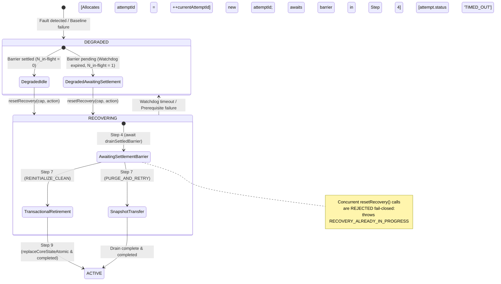

# Phase 7.5 M5.0-R18 — Concurrent Recovery Arbitration & State-Guard Architectural Decision

**Sub-Milestone Title:** Concurrent Recovery Arbitration & State-Guard Architectural Decision Proposal
**Role:** Principal TypeScript Distributed-Systems Architect and Recovery-Protocol Designer
**Mode:** ARCHITECTURAL DECISION ANALYSIS AND DOCUMENTATION ONLY
**Status:** PROPOSED ARCHITECTURAL DECISION AMENDMENT (AWAITING ENGINEERING AUTHORITY APPROVAL)
**Baseline Document:** Formally Accepted & Frozen M5.0 Baseline (`b654cd2e5c38440f6c26ff0d827a6fdc9652c378`) and Stage 0-R3 Report (`4175e8930df01bc914be4e0f902f59c8e4fb20a5`)
**Implementation Authorization Status: Milestone M5.1 remains STRICTLY BLOCKED AND UNAUTHORIZED.**

---

## 1. Problem Statement & Executive Summary

During the Stage 0-R3 readiness audit (`docs/PHASE7_5_M5_1_STAGE0_IMPLEMENTATION_READINESS_REPORT.md`), a fundamental architectural tension was identified within the frozen Milestone M5.0 specification baseline:

1. **Unresolved Mixed-Mode Reset Arbitration:**
   The recovery coordinator provides two distinct administrative reset actions with opposing custody semantics:
   - `REINITIALIZE_CLEAN`: Irrevocably purges pre-reset quarantined operations to the `TerminalQuarantineArchive`, replaces the engine core state with a clean verified baseline, and unlocks the engine into `ACTIVE` state.
   - `PURGE_AND_RETRY`: Preserves pre-reset quarantined operations within `QuarantineBuffer` custody, maintains the causal history log, and initiates a new snapshot transfer attempt to replay retained operations.

   The frozen M5.0 specifications provide **zero arbitration rules** when concurrent reset requests arrive with conflicting modes (e.g., Request A requests `REINITIALIZE_CLEAN` and Request B requests `PURGE_AND_RETRY`).
2. **Contradiction Between Reset Supersession and the `DEGRADED` State Guard:**
   - In `PHASE7_5_M5_INTERFACE_SPECIFICATION.md:423-424` and `PHASE7_5_M5_0_R9_CORRECTION_REPORT.md:40-75`, the protocol specifies that multiple concurrent reset requests share the settlement barrier, with later attempts incrementing `currentAttemptId` and superseding earlier attempts.
   - Conversely, `PHASE7_5_M5_INTERFACE_SPECIFICATION.md:1046` and `PHASE7_5_M5_ARCHITECTURE.md:285` mandate:
     $$\text{resetRecovery() is permitted strictly from } \mathbf{DEGRADED} \text{ state; non-} \mathbf{DEGRADED} \text{ invocation throws } \mathbf{INVALID\_STATE}.$$
   - In Step 3 of the 10-step reset sequence (`Architecture §3.4.2`), the first request immediately transitions the coordinator's state machine from `DEGRADED` to `RECOVERING`. Consequently, any subsequent concurrent reset request arriving while Step 4 awaits the settlement barrier arrives when the coordinator is in `RECOVERING`, creating a direct specification deadlock: does the second request supersede the first, or does it throw `SyncEngineError('INVALID_STATE')`?

This document provides a comprehensive architectural evaluation of five arbitration alternatives, details the source audit findings, defines the proposed **Single Active Recovery-Attempt Ownership with Explicit Concurrency Rejection** model, and submits formal approval questions to the Engineering Authority.

---

## 2. Source and Specification Audit Findings

A rigorous comparative audit was conducted across the frozen M5.0 specifications and the accepted M4.3d implementation baseline:

### 2.1 What Frozen M5.0 Authorizes
1. **Monotonic Sequence Allocation:** Every invocation of `resetRecovery` advances the coordinator's attempt counter: `const newAttemptId = ++this.currentAttemptId;` (`Architecture §3.4.2:259`).
2. **Latched Terminal States:** Each reset attempt is tracked by a state record with terminal states `TIMED_OUT` and `INVALIDATED` (`Architecture §3.4.2:263-270`). Once an attempt is latched terminal, it can never transition to `SETTLED` or `COMPLETED`.
3. **Shared Settlement Barrier:** Drainer in-flight cardinality is strictly bounded to $N_{\text{in-flight}} \le 1$. In-flight operations retain custody across reset invocations until actual Promise settlement (`drainSettledBarrier()`).
4. **Homogeneous Post-Settlement Validation (R9-01):** For multiple reset requests of identical intent, `R9-01` specified that each continuation checks `if (myAttemptId !== this.currentAttemptId) return;` post-settlement, allowing only the latest attempt to initiate transfer.

### 2.2 What the Accepted M4.3d Source Baseline Implements
In `packages/sync-engine/src/recovery/recovery-coordinator.ts:668-686`:
```typescript
public resetRecovery(initiatedBy: string): void {
  if (this._isDisposed) return;
  this.activeAttemptId += 1;
  this.clearTimers();

  if (
    (this.stateMachine.state === 'RECOVERING' || this.stateMachine.state === 'RECONCILING') &&
    this.stateMachine.canTransition('ACTIVE')
  ) {
    this.engine.setRecoveryMode(false);
    try {
      this.stateMachine.transition('ACTIVE', `Recovery reset by ${initiatedBy}`, 'IDLE');
    } catch (err) {
      this.engine.setRecoveryMode(true);
      throw err;
    }
  }
}
```
*Audit Observation:* In M4.3d source code, `resetRecovery` was a simple synchronous reset method that did not check for `DEGRADED`, did not accept recovery strategy arguments (`REINITIALIZE_CLEAN` vs. `PURGE_AND_RETRY`), and did not await asynchronous drain settlement. The frozen M5.0 architecture redefined `resetRecovery` as an asynchronous capability-gated administrative ceremony, but left the concurrency interaction with the `DEGRADED` guard unspecified.

---

## 3. Evaluation of Arbitration Alternatives

Five alternative architectural models were evaluated across nine critical distributed systems criteria:

### Alternative A: First Accepted Request Wins (Mutual Exclusion with Rejection)
- **Mechanism:** The first valid invocation from `DEGRADED` transitions the coordinator to `RECOVERING` and acquires exclusive recovery ownership. Any subsequent request arriving while the attempt is active is rejected fail-closed with `SyncEngineError('RECOVERY_ALREADY_IN_PROGRESS')`.
- **Custody Safety:** Excellent. No race conditions, zero risk of concurrent root mutations.
- **Archive Safety:** Irreversible archive retirement in `REINITIALIZE_CLEAN` cannot be interrupted or corrupted.
- **State Machine Alignment:** 100% compliant with the `DEGRADED` state guard.

### Alternative B: Latest Accepted Request Wins (Continuous Cross-Mode Supersession)
- **Mechanism:** Every incoming `resetRecovery` increments `currentAttemptId`, marks the active attempt as `INVALIDATED`, and switches the active recovery action.
- **Custody Safety:** Hazardous. If Request 1 was executing `REINITIALIZE_CLEAN` (staging entries to the terminal archive) and Request 2 arrives requesting `PURGE_AND_RETRY`, operations could be partially staged or orphaned.
- **Caller Semantics:** Highly confusing. Caller 1 receives an invalidated attempt with no recovery, while Caller 2 experiences unexpected delay awaiting previous drain settlement.
- **State Machine Alignment:** Breaks the public `DEGRADED` guard unless an internal re-entry loophole is carved out.

### Alternative C: Mode-Matching Latest-Wins; Conflicting-Mode Rejection
- **Mechanism:** If an incoming request matches the active attempt's action, it supersedes it. If the action differs, it is rejected.
- **Evaluation:** Prevents cross-mode corruption, but superseding an in-flight `REINITIALIZE_CLEAN` with another clean reset still causes churn, abandoned pre-reservations, and unnecessary complexity.

### Alternative D: Strict Single Active Recovery Ownership with Explicit Concurrency Rejection (Preferred)
- **Mechanism:** The first request from `DEGRADED` acquires exclusive attempt ownership. Any concurrent request (regardless of mode) arriving while recovery is in progress (`RECOVERING` or `RECONCILING`) is rejected with `RECOVERY_ALREADY_IN_PROGRESS`.
- **Evaluation:** Uncompromising safety, zero ambiguity, deterministic caller feedback, zero opportunity for split-brain recovery.

### Alternative E: Static Priority Arbitration (`REINITIALIZE_CLEAN` Dominates)
- **Mechanism:** `REINITIALIZE_CLEAN` statically overrides `PURGE_AND_RETRY`, but not vice versa.
- **Evaluation:** Violates principle of least surprise; an operator requesting retry may have data permanently purged by a concurrent automated script requesting clean reset.

---

### Comparative Evaluation Matrix

| Architectural Evaluation Criterion | Policy A (First Wins) | Policy B (Latest Wins) | Policy C (Mode-Match Latest) | Policy D (Preferred: Single Ownership) | Policy E (Static Priority) |
|:---|:---|:---|:---|:---|:---|
| **1. Operation Custody Safety** | **High** | Critical Risk | Medium | **Absolute (Zero Leak)** | Medium Risk |
| **2. Irreversible Archive Safety** | **Safe** | High Hazard | Medium | **Completely Isolated** | Moderate Risk |
| **3. Quarantine Preservation** | **Guaranteed** | Risk of Loss | Guaranteed | **Strictly Preserved** | High Risk of Loss |
| **4. Stale Continuation Fencing** | **Simple** | Complex | Complex | **Deterministic** | Complex |
| **5. Settlement Barrier Invariance** | **Preserved** | Preserved | Preserved | **Preserved ($N \le 1$)** | Preserved |
| **6. Caller-Visible Semantics** | Deterministic | Highly Ambiguous | Moderate | **Explicit Fail-Closed** | Asymmetric |
| **7. State-Machine Consistency** | **100% Compliant** | Contradictory | Contradictory | **100% Compliant** | Contradictory |
| **8. Retry After DEGRADED** | **Deterministic** | Convoluted | Moderate | **Cleanly Re-entrant** | Asymmetric |
| **9. Implementation Complexity** | **Low** | Very High | High | **Low (Fail-Closed)** | High |

---

## 4. The Preferred Architectural Decision: Single Active Recovery-Attempt Ownership

The recommended architectural decision resolves the R3 blocker through **Single Active Recovery-Attempt Ownership with Explicit Concurrency Rejection**:

### Core Principles of the Policy:
1. **Single-Owner Lifecycle:** Exactly one administrative reset attempt owns the recovery lifecycle at any instant.
2. **Strict `DEGRADED` Entry Guard:** Invocation of `resetRecovery(capability, resetAction)` is authorized **strictly and exclusively** when:
   $$\text{this.stateMachine.state} === \mathbf{DEGRADED}$$
3. **Explicit Rejection of Concurrent Requests:** If `resetRecovery()` is invoked while the coordinator is already executing recovery (`stateMachine.state === 'RECOVERING'` or `'RECONCILING'`), the request is immediately rejected fail-closed with a dedicated typed error:
   ```typescript
   throw new SyncEngineError(
     'RECOVERY_ALREADY_IN_PROGRESS',
     `Administrative recovery reset is already active (attemptId: ${this.activeAttempt.attemptId}, action: ${this.activeAttempt.action}). Concurrent reset requests are rejected.`
   );
   ```
4. **Rejection Over Ambient Joining:** Concurrent callers do **not** ambiently join or share the pending Promise. Ambient joining hides operational concurrency, introduces capability custody ambiguity, and prevents callers from knowing that another administrative subsystem is operating. Explicit rejection enforces deterministic caller awareness.
5. **Re-Entrancy After Terminal Failure:** If the active attempt fails (e.g. settlement watchdog expires after 5,000 ms, or custody reconciliation throws), the coordinator automatically aborts back to `DEGRADED`. Once in `DEGRADED`, a new reset request is authorized and can proceed.
6. **Drain Settlement Barrier Independence Preserved:** If an attempt times out and transitions to `DEGRADED`, but its underlying destination Promise is still pending on the event loop, a subsequent reset attempt initiated from `DEGRADED` safely enters Step 4 and awaits the shared settlement barrier (`drainSettledBarrier()`). It does not cancel the earlier drain, does not clear `_inFlightRecord`, and proceeds only when real settlement and custody reconciliation complete.

---

## 5. State-Transition Model & Reset Request Decision Table

### 5.1 Formal State-Transition Diagram



---

### 5.2 Reset Request Decision Table Across All Operational States

| Operational Context | Coordinator State Machine | Drainer In-Flight Slot ($N_{\text{in-flight}}$) | Settlement Barrier Status | Incoming Reset Action | System Outcome & Caller-Visible Result |
|:---|:---|:---|:---|:---|:---|
| **1. Normal Reset Entry** | `DEGRADED` | 0 (Empty) | Settled (Resolved) | `REINITIALIZE_CLEAN` or `PURGE_AND_RETRY` | **ACCEPTED.** Transitions to `RECOVERING`; mints `attemptId = ++currentAttemptId`; begins 10-step sequence. |
| **2. Concurrent Same-Mode Request** | `RECOVERING` or `RECONCILING` | 1 or 0 | Pending or Settled | Same as active attempt | **REJECTED FAIL-CLOSED.** Throws `SyncEngineError('RECOVERY_ALREADY_IN_PROGRESS')`. Active attempt untouched. |
| **3. Concurrent Conflicting-Mode Request** | `RECOVERING` or `RECONCILING` | 1 or 0 | Pending or Settled | Different from active attempt | **REJECTED FAIL-CLOSED.** Throws `SyncEngineError('RECOVERY_ALREADY_IN_PROGRESS')`. Active attempt untouched. |
| **4. Request During Active Engine** | `ACTIVE` | 0 (Empty) | Settled | Any Action | **REJECTED FAIL-CLOSED.** Throws `SyncEngineError('INVALID_STATE', 'Cannot reset active engine')`. |
| **5. Request After Attempt Failure** | `DEGRADED` | 0 (Empty) | Settled (Resolved) | Any Action | **ACCEPTED.** Transitions to `RECOVERING` under fresh `newAttemptId = ++currentAttemptId`. |
| **6. Request After Watchdog Timeout (Barrier Pending)** | `DEGRADED` | 1 (Occupied) | Pending (Unresolved) | Any Action | **ACCEPTED.** Enters `RECOVERING` under new `attemptId`; in Step 4, halts and awaits `drainSettledBarrier()`. |
| **7. Request While Reconciliation Fails / Inconclusive** | `DEGRADED` | 1 (Occupied) | Pending (Unresolved) | Any Action | **ACCEPTED into Step 4.** Awaits settlement barrier; cannot bypass in-flight custody or execute root swap. |

---

## 6. Settlement Barrier Interaction & Custody Safety Analysis

Under the Single Active Recovery-Attempt Ownership policy:

1. **Absolute Custody Preservation:** An operation in `_inFlightRecord` cannot be overwritten, discarded, or dual-owned.
2. **Watchdog Independence Maintained:** A watchdog timeout latches the current attempt to `TIMED_OUT` and aborts the coordinator to `DEGRADED`. Crucially, it does **not** clear `_inFlightRecord` and does **not** resolve the settlement barrier.
3. **Serialized Re-Entrancy:** When an operator or automation script re-invokes `resetRecovery()` from `DEGRADED` while the barrier is pending, the new attempt is safely serialized on the existing drainer barrier. Once the underlying destination Promise settles and the drainer completes custody reconciliation:
   - Drainer clears `_inFlightRecord = null`;
   - Drainer sets `_isDraining = false`;
   - Settlement barrier resolves;
   - The new attempt unblocks and proceeds with authoritative recovery.
4. **Zero Cross-Mode Corruption:** Because concurrent requests are rejected, an in-flight `REINITIALIZE_CLEAN` can never have its staged archive entries orphaned or mixed with `PURGE_AND_RETRY`.

---

## 7. Caller-Visible Result Semantics & Proposed Error Contracts

To ensure exact TypeScript contract compliance without silently inventing error codes, this proposal formally specifies the required error extension:

```typescript
// Proposed addition to SyncEngineErrorCode in packages/protocol or sync-engine
export type RecoveryErrorCode =
  | 'INVALID_STATE'                 // Existing: invoked from non-permitted state (e.g. ACTIVE)
  | 'UNAUTHORIZED'                  // Existing: invalid capability reference
  | 'RECOVERY_ALREADY_IN_PROGRESS'  // PROPOSED M5.0-R18 ADDITION: concurrent reset rejected
  | 'CUSTODY_LEAK_DETECTED'         // Existing M5.0 requirement
  | 'CAPACITY_INSUFFICIENT';        // Existing M5.0 requirement
```

### Caller Error Signature:
```typescript
interface RecoveryAlreadyInProgressDetails {
  readonly activeAttemptId: number;
  readonly activeAction: 'REINITIALIZE_CLEAN' | 'PURGE_AND_RETRY';
  readonly state: 'RECOVERING' | 'RECONCILING';
  readonly startedAtMs: number;
}
```

---

## 8. Deterministic Failure Scenarios and Test Requirements

Sub-Milestone M5.1d test suites must verify the following four deterministic test sequences:

1. **Test R18-T1 (Concurrent Rejection of Same Mode):**
   - Coordinator is in `DEGRADED`.
   - Caller 1 invokes `resetRecovery(cap, 'REINITIALIZE_CLEAN')` (Attempt 1). Coordinator enters `RECOVERING`.
   - Caller 2 invokes `resetRecovery(cap, 'REINITIALIZE_CLEAN')`.
   - Assert Caller 2 receives `SyncEngineError('RECOVERY_ALREADY_IN_PROGRESS')`.
   - Assert Attempt 1 continues uninterrupted.
2. **Test R18-T2 (Concurrent Rejection of Conflicting Mode):**
   - Coordinator is in `DEGRADED`.
   - Caller 1 invokes `resetRecovery(cap, 'PURGE_AND_RETRY')` (Attempt 1).
   - Caller 2 invokes `resetRecovery(cap, 'REINITIALIZE_CLEAN')`.
   - Assert Caller 2 receives `SyncEngineError('RECOVERY_ALREADY_IN_PROGRESS')`.
   - Assert QuarantineBuffer operations are NOT purged to the terminal archive.
3. **Test R18-T3 (Re-Entry from DEGRADED While Barrier Pending):**
   - Attempt 1 times out after 5,000 ms; coordinator enters `DEGRADED`; destination Promise remains unresolved; `_inFlightRecord` remains occupied ($N_{\text{in-flight}} = 1$).
   - Caller invokes `resetRecovery(cap, 'REINITIALIZE_CLEAN')` (Attempt 2).
   - Assert Attempt 2 is accepted, advances `currentAttemptId` to 2, transitions to `RECOVERING`, and halts in Step 4 awaiting `drainSettledBarrier()`.
   - Resolve destination Promise $\to$ assert custody reconciles $\to$ barrier resolves $\to$ Attempt 2 completes cleanly.
4. **Test R18-T4 (Rejection from ACTIVE):**
   - Coordinator is in `ACTIVE` state.
   - Caller invokes `resetRecovery(cap, 'REINITIALIZE_CLEAN')`.
   - Assert throws `SyncEngineError('INVALID_STATE')`.

---

## 9. Backward-Compatibility Impact

1. **Protocol Wire Compatibility:** Zero impact. Recovery reset is an internal node administrative procedure; wire frames and peer envelopes are completely unaffected.
2. **API Surface Compatibility:** `resetRecovery` signature remains `(capability: RecoveryInstallationCapability, resetAction: 'PURGE_AND_RETRY' | 'REINITIALIZE_CLEAN') => Promise<ResetRecoveryReport>`.
3. **Call-Site Handling:** Callers submitting concurrent reset requests receive a typed, catchable `RECOVERY_ALREADY_IN_PROGRESS` error rather than undefined or hanging Promises.

---

## 10. Explicit Approval Questions for Engineering Authority

Before Milestone M5.1 implementation can be authorized, the Engineering Authority must formally review and decide upon the following four architectural questions:

```
================================================================================
ENGINEERING AUTHORITY APPROVAL QUESTIONS (MILESTONE M5.0-R18):
================================================================================
1. [ARBITRATION POLICY]: Does the Engineering Authority approve the "Single Active
   Recovery-Attempt Ownership with Explicit Concurrency Rejection" policy,
   rejecting all concurrent reset requests fail-closed with
   RECOVERY_ALREADY_IN_PROGRESS, rather than attempting ambient Promise-joining
   or cross-mode supersession?

2. [STATE GUARD UNIFICATION]: Does the Engineering Authority confirm that
   resetRecovery() is strictly guarded by coordinator state === 'DEGRADED',
   and that any invocation during RECOVERING or RECONCILING must fail closed?

3. [ERROR TYPE ADDITION]: Does the Engineering Authority approve introducing the
   explicit typed error code 'RECOVERY_ALREADY_IN_PROGRESS' into the
   SyncEngineError classification?

4. [DEGRADED BARRIER SERIALIZATION]: Does the Engineering Authority approve that a
   fresh reset initiated from DEGRADED following a watchdog timeout safely
   awaits the pending drain settlement barrier in Step 4 under the new attempt ID,
   preserving single in-flight custody without cancelling the underlying Promise?
================================================================================
```

---

## 11. Final Verdict & Mandatory Authorization Statement

```
================================================================================
M5.0-R18 ARCHITECTURAL DECISION PROPOSAL VERDICT:
DECISION PROPOSAL COMPLETE — AWAITING ENGINEERING AUTHORITY
================================================================================
```

This proposal establishes a fully reconciled, fail-close architectural solution to the concurrent recovery arbitration gap identified in Stage 0-R3. It preserves all frozen M5.0 custody invariants, strictly enforces the `DEGRADED` state guard, and eliminates cross-mode recovery hazards.

### Mandatory Implementation Authorization Statement
**"M5.0-R18 is an architectural decision proposal only. M5.1 implementation remains unauthorized. No M5.1a implementation has started."**
