# Phase 7.5 M5.0-R18-R9 — Final Custody Authorization and Settlement-Barrier Proof Correction

**Role:** Principal TypeScript Distributed-Systems Architect and Recovery-Systems Auditor
**Mode:** STRICTLY DOCUMENTATION-ONLY ARCHITECTURAL CORRECTION
**Target Document:** `docs/PHASE7_5_M5_0_R18_CONCURRENT_RECOVERY_ARBITRATION_DECISION.md`
**Baseline Commit:** `32e2ddd29af9a61cb5b5f4a7bcbced5a9fe796c4`
**Direct Parent Commit:** `32e2ddd29af9a61cb5b5f4a7bcbced5a9fe796c4`
**Implementation Authorization:** Milestone M5.1 remains **STRICTLY BLOCKED AND UNAUTHORIZED**.

---

## 1. Problem Statement & R18-R9 Objectives

The M5.0-R18-R8 architectural decision established generation-scoped settlement barriers and introduced the `CustodyOwnershipToken` for attempt-fenced release. However, rigorous distributed-systems auditing identified five critical authorization and proof gaps:

1. **Incomplete Ownership-Token Comparison:** R18-R8 specified that custody release compares five immutable fields, but its pseudocode compared only three (`recoveryAttemptId`, `custodyGeneration`, `drainerOwnershipGeneration`), omitting `operationIdentity` and `transactionId`. If a concurrent or retried attempt had matching attempt and generation counters but was executing a different operation or transaction, custody could be improperly released. Custody release must compare **all five** immutable fields via an explicit equivalence predicate.
2. **Missing Settlement Prerequisites Proof Prior to Barrier Resolution:** R18-R8 declared the invariant `BARRIER_RESOLVED(g) => EXECUTION_SETTLED(g) && CUSTODY_RECONCILED(g) && NO_IN_FLIGHT_OWNER(g)`, but its pseudocode resolved `activeBarrier(g)` based on owner-token clearance alone without verifying typed proof that the execution Promise physically settled and custody was reconciled.
3. **Incomplete Generation-Scoped Barrier Lifecycle:** While R18-R8 isolated barriers per generation, the lifecycle for barrier registration of concurrent waiters, active barrier retirement, and disposal was underspecified.
4. **Tombstone Backpressure Operational Recovery:** R18-R8 introduced backpressure when safe tombstone eviction was blocked by active reservations, but did not define the synchronous, bounded recovery sequence when a blocking reservation settles.
5. **Deep Immutability & Adversarial Fencing:** Proof was required showing that an adversarial caller presenting matching attempt and generation counters but mismatched operation or transaction identities is strictly rejected.

### Core Architectural Guarantees Established in R18-R9:
- **Exhaustive Five-Field Ownership Comparison:** `publishCustodyRelease(expectedOwnerToken, settlementProof)` validates all five fields (`recoveryAttemptId`, `custodyGeneration`, `operationIdentity`, `transactionId`, `drainerOwnershipGeneration`) via `isEquivalentOwnerToken`. Mismatches reject with `STALE_CUSTODY_RELEASE_REJECTED`.
- **Typed Settlement Reconciliation Proof:** Enforces `SettlementReconciliationProof` validation as a mandatory prerequisite before any barrier may resolve. A barrier cannot resolve merely because an in-flight slot was cleared.
- **Closed Generation-Scoped Barrier Lifecycle:** Formulates creation, concurrent waiter registration, owner association, once-only resolution, generation-checked retirement, and replacement.
- **Operational Tombstone Backpressure Recovery:** Specifies synchronous reevaluation upon reservation settlement, advancing `fencingGenerationFloor` safely without unbounded queues or hidden retained states.
- **Twenty Deterministic Future Test Requirements:** Codifies 20 exhaustive test requirements for future M5.1 suites.

---

## 2. Separation of the Three Independent Conditions

```
┌─────────────────────────────────────────────────────────────────────────────────────────┐
│                        THREE INDEPENDENT LIFECYCLE CONDITIONS                           │
├─────────────────────────────────────────────────────────────────────────────────────────┤
│ CONDITION A: DESTINATION TRANSACTION OUTCOME (Archive State)                            │
│ Authoritative state in TerminalArchiveCoreState:                                        │
│ • COMMITTED: Irrevocably recorded in #committedTransactions via atomic swap.           │
│ • ABORTED_FENCED: Irrevocably recorded in #fencedTransactions; late commits rejected.   │
│ • COMMIT_PENDING: Reservation active; commit operation is executing. Non-terminal.     │
│ • NOT_FOUND_AT_QUERY: Absent at query linearization point. Non-terminal point-in-time!  │
│ • INCONCLUSIVE: Archive query threw, timed out, or memory corrupted. Preserves custody. │
├─────────────────────────────────────────────────────────────────────────────────────────┤
│ CONDITION B: UNDERLYING ASYNCHRONOUS EXECUTION SETTLEMENT (Event Loop State)           │
│ Physical settlement of the original destination Promise:                                │
│ • FULFILLED: Promise settled with success receipt.                                      │
│ • REJECTED: Promise settled with an Error (post-commit execution failure or transport). │
│ Invariant: Watchdogs, receipts, timeouts, and lookups NEVER prove Promise settlement!   │
├─────────────────────────────────────────────────────────────────────────────────────────┤
│ CONDITION C: CUSTODY RECONCILIATION (Storage Representation)                            │
│ Verified representation in authoritative ownership boundary:                            │
│ • PROTOCOL A: Operation committed in archive AND retired from source buffer.            │
│ • PROTOCOL B: Operation terminally fenced in archive AND restored to buffer head.       │
│ • RECONCILIATION BLOCKED: Unresolved outcome retains drainer custody fail-closed.       │
└─────────────────────────────────────────────────────────────────────────────────────────┘
```

### The Generation-Scoped Universal Settlement-Barrier Invariant:
$$\mathbf{BARRIER\_RESOLVED}(g) \implies \mathbf{EXECUTION\_SETTLED}(g) \land \mathbf{CUSTODY\_RECONCILED}(g) \land \mathbf{NO\_IN\_FLIGHT\_OWNER}(g)$$

$$\mathbf{BARRIER\_PENDING}(g) \land \neg\mathbf{CUSTODY\_RECONCILED}(g) \implies \mathbf{CUSTODY\_REMAINS\_OWNED\_OR\_EXPLICITLY\_QUARANTINED}(g)$$

---

## 3. Three Independent Ownership Concepts

1. **Quarantine-Buffer Ownership:** Operations resided in `QuarantineBuffer._queue` with composite identities in `_identityIndex`. An operation is buffer-owned if and only if it is present in `_queue` and accounted for in `retainedBytes` / `retainedCount`.
2. **Drainer In-Flight Custody:** A dequeued operation held exclusively in `QuarantineDrainer._custodyState`. The drainer possesses sole execution custody. It is not owned by the buffer, nor is it owned by the archive.
3. **Terminal Archive Representation:** Operations immutably recorded in `TerminalArchiveCoreState.#committedTransactions` and appended to `#entries`.

```
┌────────────────────────┐      drainNext()      ┌─────────────────────────┐   Commit + Retirement   ┌───────────────────────────┐
│ QuarantineBuffer       │ ────────────────────► │ QuarantineDrainer       │ ──────────────────────► │ TerminalArchive           │
│ (Buffer Ownership)     │                       │ (In-Flight Custody)     │                         │ (Terminal Representation) │
│                        │ ◄──────────────────── │                         │                         │                           │
└────────────────────────┘     Protocol B        └─────────────────────────┘                         └───────────────────────────┘
                           (ABORTED_FENCED + Settlement)
```

---

## 4. Separation of the Three Evidence Levels

```
┌─────────────────────────────────────────────────────────────────────────────────┐
│                          THREE EVIDENCE LEVELS                                  │
├─────────────────────────────────────────────────────────────────────────────────┤
│ LEVEL 1: TRANSPORT-LEVEL OUTCOME                                                │
│ Evaluates transport frames over WebRTC DataChannel, local loop, or pipes.       │
│ Signals: DELIVERED, TRANSPORT_REJECTED, CHANNEL_CLOSED, TIMEOUT.                │
│ Invariant: Transport drop does NOT prove destination produced no side effect!   │
├─────────────────────────────────────────────────────────────────────────────────┤
│ LEVEL 2: DESTINATION APPLICATION-LEVEL OUTCOME                                  │
│ Evaluates application admission controller responses.                          │
│ Signals: ACCEPTED_REDUCED, ATTEMPT_INVALIDATED, TERMINALLY_REJECTED, etc.       │
│ Invariant: ATTEMPT_INVALIDATED proves attempt fencing, NOT archive absence!     │
├─────────────────────────────────────────────────────────────────────────────────┤
│ LEVEL 3: AUTHORITATIVE ARCHIVE TRANSACTION OUTCOME                              │
│ Direct atomic arbitration against TerminalArchiveCoreState.                     │
│ Signals: COMMITTED, ABORTED_FENCED, NOT_FOUND_AT_QUERY, INCONCLUSIVE.            │
│ Invariant: Authoritative state is governed SOLELY by Level 3 atomic decisions.  │
└─────────────────────────────────────────────────────────────────────────────────┘
```

---

## 5. Transaction Absence vs. Terminal Non-Commit & Disposition Consistency

```
┌────────────────────────────────────────────────────────────────────────────────────────┐
│                      TRANSACTION OUTCOME TAXONOMY                                      │
├────────────────────────┬───────────────────────────────────────────────────────────────┤
│ State                  │ Definition & Architectural Operational Meaning                │
├────────────────────────┼───────────────────────────────────────────────────────────────┤
│ 1. NOT_FOUND_AT_QUERY  │ The transaction ID is absent from #committedTransactions      │
│                        │ at the query's linearization point. Asynchronous commit may   │
│                        │ still be executing. MUST NOT authorize buffer restoration!    │
├────────────────────────┼───────────────────────────────────────────────────────────────┤
│ 2. COMMIT_PENDING      │ The transaction has registered reservation or staged batch,   │
│                        │ and its commit operation is actively executing. Non-terminal. │
├────────────────────────┼───────────────────────────────────────────────────────────────┤
│ 3. COMMITTED           │ The transaction has committed via atomic root replacement     │
│                        │ into #committedTransactions. Irrevocable terminal success.    │
├────────────────────────┼───────────────────────────────────────────────────────────────┤
│ 4. ABORTED_FENCED      │ The archive has atomically recorded terminal cancellation and │
│                        │ fencing evidence. Any subsequent commit attempt is rejected.  │
│                        │ Irrevocable terminal abort. SOLE authorizer of Protocol B!    │
├────────────────────────┼───────────────────────────────────────────────────────────────┤
│ 5. INCONCLUSIVE        │ Archive state cannot be established (e.g. query failure,      │
│                        │ memory corruption, timeout). Preserves fail-closed custody.   │
└────────────────────────┴───────────────────────────────────────────────────────────────┘
```

### Archive Disposition Consistency Invariant:
$$\mathbf{committedTransactions} \cap \mathbf{fencedTransactions} = \emptyset$$

Before any candidate root is published via `this.#core = candidateRoot`, the archive validates:
1. **Disjointness:** No `retirementTransactionId` exists in both `#committedTransactions` and `#fencedTransactions`.
2. **Reservation Consumption:** If committed, `reservationId` is removed from `#activeReservations`; if fenced, reserved capacity is subtracted from `reservedBytes`.
3. **Generation Floor Monotonicity:** `candidateRoot.fencingGenerationFloor >= currentRoot.fencingGenerationFloor`.

---

## 6. Commit-Path Fencing & Exact Immutable Retry Identity

### 6.1 Exact Immutable Identity Equality for Idempotent Retries
A retried commit request is authorized to receive a cached `TerminalBatchCommitReceipt` if and only if it represents the **exact same immutable transaction**.

Before returning a cached receipt, the archive performs a canonical comparison of the incoming request against the committed record across all 6 identity dimensions:
1. `txId`: Exact string equality.
2. `reservationId`: Exact string equality.
3. `fencingGeneration`: Exact numeric integer equality.
4. `membershipEpoch`: Exact string equality.
5. `batchDigest`: Exact SHA-256 hex string equality.
6. `operationIdentities`: Canonical identity collection equality:
   - **Ordering:** Canonical lexicographical sort of composite operation IDs (`streamId:sequenceNumber`).
   - **Duplicate Rejection:** If the incoming array contains duplicate IDs, it is rejected with `DUPLICATE_OPERATION_IDENTITY_DETECTED`.
   - **1-to-1 Match:** Every sorted composite string ID matches the sorted recorded ID exactly.

```typescript
// Proposed M5.1 Exact Immutable Identity Verification:
function assertExactImmutableIdentityMatch(
  committed: QuarantineRetirementTransactionRecord,
  incoming: CommitRetirementBatchParams,
): void {
  if (committed.retirementTransactionId !== incoming.retirementTransactionId) {
    throw new Error('TRANSACTION_IDENTITY_MISMATCH_CONFLICT: txId mismatch.');
  }
  if (committed.reservationId !== incoming.reservationId) {
    throw new Error('TRANSACTION_IDENTITY_MISMATCH_CONFLICT: reservationId mismatch.');
  }
  if (committed.fencingGeneration !== incoming.stagedGeneration) {
    throw new Error('TRANSACTION_IDENTITY_MISMATCH_CONFLICT: fencingGeneration mismatch.');
  }
  if (committed.membershipEpoch !== incoming.membershipEpoch) {
    throw new Error('TRANSACTION_IDENTITY_MISMATCH_CONFLICT: membershipEpoch mismatch.');
  }
  if (committed.batchDigest !== incoming.batchDigest) {
    throw new Error('TRANSACTION_IDENTITY_MISMATCH_CONFLICT: batchDigest mismatch.');
  }
  const incomingSorted = canonicalizeIdentities(incoming.operationIdentities);
  const committedSorted = committed.canonicalOperationIdentities;
  if (incomingSorted.length !== committedSorted.length) {
    throw new Error('TRANSACTION_IDENTITY_MISMATCH_CONFLICT: operation count mismatch.');
  }
  for (let i = 0; i < incomingSorted.length; i++) {
    if (incomingSorted[i] !== committedSorted[i]) {
      throw new Error(`TRANSACTION_IDENTITY_MISMATCH_CONFLICT: operation identity mismatch at [${i}].`);
    }
  }
}
```

---

### 6.2 The Synchronous 9-Step Commit Protocol
```
[Asynchronous Payload Preparation & Hashing]
                 │
                 ▼
═════════════════════════════════════════════════════════════════════════════
SYNCHRONOUS ATOMIC PUBLICATION SEGMENT (Single Non-Interleavable Microtask Turn)
═════════════════════════════════════════════════════════════════════════════
1. Read Authoritative Archive Root: const currentRoot = this.#core;
2. Verify Transaction Disposition & Immutable Identity:
   if (currentRoot.fencedTransactions.has(txId)) throw TRANSACTION_ABORTED_FENCED;
   if (currentRoot.committedTransactions.has(txId)) {
     assertExactImmutableIdentityMatch(currentRoot.committedTransactions.get(txId), incoming);
     return currentRoot.committedTransactions.get(txId).receipt;
   }
3. Verify Fencing Generation:
   if (stagedGeneration <= currentRoot.fencingGenerationFloor ||
       stagedGeneration < currentRoot.fencingGeneration) throw GENERATION_OBSOLETE;
4. Verify Reservation Validity:
   if (!currentRoot.activeReservations.has(reservationId)) throw RESERVATION_NOT_FOUND_OR_FENCED;
5. Verify Immutable Batch Digest & Identity Invariants:
   if (currentRoot.activeReservations.get(reservationId).digest !== stagedDigest) throw DIGEST_MISMATCH;
6. Construct Committed Candidate Root from currentRoot (private Map clones, append entry, consume reservation);
7. Validate Disjointness Invariant: assertDisjoint(candidateRoot.committedTransactions, candidateRoot.fencedTransactions);
8. Advance Archive Generation: candidateRoot.archiveGeneration = currentRoot.archiveGeneration + 1;
9. LINEARIZATION POINT: this.#core = candidateRoot; (Synchronous Reference Swap)
═════════════════════════════════════════════════════════════════════════════
10. Return Authoritative TerminalBatchCommitReceipt;
```

---

## 7. Atomic Commit-versus-Cancellation Arbitration

```
                     ┌─────────────────────────────────────────┐
                     │ Atomic Candidate-Root Linearization     │
                     │ (Single Microtask JavaScript Turn)      │
                     └────────────────────┬────────────────────┘
                                          │
                 ┌────────────────────────┴────────────────────────┐
                 ▼                                                 ▼
     ┌───────────────────────┐                         ┌───────────────────────┐
     │      COMMIT WINS      │                         │   CANCELLATION WINS   │
     ├───────────────────────┤                         ├───────────────────────┤
     │ Candidate includes:   │                         │ Candidate includes:   │
     │ - Transaction commit  │                         │ - Fenced transaction  │
     │ - Entry appends       │                         │ - Released capacity   │
     │ - Reservation consumed│                         │ - Advanced generation │
     │ - Root swap committed │                         │ - Root swap committed │
     └───────────┬───────────┘                         └───────────┬───────────┘
                 │                                                 │
                 ▼                                                 ▼
      Protocol A Required                               Protocol B Permitted
     (Source Retirement +                              (Buffer Restoration +
      Promise Settlement)                               Promise Settlement)
```

---

## 8. Generation-Floor Scope & Strict Tombstone Backpressure Recovery

### 8.1 Scope & Monotonicity of Generations
- **Scope:** `fencingGeneration` is a monotonic counter strictly scoped to the local `TerminalQuarantineArchive` instance (`#core.fencingGeneration`).
- **Assignment to Reservations:** When a capacity reservation is created via `reserveCapacity(...)`, it receives:
  $$\text{reservation.generation} = \text{currentRoot.archiveGeneration}$$
  This generation is strictly greater than `fencingGenerationFloor`.

### 8.2 Safe FIFO Tombstone Eviction Rule
`fencingGenerationFloor` advances **if and only if** `#fencedTransactions` reaches capacity (`MAX_FENCED_TRANSACTIONS = 1000`) and the oldest tombstone can be safely evicted:
$$\text{candidateRoot.fencingGenerationFloor} = \max(\text{currentRoot.fencingGenerationFloor},\; \text{evictedTombstone.fencingGeneration})$$

### 8.3 Protection of Active Reservations & Strict Backpressure Recovery (Mandatory Correction D)
To prevent advancing the floor past an active reservation while enforcing the hard 1,000-entry memory bound:
1. **Eviction Safety Condition:** Safe eviction requires:
   $$\mathbf{evictedTombstone.fencingGeneration} < \min_{r \in \mathbf{activeReservations}}(r.\mathbf{generation})$$
2. **Backpressure Trigger:** If `#fencedTransactions.size === 1000` and the eviction safety condition is violated, eviction is **strictly deferred**.
3. **Fail-Closed Backpressure State:**
   - Any new arbitration request that would add a 1,001st tombstone throws or returns:
     $$\mathbf{FENCING\_BACKPRESSURE\_CAPACITY\_EXHAUSTED}$$
   - New capacity reservations (`reserveCapacity`) are temporarily rejected with `CAPACITY_RESERVATION_BACKPRESSURE_BLOCKED`.
   - Existing active reservations and existing 1,000 tombstones are **100% preserved**.
   - The 1,000-entry bound is **never exceeded**.
   - Old tombstones are **never prematurely evicted**.
   - Floor **never advances past active reservations**.
4. **Synchronous Operational Recovery Path:**
   - When a blocking reservation settles (via `commitRetirementBatch` or `cancelReservation`), it is removed from `#activeReservations`.
   - In that **same synchronous microtask turn**, the archive evaluates whether deferred eviction can proceed:
     $$\text{newMinResGen} = \min_{r \in \text{activeReservations}}(r.\text{generation})$$
   - If the oldest tombstone's generation is now strictly $< \text{newMinResGen}$, the oldest tombstone is evicted immediately, advancing `fencingGenerationFloor`.
   - **Zero Unbounded Queues:** The archive does not maintain an unbounded queue of deferred fencing requests. Callers that received `FENCING_BACKPRESSURE_CAPACITY_EXHAUSTED` retry via caller-managed exponential backoff.
   - If active reservations remain blocking, the archive remains in backpressure fail-closed.

---

## 9. Process Failure Model

$$\mathbf{IN\-PROCESS,\; SINGLE\-RUNTIME\; MEMORY\; SAFETY\; ONLY}$$

1. **Volatile In-Memory Boundaries:** `TerminalArchiveCoreState` is held exclusively in JavaScript process memory (`this.#core`).
2. **Process Termination Effects:** Process crash, SIGKILL, browser tab closure, or host restart terminates process memory. All in-memory entries, committed transactions, active reservations, and `ABORTED_FENCED` tombstones are cleared.
3. **Restart Durability Disclaimer:** Restart durability is **NOT** claimed. An in-memory `ABORTED_FENCED` record protects against concurrent, delayed, or replayed execution **within the lifetime of the process**. It does not protect against external re-dispatch across process restarts.
4. **Future Architectural Dependency:** Durable persistence across process restarts or machine failures requires write-ahead logging (WAL) or transactional database backends. This is explicitly designated as an external dependency outside Phase 7.5 M5.1.

---

## 10. Disposition & Lost-Response Semantics

```typescript
getTransactionDisposition(
  retirementTransactionId: string,
): 'COMMITTED' | 'ABORTED_FENCED' | 'COMMIT_PENDING' | 'NOT_FOUND_AT_QUERY' | 'INCONCLUSIVE';
```

- **Lost Commit Response:** The client retries `commitRetirementBatch` with the identical immutable transaction 6-tuple. The archive detects `committedTransactions.has(txId)`, validates exact identity match, and idempotently returns the cached `TerminalBatchCommitReceipt`.
- **Lost Cancellation Response:** The client retries `arbitrateOrFenceTransaction(txId, resId, cap)`. The archive detects `fencedTransactions.has(txId)` and idempotently returns the cached `{ status: 'ABORTED_FENCED', ... }` receipt.
- **Lost Arbitration Response (Root Changed):** Caller queries `getTransactionDisposition(txId)`. Because the root swap was atomic, the query returns either `COMMITTED` or `ABORTED_FENCED`. The caller reconciles accordingly.
- **Transaction in Preparation:** Returns `COMMIT_PENDING` (if reservation exists) or `NOT_FOUND_AT_QUERY`. Does **NOT** authorize restoration.
- **Source Retirement Incomplete:** Query returns `COMMITTED`. Drainer resumes Protocol A source retirement.

---

## 11. Destination Outcome Classification & Post-Commit Promise Rejection

### A. Confirmed Committed (Level 3 Proof)
- **Condition:** Authoritative lookup `archive.getTransactionDisposition(txId) === 'COMMITTED'` confirms exact `txId`, matching `stagedBatchDigest`, and composite operation identities.
- **Required Action:** Execute Protocol A: retire source operations from `QuarantineBuffer`, verify buffer disjointness, await destination Promise settlement, publish attempt-fenced custody release with valid settlement proof, and resolve the generation-scoped settlement barrier.

### B. Post-Commit Promise Rejection (Execution Failure)
- **Condition:** Archive transaction is confirmed `COMMITTED`, but the original destination Promise settles with a rejection (`Promise.reject(err)`).
- **Classification:** **Post-commit execution failure** (e.g. transport drop, post-commit listener exception).
- **Invariants:**
  1. The archive commit remains **100% authoritative and irrevocable**. Zero archive rollback!
  2. Protocol B restoration is **strictly prohibited** (preventing double replay).
  3. Execution is marked settled (`EXECUTION_SETTLED = true`).
  4. Final custody reconciliation (source retirement verification) must still succeed.
  5. If reconciliation succeeds, construct `SettlementReconciliationProof`, publish custody release, and resolve the barrier. If reconciliation fails, enter `CUSTODY_RECONCILIATION_BLOCKED`.

### C. Aborted Fenced (Level 3 Proof)
- **Condition:** Atomic arbitration confirms `archive.arbitrateOrFenceTransaction(...)` returned `ABORTED_FENCED`.
- **Required Action:** Execute Protocol B: await destination Promise settlement, restore operation to `QuarantineBuffer` head via `unshiftDrain(op)`, verify buffer representation, construct settlement proof, publish attempt-fenced custody release, and resolve the barrier.

### D. Inconclusive or Commit Pending (Level 3 Ambiguity)
- **Condition:** Arbitration throws, times out, or reports `NOT_FOUND_AT_QUERY` or `COMMIT_PENDING`.
- **Required Action:** Drainer in-flight custody is **strictly retained** ($N_{\text{in-flight}} = 1$). Gate transitions to `CUSTODY_RECONCILIATION_BLOCKED`. Settlement barrier remains **PENDING**.

---

## 12. Complete Custody Authorization & Settlement-Barrier Proof Contract

### 12.1 Five-Field Ownership Comparison & Equivalence Predicate (Mandatory Correction A)
To guarantee that a stale continuation cannot release custody owned by a newer recovery attempt, custody release requires an exact immutable `CustodyOwnershipToken` compared across **all five fields**:

```typescript
export interface CustodyOwnershipToken {
  readonly recoveryAttemptId: number;
  readonly custodyGeneration: number;
  readonly operationIdentity: string;
  readonly transactionId: string;
  readonly drainerOwnershipGeneration: number;
}

export function isEquivalentOwnerToken(
  current: CustodyOwnershipToken | null,
  expected: CustodyOwnershipToken,
): boolean {
  if (!current) return false;
  return (
    current.recoveryAttemptId === expected.recoveryAttemptId &&
    current.custodyGeneration === expected.custodyGeneration &&
    current.operationIdentity === expected.operationIdentity &&
    current.transactionId === expected.transactionId &&
    current.drainerOwnershipGeneration === expected.drainerOwnershipGeneration
  );
}
```

#### Adversarial Equivalence Example:
Consider an adversarial or confused delayed continuation:
- **Active Current State:** `Attempt 2`, `Custody Gen 1`, operating on `stream-A:seq-10` under `tx-2-res-1` (drainer gen 1).
- **Adversarial Caller Token:** `Attempt 2`, `Custody Gen 1`, but operating on `stream-B:seq-99` under `tx-2-res-99` (drainer gen 1).
- **Evaluation:** In R18-R8's pseudocode, comparing only attempt, custody generation, and drainer generation would have falsely succeeded. Under R18-R9, `isEquivalentOwnerToken` evaluates:
  $$\text{"stream-B:seq-99"} === \text{"stream-A:seq-10"} \implies \mathbf{false}$$
  $$\text{"tx-2-res-99"} === \text{"tx-2-res-1"} \implies \mathbf{false}$$
- **Result:** The release is rejected with `STALE_CUSTODY_RELEASE_REJECTED`. The active in-flight custody of `stream-A:seq-10` and its barrier are 100% untouched.

---

### 12.2 Typed Settlement Reconciliation Proof (Mandatory Correction B)
A settlement barrier must **never** resolve based on custody-slot clearance alone. It requires formal verification of `SettlementReconciliationProof`:

```typescript
export interface SettlementReconciliationProof {
  readonly recoveryAttemptId: number;
  readonly custodyGeneration: number;
  readonly operationIdentity: string;
  readonly transactionId: string;
  readonly executionSettled: boolean;
  readonly settlementType: 'FULFILLED' | 'REJECTED';
  readonly archiveDisposition: 'COMMITTED' | 'ABORTED_FENCED';
  readonly custodyReconciled: boolean;
  readonly sourceBufferDisjoint: boolean;
}

export function assertValidSettlementProof(
  proof: SettlementReconciliationProof,
  ownerToken: CustodyOwnershipToken,
): void {
  if (!proof.executionSettled) {
    throw new Error('BARRIER_PRECONDITION_FAILED: Execution Promise has not physically settled.');
  }
  if (!proof.custodyReconciled) {
    throw new Error('BARRIER_PRECONDITION_FAILED: Custody reconciliation is not complete.');
  }
  if (proof.archiveDisposition !== 'COMMITTED' && proof.archiveDisposition !== 'ABORTED_FENCED') {
    throw new Error(`BARRIER_PRECONDITION_FAILED: Archive disposition ${proof.archiveDisposition} is not terminal.`);
  }
  if (proof.archiveDisposition === 'COMMITTED' && !proof.sourceBufferDisjoint) {
    throw new Error('BARRIER_PRECONDITION_FAILED: Source buffer disjointness is unverified.');
  }
  if (
    proof.recoveryAttemptId !== ownerToken.recoveryAttemptId ||
    proof.custodyGeneration !== ownerToken.custodyGeneration ||
    proof.operationIdentity !== ownerToken.operationIdentity ||
    proof.transactionId !== ownerToken.transactionId
  ) {
    throw new Error('BARRIER_PRECONDITION_FAILED: Proof identity does not match expected owner token.');
  }
}
```

---

### 12.3 Closed Generation-Scoped Barrier Lifecycle (Mandatory Correction C)
Barriers are strictly scoped per **in-flight custody generation** ($g \in \mathbb{N}$):

```typescript
export class GenerationSettlementBarrier {
  public readonly generation: number;
  public readonly ownerToken: Readonly<CustodyOwnershipToken>;
  private readonly _promise: Promise<void>;
  private _resolver!: () => void;
  private _resolved: boolean = false;

  constructor(generation: number, ownerToken: CustodyOwnershipToken) {
    this.generation = generation;
    this.ownerToken = Object.freeze({ ...ownerToken });
    this._promise = new Promise<void>((resolve) => {
      this._resolver = resolve;
    });
  }

  public get promise(): Promise<void> {
    return this._promise;
  }

  public resolveWithProof(proof: SettlementReconciliationProof): void {
    if (this._resolved) return;
    assertValidSettlementProof(proof, this.ownerToken);
    this._resolved = true;
    this._resolver();
  }

  public get isResolved(): boolean {
    return this._resolved;
  }
}
```

#### Lifecycle State Transitions:
1. **Creation:** When `drainNext()` dequeues operation $g$, `custodyGeneration` advances ($g \to g+1$), creating `new GenerationSettlementBarrier(g+1, ownerToken)`.
2. **Registration of Waiters:** Any coordinator or caller invoking `drainSettledBarrier()` awaits `this._activeBarrier.promise`. Concurrent callers share the identical Promise.
3. **Owner Association:** Bound immutably to `ownerToken`.
4. **Resolution:** `publishCustodyRelease(expectedOwnerToken, proof)` invokes `barrier.resolveWithProof(proof)`.
5. **Retirement & Safe Replacement:** Active barrier reference is cleared only when the retiring barrier's generation matches:
   ```typescript
   if (this._activeBarrier && this._activeBarrier.generation === expectedOwnerToken.custodyGeneration) {
     this._activeBarrier = null;
   }
   ```
6. **Bypass Prohibition:** A new barrier cannot be created while `this._custodyState.inFlightRecord !== null`. `drainNext()` strictly fails closed.
7. **Failed Release Behavior:** If `publishCustodyRelease` throws or fails pre-verification, the barrier is **neither resolved nor retired**; it remains pending fail-closed.

---

### 12.4 Deep Immutability of Published Custody Records (Mandatory Correction D)
```typescript
export interface DrainerCustodyState {
  readonly inFlightRecord: Readonly<DrainerInFlightRecord> | null;
  readonly isDraining: boolean;
  readonly gateState: CustodyGateState;
  readonly ownerToken: Readonly<CustodyOwnershipToken> | null;
}
```
- Internal records use ECMAScript `#` private fields.
- Nested operation identity arrays (`canonicalOperationIdentities`) are defensively cloned into detached instances.
- The snapshot object and all nested records are recursively frozen with `Object.freeze()`. Callers holding prior references cannot mutate the active custody state.

---

### 12.5 Protocol A: Drainer $	o$ Terminal Archive (Execution Settlement & Attempt Fenced)

```
[Level 3 Authoritative Commit Confirmed]
                 │
                 ▼
1. Authoritative Archive Lookup (archive.getTransactionDisposition(txId) === 'COMMITTED')
                 │
                 ▼
2. Verify Commit Digest & Composite Operation Identities (assertExactImmutableIdentityMatch)
                 │
                 ▼
3. Source Quarantine Retirement (quarantineBuffer.retireCommittedBatch(identities, cap))
                 │
                 ▼
4. Verify Source Buffer Disjointness (hasOperation(...) === false for all identities)
                 │
                 ▼
5. RETAIN DRAINER CUSTODY WHILE DESTINATION PROMISE IS PENDING
   [_custodyState.inFlightRecord remains occupied; activeBarrier(g) remains PENDING]
                 │
                 ▼
6. Await Actual Destination Promise Settlement (Fulfilled or Rejected)
                 │
                 ▼
7. Reconcile Settlement Against Confirmed Commit:
   ├─ Fulfill: Standard success path.
   └─ Reject: Classify as post-commit execution failure; suppress error; Protocol B PROHIBITED!
                 │
                 ▼
8. Construct SettlementReconciliationProof (assertValidSettlementProof)
                 │
                 ▼
9. ATTEMPT-FENCED CUSTODY RELEASE: this.publishCustodyRelease(ownerToken, proof);
   [Verifies all 5 fields via isEquivalentOwnerToken; simultaneously publishes inFlightRecord = null and gateState = 'CUSTODY_SETTLED']
                 │
                 ▼
10. Resolve Generation Barrier Exactly Once: activeBarrier(g).resolveWithProof(proof);
                 │
                 ▼
11. Retire Generation Barrier: this._retireBarrier(expectedOwnerToken.custodyGeneration);
```

---

### 12.6 Protocol B: Drainer $	o$ Quarantine Buffer (12-Step Fencing Sequence)

```
[Settlement / Fencing Trigger (Promise Completed / Rejected / Invalidation Received)]
                 │
                 ▼
1. Identify Exact Transaction & Reservation (txId, reservationId, batchDigest, opIdentities)
                 │
                 ▼
2. Request Atomic Commit-versus-Cancellation Arbitration:
   archive.arbitrateOrFenceTransaction(txId, reservationId, capability)
   ├─ If COMMITTED ────────────────────────► DIVERT TO PROTOCOL A (Source Retirement)
   ├─ If INCONCLUSIVE / ERROR ─────────────► TRANSITION TO CUSTODY_RECONCILIATION_BLOCKED (Halt)
   └─ If ABORTED_FENCED ───────────────────▼
3. Obtain Authoritative Terminal Outcome (Verify ArchiveArbitrationReceipt.status === 'ABORTED_FENCED')
                 │
                 ▼
4. Verify Fencing Identity & Cancellation Evidence (fencingToken, released capacity confirmed)
                 │
                 ▼
5. Await Actual Destination Promise Settlement (Fulfilled or Rejected)
                 │
                 ▼
6. Safe Idempotent Buffer Head Restoration (quarantineBuffer.unshiftDrain(op))
                 │
                 ▼
7. Verify Buffer Representation (hasOperation(...) === true & retainedCount++)
                 │
                 ▼
8. Construct SettlementReconciliationProof (assertValidSettlementProof)
                 │
                 ▼
9. ATTEMPT-FENCED CUSTODY RELEASE: this.publishCustodyRelease(ownerToken, proof);
   [Verifies all 5 fields via isEquivalentOwnerToken; simultaneously publishes inFlightRecord = null and gateState = 'CUSTODY_SETTLED']
                 │
                 ▼
10. Resolve Generation Barrier Exactly Once: activeBarrier(g).resolveWithProof(proof);
                 │
                 ▼
11. Retire Generation Barrier: this._retireBarrier(expectedOwnerToken.custodyGeneration);
```

---

## 13. The Custody-Reconciliation Gate State Machine

```mermaid
stateDiagram-v2
    [*] --> CUSTODY_SETTLED: Initial Engine Startup (N=0)

    CUSTODY_SETTLED --> SETTLEMENT_PENDING: drainNext() dequeues op (N=1, Barrier g created)

    SETTLEMENT_PENDING --> CUSTODY_RECONCILIATION_REQUIRED: Fencing Trigger fired or Promise Settled

    CUSTODY_RECONCILIATION_REQUIRED --> CUSTODY_SETTLED: Protocol A or B Complete (publishCustodyRelease succeeds, Barrier g resolves)
    CUSTODY_RECONCILIATION_REQUIRED --> CUSTODY_RECONCILIATION_BLOCKED: Arbitration Inconclusive / Verification Threw

    CUSTODY_RECONCILIATION_BLOCKED --> CUSTODY_RECONCILIATION_REQUIRED: Verified query / Idempotent retry initiated
    CUSTODY_RECONCILIATION_BLOCKED --> [*]: Reset strictly BLOCKED; No automated root swap
```



### State Operational Rules

| Gate State | Operational Meaning | Reset Request Admission | Drainer Dequeue Permitted? | Candidate Root Staging Permitted? | Root Replacement Permitted? | Barrier Status | Next Action Owner | Transition Conditions |
|:---|:---|:---|:---|:---|:---|:---|:---|:---|
| **`CUSTODY_SETTLED`** | Operation has exactly one established terminal or recoverable owner. In-flight slot empty ($N_{\text{in-flight}} = 0$). | **PERMITTED** from `DEGRADED`. | **YES**, if buffer non-empty. | **PERMITTED** by active attempt. | **PERMITTED** after Step 7 zero-custody verification. | **RESOLVED** (Idle). | Recovery Coordinator / Drainer loop. | Transitions to `SETTLEMENT_PENDING` when `drainNext()` dequeues an operation. |
| **`SETTLEMENT_PENDING`** | Destination Promise has not settled. Drainer retains in-flight record ($N_{\text{in-flight}} = 1$). | **PERMITTED** from `DEGRADED` strictly into Step 4 barrier wait. | **STRICTLY PROHIBITED** ($N_{\text{in-flight}} \le 1$). | **STRICTLY PROHIBITED.** | **STRICTLY PROHIBITED.** | **PENDING** (Unresolved). | Asynchronous Destination Promise. | Transitions to `CUSTODY_RECONCILIATION_REQUIRED` when destination Promise completes. Watchdog timeout does NOT change gate. |
| **`CUSTODY_RECONCILIATION_REQUIRED`** | Settlement trigger fired; atomic arbitration or custody transfer active (e.g. arbitration call, unshift, source retirement). | **REJECTED** fail-closed (`RECOVERY_ALREADY_IN_PROGRESS`). | **STRICTLY PROHIBITED.** | **STRICTLY PROHIBITED.** | **STRICTLY PROHIBITED.** | **PENDING** (Unresolved). | Drainer Reconciliation Handler. | Transitions to `CUSTODY_SETTLED` upon attempt-fenced custody release; transitions to `CUSTODY_RECONCILIATION_BLOCKED` on failure. |
| **`CUSTODY_RECONCILIATION_BLOCKED`** | Arbitration or reconciliation threw or produced an inconclusive result that cannot safely be resolved automatically. | **STRICTLY REJECTED** (`CUSTODY_RECONCILIATION_BLOCKED`). | **STRICTLY PROHIBITED.** | **STRICTLY PROHIBITED.** | **STRICTLY PROHIBITED.** | **PENDING** (Blocked). | Administrative Investigation / Retry API. | Can transition to `CUSTODY_RECONCILIATION_REQUIRED` ONLY through a verified query or successful idempotent reconciliation retry. |

---

## 14. Comprehensive Analysis of Cases A through H Across Operational States

| Operational State Case | Archive Transaction Status | Source Quarantine Status | Reservation Status | Drainer In-Flight Slot ($N_{\text{in-flight}}$) | Settlement Barrier Status | Custody Gate Status | Reset Admission Result | Outstanding Disposition | Condition Permitting Slot Release |
|:---|:---|:---|:---|:---|:---|:---|:---|:---|:---|
| **Case A: Watchdog timeout; destination Promise pending** | N/A (Not reached) | Retained in buffer / in-flight | None | 1 (Occupied by `op1`) | Pending (Unresolved) | `SETTLEMENT_PENDING` | **ACCEPTED into Step 4.** Awaits barrier under new Attempt 2. | Awaiting destination Promise resolution. | Promise settles AND Level 3 reconciliation finishes. |
| **Case B: Destination Promise settled; normal reconciliation** | Staging / Querying | Retained until Step 4 | Active | 1 (Reconciling) | Pending (Resolving) | `CUSTODY_RECONCILIATION_REQUIRED` | **REJECTED.** Throws `RECOVERY_ALREADY_IN_PROGRESS`. | Reconciliation in flight. | Protocol A or B completes fully. |
| **Case C: Destination settled; `unshiftDrain()` threw error** | `ABORTED_FENCED` | Restoration failed; stranded | Cancelled | 1 (Occupied) | Pending (Blocked) | `CUSTODY_RECONCILIATION_BLOCKED` | **STRICTLY REJECTED.** Throws `CUSTODY_RECONCILIATION_BLOCKED`. | Buffer restoration unconfirmed. | Successful unshiftDrain retry confirms buffer custody. |
| **Case D: Archive commit outcome inconclusive** | Inconclusive (Arbitration required) | Retained in buffer / in-flight | Active / Unconsumed | 1 (Occupied) | Pending (Blocked) | `CUSTODY_RECONCILIATION_REQUIRED` | **STRICTLY REJECTED.** Throws `CUSTODY_RECONCILIATION_REQUIRED`. | Level 3 archive query not yet resolved. | Level 3 arbitration confirms status AND disposition completes. |
| **Case E: Archive query confirms committed (Transitional)** | Confirmed Committed | **Source retirement pending** | Consumed | 1 (Occupied) | Pending (Resolving) | `CUSTODY_RECONCILIATION_REQUIRED` (Transitional) | **REJECTED** while retiring; **ACCEPTED** once settled. | Source retirement in `QuarantineBuffer`. | `retireCommittedBatch()` completes, promise settles, AND zero source ownership confirmed. |
| **Case F: Archive query confirms absent (Transitional)** | `ABORTED_FENCED` | Restoration in progress | Safely Cancelled | 1 (Occupied) | Resolves post-unshift | `CUSTODY_RECONCILIATION_REQUIRED` (Transitional) | **ACCEPTED** once unshift completed. | Source restoration via `unshiftDrain(op)`. | Fencing verified, promise settled, AND `unshiftDrain(op)` verified. |
| **Case G: Archive query remains inconclusive** | Permanently Inconclusive | Retained in drainer | Active / Orphaned | 1 (Occupied) | Pending (Blocked) | `CUSTODY_RECONCILIATION_BLOCKED` | **STRICTLY REJECTED.** Throws `CUSTODY_RECONCILIATION_BLOCKED`. | Transaction state unknown. | Verified Level 3 query succeeds; blind re-publish/restore is prohibited. |
| **Case H: Permanent custody fault / unrecoverable failure** | Inconclusive / Failed | Stranded in drainer | Faulted | 1 (Occupied) | Permanently Pending | `CUSTODY_RECONCILIATION_BLOCKED` | **STRICTLY REJECTED.** Throws `CUSTODY_RECONCILIATION_BLOCKED`. | Unresolved custody fault. | **No automated root replacement.** Emergency abandonment requires a separate unapproved authority. |

---

## 15. Exhaustive Failure and Retry Matrix (20 Deterministic Cases)

| Case # | Scenario Description | Archive Transaction State | Execution Settlement State | Commit-vs-Cancel Winner | Fencing Generation | Buffer Representation | Drainer Custody | In-Flight Slot | Barrier Status | Custody Gate State | Restoration Permitted? | Source Retirement Required? | Late Commit Possible? | Permitted Next Action |
|:---|:---|:---|:---|:---|:---|:---|:---|:---|:---|:---|:---|:---|:---|:---|
| **1** | Attempt A stale continuation attempts release | Any | Any | N/A | $G_0$ | Retained | In-flight (Attempt B) | **YES** | **PENDING** | `SETTLEMENT_PENDING` | **NO** | **NO** | **NO** | Throws `STALE_CUSTODY_RELEASE_REJECTED`; Attempt B untouched. |
| **2** | Stale release: matching op identity, wrong attempt | Any | Any | N/A | $G_0$ | Retained | In-flight (Attempt B) | **YES** | **PENDING** | `SETTLEMENT_PENDING` | **NO** | **NO** | **NO** | Attempt mismatch detected; throws `STALE_CUSTODY_RELEASE_REJECTED`. |
| **3** | Stale release: matching attempt, wrong custody gen | Any | Any | N/A | $G_0$ | Retained | In-flight (Gen 2) | **YES** | **PENDING** | `SETTLEMENT_PENDING` | **NO** | **NO** | **NO** | Gen mismatch detected; throws `STALE_CUSTODY_RELEASE_REJECTED`. |
| **4** | Exact current owner releases custody | `COMMITTED` or `FENCED` | **Settled** | Commit / Cancel | $G_0$ | Reconciled | Relinquished | **NO** | **RESOLVED (g)** | `CUSTODY_SETTLED` | If Fenced | If Committed | **NO** | Release published; barrier $g$ resolves. |
| **5** | Failed pre-publication check leaves state untouched | `ABORTED_FENCED` | Settled | Cancellation | $G_1$ | Unconfirmed | In-flight | **YES** | **PENDING (g)** | `CUSTODY_RECONCILIATION_BLOCKED` | **NO** | **NO** | **NO** | Pre-verification throw keeps slot occupied; barrier pending. |
| **6** | Duplicate release of same owner is idempotent | `CUSTODY_SETTLED` | Settled | Resolved | $G_0$ | Reconciled | Empty ($N=0$) | **NO** | **RESOLVED (g)** | `CUSTODY_SETTLED` | Already Done | Already Done | **NO** | Duplicate call returns cleanly; barrier remains resolved. |
| **7** | Earlier barrier resolves; new barrier resolves later | Sequential | Settled | Both | $G_0, G_1$ | Reconciled | Sequential | **NO** | **RESOLVED (g+1)**| `CUSTODY_SETTLED` | As appropriate | As appropriate | **NO** | Independent barrier lifecycle per generation. |
| **8** | Duplicate resolution of barrier g | Any | Any | N/A | $G_0$ | Any | Any | Any | **RESOLVED (g)** | Any | N/A | N/A | **NO** | Evaluates `#resolved`; does NOT resolve barrier $g+1$. |
| **9** | Concurrent waiters share same barrier Promise | In-flight | Pending | N/A | $G_0$ | In-flight | In-flight | **YES** | **PENDING (g)** | `SETTLEMENT_PENDING` | **NO** | **NO** | **NO** | All callers await `activeBarrier.promise`; unblock together. |
| **10** | New barrier blocked while previous unresolved | In-flight | Pending | N/A | $G_0$ | In-flight | In-flight | **YES** | **PENDING (g)** | `SETTLEMENT_PENDING` | **NO** | **NO** | **NO** | `drainNext()` fails closed; cannot bypass unresolved slot. |
| **11** | Tombstone collection reaches 1,000 entries | 1000 Tombs | Normal | Cancel | $G_{1000}$ | Normal | Normal | Normal | Normal | Normal | Normal | Normal | **NO** | Hard capacity ceiling maintained. |
| **12** | Safe eviction advances generation floor | Evicted | Normal | Cancel | Floor advanced | Reconciled | Relinquished | **NO** | **RESOLVED** | `CUSTODY_SETTLED` | Normal | Normal | **NO** | Eviction advances floor; stale commits rejected. |
| **13** | Unsafe eviction deferred by active reservation | 1000 Tombs | Active res | N/A | Floor unadvanced| Normal | Normal | Normal | Normal | Normal | Normal | Normal | **NO** | Active res protected; eviction deferred. |
| **14** | Capacity exhaustion rejects new fencing | 1000 Tombs | Active res | Blocked | Fixed | Normal | In-flight | **YES** | **PENDING** | Normal | **NO** | **NO** | **NO** | Throws `FENCING_BACKPRESSURE_CAPACITY_EXHAUSTED`. |
| **15** | Existing reservations preserved under backpressure | 1000 Tombs | Active res | Preserved | Fixed | Active res ok | Normal | Normal | Normal | Normal | Normal | Normal | **NO** | Valid reservations 100% preserved; no eviction corruption. |
| **16** | Capacity recovers after blocking reservation settles | 999 Tombs | Settled res | Res settled | Res removed | Normal | Relinquished | **NO** | **RESOLVED** | `CUSTODY_SETTLED` | Normal | Normal | **NO** | Res cleared; deferred eviction executes; backpressure relieved. |
| **17** | Caller attempts to mutate published custody record | Frozen | Any | N/A | N/A | Unchanged | Frozen snapshot | N/A | N/A | N/A | N/A | N/A | **NO** | Mutation throws or fails silently in strict mode; state safe. |
| **18** | Timeout + late settlement cannot release new custody | Attempt 2 | Attempt 1 late | Mismatch | $G_1$ | Reconciled 2 | In-flight (2) | **YES** | **PENDING (2)** | `SETTLEMENT_PENDING` | **NO** | **NO** | **NO** | Attempt 1 continuation rejected by owner token check. |
| **19** | Settlement barrier pending during stale release reject | Any | Any | Mismatch | Any | Retained | In-flight | **YES** | **PENDING** | `SETTLEMENT_PENDING` | **NO** | **NO** | **NO** | Stale throw preserves barrier pending state. |
| **20** | Barrier resolves only after exact-owner release | Reconciled | Settled | Match | Any | Reconciled | Relinquished | **NO** | **RESOLVED** | `CUSTODY_SETTLED` | Verified | Verified | **NO** | Verified release resolves barrier exactly once. |

---

## 16. Mandatory Barrier and Drain Invariants

1. **The Universal Generation-Scoped Settlement-Barrier Invariant:**
   $$\mathbf{BARRIER\_RESOLVED}(g) \implies \mathbf{EXECUTION\_SETTLED}(g) \land \mathbf{CUSTODY\_RECONCILED}(g) \land \mathbf{NO\_IN\_FLIGHT\_OWNER}(g)$$
2. **Attempt-Fenced Custody Release Invariant:**
   $$\mathbf{STALE\_ATTEMPT} \implies \mathbf{CANNOT\_RELEASE\_NEWER\_CUSTODY}$$
3. **Execution Settlement Precedence:** The settlement barrier **CANNOT** resolve while the destination Promise remains pending.
4. **Five-Field Owner-Token Verification Precedence:** Custody release **CANNOT** execute unless `isEquivalentOwnerToken` evaluates to `true` across all 5 fields.
5. **Typed Settlement Proof Precedence:** A barrier **CANNOT** resolve unless `assertValidSettlementProof` succeeds.
6. **Strict Tombstone Capacity Ceiling:** `#fencedTransactions.size` **CANNOT** exceed 1,000 under any condition.
7. **Active Reservation Floor Protection:** `fencingGenerationFloor` **CANNOT** advance past $\min_{r \in \text{activeReservations}}(r.\text{generation})$.
8. **Single In-Flight Drain Invariant:** A second drain **CANNOT** dequeue an operation while `this._custodyState.inFlightRecord !== null` ($N_{\text{in-flight}} \le 1$).
9. **Watchdog Immunity:** A watchdog timeout (`SETTLEMENT_BARRIER_TIMEOUT_MS = 5000`) **CANNOT** release drainer custody or cancel the destination Promise.

### Strict Ordering of Finalization:
$$\text{1. Settle Promise} \longrightarrow \text{2. Reconcile Custody} \longrightarrow \text{3. Construct Proof} \longrightarrow \text{4. } \mathbf{publishCustodyRelease(token, proof)} \longrightarrow \text{5. } \mathbf{activeBarrier(g).resolveWithProof(proof)}$$

---

## 17. Removal of Unapproved Emergency Reset Authority

The proposal excises all references to `forceEmergencyReset(capability)`:
- Ordinary recovery APIs cannot bypass `CUSTODY_RECONCILIATION_BLOCKED`.
- No automated root replacement is permitted while custody remains unresolved.
- Emergency data abandonment, if ever required, needs a separate architectural decision defining operator authorization, auditability, late-settling Promise behavior, and data-loss semantics.
- That separate decision is outside the scope of R18-R9 and is **not authorized** by this proposal.

---

## 18. Attempt Overlap Resolution After Watchdog Timeout

1. **Admitted Under New Monotonic Token:** Attempt 2 is admitted from `DEGRADED` when gate status is `SETTLEMENT_PENDING`, incrementing `currentAttemptId = 2`.
2. **Permanent Invalidation of Attempt 1:** Attempt 1 is superseded (`1 !== currentAttemptId (2)`) and latched `TIMED_OUT`. Its continuation is completely fenced and cannot mutate roots or stage batches.
3. **Step 4 Serialized Barrier Wait:** Attempt 2 enters `RECOVERING`, advances to Step 4, and halts at `await drainer.drainSettledBarrier()`. Candidate root staging, archive pre-reservation, and root replacement are strictly prohibited while in Step 4.
4. **Resolution & Exclusive Resumption:** When Attempt 1's destination Promise finishes and Level 3 custody reconciliation completes, Attempt 1's continuation attempts `publishCustodyRelease(token1, proof)`, which is rejected because Attempt 2 owns the coordinator. The coordinator reconciles custody, executes `publishCustodyRelease(token2, proof)`, and resolves the barrier. Attempt 2 unblocks with clean custody and proceeds to Step 7 with exclusive authority.

---

## 19. Deterministic Failure Scenarios and Future Test Requirements

Sub-Milestone M5.1 test suites must verify the following twenty deterministic test sequences:

- **Test R18-R9-T1 (Exact Five-Field Owner-Token Match Permits Release):** Pass matching token across all 5 fields with valid settlement proof; assert custody release succeeds; barrier resolves.
- **Test R18-R9-T2 (Matching Attempt/Gen But Mismatching Op Identity Rejected):** Supply matching attempt and generation but altered `operationIdentity`; assert throws `STALE_CUSTODY_RELEASE_REJECTED`; custody untouched.
- **Test R18-R9-T3 (Matching Attempt/Gen But Mismatching Transaction ID Rejected):** Supply matching attempt and generation but altered `transactionId`; assert throws `STALE_CUSTODY_RELEASE_REJECTED`.
- **Test R18-R9-T4 (Mismatching Drainer Ownership Generation Rejected):** Supply mismatched `drainerOwnershipGeneration`; assert throws `STALE_CUSTODY_RELEASE_REJECTED`.
- **Test R18-R9-T5 (Stale Attempt A Cannot Release Attempt B Custody):** Attempt A continuation attempts release after Attempt B assumed ownership; assert throws `STALE_CUSTODY_RELEASE_REJECTED`.
- **Test R18-R9-T6 (Rejected Stale Release Leaves Newer Custody State Byte-for-Byte Unchanged):** Assert custody state before and after rejected release is identical.
- **Test R18-R9-T7 (Watchdog Timeout Does Not Settle Barrier):** Fire 5,000 ms watchdog; assert coordinator status latches `DEGRADED`; assert barrier remains pending.
- **Test R18-R9-T8 (Promise Rejection Without Authoritative Disposition Does Not Resolve Barrier):** Destination Promise rejects while archive query inconclusive; assert barrier remains pending.
- **Test R18-R9-T9 (Execution Settlement Without Custody Reconciliation Does Not Resolve Barrier):** Promise settles but source retirement unconfirmed; assert barrier remains pending.
- **Test R18-R9-T10 (Archive Commit Without Custody Release Does Not Resolve Barrier):** Archive commit confirmed but drainer slot occupied; assert barrier remains pending.
- **Test R18-R9-T11 (Barrier Resolves Only When All Evidence Matches Same Gen & Tx):** Provide proof with mismatched generation; assert `assertValidSettlementProof` throws; barrier remains pending.
- **Test R18-R9-T12 (Concurrent Waiters Share Same Barrier Promise):** Multiple callers await `drainSettledBarrier()`; assert all resolve upon the identical Promise.
- **Test R18-R9-T13 (Resolved Generation Barrier Cannot Be Reused for Later Generation):** Settle generation 1; advance to generation 2; assert generation 2 creates discrete barrier instance.
- **Test R18-R9-T14 (Stale Resolver Cannot Affect Newer Barrier):** Attempt to invoke stale generation resolver; assert newer active barrier is unaffected.
- **Test R18-R9-T15 (Failed Release Leaves Active Barrier Untouched):** Mock verification throw during release; assert active barrier remains pending.
- **Test R18-R9-T16 (Blocking Active Reservation Prevents Unsafe Tombstone Eviction):** Assert tombstone eviction deferred when oldest tombstone generation exceeds active reservation.
- **Test R18-R9-T17 (Tombstone Count Never Exceeds 1,000 Under Repeated Pressure):** Attempt multiple fences under capacity pressure; assert `#fencedTransactions.size <= 1000`.
- **Test R18-R9-T18 (Capacity Recovery Advances Floor Safely):** Settle blocking reservation; assert synchronous eviction advances floor without breaching remaining reservations.
- **Test R18-R9-T19 (Capacity Rejection Does Not Accumulate Unbounded Work):** Assert failed backpressure calls do not leave background timers or queues.
- **Test R18-R9-T20 (Nested Custody Records Cannot Be Mutated Via Retained References):** Attempt to mutate external array passed into custody record; assert internal published state is deeply frozen and unaffected.

---

## 20. Updated Formal Approval Questions for Engineering Authority

```
================================================================================
ENGINEERING AUTHORITY APPROVAL QUESTIONS (MILESTONE M5.0-R18-R9):
================================================================================
1. [FIVE-FIELD OWNERSHIP COMPARISON]: Does the Engineering Authority approve
   requiring all five fields (recoveryAttemptId, custodyGeneration, operationIdentity,
   transactionId, drainerOwnershipGeneration) in isEquivalentOwnerToken, ensuring
   adversarial or mismatched continuations are strictly rejected?

2. [TYPED SETTLEMENT PROOF PREREQUISITE]: Does the Engineering Authority approve
   requiring assertValidSettlementProof verification before any settlement barrier
   may resolve, preventing premature resolution on slot clearance alone?

3. [CLOSED GENERATION-SCOPED BARRIER LIFECYCLE]: Does the Engineering Authority
   approve the closed barrier lifecycle, ensuring concurrent waiters share one
   Promise and generation retirement safely prevents cross-generation interference?

4. [SYNCHRONOUS TOMBSTONE BACKPRESSURE RECOVERY]: Does the Engineering Authority
   approve the synchronous recovery sequence upon reservation settlement, maintaining
   the strict 1,000 bound without unbounded queues?

5. [DEEP IMMUTABILITY & ENCAPSULATION]: Does the Engineering Authority confirm
   that defensive deep cloning and deep freezing provide complete runtime
   protection for published custody records?
================================================================================
```

---

## 21. Final Verdict & Mandatory Authorization Statement

```
================================================================================
M5.0-R18-R9 ARCHITECTURAL DECISION PROPOSAL VERDICT:
DECISION PROPOSAL COMPLETE — READY FOR ENGINEERING AUTHORITY REVIEW
================================================================================
```

This R18-R9 proposal establishes complete architectural closure: it enforces five-field ownership-token equivalence, guarantees that settlement barriers resolve only upon verified typed settlement proof, defines the complete generation-scoped barrier lifecycle, specifies synchronous tombstone backpressure recovery, and secures published custody records with deep immutability.

### Mandatory Implementation Authorization Statement
**"M5.0-R18-R9 is an architectural documentation correction only. No production implementation has been started. M5.1, including M5.1a, remains strictly unauthorized pending explicit Engineering Authority approval."**
