# Phase 7.5 M5.0-R18-R3 — Atomic Custody Transfer & In-Flight Ownership Release Semantics

**Sub-Milestone Title:** Atomic Custody Transfer & In-Flight Ownership Release Semantics (R18-R3 Revision)
**Role:** Principal TypeScript Distributed-Systems Architect and Recovery-Systems Auditor
**Mode:** STRICTLY DOCUMENTATION-ONLY ARCHITECTURAL CORRECTION
**Status:** PROPOSED ARCHITECTURAL DECISION AMENDMENT (AWAITING ENGINEERING AUTHORITY APPROVAL)
**Baseline Document:** R18-R2 Commit `d87debcb7028574e3339da17e2178075fd34af3c`, Formally Accepted M5.0 Freeze (`b654cd2e5c38440f6c26ff0d827a6fdc9652c378`), and Stage 0-R3 Report (`4175e8930df01bc914be4e0f902f59c8e4fb20a5`)
**Implementation Authorization Status: Milestone M5.1 remains STRICTLY BLOCKED AND UNAUTHORIZED.**

---

## 1. Problem Statement & R18-R3 Objectives

Following the independent R18-R2 review, this R18-R3 revision establishes definitive architectural closure by eliminating all remaining ambiguities regarding custody transfer, in-flight ownership release, and transitional states:

1. **Three Independent Ownership Concepts (§2):** Formally distinguishes *Quarantine-Buffer Ownership*, *Drainer In-Flight Custody*, and *Terminal Archive Representation*. Eliminates ambiguous phrases like "zero source ownership" while an in-flight record exists.
2. **Two Formally Grounded Custody-Transfer Protocols (§3):** Specifies the end-to-end multi-step protocols for *Drainer $\to$ Terminal Archive* and *Drainer $\to$ Quarantine Buffer*, establishing their exact linearization points and proving why transitional representations are fail-safe under ECMAScript run-to-completion semantics.
3. **Exhaustive Failure and Retry Semantics Across 12 Critical Cases (§5):** Specifies exact system ownership, gate states, and retry permissions for 12 edge cases including throw-before-mutation, throw-after-mutation, partial retirement progress, and repeated reconciliation.
4. **Correction of Transitional Cases E & F (§6):** Refines Cases E and F to explicitly represent the transitional window where archive commitment or buffer restoration is confirmed but the drainer has not yet executed its synchronous in-flight release instruction.
5. **Codification of 12 Deterministic Test Requirements (§10):** Expands the future M5.1 test plan with explicit failure-injection scenarios validating that the barrier is structurally incapable of resolving prematurely.

---

## 2. Three Independent Ownership Concepts

To ensure mathematical precision across subsystem boundaries, the recovery architecture defines three independent, concurrent ownership concepts:

```
┌─────────────────────────────────────────────────────────────────────────────────┐
│                       THREE INDEPENDENT OWNERSHIP CONCEPTS                      │
├─────────────────────────────────────────────────────────────────────────────────┤
│ 1. Quarantine-Buffer Ownership:                                                 │
│    Operation is stored in QuarantineBufferCoreState.#entries                    │
│    Indexed by #identityIndex (originPeerId + sequenceNumber).                   │
│    Meaning: Operation is owned by buffer and eligible for future drain dequeue. │
├─────────────────────────────────────────────────────────────────────────────────┤
│ 2. Drainer In-Flight Custody:                                                   │
│    Operation is referenced in QuarantineDrainer._inFlightRecord.operation.      │
│    Flag _isDraining === true (N_in-flight = 1).                                 │
│    Meaning: Drainer holds exclusive possession while destination settlement     │
│    and custody reconciliation are pending. Cannot be dequeued by another drain. │
├─────────────────────────────────────────────────────────────────────────────────┤
│ 3. Terminal Archive Representation:                                             │
│    Entry is committed in TerminalArchiveCoreState.#entries.                     │
│    Indexed in #committedTransactions by transaction ID and digest.              │
│    Meaning: Operation is terminally archived under an immutable candidate root.  │
│    Permanently retired; strictly forbidden from replaying into engine playback. │
└─────────────────────────────────────────────────────────────────────────────────┘
```

### Analysis of Intermediate Ownership States:
- **During Active Drain ($N_{\text{in-flight}} = 1$):** Buffer Ownership = 0; Drainer Custody = 1; Archive Representation = 0.
- **Transitional Restoration (Buffer restored before slot cleared):** Buffer Ownership = 1; Drainer Custody = 1; Archive Representation = 0.
- **Transitional Archive Commit (Archive committed before source retired):** Buffer Ownership = 1 (or 0); Drainer Custody = 1; Archive Representation = 1.
- **Transitional Source Retirement (Source retired before slot cleared):** Buffer Ownership = 0; Drainer Custody = 1; Archive Representation = 1.
- **Settled Terminal State (Drainer slot released):** Buffer Ownership = 0; Drainer Custody = 0; Archive Representation = 1. `CUSTODY_SETTLED`.

---

## 3. Two Formal Custody-Transfer Protocols

In a single-threaded ECMAScript environment, multi-subsystem transfers cannot be executed as a single CPU-level hardware CAS. Instead, they are structured as **idempotent multi-step staged protocols with explicit transitional ownership and verified linearization points**.

### 3.1 Protocol A: Drainer $\to$ Terminal Archive

```
[Destination Settled]
         │
         ▼
1. Authoritative Archive Lookup (archive.getTransaction(txId))
         │
         ▼
2. Verify Commit Digest & Composite Operation Identities (1-to-1 match)
         │
         ▼
3. Source Quarantine Retirement (quarantineBuffer.retireCommittedBatch(identities, cap))
         │
         ▼
4. Verify Source Buffer Disjointness (hasOperation(...) === false for all identities)
         │
         ▼
5. LINEARIZATION POINT: Drainer Relinquishes In-Flight Custody
   [Synchronous Turn: this._inFlightRecord = null; this._isDraining = false]
         │
         ▼
6. Transition Gate to CUSTODY_SETTLED
         │
         ▼
7. Resolve Settlement Barrier (drainSettledBarrier() Promise RESOLVES)
```

- **Linearization Point:** The exact instruction where drainer in-flight custody is relinquished is the synchronous assignment:
  $$\mathbf{this.\_inFlightRecord = null;}$$
- **Intermediate Safety:** Between Step 3 and Step 5, the operation is committed in the archive and excised from the buffer, but the drainer still temporarily holds `_inFlightRecord`. This intermediate state is completely safe because:
  1. The custody gate remains `CUSTODY_RECONCILIATION_REQUIRED`;
  2. The settlement barrier remains **PENDING**;
  3. No new drain can dequeue ($N_{\text{in-flight}} = 1$);
  4. Step 5 executes synchronously in the same microtask turn.

---

### 3.2 Protocol B: Drainer $\to$ Quarantine Buffer

```
[Absence Confirmed / Destination Fenced / Rejected]
         │
         ▼
1. Cancel Staged Reservation (archive.cancelReservation(resId, cap) if active)
         │
         ▼
2. Buffer Head Restoration (quarantineBuffer.unshiftDrain(op))
         │
         ▼
3. Verify Buffer Representation (hasOperation(...) === true & retainedCount++)
         │
         ▼
4. LINEARIZATION POINT: Drainer Relinquishes In-Flight Custody
   [Synchronous Turn: this._inFlightRecord = null; this._isDraining = false]
         │
         ▼
5. Transition Gate to CUSTODY_SETTLED
         │
         ▼
6. Resolve Settlement Barrier (drainSettledBarrier() Promise RESOLVES)
```

- **Linearization Point:** The exact instruction where drainer in-flight custody is relinquished is the synchronous assignment:
  $$\mathbf{this.\_inFlightRecord = null;}$$
- **Transitional Dual Representation:** Between Step 2 and Step 4, the operation is represented in the buffer AND referenced in `_inFlightRecord`. This transitional overlap is fail-safe because:
  1. `_isDraining` remains `true`, preventing `drainNext()` from re-dequeuing the operation;
  2. The settlement barrier remains **PENDING**;
  3. If an uncaught runtime crash occurs, both components are in volatile memory;
  4. If Step 2 throws before mutation, buffer has 0, drainer retains 1, gate moves to `CUSTODY_RECONCILIATION_BLOCKED`.

---

## 4. The Custody-Reconciliation Gate State Machine

```mermaid
stateDiagram-v2
    [*] --> CUSTODY_SETTLED: Initial Engine Startup (N=0)

    CUSTODY_SETTLED --> SETTLEMENT_PENDING: drainNext() dequeues op (N=1)

    SETTLEMENT_PENDING --> CUSTODY_RECONCILIATION_REQUIRED: Destination Promise settles (Resolved/Rejected)

    CUSTODY_RECONCILIATION_REQUIRED --> CUSTODY_SETTLED: Reconciliation & Source Retirement Confirmed (N=0)
    CUSTODY_RECONCILIATION_REQUIRED --> CUSTODY_RECONCILIATION_BLOCKED: Unshift failed / Commit inconclusive / Query failed

    CUSTODY_RECONCILIATION_BLOCKED --> CUSTODY_RECONCILIATION_REQUIRED: Verified query / Idempotent retry initiated
    CUSTODY_RECONCILIATION_BLOCKED --> [*]: Reset strictly BLOCKED; No automated root swap
```



### State Operational Rules

| Gate State | Operational Meaning | Reset Request Admission | Drainer Dequeue Permitted? | Candidate Root Staging Permitted? | Root Replacement Permitted? | Barrier Status | Next Action Owner | Transition Conditions |
|:---|:---|:---|:---|:---|:---|:---|:---|:---|
| **`CUSTODY_SETTLED`** | Operation has exactly one established terminal or recoverable owner. In-flight slot empty ($N_{\text{in-flight}} = 0$). | **PERMITTED** from `DEGRADED`. | **YES**, if buffer non-empty. | **PERMITTED** by active attempt. | **PERMITTED** after Step 7 zero-custody verification. | **RESOLVED** (Idle). | Recovery Coordinator / Drainer loop. | Transitions to `SETTLEMENT_PENDING` when `drainNext()` dequeues an operation. |
| **`SETTLEMENT_PENDING`** | Destination Promise has not settled. Drainer retains in-flight record ($N_{\text{in-flight}} = 1$). | **PERMITTED** from `DEGRADED` strictly into Step 4 barrier wait. | **STRICTLY PROHIBITED** ($N_{\text{in-flight}} \le 1$). | **STRICTLY PROHIBITED.** | **STRICTLY PROHIBITED.** | **PENDING** (Unresolved). | Asynchronous Destination Promise. | Transitions to `CUSTODY_RECONCILIATION_REQUIRED` when destination Promise completes. Watchdog timeout does NOT change gate. |
| **`CUSTODY_RECONCILIATION_REQUIRED`** | Destination Promise settled, but custody disposition is active or pending confirmation (e.g. 3-way query, unshift, source retirement). | **REJECTED** fail-closed (`RECOVERY_ALREADY_IN_PROGRESS`). | **STRICTLY PROHIBITED.** | **STRICTLY PROHIBITED.** | **STRICTLY PROHIBITED.** | **PENDING** (Unresolved). | Drainer Reconciliation Handler. | Transitions to `CUSTODY_SETTLED` upon verified disposition and source retirement; transitions to `CUSTODY_RECONCILIATION_BLOCKED` on failure. |
| **`CUSTODY_RECONCILIATION_BLOCKED`** | Reconciliation operation threw or produced an inconclusive result that cannot safely be resolved automatically. | **STRICTLY REJECTED** (`CUSTODY_RECONCILIATION_BLOCKED`). | **STRICTLY PROHIBITED.** | **STRICTLY PROHIBITED.** | **STRICTLY PROHIBITED.** | **PENDING** (Blocked). | Administrative Investigation / Retry API. | Can transition to `CUSTODY_RECONCILIATION_REQUIRED` ONLY through a verified query or successful idempotent reconciliation retry. |

---

## 5. Exhaustive Failure and Retry Semantics Across 12 Critical Cases

| Case # | Scenario Description | Component Retaining Custody | Archive Representation | Buffer Representation | `_inFlightRecord` Occupied? | `_isDraining` True? | Barrier Status | Custody Gate State | Reconciliation Can Retry? | Permitted Actions (Reset / Drain / Root Swap) |
|:---|:---|:---|:---|:---|:---|:---|:---|:---|:---|:---|
| **1** | Source retirement succeeds, but in-flight release throws/fails | Drainer in-flight + Archive | **YES (Committed)** | **NO (Retired)** | **YES** | **YES** | **PENDING** | `CUSTODY_RECONCILIATION_BLOCKED` | **YES (Idempotent retry)**: re-invoking retirement is no-op; completes slot release. | Resets, drains, and root replacement are **STRICTLY PROHIBITED**. |
| **2** | Source retirement partially succeeds (some ops retired, error before completion) | Drainer in-flight (partial in buffer/archive) | **YES (Committed)** | **Partial** | **YES** | **YES** | **PENDING** | `CUSTODY_RECONCILIATION_BLOCKED` | **YES**: Retry passes remaining identities; buffer excises rest under candidate root. | Resets, drains, and root replacement are **STRICTLY PROHIBITED**. |
| **3** | Source retirement throws before mutation | Drainer in-flight + Archive | **YES (Committed)** | **YES (Retained)** | **YES** | **YES** | **PENDING** | `CUSTODY_RECONCILIATION_BLOCKED` | **YES**: Safe to re-invoke `retireCommittedBatch`; old root was untouched. | Resets, drains, and root replacement are **STRICTLY PROHIBITED**. |
| **4** | Source retirement throws after mutation | Drainer in-flight + Archive | **YES (Committed)** | **NO (Retired)** | **YES** | **YES** | **PENDING** | `CUSTODY_RECONCILIATION_BLOCKED` | **YES**: Idempotent retry checks buffer; confirms already retired; clears slot. | Resets, drains, and root replacement are **STRICTLY PROHIBITED**. |
| **5** | Restoration succeeds, but in-flight release throws/fails | Drainer in-flight + Buffer | **NO** | **YES (Restored)** | **YES** | **YES** | **PENDING** | `CUSTODY_RECONCILIATION_BLOCKED` | **YES**: Retry confirms buffer presence via `hasOperation`; completes slot release. | Resets, drains, and root replacement are **STRICTLY PROHIBITED**. |
| **6** | Restoration partially succeeds | Drainer in-flight | **NO** | **Partial** | **YES** | **YES** | **PENDING** | `CUSTODY_RECONCILIATION_BLOCKED` | **YES**: Re-evaluates missing ops; restores unrepresented ops cleanly. | Resets, drains, and root replacement are **STRICTLY PROHIBITED**. |
| **7** | Restoration throws before mutation | Drainer in-flight | **NO** | **NO** | **YES** | **YES** | **PENDING** | `CUSTODY_RECONCILIATION_BLOCKED` | **YES**: Safe to retry `unshiftDrain`; buffer was untouched. | Resets, drains, and root replacement are **STRICTLY PROHIBITED**. |
| **8** | Restoration throws after mutation | Drainer in-flight + Buffer | **NO** | **YES (Restored)** | **YES** | **YES** | **PENDING** | `CUSTODY_RECONCILIATION_BLOCKED` | **YES**: Retry confirms presence; does not re-insert duplicate; clears slot. | Resets, drains, and root replacement are **STRICTLY PROHIBITED**. |
| **9** | Retry encounters already-retired source operation | Drainer (transitional) | **YES (Committed)** | **NO (Retired)** | **YES** | **YES** | Resolves post-slot release | `CUSTODY_RECONCILIATION_REQUIRED` $\to$ `SETTLED` | **YES**: Buffer treats as safe no-op; drainer clears slot; barrier resolves. | Root replacement permitted ONLY after barrier resolves. |
| **10** | Retry encounters already-restored buffer operation | Drainer (transitional) | **NO** | **YES (Restored)** | **YES** | **YES** | Resolves post-slot release | `CUSTODY_RECONCILIATION_REQUIRED` $\to$ `SETTLED` | **YES**: Buffer treats duplicate unshift as no-op; drainer clears slot; barrier resolves. | Root replacement permitted ONLY after barrier resolves. |
| **11** | Archive commit confirmed, but source retirement uncertain | Drainer in-flight + Archive | **YES (Committed)** | **Uncertain** | **YES** | **YES** | **PENDING** | `CUSTODY_RECONCILIATION_REQUIRED` | **YES**: Query buffer; if still present, re-execute retirement; if absent, clear slot. | Resets, drains, and root replacement are **STRICTLY PROHIBITED**. |
| **12** | Archive absence confirmed, but restoration uncertain | Drainer in-flight | **NO (Absent)** | **Uncertain** | **YES** | **YES** | **PENDING** | `CUSTODY_RECONCILIATION_REQUIRED` | **YES**: Query buffer; if present, clear slot; if absent, invoke `unshiftDrain(op)`. | Resets, drains, and root replacement are **STRICTLY PROHIBITED**. |

---

## 6. Comprehensive Analysis of Cases A through H Across Operational States

| Failure Case | Archive Transaction Status | Source Quarantine Status | Reservation Status | Drainer In-Flight Slot ($N_{\text{in-flight}}$) | Settlement Barrier Status | Custody Gate Status | Reset Admission Result | Outstanding Disposition | Condition Permitting Slot Release |
|:---|:---|:---|:---|:---|:---|:---|:---|:---|:---|
| **Case A: Watchdog timeout; destination Promise still pending** | N/A (Not reached) | Retained in buffer / in-flight | None | 1 (Occupied by `op1`) | Pending (Unresolved) | `SETTLEMENT_PENDING` | **ACCEPTED into Step 4.** Awaits barrier under new Attempt 2. | Awaiting destination Promise resolution. | Promise settles AND custody is reconciled. |
| **Case B: Destination Promise settled; normal reconciliation** | Staging / Querying | Retained until Step 4 | Active | 1 (Reconciling) | Pending (Resolving) | `CUSTODY_RECONCILIATION_REQUIRED` | **REJECTED.** Throws `RECOVERY_ALREADY_IN_PROGRESS`. | Reconciliation in flight. | Reconciliation & source retirement complete. |
| **Case C: Destination settled; `unshiftDrain()` threw error** | Absent | Restoration failed; stranded | None | 1 (Occupied) | Pending (Blocked) | `CUSTODY_RECONCILIATION_BLOCKED` | **STRICTLY REJECTED.** Throws `CUSTODY_RECONCILIATION_BLOCKED`. | Buffer restoration unconfirmed. | Successful unshiftDrain retry confirms buffer custody. |
| **Case D: Archive commit outcome inconclusive** | Uncertain (Query required) | Retained in buffer / in-flight | Active / Unconsumed | 1 (Occupied) | Pending (Blocked) | `CUSTODY_RECONCILIATION_REQUIRED` | **STRICTLY REJECTED.** Throws `CUSTODY_RECONCILIATION_REQUIRED`. | 3-way archive query not yet resolved. | Query confirms status AND source retirement completes. |
| **Case E: Archive query confirms committed (Transitional)** | Confirmed Committed | **Source retirement pending** | Consumed | 1 (Occupied) | Pending (Resolving) | `CUSTODY_RECONCILIATION_REQUIRED` (Transitional) | **REJECTED** while retiring; **ACCEPTED** once settled. | Source retirement in `QuarantineBuffer`. | `retireCommittedBatch()` completes AND confirms zero source ownership. |
| **Case F: Archive query confirms absent (Transitional)** | Confirmed Absent | Restoration in progress | Safely Cancelled | 1 (Occupied) | Resolves post-unshift | `CUSTODY_RECONCILIATION_REQUIRED` (Transitional) | **ACCEPTED** once unshift completed. | Source restoration via `unshiftDrain(op)`. | Reservation cancelled AND `unshiftDrain(op)` verified. |
| **Case G: Archive query remains inconclusive** | Permanently Inconclusive | Retained in drainer | Active / Orphaned | 1 (Occupied) | Pending (Blocked) | `CUSTODY_RECONCILIATION_BLOCKED` | **STRICTLY REJECTED.** Throws `CUSTODY_RECONCILIATION_BLOCKED`. | Transaction state unknown. | Verified query succeeds; blind re-publish/restore is prohibited. |
| **Case H: Permanent custody fault / unrecoverable failure** | Inconclusive / Failed | Stranded in drainer | Faulted | 1 (Occupied) | Permanently Pending | `CUSTODY_RECONCILIATION_BLOCKED` | **STRICTLY REJECTED.** Throws `CUSTODY_RECONCILIATION_BLOCKED`. | Unresolved custody fault. | **No automated root replacement.** Emergency abandonment requires a separate unapproved authority. |

---

## 7. Mandatory Barrier and Drain Invariants

The protocol establishes seven strict distributed invariants:

1. **In-Flight Custody Resolution Precedence:** The settlement barrier (`drainSettledBarrier()`) **CANNOT** resolve while `this._inFlightRecord !== null`.
2. **Archive Commitment Insufficiency:** The settlement barrier **CANNOT** resolve merely because an archive transaction committed. Source retirement must be verified first.
3. **Restoration Verification Precedence:** The settlement barrier **CANNOT** resolve merely because `unshiftDrain()` was invoked; buffer presence must be verified and the drainer must execute slot relinquishment.
4. **Single In-Flight Drain Invariant:** A second drain **CANNOT** dequeue an operation while `this._inFlightRecord !== null` ($N_{\text{in-flight}} \le 1$).
5. **Idempotent Retry Non-Duplication:** Reconciliation retries must be lookup-first and **CANNOT** create duplicate archive entries or duplicate buffer records.
6. **Drainer Custody Immunity to Stale Attempts:** Stale or timed-out administrative recovery attempts **CANNOT** release, mutate, or overwrite custody held by `QuarantineDrainer`.
7. **Watchdog Immunity:** A watchdog timeout (`SETTLEMENT_BARRIER_TIMEOUT_MS = 5000`) **CANNOT** release drainer custody or cancel the destination Promise.

### Strict Ordering of Finalization:
1. Custody disposition verification (Buffer check or Archive check confirmed);
2. In-flight slot release: `this._inFlightRecord = null;`
3. Drain flag release: `this._isDraining = false;`
4. Custody gate transition: `this.custodyGateStatus = 'CUSTODY_SETTLED';`
5. Barrier resolution: `this._barrierResolver?.();`

---

## 8. Removal of Unapproved Emergency Reset Authority

The proposal excises all references to `forceEmergencyReset(capability)`:
- Ordinary recovery APIs cannot bypass `CUSTODY_RECONCILIATION_BLOCKED`.
- No automated root replacement is permitted while custody remains unresolved.
- Emergency data abandonment, if ever required, needs a separate architectural decision defining operator authorization, auditability, late-settling Promise behavior, and data-loss semantics.
- That separate decision is outside the scope of R18-R3 and is **not authorized** by this proposal.

---

## 9. Attempt Overlap Resolution After Watchdog Timeout

1. **Admitted Under New Monotonic Token:** Attempt 2 is admitted from `DEGRADED` when gate status is `SETTLEMENT_PENDING`, incrementing `currentAttemptId = 2`.
2. **Permanent Invalidation of Attempt 1:** Attempt 1 is superseded (`1 !== currentAttemptId (2)`) and latched `TIMED_OUT`. Its continuation is completely fenced and cannot mutate roots or stage batches.
3. **Step 4 Serialized Barrier Wait:** Attempt 2 enters `RECOVERING`, advances to Step 4, and halts at `await drainer.drainSettledBarrier()`. Candidate root staging, archive pre-reservation, and root replacement are strictly prohibited while in Step 4.
4. **Resolution & Exclusive Resumption:** When Attempt 1's destination Promise finishes, the drainer executes custody reconciliation (and source retirement if committed), clears `_inFlightRecord = null`, and resolves the barrier. Attempt 2 unblocks with clean custody and proceeds to Step 7 with exclusive authority.

---

## 10. Deterministic Failure Scenarios and Test Requirements

Sub-Milestone M5.1 test suites must verify the following twelve deterministic test sequences:

- **Test R18-R3-T1 (Staged Archive Custody Transfer):** Verify complete 7-step sequence; assert intermediate ownership at every step; verify slot released strictly after source retirement.
- **Test R18-R3-T2 (Staged Buffer Restoration):** Verify complete 6-step restoration protocol; assert transitional dual representation before slot release; verify slot released strictly after buffer verification.
- **Test R18-R3-T3 (Partial Source Retirement Handling):** Mock source retirement to fail midway; assert slot retained; gate transitions to `CUSTODY_RECONCILIATION_BLOCKED`; assert no root swap permitted.
- **Test R18-R3-T4 (Partial Restoration Handling):** Mock buffer restoration to fail midway; assert slot retained; barrier remains pending.
- **Test R18-R3-T5 (Throw-Before-Mutation Behavior):** Mock `retireCommittedBatch` to throw before candidate pointer swap; assert core state untouched; retry succeeds.
- **Test R18-R3-T6 (Throw-After-Mutation Behavior):** Mock error after candidate root swap but before slot clearing; assert retry is idempotent and completes slot release cleanly.
- **Test R18-R3-T7 (Idempotent Retry After Successful Retirement):** Re-execute retirement on already-retired batch; assert no-op; assert zero duplicate archive entries.
- **Test R18-R3-T8 (Idempotent Retry After Successful Restoration):** Re-execute restoration on already-restored buffer op; assert no-op; assert zero duplicate buffer records.
- **Test R18-R3-T9 (In-Flight Slot Retention During Unresolved Transfer):** Assert slot is retained throughout inconclusive 3-way query; barrier remains pending.
- **Test R18-R3-T10 (Barrier Resolution Requires Verified Custody Relinquishment):** Assert barrier cannot resolve while `_inFlightRecord !== null`.
- **Test R18-R3-T11 (Second Drain Blocked While Old In-Flight Record Active):** Attempt `drainer.drainNext()` while `_inFlightRecord !== null`; assert dequeue fails closed.
- **Test R18-R3-T12 (Stale Administrative Attempt Cannot Release Custody):** Stale Attempt 1 continuation invokes reset cleanup; assert fenced fail-closed; drainer custody untouched.

---

## 11. Updated Formal Approval Questions for Engineering Authority

```
================================================================================
ENGINEERING AUTHORITY APPROVAL QUESTIONS (MILESTONE M5.0-R18-R3):
================================================================================
1. [THREE OWNERSHIP CONCEPTS]: Does the Engineering Authority approve the formal
   distinction between Quarantine-Buffer Ownership, Drainer In-Flight Custody,
   and Terminal Archive Representation, recognizing explicit transitional states?

2. [CUSTODY-TRANSFER PROTOCOLS]: Does the Engineering Authority approve the
   multi-step staged protocols for Drainer -> Terminal Archive and Drainer -> Buffer,
   with the synchronous linearization point defined as this._inFlightRecord = null?

3. [12 FAILURE CASES & CUSTODY GATE]: Does the Engineering Authority approve the
   exhaustive failure matrix across Cases 1-12 and the four-state Custody Gate,
   strictly prohibiting root replacement during unresolved or blocked custody?

4. [ATTEMPT OVERLAP GOVERNANCE]: Does the Engineering Authority approve admitting
   a fresh reset from DEGRADED into Step 4 barrier await under new attempt ID
   while an earlier destination Promise is pending, keeping old attempt fenced?

5. [REMOVAL OF EMERGENCY BYPASS]: Does the Engineering Authority confirm that no
   automated emergency reset bypass is authorized, and that permanent custody faults
   remain strictly blocked until a separate authority decision is established?
================================================================================
```

---

## 12. Final Verdict & Mandatory Authorization Statement

```
================================================================================
M5.0-R18-R3 ARCHITECTURAL DECISION PROPOSAL VERDICT:
DECISION PROPOSAL COMPLETE — AWAITING ENGINEERING AUTHORITY
================================================================================
```

This R18-R3 proposal achieves complete distributed systems rigor: it defines the three independent ownership concepts, codifies the two custody-transfer protocols with exact linearization points, resolves all transitional states in Cases E and F, details the 12 failure and retry cases, preserves the emergency boundary, and provides twelve deterministic test scenarios.

### Mandatory Implementation Authorization Statement
**"M5.0-R18-R3 is an architectural decision proposal only. Engineering Authority approval remains pending. M5.1 implementation, including M5.1a, remains strictly unauthorized. No production implementation has started."**
