# Phase 7.5 M5.0-R18-R4 — Destination Outcome Classification & Authoritative Archive Absence Proof

**Sub-Milestone Title:** Destination Outcome Classification & Authoritative Archive Absence Proof (R18-R4 Revision)
**Role:** Principal TypeScript Distributed-Systems Architect and Recovery-Systems Auditor
**Mode:** STRICTLY DOCUMENTATION-ONLY ARCHITECTURAL CORRECTION
**Status:** PROPOSED ARCHITECTURAL DECISION AMENDMENT (AWAITING ENGINEERING AUTHORITY APPROVAL)
**Baseline Document:** R18-R3 Commit `afae5fb2f424985d3d8349f80a740227d493bc63`, Formally Accepted M5.0 Freeze (`b654cd2e5c38440f6c26ff0d827a6fdc9652c378`), and Stage 0-R3 Report (`4175e8930df01bc914be4e0f902f59c8e4fb20a5`)
**Implementation Authorization Status: Milestone M5.1 remains STRICTLY BLOCKED AND UNAUTHORIZED.**

---

## 1. Problem Statement & R18-R4 Objectives

During independent review of R18-R3, a critical distributed-systems ambiguity was identified in Protocol B (Drainer $\to$ Quarantine Buffer):

> **The Blind-Restoration Hazard:** Protocol B previously treated destination Promise rejection, `ATTEMPT_INVALIDATED`, and authoritative archive absence as alternative triggers for restoring an operation to the quarantine buffer via `unshiftDrain(op)`.

These signals establish fundamentally different facts across distinct layers:
- A **rejected Promise** merely indicates a transport or runtime failure; it does **not** prove that the destination did not successfully commit the operation to the archive.
- An **`ATTEMPT_INVALIDATED`** receipt establishes that the local admission controller fenced intake for that specific attempt ID; it does **not** prove that an archive transaction was not previously committed.
- Initiating buffer restoration based on transport failure or attempt fencing without proving archive transaction absence risks **dual representation and double replay** (an operation committed to the archive could be restored to the buffer and replayed into the engine log).

### Core Corrections Introduced in R18-R4:
1. **Three Evidence Levels (§3):** Strictly separates *Transport-Level Outcomes*, *Destination Application-Level Outcomes*, and *Authoritative Archive Transaction Outcomes*.
2. **Destination Outcome Classification (§4):** Classifies all possible runtime signals into six explicit operational categories, defining whether they confirm commitment, prove absence, trigger reconciliation, or require administrative fencing.
3. **Rewritten Protocol B with Mandatory Absence Proof (§5.2):** Protocol B is completely rewritten such that buffer restoration is **strictly prohibited** unless the exact archive transaction has been authoritatively proven absent under the archive query contract.
4. **Exhaustive Failure & Retry Matrix (§7):** Expands the failure matrix across 16 critical cases, tracking exact transport evidence, application receipts, archive transaction states, and permitted retry actions.
5. **Codification of Future M5.1 Test Requirements (§12):** Specifies 14 deterministic failure tests validating that transport errors or attempt fencing never trigger blind restoration.

---

## 2. Three Independent Ownership Concepts

To ensure mathematical precision across subsystem boundaries, the recovery architecture defines three independent, concurrent ownership concepts:

```
┌─────────────────────────────────────────────────────────────────────────────────┐
│                       THREE INDEPENDENT OWNERSHIP CONCEPTS                      │
├─────────────────────────────────────────────────────────────────────────────────┤
│ 1. Quarantine-Buffer Ownership:                                                 │
│    Operation is stored in QuarantineBufferCoreState.#entries                    │
│    Indexed by #identityIndex (originPeerId + sequenceNumber).                   │
│    Meaning: Operation is owned by buffer and eligible for future drain dequeue. │
├─────────────────────────────────────────────────────────────────────────────────┤
│ 2. Drainer In-Flight Custody:                                                   │
│    Operation is referenced in QuarantineDrainer._inFlightRecord.operation.      │
│    Flag _isDraining === true (N_in-flight = 1).                                 │
│    Meaning: Drainer holds exclusive possession while destination settlement     │
│    and custody reconciliation are pending. Cannot be dequeued by another drain. │
├─────────────────────────────────────────────────────────────────────────────────┤
│ 3. Terminal Archive Representation:                                             │
│    Entry is committed in TerminalArchiveCoreState.#entries.                     │
│    Indexed in #committedTransactions by transaction ID and digest.              │
│    Meaning: Operation is terminally archived under an immutable candidate root.  │
│    Permanently retired; strictly forbidden from replaying into engine playback. │
└─────────────────────────────────────────────────────────────────────────────────┘
```

### Accounting of Intermediate States:
- **Active Drain ($N_{\text{in-flight}} = 1$):** Buffer Ownership = 0; Drainer Custody = 1; Archive Representation = 0.
- **Transitional Restoration (Buffer restored before slot cleared):** Buffer Ownership = 1; Drainer Custody = 1; Archive Representation = 0.
- **Transitional Archive Commit (Archive committed before source retired):** Buffer Ownership = 1 (or 0); Drainer Custody = 1; Archive Representation = 1.
- **Transitional Source Retirement (Source retired before slot cleared):** Buffer Ownership = 0; Drainer Custody = 1; Archive Representation = 1.
- **Settled Terminal State (Drainer slot released):** Buffer Ownership = 0; Drainer Custody = 0; Archive Representation = 1. Gate: `CUSTODY_SETTLED`.

---

## 3. Separation of the Three Evidence Levels

To prevent false inferences, the architecture establishes three strictly isolated evidence levels:

```
┌─────────────────────────────────────────────────────────────────────────────────┐
│                          THREE EVIDENCE LEVELS                                  │
├─────────────────────────────────────────────────────────────────────────────────┤
│ LEVEL 1: TRANSPORT-LEVEL OUTCOME                                                │
│ Evaluates transport frames over WebRTC DataChannel, local loop, or pipes.       │
│ Signals: DELIVERED, TRANSPORT_REJECTED, CHANNEL_CLOSED, TIMEOUT.                │
│ Invariant: Transport drop does NOT prove destination produced no side effect!   │
├─────────────────────────────────────────────────────────────────────────────────┤
│ LEVEL 2: DESTINATION APPLICATION-LEVEL OUTCOME                                  │
│ Evaluates application admission controller responses.                          │
│ Signals: ACCEPTED_REDUCED, ATTEMPT_INVALIDATED, TERMINALLY_REJECTED, etc.       │
│ Invariant: ATTEMPT_INVALIDATED proves attempt fencing, NOT archive absence!     │
├─────────────────────────────────────────────────────────────────────────────────┤
│ LEVEL 3: AUTHORITATIVE ARCHIVE TRANSACTION OUTCOME                              │
│ Direct query against TerminalArchiveCoreState.#committedTransactions.           │
│ Signals: CONFIRMED_COMMITTED, AUTHORITATIVELY_ABSENT, INCONCLUSIVE.             │
│ Invariant: Authoritative state is governed SOLELY by Level 3 evidence.          │
└─────────────────────────────────────────────────────────────────────────────────┘
```

### Strict Non-Equivalence Rules:
1. **Promise Rejection $\ne$ Archive Absence:** A rejected destination Promise indicates an uncaught error or transport drop; it does not prove the archive transaction was not linearized.
2. **Transport Failure $\ne$ Archive Absence:** Transport send failure does not prove the dispatch never reached the destination engine.
3. **`ATTEMPT_INVALIDATED` $\ne$ Archive Absence:** An invalidated attempt receipt indicates local attempt fencing; it does not establish whether an archive commit occurred.
4. **Watchdog Timeout $\ne$ Destination Cancellation:** Timeout expiration is strictly coordinator-scoped; the destination Promise and remote mutations remain active on the event loop.
5. **Missing Response $\ne$ Uncommitted Transaction:** A missing or dropped response packet does not establish that the transaction failed to commit.

---

## 4. Destination Outcome Classification

Every runtime signal is classified into one of six explicit operational categories:

### A. Confirmed Committed (Level 3 Proof)
- **Condition:** Authoritative archive lookup `archive.getTransaction(txId)` confirms exact `txId`, matching `stagedBatchDigest`, and 1-to-1 composite operation identities.
- **Required Action:** Execute Protocol A: retire source operations from `QuarantineBuffer`, verify buffer disjointness, relinquish drainer in-flight custody (`_inFlightRecord = null; _isDraining = false`), transition gate to `CUSTODY_SETTLED`, and resolve the settlement barrier.

### B. Authoritatively Absent (Level 3 Proof)
- **Condition:** Authoritative archive lookup confirms the transaction does **not** exist in `#committedTransactions` under valid generation and lease bounds:
  $$\text{archive.currentGeneration} \ge \text{expectedGeneration} \quad \land \quad \text{archive.hasTransaction(txId)} === \mathbf{false}$$
- **Query Consistency Contract:** `TerminalQuarantineArchive` maintains an append-only index `#committedTransactions` bounded by `MAX_COMMITTED_TRANSACTIONS = 1000`. Monotonic transaction IDs (`txPrefix:attemptId:resId`) ensure that an absent record at generation $\ge$ expected generation authoritatively proves the batch was never committed.
- **Required Action:** Execute Protocol B: cancel associated capacity reservation, restore operation to `QuarantineBuffer` head via `unshiftDrain(op)`, verify buffer representation, relinquish drainer custody, transition gate to `CUSTODY_SETTLED`, and resolve the barrier.

### C. Inconclusive (Level 3 Ambiguity)
- **Condition:** Query to `archive.getTransaction(txId)` throws an uncaught error, times out, or the archive is temporarily inaccessible.
- **Required Action:** Drainer in-flight custody is **strictly retained** ($N_{\text{in-flight}} = 1$). Gate transitions to `CUSTODY_RECONCILIATION_BLOCKED`. Settlement barrier remains **PENDING**. Both restoration and source retirement are **strictly prohibited**. No new drains, no resets, and no root replacements are permitted.

### D. Promise Rejected (Level 1/2 Reconciliation Trigger)
- **Condition:** The destination Promise rejects with an error (e.g. transport drop, unhandled exception).
- **Required Action:** Treat as a **reconciliation trigger**, NOT as an absence proof! The drainer initiates an authoritative Level 3 query (`archive.getTransaction(txId)`). If confirmed committed $	o$ Protocol A. If authoritatively absent $	o$ Protocol B. If inconclusive $	o$ Category C (Blocked).

### E. ATTEMPT_INVALIDATED (Level 2 Fencing Signal)
- **Condition:** Destination returns `{ status: 'ATTEMPT_INVALIDATED', vectorAdvanced: false, attemptId, reason }`.
- **Required Action:** Treat as an **attempt fencing signal**, NOT as an absence proof! The drainer queries Level 3 transaction status. If authoritatively absent $	o$ Protocol B. If confirmed committed $	o$ Protocol A. If inconclusive $	o$ Category C (Blocked).

### F. Watchdog Timeout (Coordinator-Level Termination)
- **Condition:** Elapsed monotonic duration reaches `SETTLEMENT_BARRIER_TIMEOUT_MS = 5000` in Step 4.
- **Required Action:** Coordinator marks active attempt `status = 'TIMED_OUT'` and transitions to `DEGRADED`. Drainer in-flight custody is **untouched**; settlement barrier remains **PENDING**. Reconciliation is deferred until the destination Promise completes or authoritative Level 3 status is established.

---

## 5. Two Formal Custody-Transfer Protocols

### 5.1 Protocol A: Drainer $\to$ Terminal Archive

```
[Authoritative Commit Confirmed (Level 3 Proof)]
         │
         ▼
1. Authoritative Archive Lookup (archive.getTransaction(txId))
         │
         ▼
2. Verify Commit Digest & Composite Operation Identities (1-to-1 match)
         │
         ▼
3. Source Quarantine Retirement (quarantineBuffer.retireCommittedBatch(identities, cap))
         │
         ▼
4. Verify Source Buffer Disjointness (hasOperation(...) === false for all identities)
         │
         ▼
5. LINEARIZATION POINT: Drainer Relinquishes In-Flight Custody
   [Synchronous Turn: this._inFlightRecord = null; this._isDraining = false]
         │
         ▼
6. Transition Gate to CUSTODY_SETTLED
         │
         ▼
7. Resolve Settlement Barrier (drainSettledBarrier() Promise RESOLVES)
```

- **Linearization Point:** The synchronous instruction: `this._inFlightRecord = null; this._isDraining = false;`.
- **Failure Behavior:** If Step 3 throws or reports partial progress, gate transitions to `CUSTODY_RECONCILIATION_BLOCKED`; slot is retained; barrier remains pending; retry is idempotent using candidate-root CoW.

---

### 5.2 Protocol B: Drainer $\to$ Quarantine Buffer (Rewritten with Absence Proof)

```
[Settlement / Fencing Trigger (Promise Completed / Rejected / Invalidation Received)]
         │
         ▼
1. MANDATORY LEVEL 3 ARCHIVE QUERY: archive.getTransaction(txId)
   ├─ If Confirmed Committed ──► DIVERT TO PROTOCOL A (Source Retirement)
   ├─ If Inconclusive ─────────► TRANSITION TO CUSTODY_RECONCILIATION_BLOCKED (Halt)
   └─ If AUTHORITATIVELY ABSENT ──▼
2. Safely Cancel Active Reservation (archive.cancelReservation(resId, cap))
         │
         ▼
3. Idempotent Buffer Head Restoration (quarantineBuffer.unshiftDrain(op))
         │
         ▼
4. Verify Buffer Representation (hasOperation(...) === true & retainedCount++)
         │
         ▼
5. LINEARIZATION POINT: Drainer Relinquishes In-Flight Custody
   [Synchronous Turn: this._inFlightRecord = null; this._isDraining = false]
         │
         ▼
6. Transition Gate to CUSTODY_SETTLED
         │
         ▼
7. Resolve Settlement Barrier (drainSettledBarrier() Promise RESOLVES)
```

- **Mandatory Pre-Condition:** Step 1 is mandatory. Buffer restoration **cannot begin** merely because a Promise rejected or an attempt was invalidated. Authoritative absence must be proven first.
- **Linearization Point:** The synchronous instruction: `this._inFlightRecord = null; this._isDraining = false;`.
- **Failure Behavior:**
  - If Step 1 returns `INCONCLUSIVE`: Gate transitions to `CUSTODY_RECONCILIATION_BLOCKED`. Restoration is **strictly prohibited**.
  - If Step 3 throws: Buffer representation is unconfirmed; gate transitions to `CUSTODY_RECONCILIATION_BLOCKED`; slot retained; barrier remains pending.
  - If Step 3 succeeds but slot release throws: Operation is in buffer; slot remains occupied; idempotent retry verifies presence and completes slot release.

---

## 6. The Custody-Reconciliation Gate State Machine

```mermaid
stateDiagram-v2
    [*] --> CUSTODY_SETTLED: Initial Engine Startup (N=0)

    CUSTODY_SETTLED --> SETTLEMENT_PENDING: drainNext() dequeues op (N=1)

    SETTLEMENT_PENDING --> CUSTODY_RECONCILIATION_REQUIRED: Destination Promise settles (Resolved/Rejected)

    CUSTODY_RECONCILIATION_REQUIRED --> CUSTODY_SETTLED: Protocol A or B Confirmed Complete (N=0)
    CUSTODY_RECONCILIATION_REQUIRED --> CUSTODY_RECONCILIATION_BLOCKED: Level 3 Inconclusive / Unshift threw / Retirement threw

    CUSTODY_RECONCILIATION_BLOCKED --> CUSTODY_RECONCILIATION_REQUIRED: Verified query / Idempotent retry initiated
    CUSTODY_RECONCILIATION_BLOCKED --> [*]: Reset strictly BLOCKED; No automated root swap
```



### State Operational Rules

| Gate State | Operational Meaning | Reset Request Admission | Drainer Dequeue Permitted? | Candidate Root Staging Permitted? | Root Replacement Permitted? | Barrier Status | Next Action Owner | Transition Conditions |
|:---|:---|:---|:---|:---|:---|:---|:---|:---|
| **`CUSTODY_SETTLED`** | Operation has exactly one established terminal or recoverable owner. In-flight slot empty ($N_{\text{in-flight}} = 0$). | **PERMITTED** from `DEGRADED`. | **YES**, if buffer non-empty. | **PERMITTED** by active attempt. | **PERMITTED** after Step 7 zero-custody verification. | **RESOLVED** (Idle). | Recovery Coordinator / Drainer loop. | Transitions to `SETTLEMENT_PENDING` when `drainNext()` dequeues an operation. |
| **`SETTLEMENT_PENDING`** | Destination Promise has not settled. Drainer retains in-flight record ($N_{\text{in-flight}} = 1$). | **PERMITTED** from `DEGRADED` strictly into Step 4 barrier wait. | **STRICTLY PROHIBITED** ($N_{\text{in-flight}} \le 1$). | **STRICTLY PROHIBITED.** | **STRICTLY PROHIBITED.** | **PENDING** (Unresolved). | Asynchronous Destination Promise. | Transitions to `CUSTODY_RECONCILIATION_REQUIRED` when destination Promise completes. Watchdog timeout does NOT change gate. |
| **`CUSTODY_RECONCILIATION_REQUIRED`** | Destination Promise settled, but custody disposition is active or pending confirmation (e.g. Level 3 query, unshift, source retirement). | **REJECTED** fail-closed (`RECOVERY_ALREADY_IN_PROGRESS`). | **STRICTLY PROHIBITED.** | **STRICTLY PROHIBITED.** | **STRICTLY PROHIBITED.** | **PENDING** (Unresolved). | Drainer Reconciliation Handler. | Transitions to `CUSTODY_SETTLED` upon verified disposition and source retirement; transitions to `CUSTODY_RECONCILIATION_BLOCKED` on failure. |
| **`CUSTODY_RECONCILIATION_BLOCKED`** | Reconciliation operation threw or produced an inconclusive result that cannot safely be resolved automatically. | **STRICTLY REJECTED** (`CUSTODY_RECONCILIATION_BLOCKED`). | **STRICTLY PROHIBITED.** | **STRICTLY PROHIBITED.** | **STRICTLY PROHIBITED.** | **PENDING** (Blocked). | Administrative Investigation / Retry API. | Can transition to `CUSTODY_RECONCILIATION_REQUIRED` ONLY through a verified query or successful idempotent reconciliation retry. |

---

## 7. Exhaustive Failure and Retry Matrix (16 Cases)

| Case # | Scenario Description | Administrative Attempt State | Destination Evidence (Level 1/2) | Archive Transaction State (Level 3) | Reservation State | Buffer Representation | Drainer Custody | In-Flight Slot Occupied? | Settlement Barrier Status | Custody Gate State | Restoration Allowed? | Source Retirement Required? | Permitted Actions (Reset / Drain / Root Swap) |
|:---|:---|:---|:---|:---|:---|:---|:---|:---|:---|:---|:---|:---|:---|
| **1** | Promise rejects after successful archive commit | `DEGRADED` | Rejected (Transport error) | **CONFIRMED_COMMITTED** | Consumed | Retained in buffer | In-flight | **YES** | **PENDING** | `CUSTODY_RECONCILIATION_REQUIRED` | **NO (Prohibited)** | **YES (Protocol A)** | Root replacement strictly prohibited until Protocol A completes. |
| **2** | Promise rejects while archive query confirms absent | `DEGRADED` | Rejected (Intake failure) | **AUTHORITATIVELY_ABSENT** | Cancelled | Restored post-unshift | In-flight | **YES** $\to$ **NO** | Resolves post-relinquish | `CUSTODY_RECONCILIATION_REQUIRED` $\to$ `SETTLED` | **YES (Protocol B)** | **NO** | Resets permitted post-settlement. Root swap prohibited during unshift. |
| **3** | Promise rejects while archive query is inconclusive | `DEGRADED` | Rejected | **INCONCLUSIVE** | Active / Orphaned | Unconfirmed | In-flight | **YES** | **PENDING** | `CUSTODY_RECONCILIATION_BLOCKED` | **NO (Prohibited)** | **NO (Prohibited)** | Resets, drains, and root swaps are **STRICTLY PROHIBITED**. |
| **4** | `ATTEMPT_INVALIDATED` arrives after archive commit | `TIMED_OUT` | `ATTEMPT_INVALIDATED` | **CONFIRMED_COMMITTED** | Consumed | Retained in buffer | In-flight | **YES** | **PENDING** | `CUSTODY_RECONCILIATION_REQUIRED` | **NO (Prohibited)** | **YES (Protocol A)** | Diverts to Protocol A. Zero blind restoration! |
| **5** | `ATTEMPT_INVALIDATED` arrives; archive query inconclusive | `TIMED_OUT` | `ATTEMPT_INVALIDATED` | **INCONCLUSIVE** | Active | Unconfirmed | In-flight | **YES** | **PENDING** | `CUSTODY_RECONCILIATION_BLOCKED` | **NO (Prohibited)** | **NO (Prohibited)** | Resets, drains, and root swaps are **STRICTLY PROHIBITED**. |
| **6** | Watchdog expires while destination still executing | `TIMED_OUT` | Pending (No response) | Level 3 query not yet run | Active | In-flight | In-flight | **YES** | **PENDING** | `SETTLEMENT_PENDING` | **NO** | **NO** | New reset enters Step 4 barrier wait; zero root replacement. |
| **7** | Archive lookup confirms committed after earlier rejection | `DEGRADED` | Rejected | **CONFIRMED_COMMITTED** | Consumed | Retained | In-flight | **YES** | **PENDING** | `CUSTODY_RECONCILIATION_REQUIRED` | **NO** | **YES (Protocol A)** | Safely completes Protocol A despite transport drop. |
| **8** | Archive lookup confirms absent after earlier rejection | `DEGRADED` | Rejected | **AUTHORITATIVELY_ABSENT** | Cancelled | Restored | In-flight $\to$ Empty | Resolves post-slot release | `CUSTODY_RECONCILIATION_REQUIRED` $\to$ `SETTLED` | **YES (Protocol B)** | **NO** | Safely restores to buffer under Protocol B. |
| **9** | Source retirement succeeds; in-flight release throws | `DEGRADED` | Settled | **CONFIRMED_COMMITTED** | Consumed | **Retired (Absent)** | In-flight | **YES** | **PENDING** | `CUSTODY_RECONCILIATION_BLOCKED` | **NO** | Already Done | Idempotent retry detects zero buffer ops; clears slot. |
| **10** | Source retirement partially succeeds | `DEGRADED` | Settled | **CONFIRMED_COMMITTED** | Consumed | **Partial** | In-flight | **YES** | **PENDING** | `CUSTODY_RECONCILIATION_BLOCKED` | **NO** | **YES (Retry rest)** | Idempotent retry passes remaining identities. |
| **11** | Source retirement throws before mutation | `DEGRADED` | Settled | **CONFIRMED_COMMITTED** | Consumed | Retained | In-flight | **YES** | **PENDING** | `CUSTODY_RECONCILIATION_BLOCKED` | **NO** | **YES (Retry)** | Core root untouched; safe to re-invoke retirement. |
| **12** | Source retirement throws after mutation | `DEGRADED` | Settled | **CONFIRMED_COMMITTED** | Consumed | **Retired** | In-flight | **YES** | **PENDING** | `CUSTODY_RECONCILIATION_BLOCKED` | **NO** | Already Done | Idempotent retry confirms retirement; clears slot. |
| **13** | Restoration succeeds; in-flight release throws | `DEGRADED` | Settled | **AUTHORITATIVELY_ABSENT** | Cancelled | **Restored** | In-flight | **YES** | **PENDING** | `CUSTODY_RECONCILIATION_BLOCKED` | Already Done | **NO** | Idempotent retry confirms presence; clears slot. |
| **14** | Restoration partially succeeds | `DEGRADED` | Settled | **AUTHORITATIVELY_ABSENT** | Cancelled | **Partial** | In-flight | **YES** | **PENDING** | `CUSTODY_RECONCILIATION_BLOCKED` | **YES (Retry rest)** | **NO** | Re-evaluates missing ops; restores unrepresented ops. |
| **15** | Restoration throws before mutation | `DEGRADED` | Settled | **AUTHORITATIVELY_ABSENT** | Cancelled | **Absent** | In-flight | **YES** | **PENDING** | `CUSTODY_RECONCILIATION_BLOCKED` | **YES (Retry)** | **NO** | Buffer untouched; safe to retry `unshiftDrain`. |
| **16** | Restoration throws after mutation | `DEGRADED` | Settled | **AUTHORITATIVELY_ABSENT** | Cancelled | **Restored** | In-flight | **YES** | **PENDING** | `CUSTODY_RECONCILIATION_BLOCKED` | Already Done | **NO** | Idempotent retry confirms presence; clears slot. |

---

## 8. Comprehensive Analysis of Cases A through H Across Operational States

| Operational State Case | Archive Transaction Status | Source Quarantine Status | Reservation Status | Drainer In-Flight Slot ($N_{\text{in-flight}}$) | Settlement Barrier Status | Custody Gate Status | Reset Admission Result | Outstanding Disposition | Condition Permitting Slot Release |
|:---|:---|:---|:---|:---|:---|:---|:---|:---|:---|
| **Case A: Watchdog timeout; destination Promise pending** | N/A (Not reached) | Retained in buffer / in-flight | None | 1 (Occupied by `op1`) | Pending (Unresolved) | `SETTLEMENT_PENDING` | **ACCEPTED into Step 4.** Awaits barrier under new Attempt 2. | Awaiting destination Promise resolution. | Promise settles AND Level 3 reconciliation finishes. |
| **Case B: Destination Promise settled; normal reconciliation** | Staging / Querying | Retained until Step 4 | Active | 1 (Reconciling) | Pending (Resolving) | `CUSTODY_RECONCILIATION_REQUIRED` | **REJECTED.** Throws `RECOVERY_ALREADY_IN_PROGRESS`. | Reconciliation in flight. | Protocol A or B completes fully. |
| **Case C: Destination settled; `unshiftDrain()` threw error** | Authoritatively Absent | Restoration failed; stranded | Cancelled | 1 (Occupied) | Pending (Blocked) | `CUSTODY_RECONCILIATION_BLOCKED` | **STRICTLY REJECTED.** Throws `CUSTODY_RECONCILIATION_BLOCKED`. | Buffer restoration unconfirmed. | Successful unshiftDrain retry confirms buffer custody. |
| **Case D: Archive commit outcome inconclusive** | Inconclusive (Query required) | Retained in buffer / in-flight | Active / Unconsumed | 1 (Occupied) | Pending (Blocked) | `CUSTODY_RECONCILIATION_REQUIRED` | **STRICTLY REJECTED.** Throws `CUSTODY_RECONCILIATION_REQUIRED`. | Level 3 archive query not yet resolved. | Level 3 query confirms status AND disposition completes. |
| **Case E: Archive query confirms committed (Transitional)** | Confirmed Committed | **Source retirement pending** | Consumed | 1 (Occupied) | Pending (Resolving) | `CUSTODY_RECONCILIATION_REQUIRED` (Transitional) | **REJECTED** while retiring; **ACCEPTED** once settled. | Source retirement in `QuarantineBuffer`. | `retireCommittedBatch()` completes AND confirms zero source ownership. |
| **Case F: Archive query confirms absent (Transitional)** | Confirmed Absent | Restoration in progress | Safely Cancelled | 1 (Occupied) | Resolves post-unshift | `CUSTODY_RECONCILIATION_REQUIRED` (Transitional) | **ACCEPTED** once unshift completed. | Source restoration via `unshiftDrain(op)`. | Reservation cancelled AND `unshiftDrain(op)` verified. |
| **Case G: Archive query remains inconclusive** | Permanently Inconclusive | Retained in drainer | Active / Orphaned | 1 (Occupied) | Pending (Blocked) | `CUSTODY_RECONCILIATION_BLOCKED` | **STRICTLY REJECTED.** Throws `CUSTODY_RECONCILIATION_BLOCKED`. | Transaction state unknown. | Verified Level 3 query succeeds; blind re-publish/restore is prohibited. |
| **Case H: Permanent custody fault / unrecoverable failure** | Inconclusive / Failed | Stranded in drainer | Faulted | 1 (Occupied) | Permanently Pending | `CUSTODY_RECONCILIATION_BLOCKED` | **STRICTLY REJECTED.** Throws `CUSTODY_RECONCILIATION_BLOCKED`. | Unresolved custody fault. | **No automated root replacement.** Emergency abandonment requires a separate unapproved authority. |

---

## 9. Mandatory Barrier and Drain Invariants

1. **In-Flight Custody Resolution Precedence:** The settlement barrier (`drainSettledBarrier()`) **CANNOT** resolve while `this._inFlightRecord !== null`.
2. **Archive Commitment Insufficiency:** The settlement barrier **CANNOT** resolve merely because an archive transaction committed. Source retirement must be verified first.
3. **Restoration Verification Precedence:** The settlement barrier **CANNOT** resolve merely because `unshiftDrain()` was invoked; buffer presence must be verified and the drainer must execute slot relinquishment.
4. **Single In-Flight Drain Invariant:** A second drain **CANNOT** dequeue an operation while `this._inFlightRecord !== null` ($N_{\text{in-flight}} \le 1$).
5. **Idempotent Retry Non-Duplication:** Reconciliation retries must be lookup-first and **CANNOT** create duplicate archive entries or duplicate buffer records.
6. **Drainer Custody Immunity to Stale Attempts:** Stale or timed-out administrative recovery attempts **CANNOT** release, mutate, or overwrite custody held by `QuarantineDrainer`.
7. **Watchdog Immunity:** A watchdog timeout (`SETTLEMENT_BARRIER_TIMEOUT_MS = 5000`) **CANNOT** release drainer custody or cancel the destination Promise.

### Strict Ordering of Finalization:
$$\text{1. Verify Level 3 Disposition} \longrightarrow \text{2. } \mathbf{this.\_inFlightRecord = null;} \longrightarrow \text{3. } \mathbf{this.\_isDraining = false;} \longrightarrow \text{4. Gate } \to \mathbf{CUSTODY\_SETTLED} \longrightarrow \text{5. } \mathbf{barrier.resolve()}$$

---

## 10. Removal of Unapproved Emergency Reset Authority

The proposal excises all references to `forceEmergencyReset(capability)`:
- Ordinary recovery APIs cannot bypass `CUSTODY_RECONCILIATION_BLOCKED`.
- No automated root replacement is permitted while custody remains unresolved.
- Emergency data abandonment, if ever required, needs a separate architectural decision defining operator authorization, auditability, late-settling Promise behavior, and data-loss semantics.
- That separate decision is outside the scope of R18-R4 and is **not authorized** by this proposal.

---

## 11. Attempt Overlap Resolution After Watchdog Timeout

1. **Admitted Under New Monotonic Token:** Attempt 2 is admitted from `DEGRADED` when gate status is `SETTLEMENT_PENDING`, incrementing `currentAttemptId = 2`.
2. **Permanent Invalidation of Attempt 1:** Attempt 1 is superseded (`1 !== currentAttemptId (2)`) and latched `TIMED_OUT`. Its continuation is completely fenced and cannot mutate roots or stage batches.
3. **Step 4 Serialized Barrier Wait:** Attempt 2 enters `RECOVERING`, advances to Step 4, and halts at `await drainer.drainSettledBarrier()`. Candidate root staging, archive pre-reservation, and root replacement are strictly prohibited while in Step 4.
4. **Resolution & Exclusive Resumption:** When Attempt 1's destination Promise finishes, the drainer executes Level 3 custody reconciliation (and source retirement if committed), clears `_inFlightRecord = null`, and resolves the barrier. Attempt 2 unblocks with clean custody and proceeds to Step 7 with exclusive authority.

---

## 12. Deterministic Failure Scenarios and Test Requirements

Sub-Milestone M5.1 test suites must verify the following fourteen deterministic test sequences:

- **Test R18-R4-T1 (Promise Rejection After Archive Commit Does Not Restore):** Mock destination Promise to reject after archive transaction committed; assert Level 3 query detects commit; assert Protocol A executes; assert operation is NOT restored to buffer; slot released post-retirement.
- **Test R18-R4-T2 (Promise Rejection Followed by Authoritative Absence Permits Restoration):** Destination Promise rejects; Level 3 query confirms absent; assert reservation cancelled; assert `unshiftDrain` restores operation; slot released post-verification.
- **Test R18-R4-T3 (Promise Rejection Followed by Inconclusive Query Retains Custody):** Destination Promise rejects; Level 3 query throws; assert slot remains occupied; gate transitions to `CUSTODY_RECONCILIATION_BLOCKED`; barrier remains pending.
- **Test R18-R4-T4 (`ATTEMPT_INVALIDATED` After Commit Triggers Archive Reconciliation):** Local admission returns `ATTEMPT_INVALIDATED`; Level 3 query confirms commit; assert Protocol A executes; assert zero blind restoration to buffer.
- **Test R18-R4-T5 (`ATTEMPT_INVALIDATED` With Inconclusive Outcome Retains Custody):** Receipt returns `ATTEMPT_INVALIDATED`; Level 3 query inconclusive; assert slot retained; barrier remains pending.
- **Test R18-R4-T6 (Watchdog Timeout Does Not Authorize Restoration or Release):** Timer expires after 5,000 ms; assert slot remains occupied; barrier remains pending; gate remains `SETTLEMENT_PENDING`.
- **Test R18-R4-T7 (Late Committed Transaction Recognized After Earlier Rejection):** Early transport error triggers query; query later confirms commit; assert Protocol A executes cleanly.
- **Test R18-R4-T8 (Reconciliation Retries Cannot Duplicate Archive or Buffer):** Retry retirement and restoration; assert archive lookup-first prevents duplicate entries; buffer identity index prevents duplicate queue records.
- **Test R18-R4-T9 (Barrier Remains Pending Until Custody-Transfer Protocol Finishes):** Structurally verify barrier resolver cannot execute while `_inFlightRecord !== null`.
- **Test R18-R4-T10 (Staged Archive Custody Transfer):** Verify 7-step sequence; assert intermediate ownership at each step; slot released strictly post-retirement.
- **Test R18-R4-T11 (Staged Buffer Restoration):** Verify rewritten Protocol B; assert absence proof precedes unshift; slot released strictly post-verification.
- **Test R18-R4-T12 (Partial Source Retirement Handling):** Mock partial retirement; assert gate transitions to `CUSTODY_RECONCILIATION_BLOCKED`; slot retained.
- **Test R18-R4-T13 (Second Drain Blocked While Old In-Flight Owned):** Attempt `drainer.drainNext()` while `_inFlightRecord !== null`; assert dequeue fails closed.
- **Test R18-R4-T14 (Stale Administrative Attempt Cannot Release Custody):** Stale Attempt 1 invokes reset cleanup; assert fenced fail-closed; drainer custody untouched.

---

## 13. Updated Formal Approval Questions for Engineering Authority

```
================================================================================
ENGINEERING AUTHORITY APPROVAL QUESTIONS (MILESTONE M5.0-R18-R4):
================================================================================
1. [THREE EVIDENCE LEVELS]: Does the Engineering Authority approve separating
   Transport-Level, Destination Application-Level, and Authoritative Archive
   Transaction Outcomes, establishing that transport drops or attempt invalidation
   cannot independently select buffer restoration?

2. [PROTOCOL B ABSENCE PROOF]: Does the Engineering Authority approve the rewritten
   Protocol B, requiring authoritative Level 3 archive transaction absence proof
   as a mandatory pre-condition before buffer restoration can be initiated?

3. [16 FAILURE CASES & CUSTODY GATE]: Does the Engineering Authority approve the
   expanded 16-case failure matrix and four-state Custody Gate, strictly
   prohibiting root replacement during unresolved or blocked custody?

4. [ATTEMPT OVERLAP GOVERNANCE]: Does the Engineering Authority approve admitting
   a fresh reset from DEGRADED into Step 4 barrier await under new attempt ID
   while an earlier destination Promise is pending, keeping old attempt fenced?

5. [REMOVAL OF EMERGENCY BYPASS]: Does the Engineering Authority confirm that no
   automated emergency reset bypass is authorized, and that permanent custody faults
   remain strictly blocked until a separate authority decision is established?
================================================================================
```

---

## 14. Final Verdict & Mandatory Authorization Statement

```
================================================================================
M5.0-R18-R4 ARCHITECTURAL DECISION PROPOSAL VERDICT:
DECISION PROPOSAL COMPLETE — AWAITING ENGINEERING AUTHORITY
================================================================================
```

This R18-R4 proposal achieves complete distributed systems closure: it separates transport, application, and archive evidence levels, eliminates the blind-restoration hazard by requiring authoritative Level 3 absence proof in Protocol B, expands failure governance across sixteen exhaustive cases, codifies fourteen deterministic test requirements, and strictly preserves the emergency authority boundary.

### Mandatory Implementation Authorization Statement
**"M5.0-R18-R4 is an architectural decision proposal only. Engineering Authority approval remains pending. M5.1 implementation, including M5.1a, remains strictly unauthorized. No production implementation has started."**
