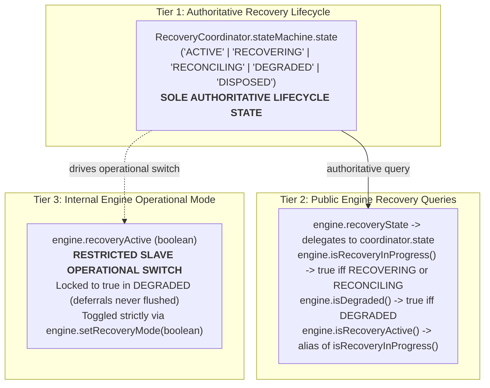

# Phase 7.5 Milestone M5.0-R5 — Final Architecture Consistency Correction Report

**Milestone:** Phase 7.5 Sub-Milestone M5.0-R5 (Architecture Consistency & Source Closure)<br/>
**Role:** Senior TypeScript Distributed-Systems Architect<br/>
**Mode:** STRICTLY DOCUMENTATION-ONLY CORRECTION AND SOURCE AUDIT<br/>
**Date:** 2026-11-25<br/>
**Starting Documentation Baseline (Parent):** `d9455910b0680455f7a123a5099dab1ee6011944`<br/>
**Accepted Implementation Baseline:** M4.3d `40b11fdafcd247c7a289723f90ec0e2029c94f64`<br/>
**Accepted M4.3c Baseline:** `eab2428681eb8a05b1c6e71906a932f671730fc8`<br/>
**Accepted M4.3b Baseline:** `f3c29b62eea63f6b06647218e4485eacba86fb50`<br/>
**Frozen M4.2d Baseline:** `aafa366cc48fdb2b83940f00e80d92d813e7c52e`<br/>
**Objective:** Resolve all three review findings from the Engineering Authority's review on Milestone M5.0-R4 without modifying production code, tests, package manifests, or configurations. Implementation of Milestone M5.1 remains strictly **UNAUTHORIZED AND UNSTARTED**.

---

## 1. Executive Summary & Verification Scope

In Milestone M5.0-R4, the memory bounds of `QuarantineBuffer` were reconciled to the actual 4 MiB source baseline, the deterministic replay contract was formalized under SMR total-order semantics, and post-installation replay failure behavior was isolated to `DEGRADED`.

The Engineering Authority's review placed technical acceptance on HOLD, identifying three critical specification-level findings:
1. **Deterministic Replay Against Compacted Snapshots ($A \prec B$ Hazard):** Replaying stashed local operations on top of a compacted snapshot base can invert canonical total order when a concurrent operation $B$ was already compacted into the snapshot base with an ordering key succeeding $A$ ($K(A) \prec K(B)$). Because conflict resolution operations are non-commutative, executing $B \to A$ out of order diverges.
2. **Trust Context Provenance (`LOCAL_REPLAY` vs `REPAIR_BATCH`):** The engine admission pipeline must establish trust context from trusted physical subsystem custody rather than reading or inferring trust from wire messages or mutable operation fields.
3. **Recovery Lifecycle State Clarity:** Public engine queries must unambiguously distinguish actively executing recovery (`isRecoveryInProgress()`) from failed recovery (`isDegraded()`), and confirm that notification deferral remains locked in `DEGRADED`.

This M5.0-R5 report completely closes these findings across all five M5 architectural specification documents.

---

## 2. Technical Resolution of Review Findings

### 2.1 Finding 1: Deterministic Replay Against Compacted Snapshots ($A \prec B$ Hazard)

#### Problem Formulation
In SyncPlay, deterministic state machine replication enforces the canonical total ordering key:
$$K(e) = \langle L(e), \text{originPeerId}, \text{logicalEventId} \rangle$$
evaluated by `compareOperations(e1, e2)` (`packages/sync-engine/src/ordering/comparator.ts`).

Consider two concurrent operations $A$ and $B$:
- Node 1 generated and locally committed $A$ with Lamport timestamp $L(A) = 10$.
- Node 2 generated $B$ with Lamport timestamp $L(B) = 11$.
- Canonical SMR total order requires evaluating $A \prec B$.
- If Node 2's snapshot has already incorporated $B$ into its compacted playback base ($S_{\text{snap}}$), installing the snapshot and replaying stashed operation $A$ on top evaluates the state transition sequence:
  $$S_{\text{snap}} \to A \implies B \to A$$

#### Non-Commutativity Hazard
Inspection of `ConflictResolver` (`packages/sync-engine/src/conflict/conflict-resolver.ts`) demonstrates that state transitions are **not universally commutative**:
- `PAUSE` takes priority over concurrent `PLAY`, but sequential resumption allows later-timestamp `PLAY` to resume playback.
- If $A$ is `PAUSE` ($L=10$) and $B$ is `PLAY` ($L=11$), canonical order $A \prec B$ evaluates $A \to B$, producing `PLAYING`.
- If $B$ was compacted into $S_{\text{snap}}$, evaluating $A$ onto $S_{\text{snap}}$ applies `PAUSE` after `PLAY`, leaving the room `PAUSED`!
- The total-order comparator `compareOperations` cannot retroactively interleave uncompacted operations into a state that has already been compacted away.

#### Normative Architectural Solution
To eliminate this hazard without introducing unverified assumptions, Milestone M5 specifies a strict **Canonical Ordering Feasibility Check** and an **Explicit Incompatibility Gate**:

1. **Compacted Frontier Invariant:** In `StateSnapshotPayloadV2`, the compacted base state is bounded by `originFrontierTimestamps: Record<string, number>` and `maxLogicalTimestamp: number`.
2. **Canonical Ordering Feasibility Check:**
   Prior to snapshot installation, the engine evaluates every stashed local operation $A$:
   - Check whether $L(A) \le \text{snapshot.maxLogicalTimestamp}$ and $A$ is concurrent with operations folded into the snapshot base ($\exists p \in \text{compacted origins},\ L(A) \le \text{snapshot.originFrontierTimestamps}[p]$).
   - If so, an **Explicit Ordering Hazard** exists: at least one operation folded into the snapshot base canonically succeeds $A$.
3. **Hazard Resolution Rules:**
   - **Priority 1 (Delta Log Repair):** The engine rejects snapshot replacement and initiates anti-entropy log repair (`RepairRequestPipeline`) from a common ancestor so that all uncompacted operations from all peers can be placed into `OrderedOperationLog` and ordered canonically by `compareOperations` before any compaction occurs.
   - **Priority 2 (Explicit Incompatibility Gate):** If anti-entropy log repair is not possible (history has been truncated across all peers and cannot be fetched), the engine **must not** apply the snapshot and replay $A$ out of order. Recovery detects that canonical SMR order cannot be guaranteed and **aborts safely to `DEGRADED`** with error code `INCOMPATIBLE_COMPACTED_HISTORY` (`SyncEngineError('INCOMPATIBLE_COMPACTED_HISTORY')`).
4. **Replay-Safe Condition:** A stashed local operation $A$ is eligible for replay onto the snapshot base if and only if:
   $$\forall p \in \text{compacted origins},\ L(A) > \text{snapshot.originFrontierTimestamps}[p]$$
   (or $L(A) > \text{snapshot.maxLogicalTimestamp}$).
   Under this condition, $\forall op \in S_{\text{snap}},\ K(op) \prec K(A)$ holds universally, guaranteeing that reducing $A$ on top of $S_{\text{snap}}$ produces the bit-exact identical outcome to complete canonical history evaluation.

---

### 2.2 Finding 2: Trust Context Provenance (`LOCAL_REPLAY` vs `REPAIR_BATCH`)

#### Physical Custody Provenance
The engine admission method is updated with an explicit, typed parameter:
```typescript
admitDrainedOperation(
  op: QuarantinedOperation,
  trustContext: 'LOCAL_REPLAY' | 'REPAIR_BATCH' = 'REPAIR_BATCH',
): DestinationAcceptanceReceipt;
```

1. **Subsystem Custody Boundary:**
   - When `QuarantineDrainer` drains `quarantineBuffer` (remote network arrivals intercepted during recovery), it passes `trustContext: 'REPAIR_BATCH'`.
   - When the reconciliation workflow drains `stashedLocalQueue` (operations extracted from local `OrderedOperationLog` before snapshot installation), it passes `trustContext: 'LOCAL_REPLAY'`.
2. **Prohibition of Metadata Inference:**
   - Trust context is **NEVER read, inferred, or accepted from:**
     - Network wire frames, payload properties, or message headers.
     - Mutable operation object fields.
     - Peer-supplied or client-supplied metadata.
   - Provenance is guaranteed solely by the physical in-process queue custody of the internal calling subsystem.
3. **Admission Semantics & Safety Boundaries:**
   - **`LOCAL_REPLAY` Context:**
     - Passes `'LOCAL_REPLAY'` to `clockManager.validateAndAdvanceRemote(origin, ts, seq, 'LOCAL_REPLAY')`.
     - Bypasses arrival token-bucket rate limits and clock inflation checks.
     - Clock is not mutated; local sequence numbers are preserved.
     - Any dependency failure or sequence collision ($H(op) \ne H(log)$) proves an irreconcilable history fork, causing recovery to abort immediately to `DEGRADED`. Committed local progress is **NEVER silently dropped**.
   - **`REPAIR_BATCH` Context:**
     - Passes `'REPAIR_BATCH'` to `clockManager.validateAndAdvanceRemote(...)`.
     - Bypasses wall-clock rate limits, but undergoes full structural and causal validation.
     - Operations with missing dependencies are safely buffered in `PendingDependencyQueue` (`ACCEPTED_PENDING`).

---

### 2.3 Finding 3: Recovery Lifecycle State Clarity & Locked Deferral

To prevent callers from confusing a failed recovery state (`DEGRADED`) with normal operational health (`ACTIVE`), the three-tier lifecycle model has been made explicit:



1. **Unambiguous Public Queries:**
   - `engine.recoveryState`: Readonly getter returning the Tier 1 coordinator state (`ACTIVE`, `RECOVERING`, `RECONCILING`, `DEGRADED`, `DISPOSED`).
   - `engine.isRecoveryInProgress(): boolean`: Returns `true` **strictly** when recovery is actively executing (`recoveryState === 'RECOVERING' || recoveryState === 'RECONCILING'`). Returns `false` in `ACTIVE`, `DEGRADED`, and `DISPOSED`.
   - `engine.isDegraded(): boolean`: Returns `true` **strictly** when `recoveryState === 'DEGRADED'`.
   - `engine.isRecoveryActive(): boolean`: Retained strictly as a backward-compatible alias of `isRecoveryInProgress()`.
2. **Caller Contract:**
   - Callers and UI components must NEVER treat `!isRecoveryInProgress()` as an indicator of healthy operation!
   - In `DEGRADED`, `isRecoveryInProgress()` evaluates to `false` because active recovery has terminated, but the engine is halted and fail-closed. Callers must check `engine.recoveryState === 'ACTIVE'` (or `!isRecoveryInProgress() && !isDegraded()`).
3. **Locked Operational Deferral in `DEGRADED`:**
   - When recovery terminates unrecoverably or aborts into `DEGRADED`, `engine.setRecoveryMode(true)` is **strictly maintained**.
   - `deferredStateChanges` and `deferredDecisions` remain locked and are **NEVER flushed**.
   - Local inputs fail-close with `SyncEngineError('REJECTED_DEGRADED')`. Remote events are dropped with outcome `REJECTED_DEGRADED`.
   - The engine remains frozen until an explicit administrative session reset (`resetRecovery()`) or full session teardown.

---

## 3. Summary of Document Amendments

| Document | Key Corrections in Milestone M5.0-R5 |
|---|---|
| `docs/PHASE7_5_M5_ARCHITECTURE.md` | • Status amended to M5.0-R5.<br/>• Section 3.1: added `isDegraded()` query; formalized locked notification deferral in `DEGRADED`.<br/>• Section 5.2: detailed $A \prec B$ Compacted Snapshot Reordering Hazard, Canonical Ordering Feasibility Condition, Explicit Incompatibility Gate (`INCOMPATIBLE_COMPACTED_HISTORY`), and physical custody provenance for `LOCAL_REPLAY` vs `REPAIR_BATCH`.<br/>• Updated 6-category replay table and 8 replay invariants. |
| `docs/PHASE7_5_M5_INTERFACE_SPECIFICATION.md` | • Status amended to M5.0-R5.<br/>• Section 2.2: added `isDegraded(): boolean` to `ILeaderlessSyncEngineRecovery`.<br/>• Section 2.2: updated `admitDrainedOperation(op, trustContext)` signature with custody documentation.<br/>• Section 7: added `INCOMPATIBLE_COMPACTED_HISTORY` error code. |
| `docs/PHASE7_5_M5_IMPLEMENTATION_ROADMAP.md` | • Status amended to M5.0-R5.<br/>• Section 2: updated M5.0, M5.1, and M5.4 with canonical ordering feasibility check, explicit incompatibility gate, physical custody trust context provenance, and unambiguous lifecycle queries. |
| `docs/PHASE7_5_M5_ACCEPTANCE_CRITERIA.md` | • Status amended to M5.0-R5.<br/>• Section 2: updated `AC-M5-01` to require `isDegraded()` and explicit health checks.<br/>• Section 2: added `AC-M5-20b` (Canonical Ordering Feasibility & Incompatibility Gate).<br/>• Section 2: updated `AC-M5-27` to specify physical custody provenance in `admitDrainedOperation()`. |
| `docs/PHASE7_5_M5_RISK_REGISTER.md` | • Status amended to M5.0-R5.<br/>• Section 3: expanded `R-M5-09` to detail $A \prec B$ reordering hazard and canonical ordering feasibility check.<br/>• Section 3: expanded `R-M5-10` to cover `isDegraded()` lifecycle query and locked deferral behavior. |

---

## 4. Scope & Invariant Conformance

- **Production Code Modified:** 0 files (0 lines changed).
- **Test Code Modified:** 0 files (0 lines changed).
- **Package Manifests / Lockfiles Modified:** 0 files.
- **TypeScript Configuration Modified:** 0 files.
- **Frozen Baselines Intact:** Phase 1–7.4 and M4 baselines completely untouched.
- **Milestone M5.1 Status:** UNAUTHORIZED AND UNSTARTED.
