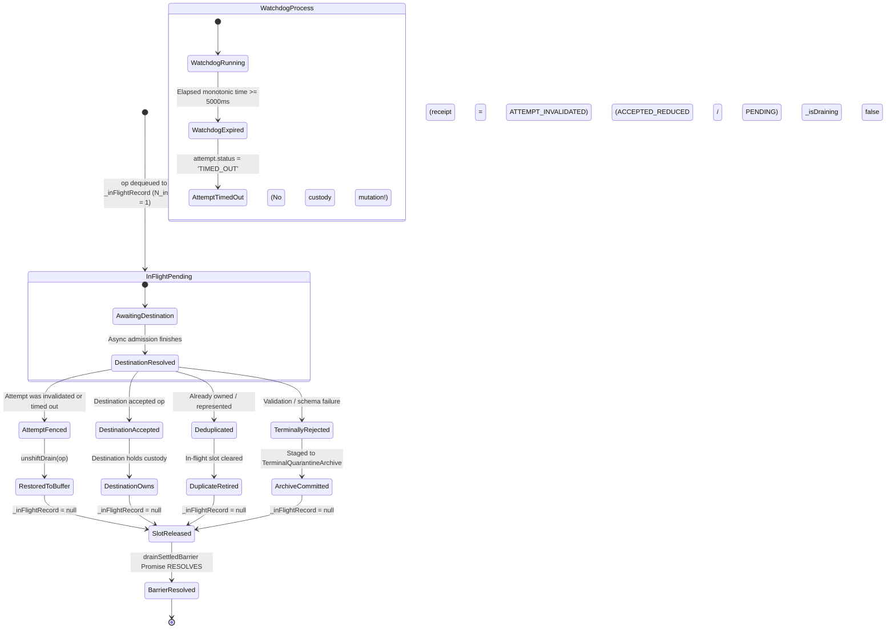
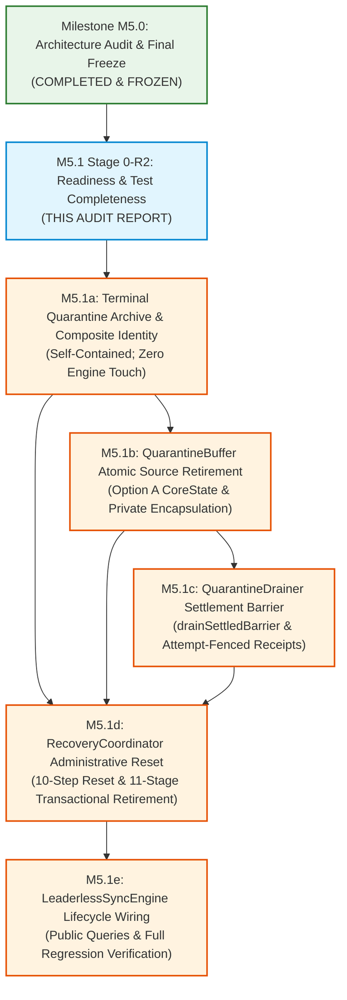

# Phase 7.5 M5.1 — Stage 0-R2: Implementation Readiness, Settlement Barrier Test Completeness & Late-Continuation Fencing

**Sub-Milestone Title:** Engine Runtime Recovery Integration — Stage 0-R2 Implementation Readiness
**Role:** Principal TypeScript Distributed-Systems Architect, Senior Recovery-Systems Engineer, and Independent Implementation Auditor
**Mode:** STRICTLY READ-ONLY SOURCE AUDIT, IMPLEMENTATION READINESS ANALYSIS, AND EXECUTION PLANNING
**Target Milestone:** Phase 7.5 Sub-Milestone M5.1 (Stage 0-R2 Correction)
**Revision:** Stage 0-R2 (Settlement Barrier Test Completeness & Late-Continuation Fencing)
**Starting Baseline Commit:** `3cbf60c113e1760ad58388baab0005ecdbf0a73e` (Stage 0-R1 Commit)
**Authoritative Historical Baselines:**
- M5.0 Final Freeze Commit: `b654cd2e5c38440f6c26ff0d827a6fdc9652c378`
- M5.0-R17 Commit: `e16b38ea08b340d9945f069f4a41b4fc80958d0c`
- Initial Stage 0 Commit: `260647707edbdc0b0faa78b05cf870424330583e`
- Formally Accepted M4.3d Baseline: `40b11fdafcd247c7a289723f90ec0e2029c94f64`
- M4.3c Baseline: `eab2428681eb8a05b1c6e71906a932f671730fc8`
- M4.3b Baseline: `f3c29b62eea63f6b06647218e4485eacba86fb50`
- Approved M4.3 Architecture: `2bb117c5db474a13307be65c6f68845f2bd74720`
- Frozen M4.2d Baseline: `aafa366cc48fdb2b83940f00e80d92d813e7c52e`

**Implementation Authorization Status: Milestone M5.1 remains STRICTLY UNAUTHORIZED AND UNSTARTED.**

---

## 1. Executive Summary & R2 Corrections

Milestone M5.0 is formally accepted and frozen. Following the Stage 0-R1 review, this Stage 0-R2 report completes the implementation readiness analysis by addressing the remaining test-plan and late-continuation fencing gaps:

1. **Preservation of the Ten Mandatory Settlement Rules (R1 Core Contract):**
   - Retains the strict separation of watchdog deadline expiration (`SETTLEMENT_BARRIER_TIMEOUT_MS = 5000`) from actual asynchronous settlement (`drainSettledBarrier(): Promise<void>`).
   - Re-affirms that watchdog expiry must never resolve, reject, or force-settle the settlement barrier, nor clear `_inFlightRecord`, nor release operation custody.
2. **Clarification of the Late-ACK Case & Four-Layer Separation:**
   - Formally decouples four distinct concepts:
     a. *Destination-Level Acknowledgement:* Remote or engine intake receipt (`ACCEPTED_REDUCED`, `ACCEPTED_PENDING`, `ALREADY_REPRESENTED`, `ALREADY_OWNED_DUPLICATE`, `ATTEMPT_INVALIDATED`, `TERMINALLY_REJECTED`, `CAPACITY_REJECTED`);
     b. *Recovery-Attempt Validity:* Monotonic attempt state machine (`INITIATED`, `WAITING_FOR_SETTLEMENT`, `SETTLED`, `TIMED_OUT`, `INVALIDATED`, `COMPLETED`);
     c. *Permission to Commit Candidate Root:* Authorization to execute `replaceCoreStateAtomic` or commit candidate archive roots (strictly forbidden for stale or timed-out attempts);
     d. *Permission to Retire or Transfer Custody:* Drainer-level ownership release strictly synchronized with actual receipt evaluation and custody reconciliation.
   - Proves that a late destination acknowledgement does **NOT** authorize a timed-out recovery attempt to resume root replacement or notification flush.
3. **Comprehensive Expansion of Deterministic Test Plans (Scenarios A through F):**
   - Retains the baseline 17-step sequence (§12.1) and introduces explicit step-by-step test plans (§12.2) using Vitest fake timers (`vi.useFakeTimers()`) and controlled deferred Promises:
     - **Scenario A:** Watchdog expiry with unresolved destination Promise;
     - **Scenario B:** Second reset cannot bypass outstanding settlement;
     - **Scenario C:** Late settlement and stale-attempt fencing;
     - **Scenario D:** Custody reconciliation before barrier resolution;
     - **Scenario E:** Subsequent authorized recovery;
     - **Scenario F:** Concurrent reset requests serialized on shared settlement condition.
4. **Strict Adherence to Testability Constraints Without Exposing Private State:**
   - Prohibits all test-only backdoor getters, raw backing map handles, or public debug APIs.
   - Mandates external verification via observable public outcomes, receipt inspection, defensive cloning mutation tests, and static AST verification.

---

## 2. Mandatory First Action: Repository and Baseline Verification

An inspection of the local Git repository reveals:

1. **Current Branch:** `main`
2. **Starting Baseline Commit for R2:** `3cbf60c113e1760ad58388baab0005ecdbf0a73e` (Stage 0-R1 Commit)
3. **Working-Tree Status:** Clean (`nothing to commit, working tree clean`).
4. **Stage 0-R1 Commit in History:** Confirmed (`3cbf60c113e1760ad58388baab0005ecdbf0a73e`).
5. **Initial Stage 0 Commit in History:** Confirmed (`260647707edbdc0b0faa78b05cf870424330583e`).
6. **M5.0 Final Acceptance Commit in History:** Confirmed (`b654cd2e5c38440f6c26ff0d827a6fdc9652c378`).
7. **Lineage Relationship:**
   ```
   3cbf60c (Stage 0-R1) docs(phase-7.5-m5.1): stage 0-r1 settlement barrier semantics and watchdog separation correction
   │
   2606477 (Initial Stage 0) docs(phase-7.5-m5.1): stage 0 implementation readiness and source integration plan
   │
   b654cd2 (M5.0 Final Freeze) docs(phase-7.5-m5): formal architectural acceptance and baseline freeze (m5.0-final)
   │
   e16b38e (M5.0-R17) docs(phase-7.5-m5): formalize published map encapsulation and runtime ownership (m5.0-r17)
   │
   ... [Intervening M5.0 Documentation Commits R16 -> R1]
   │
   40b11fd (tag: m4.3d-accepted) feat(phase-7.5-m4.3d): complete recovery acceptance matrix and test coverage
   ```
8. **Source Tree Integrity:** Executing `git diff --stat 40b11fdafcd247c7a289723f90ec0e2029c94f64 HEAD -- packages/` yields **zero lines changed**. The current codebase corresponds 100% byte-for-byte to the accepted M4.3d implementation baseline.

---

## 3. Frozen M5.0 Document Verification

All six authoritative M5.0 specification documents remain formally accepted and frozen:

1. `docs/PHASE7_5_M5_ARCHITECTURE.md`: Status: `FORMALLY ACCEPTED & FROZEN ARCHITECTURAL SPECIFICATION (MILESTONE M5.0 FINAL)`. Defines the 10-step reset sequence, 11-stage retirement transaction lifecycle, Option A candidate-root publication, Eight Rules of Map Ownership, settlement barrier, and 12-scenario failure matrix.
2. `docs/PHASE7_5_M5_INTERFACE_SPECIFICATION.md`: Status: `FORMALLY ACCEPTED & FROZEN ARCHITECTURAL SPECIFICATION (MILESTONE M5.0 FINAL)`. Defines formal TypeScript contracts, `ITerminalQuarantineArchive`, `IQuarantineBufferRetirementExtension`, `CompositeOperationIdentity`, `canonicalOperationIdentityKey`, and capability definitions.
3. `docs/PHASE7_5_M5_IMPLEMENTATION_ROADMAP.md`: Status: `FORMALLY ACCEPTED & FROZEN ARCHITECTURAL SPECIFICATION (MILESTONE M5.0 FINAL)`. Defines roadmap phasing (M5.0 through M5.5) and gating prerequisites.
4. `docs/PHASE7_5_M5_ACCEPTANCE_CRITERIA.md`: Status: `FORMALLY ACCEPTED & FROZEN ARCHITECTURAL SPECIFICATION (MILESTONE M5.0 FINAL)`. Defines invariants INV-M5-01 through INV-M5-09, criteria AC-M5-01 through AC-M5-33, and regression test floors.
5. `docs/PHASE7_5_M5_RISK_REGISTER.md`: Status: `FORMALLY ACCEPTED & FROZEN ARCHITECTURAL SPECIFICATION (MILESTONE M5.0 FINAL)`. Defines risks R-M5-01 through R-M5-10 and mitigations.
6. `docs/PHASE7_5_M5_0_FINAL_ACCEPTANCE_REPORT.md`: Status: `FORMALLY ACCEPTED AND FROZEN`. Records formal acceptance, review lineage, and codification of Qualifications A through D.

---

## 4. Existing Recovery Implementation Inventory

The accepted source files in `packages/sync-engine/src/recovery/` and `packages/sync-engine/src/engine/` were audited:

| Source File | Line Count | Existing Role in M4.3d | Existing Classes / Types | Audit Status for M5.1 |
|:---|:---|:---|:---|:---|
| `quarantine-buffer.ts` | 311 lines | Generational quarantine queue | `QuarantineBuffer`, `QuarantinedOperation`, `QuarantineDrainResult` | Partially sufficient. Missing candidate-root state (`QuarantineBufferCoreState`), Option A source retirement, and private collection encapsulation. |
| `quarantine-drainer.ts` | 421 lines | $N_{\text{in-flight}} \le 1$ drain loop | `QuarantineDrainer`, `DrainedInFlightRecord`, `DestinationAcceptanceReceipt` | Partially sufficient. Missing `ATTEMPT_INVALIDATED` receipt handling, settlement barrier Promise, and monotonic attempt-ID fencing. |
| `recovery-coordinator.ts` | 810 lines | Recovery orchestration & snapshot staging | `RecoveryCoordinator`, `RecoveryCoordinatorConfig`, `IRecoveryCoordinator` | Partially sufficient. Missing `bindEngine()` capability ceremony, failure-atomic `resetRecovery()`, 10-step reset sequence, and transactional retirement. |
| `recovery-state-machine.ts` | 212 lines | Legal 4-state lifecycle transitions | `RecoveryStateMachine`, `RecoveryState`, `RecoverySubstate` | Fully sufficient. Valid transition graph already allows `DEGRADED -> RECOVERING` and `RECOVERING -> ACTIVE`. |
| `snapshot-installer.ts` | 647 lines | 4-stage atomic snapshot installation | `SnapshotInstaller`, `StagedSnapshotInstallation`, `SnapshotInstallationReport` | Fully sufficient. `commitAtomic()` with `replaceCoreStateAtomic` verified and stable. |
| `engine-core-state.ts` | 199 lines | 12-field single-root engine state | `EngineCoreState`, `createEngineCoreState`, `createInitialEngineCoreState` | Fully sufficient. Sealed core state container verified. |
| `leaderless-sync-engine.ts` | 2,750 lines | Core playback and causal sync authority | `LeaderlessSyncEngine`, `RecoveryInstallationCapability` | Partially sufficient. `replaceCoreStateAtomic` exists; missing public recovery lifecycle accessors and coordinator constructor wiring. |
| `recovery-admission-controller.ts` | 327 lines | Remote event and local intent routing | `RecoveryAdmissionController`, `RemoteAdmissionResult`, `LocalAdmissionResult` | Fully sufficient. Validates epochs, event byte sizes, and enforces fail-close local intent rejection. |

---

## 5. Architecture-to-Source Traceability Matrix & Settlement Semantics

| M5.0 Architectural Requirement | Reference Spec | Target Source File | Existing Line Range | Status in Baseline | Concrete Required Implementation Change |
|:---|:---|:---|:---|:---|:---|
| **Authoritative Lifecycle State vs. Operational Mode** | Architecture §2.1.1, AC-M5-01 | `leaderless-sync-engine.ts` | 693, 914–922 | Partially Exists | Expose `isRecoveryInProgress()`, `isDegraded()`, and `recoveryState` delegating to coordinator; preserve `recoveryActive` strictly as slave notification gate. |
| **Engine-Coordinator Capability Binding Ceremony** | Architecture §2.1.1, AC-M5-07 | `recovery-coordinator.ts`, `leaderless-sync-engine.ts` | 146–175, 754–757 | Partially Exists | Add `bindEngine(engine, capability)` method; enforce single-attachment check (`SyncEngineError('ALREADY_BOUND')`); check object identity. |
| **Drain Admission Context Capability & Replay Gating** | Architecture §2.1.2, AC-M5-01 | `leaderless-sync-engine.ts` | 977–1010 | Partially Exists | Add capability-gated provenance parameter to `admitDrainedOperation(op, capability)`; gate local replay provenance checks. |
| **Receipt Variant `ATTEMPT_INVALIDATED`** | Interface §3.2, AC-M5-01 | `quarantine-drainer.ts` | 65–71, 318–344 | Missing | Add `ATTEMPT_INVALIDATED` variant to `DestinationAcceptanceReceipt`; handle in `processSingleOperation` by restoring operation to buffer via `unshiftDrain`. |
| **Shared Settlement Barrier (`drainSettledBarrier`) (Rule 1, 9)** | Architecture §3.4.1, AC-M5-01 | `quarantine-drainer.ts`, `recovery-coordinator.ts` | 119, 174–279 | Missing | Implement `drainSettledBarrier(): Promise<void>`. Resolves **strictly and only** upon actual settlement (`_inFlightRecord === null && !_isDraining`). **Never resolves or rejects on watchdog timeout.** |
| **Monotonic Attempt-ID Fencing & Watchdog Separation (Rule 2, 6)** | Architecture §3.4.1, AC-M5-01 | `recovery-coordinator.ts`, `quarantine-drainer.ts` | 670, 696 | Partially Exists | Coordinator advances `currentAttemptId` monotonically on reset/abort. Watchdog latches attempt to `TIMED_OUT` without touching drainer custody. Actual continuation fences on attempt ID before root replacement. |
| **Terminal Quarantine Archive Implementation** | Architecture §3.4.4, Interface §3.3 | `terminal-quarantine-archive.ts` (New) | N/A (New File) | **Missing** | Implement `TerminalQuarantineArchive`, `TerminalArchiveCoreState`, `reserveCapacity`, `commitRetirementBatch`, `getEntries`, and export lifecycle. |
| **Composite Operation Identity & UTF-8 Canonical Key** | Architecture §3.4.3, Interface §3.3 | `terminal-quarantine-archive.ts` (New) | N/A (New File) | **Missing** | Implement `CompositeOperationIdentity`, pre-validate ASCII schema (`/^[a-zA-Z0-9_.:-]+$/`), compute exact UTF-8 byte lengths via `TextEncoder`, construct `opid:...` key. |
| **Option A Atomic Source Retirement in QuarantineBuffer** | Architecture §3.4.4, Interface §3.3 | `quarantine-buffer.ts` | 76–86, 243–271 | Missing | Add `QuarantineBufferCoreState`, `#identityIndex` private encapsulation, and `retireCommittedBatch(identities, capability)` with candidate-root pointer swap. |
| **10-Step Reset Sequence (`PURGE_AND_RETRY`)** | Architecture §3.4.2, AC-M5-01 | `recovery-coordinator.ts` | 668–686 | Partially Exists | Overhaul `resetRecovery` to require `RecoveryInstallationCapability`, execute 10-step sequence, await settlement barrier, and suppress stale notifications. |
| **11-Stage Transactional Retirement (`REINITIALIZE_CLEAN`)** | Architecture §3.4.3, AC-M5-01 | `recovery-coordinator.ts` | 668–686 | Missing | Implement 11-stage pipeline: generation freeze, settlement verify, complete entry staging, UTF-8 measurement, pre-reservation, commit, source retirement, zero-custody assert. |
| **Dual Zero-Custody Verification Assertion** | Architecture §3.4.3, AC-M5-01 | `recovery-coordinator.ts` | N/A | Missing | Assert `quarantineBuffer.totalRetainedCount === 0 && quarantineDrainer.inFlightRecord === null`; throw `SyncEngineError('CUSTODY_LEAK_DETECTED')` on failure. |
| **3-Way Uncertain Commit Reconciliation** | Architecture §3.4.3, AC-M5-01 | `recovery-coordinator.ts` | N/A | Missing | On commit timeout/error, query `archive.getTransaction(txId)`; if committed $\to$ complete source retirement; if absent $\to$ cancel reservation; if fails $\to$ halt `DEGRADED`. |
| **Non-Throwing Notification Flush** | Architecture §3.4.3, AC-M5-04 | `leaderless-sync-engine.ts` | 929–960 | Partially Exists | Ensure listener exceptions in `flushDeferredNotifications()` are caught, isolated, increment `listenerErrorCount`, and never throw out to caller. |

---

## 6. Settlement Barrier, Late Settlement & Watchdog Separation (The Core Contract)

### 6.1 The Ten Mandatory Rules of Settlement

To guarantee absolute custody safety across asynchronous engine boundaries, the implementation must adhere to ten invariant rules:

1. **Actual Settlement Representation:** The settlement barrier (`drainSettledBarrier(): Promise<void>`) represents actual drainer settlement, not watchdog completion.
2. **Watchdog Latching:** The 5,000 ms watchdog (`SETTLEMENT_BARRIER_TIMEOUT_MS`) may latch an attempt as `TIMED_OUT` and transition recovery health to `DEGRADED`.
3. **Watchdog Barrier Invariance:** Watchdog expiry must **never** resolve or reject the settlement barrier.
4. **Custody Invariance on Timeout:** Watchdog expiry must **never** clear `_inFlightRecord`, falsely set `_isDraining` to `false`, or release operation custody.
5. **Promise Continuation Invariance:** The underlying destination Promise remains active until it actually settles; Promise timeout is never interpreted as Promise cancellation.
6. **Late-Continuation Fencing:** A timed-out attempt's continuation must be strictly fenced from performing stale commit, root replacement, or notification-flush work.
7. **Frozen M5.0 Receipt Disposition:** The drainer must process the actual late receipt according to the frozen M5.0 disposition rules.
8. **Custody Reconciliation Precedence:** Operation custody must be restored (`unshiftDrain`), transferred, or retired according to that receipt **before** the in-flight slot is released.
9. **Barrier Resolution Condition:** The settlement barrier resolves **only** after actual settlement and completion of the corresponding custody reconciliation ($this.\_inFlightRecord === \text{null} \land this.\_isDraining === \text{false}$).
10. **Serialized Reset Sharing:** Concurrent reset attempts must share or await the same outstanding settlement condition. They must never create independent paths that bypass the original in-flight operation.

### 6.2 Independent State Transitions



#### Detailed Transition Dynamics:
- **Transition 1: Watchdog Timeout (Coordinator-Level)**
  - Monotonic elapsed duration reaches `SETTLEMENT_BARRIER_TIMEOUT_MS` (5,000 ms).
  - Attempt status transitions to `attempt.status = 'TIMED_OUT'`.
  - Coordinator aborts clean reset to `DEGRADED` (`RESET_PREREQUISITE_FAILED`).
  - **In-flight record remains occupied** (`_inFlightRecord !== null`).
  - **Drainer remains draining** (`_isDraining === true`).
  - **Settlement barrier remains unresolved (pending).**
  - Any subsequent reset attempt sharing or observing the barrier is blocked from proceeding until actual settlement occurs.
- **Transition 2: Actual Promise Settlement (Drainer-Level)**
  - The underlying destination Promise completes.
  - Continuation executes: checks `attemptId === currentAttemptId`.
  - If attempt was timed out or invalidated, destination returns `{ status: 'ATTEMPT_INVALIDATED', reason: 'STALE_ATTEMPT_FENCED' }`.
  - Drainer restores operation to buffer via `quarantineBuffer.unshiftDrain(op)`.
  - `_inFlightRecord` is set to `null`.
  - `_isDraining` is set to `false`.
  - **Settlement barrier Promise resolves.**
  - A subsequent reset attempt awaiting the barrier is now unblocked and can safely proceed.

### 6.3 Clarification of the Late-ACK Case and Four-Layer Separation

When an asynchronous drain destination settles after a watchdog timeout has expired, four distinct architectural layers must be strictly distinguished:

```
┌─────────────────────────────────────────────────────────────────────────────────┐
│ 1. Destination-Level Acceptance                                                 │
│    Destination returns DestinationAcceptanceReceipt                             │
│    (ACCEPTED_REDUCED, ACCEPTED_PENDING, ATTEMPT_INVALIDATED, etc.)              │
└──────────────────────────────────────┬──────────────────────────────────────────┘
                                       ▼
┌─────────────────────────────────────────────────────────────────────────────────┐
│ 2. Recovery-Attempt Validity                                                    │
│    Coordinator evaluates: attempt.status === 'TIMED_OUT'                        │
│    Result: Attempt is DEAD/TERMINAL. Validity is FALSE.                         │
└──────────────────────────────────────┬──────────────────────────────────────────┘
                                       ▼
┌─────────────────────────────────────────────────────────────────────────────────┐
│ 3. Permission to Commit Candidate Root (FENCED)                                 │
│    Can Attempt 1 execute replaceCoreStateAtomic or flush notifications?         │
│    Result: STRICTLY FORBIDDEN. Zero state mutation. Zero notifications.        │
└──────────────────────────────────────┬──────────────────────────────────────────┘
                                       ▼
┌─────────────────────────────────────────────────────────────────────────────────┐
│ 4. Permission to Retire or Transfer Custody                                     │
│    Drainer reconciles operation custody based on frozen M5.0 disposition rules: │
│    - ATTEMPT_INVALIDATED -> unshiftDrain(op) to QuarantineBuffer               │
│    - ACCEPTED_*          -> Destination owns op; clear in-flight slot           │
│    - TERMINALLY_REJECTED -> Commit to TerminalQuarantineArchive                 │
│    Slot released (N_in-flight -> 0) ONLY AFTER custody reconciliation completes.│
└─────────────────────────────────────────────────────────────────────────────────┘
```

#### Detailed Layer Invariants:
1. **Destination-Level Acceptance $\ne$ Recovery Authorization:** Even if a remote peer or destination engine returns `ACCEPTED_REDUCED`, this receipt merely acknowledges that the destination admitted the operation into its log. It provides **zero authorization** for an invalidated or timed-out recovery attempt to resume its execution sequence.
2. **Attempt Fencing Checks Before Every Protected Mutation:** Every asynchronous suspension point (`await`) in `RecoveryCoordinator` must re-verify `attempt.status !== 'TIMED_OUT'` and `attempt.attemptId === this.currentAttemptId`. If invalidated, the continuation halts immediately without calling `engine.replaceCoreStateAtomic()`, without committing archive batches, and without calling `engine.flushDeferredNotifications()`.
3. **Custody Reconciliation is Pre-Requisite to Barrier Resolution:** Custody disposition (restoring to buffer, committing to archive, or logging acceptance) must complete before `this._inFlightRecord = null` is executed. The settlement barrier promise resolves only when both `_inFlightRecord === null` and `_isDraining === false`.

---

## 7. Runtime Ownership & Collection Encapsulation Audit

### 7.1 Real Runtime Private Encapsulation (Qualification A)
`TerminalQuarantineArchive` and `QuarantineBuffer` must enforce genuine runtime privacy via **ECMAScript `#private` class fields** (`#committedTransactions`, `#activeReservations`, `#identityIndex`, `#core`) or closure-held state:
- TypeScript's compile-time `private` compiles to ordinary enumerable/accessible JavaScript properties.
- `ReadonlyMap<K, V>` is completely erased at compile time.
- `#private` class fields guarantee that external callers and reflection cannot retrieve or call `.set()`, `.delete()`, or `.clear()` on backing collections.

### 7.2 Protected Elements & Defensive Cloning (Qualification B)
- `Object.freeze([...this._core.entries])` protects only the outer array structure.
- Every `TerminalQuarantineEntry` must be individually shallow-frozen with `Object.freeze(entry)`.
- `entry.canonicalWireBytes: Uint8Array` is held as private backing storage.
- All public accessors and `archive.getEntries()` return defensively cloned `Uint8Array` instances (`new Uint8Array(entry.canonicalWireBytes)`).

---

## 8. Archive Transaction & Atomic Retirement Integration Analysis

`TerminalQuarantineArchive` commits staged retirement batches via candidate-root reference replacement:
```typescript
const candidateCore: TerminalArchiveCoreState = Object.freeze({
  entries: Object.freeze([...this.#core.entries, ...stagedBatch]),
  committedTransactions: nextTransactions, // Private encapsulated Map
  activeReservations: nextReservations,       // Private encapsulated Map
  totalBytes: this.#core.totalBytes + batchBytes,
  size: this.#core.size + stagedBatch.length,
  archiveGeneration: this.#core.archiveGeneration + 1,
});
// Single atomic linearization instruction:
this.#core = candidateCore;
```
Concurrent readers observe either the pre-commit root or the complete post-commit root with entries added and reservation consumed together.

---

## 9. Mandatory Audit of the 12 Failure Scenarios

| Scenario # | Scenario Title | Participating Components | Existing Baseline Support | Required M5.1 Implementation | State & Custody Invariants | Automated Test Specification |
|:---|:---|:---|:---|:---|:---|:---|
| **1** | Reservation capacity insufficient | `TQA`, `RC` | Missing | `TQA.reserveCapacity` checks $N \le 500$, bytes $\le 2\,\text{MiB}$; throws `CAPACITY_INSUFFICIENT`. | Buffer retains operations; clean reset aborts to `DEGRADED`; zero loss. | Unit test attempting reservation with 501 entries or 2,097,153 bytes; assert fail-closed rejection. |
| **2** | Oversized canonical entry | `TQA`, `RC` | Missing | UTF-8 byte measurement asserts $\le 4096$; throws `ENTRY_SIZE_EXCEEDED`. | Entry never truncated; retained in buffer; clean reset aborts to `DEGRADED`. | Unit test with 4097-byte entry; assert rejection and buffer custody preservation. |
| **3** | Generation mismatch at reservation commit | `TQA`, `RC` | Missing | `TQA.commitRetirementBatch` asserts `expectedArchiveGeneration === core.archiveGeneration`. | Reservation cancelled; batch re-staged or reset aborted cleanly. | Concurrent commit advances generation before pending commit; assert `GENERATION_MISMATCH`. |
| **4** | Exception during candidate-root construction | `TQA`, `RC` | Missing | Candidate allocation wrapped in try/catch prior to reference swap. | Old root remains authoritative; zero entries added; reservation unconsumed. | Inject simulated fault during Map copying; assert `#core` remains identical reference. |
| **5** | **Archive commit succeeds but source retirement throws (CRITICAL PATH)** | `TQA`, `QB`, `RC` | Missing | Coordinator catches failure; queries `getTransaction()`; skips duplicate archive commit; retries source retirement. | **No duplicate archive entries**; buffer retained until successful retry; transaction record is authoritative. | Deterministic partial-failure test: mock `QB.retireCommittedBatch` to throw on first call; verify coordinator retries, queries receipt, and completes retirement cleanly. |
| **6** | Duplicate transaction submission | `TQA` | Missing | Lookup-first commit ordering: checks `committedTransactions.has(txId)` before validation. | Exactly zero duplicate entries added; returns existing receipt idempotently. | Submit identical transaction ID and digest twice; assert identical receipt and unchanged archive size. |
| **7** | Transaction ID reused with different digest | `TQA` | Missing | If transaction ID exists but digest differs, throws `TRANSACTION_ID_DIGEST_MISMATCH`. | Archive and buffer preserved; prevents corrupted partial batch replay. | Submit same transaction ID with different batch digest; assert conflict error thrown. |
| **8** | Uncertain commit outcome | `TQA`, `RC` | Missing | 3-way reconciliation: query `getTransaction(txId)`; if committed $\to$ retire source; if absent $\to$ cancel reservation. | Zero dual mutation; zero lost custody; halts safely in `DEGRADED` if query fails. | Simulate timeout awaiting commit receipt; execute 3-way query; assert reconciliation to committed or aborted. |
| **9** | Attempt invalidation during preparation | `RC`, `QD` | Missing | Reset/abort advances `currentAttemptId`; stale continuation detects mismatch and aborts. | Stale continuation cannot install state or mutate archive; operations preserved. | Trigger concurrent reset while preparation awaits barrier; assert earlier attempt terminates with zero effect. |
| **10** | Conflicting composite identity in batch | `RC`, `QB` | Missing | Full 4-field comparison (`originPeerId`, `sequenceNumber`, `membershipEpoch`, `logicalEventId`). | Batch rejected fail-closed; quarantine buffer preserved; reset halts in `DEGRADED`. | Batch contains operation with same origin/seq but different epoch; assert `RETIREMENT_BATCH_CONFLICT`. |
| **11** | **Settlement watchdog timeout (Rules 1–10 & Scenarios A–F)** | `RC`, `QD` | Missing | Watchdog timer (`5000ms`); latches attempt to `TIMED_OUT`; clean reset aborts to `DEGRADED`. **Barrier remains pending.** | In-flight slot remains occupied; barrier does NOT settle on timeout; continuation restores custody upon actual settlement. | 17-step deterministic test sequence (§12.1) and Scenarios A through F (§12.2); verifies custody retention past timeout and barrier resolution only upon actual settlement. |
| **12** | Dual zero-custody verification failure | `RC`, `QB`, `QD` | Missing | Coordinator asserts `buffer.count === 0 && drainer.inFlight === null`; throws `CUSTODY_LEAK_DETECTED`. | Clean-root install strictly blocked; enters `DEGRADED`; prevents uncommitted operation loss. | Inject mock leftover operation in drainer after retirement; assert clean baseline install is blocked. |

---

## 10. Proposed M5.1 Implementation Phasing

To guarantee risk isolation, incremental testability, and zero regression, M5.1 is partitioned into five sequential sub-milestones:

### Sub-Milestone M5.1a: Terminal Quarantine Archive & Composite Identity Domain
- **Scope:** New file `packages/sync-engine/src/recovery/terminal-quarantine-archive.ts`. Implements `TerminalQuarantineArchive`, `CompositeOperationIdentity`, `canonicalOperationIdentityKey()`, `TerminalArchiveCoreState`, Eight Rules of Map Ownership, ECMAScript `#private` fields, defensive `Uint8Array` cloning, single-pointer candidate-root publication (`this.#core = candidateCore`), reservation allocation/consumption/cancellation, lookup-first idempotency, and single-lease export governance.
- **Why Safe First:** Completely self-contained leaf component. Zero changes to existing engine, buffer, or drainer code. 100% testable via isolated unit tests and failure-injection tests (covering Scenarios 1, 2, 3, 4, 6, 7).

### Sub-Milestone M5.1b: QuarantineBuffer Option A Atomic Source Retirement & Core State Root
- **Scope:** Enhance `quarantine-buffer.ts` with candidate-root encapsulation (`QuarantineBufferCoreState`), ECMAScript `#private` identity index, and Option A atomic source retirement method `retireCommittedBatch(identities, capability)`.

### Sub-Milestone M5.1c: QuarantineDrainer Settlement Barrier & Attempt-Fenced Admission
- **Scope:** Enhance `quarantine-drainer.ts` with `ATTEMPT_INVALIDATED` confirmation handling, the shared settlement barrier (`drainSettledBarrier(): Promise<void>`), and attempt-ID fencing.
- **Settlement Invariant:** The barrier resolves **only** when `_inFlightRecord === null && !_isDraining`. It does **NOT** resolve or reject on watchdog timeout.

### Sub-Milestone M5.1d: RecoveryCoordinator Lifecycle Binding, Settlement & Administrative Reset Orchestration
- **Scope:** Enhance `recovery-coordinator.ts` with `bindEngine()` capability ceremony, 10-step `PURGE_AND_RETRY` sequence, 11-stage `REINITIALIZE_CLEAN` transactional retirement, independent watchdog timeout latching (`attempt.status = 'TIMED_OUT'`), 3-way uncertain commit reconciliation, and dual zero-custody verification.

### Sub-Milestone M5.1e: LeaderlessSyncEngine Public Lifecycle Queries, Capability Wiring & Regression Floor Verification
- **Scope:** Enhance `leaderless-sync-engine.ts` with constructor coordinator binding, public queries (`isRecoveryInProgress()`, `isDegraded()`, `recoveryState`), wire intake interception, and run full monorepo regression suite ($\ge 1,550$ tests).

---

## 11. Implementation Dependency Graph



---

## 12. Mandatory Test Strategy & Deterministic Sequences (Corrections C & E, and R2 Extensions)

### 12.1 Baseline Deterministic Settlement Barrier & Watchdog Timeout Test Sequence (Retained from R1)
To verify that watchdog timeout and actual settlement are completely independent and that in-flight custody cannot be leaked or bypassed, Sub-Milestone M5.1c/M5.1d must include an explicit deterministic test executing the following 17-step sequence:

```
1. Start a drain operation whose destination Promise remains unresolved (pending).
2. Begin a recovery reset and await its settlement barrier (drainSettledBarrier()).
3. Advance the watchdog timer beyond 5,000 ms using deterministic injected fake timers.
4. Assert that the reset attempt transitions to and latches as TIMED_OUT.
5. Assert that the underlying destination Promise remains pending.
6. Assert that _inFlightRecord remains occupied (N_in-flight == 1).
7. Assert that _isDraining remains true (consistent with actual active drain ownership).
8. Assert that the settlement barrier Promise remains pending (unresolved and unrejected).
9. Attempt to start a second recovery reset attempt.
10. Assert that the second reset cannot acquire a new drain owner or bypass the pending barrier.
11. Resolve the original destination Promise.
12. Allow the asynchronous drain continuation to execute in the microtask queue.
13. Assert that stale-attempt fencing intercepts the continuation (receipt = ATTEMPT_INVALIDATED).
14. Assert that operation custody is restored to QuarantineBuffer via unshiftDrain().
15. Assert that _inFlightRecord is cleared to null ONLY AFTER actual settlement and ownership restoration.
16. Assert that the settlement barrier Promise NOW resolves.
17. Assert that a subsequent authorized reset attempt can now proceed cleanly.
```

*Testing Infrastructure Requirement:* This test must be implemented using Vitest deterministic fake timers (`vi.useFakeTimers()`) and microtask queue flushing (`await Promise.resolve()`). Zero arbitrary real-time sleeps (`setTimeout`) are permitted.

---

### 12.2 Expanded Deterministic Scenarios A through F (Stage 0-R2 Extension)

To provide exhaustive coverage of late settlement, stale-continuation fencing, custody reconciliation, and concurrent reset serialization, the test suite must implement the following six formal deterministic scenarios:

#### Scenario A — Watchdog Expiry with Unresolved Destination Promise
- **Objective:** Verify that exceeding the 5,000 ms watchdog latches the attempt as `TIMED_OUT` without resolving or rejecting the barrier, and without releasing drainer custody.
- **Deterministic Step Sequence:**
  1. Initialize Vitest fake timers (`vi.useFakeTimers()`).
  2. Instantiate `QuarantineBuffer`, `QuarantineDrainer`, and `RecoveryCoordinator`.
  3. Enqueue operation `op1` into `QuarantineBuffer`.
  4. Initiate drain via `drainer.drainNext()`. Destination mock returns an unsettled deferred Promise (`destinationDeferred`).
  5. Assert drainer has entered draining state: `drainer.isDraining() === true` and `_inFlightRecord` contains `op1` ($N_{\text{in-flight}} = 1$).
  6. Trigger administrative clean reset via `coordinator.resetRecovery(capability, 'REINITIALIZE_CLEAN')` (Attempt 1).
  7. Capture barrier Promise from `drainer.drainSettledBarrier()`. Attach settlement tracking flag (`barrierSettled = false`).
  8. Advance virtual clock by 4,999 ms: `await vi.advanceTimersByTimeAsync(4999)`.
  9. Assert Attempt 1 status is `WAITING_FOR_SETTLEMENT`, barrier is pending (`barrierSettled === false`), and `_inFlightRecord` remains occupied.
  10. Advance virtual clock by 2 ms (reaching 5,001 ms, crossing 5,000 ms watchdog threshold).
  11. Assert coordinator watchdog executes: Attempt 1 status is latched to `TIMED_OUT`, and coordinator transitions to `DEGRADED`.
  12. Assert barrier Promise REMAINS PENDING (`barrierSettled === false`).
  13. Assert drainer in-flight slot REMAINS OCCUPIED with `op1` (`drainer.hasInFlightRecord() === true`), and `drainer.isDraining() === true`.
  14. Advance virtual clock by an additional 100,000 ms: `await vi.advanceTimersByTimeAsync(100000)`.
  15. Assert that neither timer advancement nor timeout releases custody: barrier remains pending, `_inFlightRecord` remains occupied, and engine root remains untouched.

#### Scenario B — Second Reset Cannot Bypass Outstanding Settlement
- **Objective:** Verify that a subsequent reset attempt arriving while an earlier destination Promise is pending cannot start a new drain, cannot replace roots, and must share/await the existing settlement condition.
- **Deterministic Step Sequence:**
  1. Continue from Scenario A (Attempt 1 is `TIMED_OUT`, destination Promise remains pending, `_inFlightRecord` occupied by `op1`).
  2. Initiate second reset request: `coordinator.resetRecovery(capability, 'REINITIALIZE_CLEAN')` (Attempt 2).
  3. Assert coordinator assigns `attemptId = 2` and checks drainer status.
  4. Assert Attempt 2 detects that drainer is occupied ($N_{\text{in-flight}} = 1$) and joins the existing settlement condition via `drainSettledBarrier()`.
  5. Assert Attempt 2 CANNOT initiate a new drain dequeue (`QuarantineBuffer` head is not dequeued).
  6. Assert no second in-flight record is created: $N_{\text{in-flight}}$ remains strictly 1.
  7. Assert Attempt 2 CANNOT execute candidate root replacement or commit archive batches.
  8. Assert original operation `op1` remains accounted for exactly once in system custody (solely in drainer `_inFlightRecord`).

#### Scenario C — Late Settlement and Stale-Attempt Fencing
- **Objective:** Verify that when the original destination Promise settles after the watchdog timeout, the stale Attempt 1 continuation is fenced from performing root replacement or notification flushes, and late receipts are safely handled.
- **Deterministic Step Sequence:**
  1. Continue from Scenario B (Attempt 1 is `TIMED_OUT`, Attempt 2 is waiting on settlement).
  2. Resolve the original `destinationDeferred` Promise with `{ status: 'ATTEMPT_INVALIDATED', attemptId: 1, reason: 'STALE_ATTEMPT_FENCED' }`.
  3. Drainer microtask continuation resumes execution.
  4. Drainer evaluates receipt: observes `ATTEMPT_INVALIDATED`. Under frozen M5.0 rules, executes `quarantineBuffer.unshiftDrain(op1)`.
  5. Drainer clears in-flight tracking: sets `_inFlightRecord = null` and `_isDraining = false`.
  6. Barrier Promise now resolves (`barrierSettled = true`).
  7. Attempt 1 continuation (which was awaiting the barrier in step 4 of the 10-step sequence) wakes up in microtask queue.
  8. Attempt 1 checks its latched state: observes `this.attempt.status === 'TIMED_OUT'` (and `attempt.attemptId !== coordinator.currentAttemptId`).
  9. Assert Attempt 1 continuation TERMINATES IMMEDIATELY with zero side effects:
     - `engine.replaceCoreStateAtomic` is NEVER called.
     - `archive.commitRetirementBatch` is NEVER called.
     - `engine.flushDeferredNotifications` is NEVER called.
  10. Assert operation `op1` is safely residing at the head of `QuarantineBuffer` with zero duplication, zero deletion, and zero dual-ownership.

#### Scenario D — Custody Reconciliation Before Barrier Resolution
- **Objective:** Verify that the settlement barrier resolves ONLY AFTER custody disposition is completely finished and asserted.
- **Deterministic Step Sequence:**
  1. Setup drainer with a destination returning a controlled deferred Promise.
  2. Enqueue `op1` and start drain.
  3. Attach spy/hook into `quarantineBuffer.unshiftDrain` and `drainSettledBarrier().then(...)`.
  4. Resolve destination Promise with `ATTEMPT_INVALIDATED`.
  5. Assert that when `quarantineBuffer.unshiftDrain` executes, `drainer.hasInFlightRecord() === true` (custody is transferred BEFORE releasing slot).
  6. Assert that `drainSettledBarrier()` promise handler has NOT yet executed during `unshiftDrain`.
  7. Allow drainer to complete slot release (`_inFlightRecord = null`, `_isDraining = false`).
  8. Assert that `drainSettledBarrier()` resolver executes strictly after slot release.
  9. Assert that when the barrier promise resolves, `quarantineBuffer.totalRetainedCount === 1`, `drainer.hasInFlightRecord() === false`, and `drainer.isDraining() === false`.

#### Scenario E — Subsequent Authorized Recovery
- **Objective:** Verify that after actual settlement and custody reconciliation, a fresh authorized recovery attempt can proceed cleanly without interference from prior timed-out attempts.
- **Deterministic Step Sequence:**
  1. Continue following completion of Scenario C and D (Attempt 1 timed out and fenced, Attempt 2 observed settlement and clean custody state).
  2. Attempt 2 proceeds to Step 7 of the 10-step sequence:
     - Pre-condition check confirms: `quarantineDrainer.inFlightRecord === null` and `quarantineDrainer.isDraining === false`.
     - `QuarantineBuffer` contains `op1` safely preserved.
  3. Attempt 2 executes 11-stage atomic retirement transaction:
     - Discovers `op1` composite identity;
     - Pre-reserves capacity in `TerminalQuarantineArchive`;
     - Commits retirement batch to archive via candidate-root swap;
     - Retires source operation from `QuarantineBuffer` under Option A;
     - Executes dual zero-custody verification: asserts `quarantineBuffer.totalRetainedCount === 0` and `quarantineDrainer.inFlightRecord === null`.
  4. Attempt 2 executes Step 8: `engine.replaceCoreStateAtomic(cleanBaseline, capability)`.
  5. Attempt 2 executes Step 9: transitions state machine to `ACTIVE` with `attempt.status = 'COMPLETED'`.
  6. Attempt 2 executes Step 10: `engine.flushDeferredNotifications()`.
  7. Assert Attempt 2 completes successfully with engine active and clean baseline installed.
  8. Assert stale Attempt 1 cannot perform any subsequent mutation on Attempt 2's completed state.

#### Scenario F — Concurrent Reset Requests
- **Objective:** Verify that multiple concurrent reset requests arriving while destination settlement is pending all observe the same settlement condition, earlier attempts are invalidated cleanly, and no split-brain recovery occurs.
- **Deterministic Step Sequence:**
  1. Enqueue `op1` and initiate drain with unsettled `destinationDeferred`.
  2. Concurrently invoke three reset requests from separate callers:
     - `promiseA = coordinator.resetRecovery(cap, 'REINITIALIZE_CLEAN')` (Attempt A, ID=1);
     - `promiseB = coordinator.resetRecovery(cap, 'REINITIALIZE_CLEAN')` (Attempt B, ID=2);
     - `promiseC = coordinator.resetRecovery(cap, 'PURGE_AND_RETRY')` (Attempt C, ID=3).
  3. Assert coordinator advances `currentAttemptId` to 3.
  4. Assert Attempt A and Attempt B are latched to `INVALIDATED` (superseded by newer reset requests).
  5. Assert all three requests share and await the same underlying drainer settlement condition (`drainSettledBarrier()`).
  6. Assert only ONE in-flight operation exists ($N_{\text{in-flight}} = 1$); no concurrent drains are dequeued.
  7. Resolve `destinationDeferred` with `ATTEMPT_INVALIDATED`.
  8. Allow microtasks to execute:
     - Drainer unshifts `op1` to `QuarantineBuffer` and releases slot;
     - Barrier resolves;
     - Attempt A wakes up, detects `attempt.status === 'INVALIDATED'`, and halts with zero mutation;
     - Attempt B wakes up, detects `attempt.status === 'INVALIDATED'`, and halts with zero mutation;
     - Attempt C (authoritative attempt, ID=3) wakes up, confirms `attemptId === coordinator.currentAttemptId`, and proceeds to execute `PURGE_AND_RETRY`.
  9. Assert zero state corruption, zero duplicate retirement, and zero unhandled Promise rejections.

---

### 12.3 Late-ACK Semantics & Custody Disposition Verification Matrix

| Destination Acceptance Receipt Status | Destination Meaning | Recovery Attempt Status (Post-Timeout) | Authorized to Commit Candidate Root? | Drainer Custody Disposition Action | Post-Condition at Barrier Resolution |
|:---|:---|:---|:---|:---|:---|
| **`ATTEMPT_INVALIDATED`** | Engine admission boundary rejected op due to attempt fencing (`STALE_ATTEMPT_FENCED`). Vector not advanced. | `TIMED_OUT` (Terminal) | **NO (Strictly Fenced)** | Restore operation to `QuarantineBuffer` head via `unshiftDrain(op)`. Release in-flight slot. | Op safely in buffer; slot empty; barrier resolves; ready for next attempt. |
| **`ACCEPTED_REDUCED`** | Engine or peer admitted and reduced op into causal vector. | `TIMED_OUT` (Terminal) | **NO (Strictly Fenced)** | Destination holds custody. Drainer logs receipt, increments metrics, and releases in-flight slot. | Op in engine log; slot empty; barrier resolves; timed-out attempt halts. |
| **`ACCEPTED_PENDING`** | Engine admitted op to pending queue awaiting missing dependency. | `TIMED_OUT` (Terminal) | **NO (Strictly Fenced)** | Destination holds custody. Drainer logs receipt and releases in-flight slot. | Op in engine pending queue; slot empty; barrier resolves; timed-out attempt halts. |
| **`ALREADY_REPRESENTED`** | Op already covered by engine replication vector (frontier duplicate). | `TIMED_OUT` (Terminal) | **NO (Strictly Fenced)** | Deduplicated. Drainer releases in-flight slot ($N_{\text{in-flight}} \to 0$). | Op safely ignored; slot empty; barrier resolves; timed-out attempt halts. |
| **`ALREADY_OWNED_DUPLICATE`** | Op already present in engine operation log. | `TIMED_OUT` (Terminal) | **NO (Strictly Fenced)** | Deduplicated. Drainer releases in-flight slot ($N_{\text{in-flight}} \to 0$). | Op safely ignored; slot empty; barrier resolves; timed-out attempt halts. |
| **`TERMINALLY_REJECTED`** | Op failed schema validation, obsolete epoch, or malformed payload. | `TIMED_OUT` (Terminal) | **NO (Strictly Fenced)** | Stage and commit op to `TerminalQuarantineArchive`. Release in-flight slot. | Op safely in archive; slot empty; barrier resolves; timed-out attempt halts. |
| **`CAPACITY_REJECTED`** | Destination queue full (transient backpressure). | `TIMED_OUT` (Terminal) | **NO (Strictly Fenced)** | Restore operation to `QuarantineBuffer` head via `unshiftDrain(op)`. Halt drain. | Op safely in buffer; slot empty; barrier resolves; coordinator halts in `DEGRADED`. |

---

### 12.4 Preserving Testability Without Exposing Private State (Qualification A & E)
To ensure 100% testability while strictly enforcing the Eight Rules of Map Ownership:
1. **Public Observable Behavior:** Unit and integration tests verify state transitions, returned receipts, thrown error codes, and exported snapshots via public API methods only.
2. **Structural & Encapsulation Verification:** ECMAScript `#private` fields (`#committedTransactions`, `#activeReservations`, `#identityIndex`, `#core`) are verified via compile-time syntax enforcement and static AST checks, asserting that reflection (`Object.getOwnPropertyNames`, `Object.getOwnPropertySymbols`) reveals zero internal collection handles.
3. **Defensive Copy Verification:** Tests verify defensive cloning by explicitly mutating returned values (e.g. calling `bytes[0] = 0xFF` on the `Uint8Array` returned by `entry.canonicalWireBytes` or pushing to the array returned by `archive.getEntries()`) and asserting that subsequent public queries return unaltered data.
4. **Zero Test-Only Leaks:** No test-only public getters, backdoor inspection handles, or debug accessors may be added to expose backing Maps, core roots, or internal buffer references.

---

### 12.5 Regression Test Floors
- Total Monorepo Tests: $\ge 1,550$ passing tests.
- Sync-Engine Package Tests: $\ge 965$ passing tests.
- Recovery Subsystem Tests: $\ge 42$ passing tests.
- Zero skipped tests, zero failed tests.

---

## 13. Risks and Unresolved Questions (Correction D)

1. **V8 Heap vs. Wire Bounds:** As identified in R17, JavaScript object wrappers and closures consume $\sim 3.5\times$ to $5\times$ more heap than serialized wire bytes. The 2 MiB wire limit for `TerminalQuarantineArchive` translates to $\sim 7$ to $10$ MiB of V8 heap. Telemetry must track heap expansion during long-running sessions.
2. **Monotonic Elapsed Duration & Browser Throttling (Correction D):**
   - `performance.now()` measures **monotonic elapsed time**, NOT wall-clock time. It is immune to system clock adjustments, NTP stepping, or leap seconds.
   - The coordinator watchdog must record its start time using `performance.now()` and compare elapsed monotonic duration when the timer callback executes.
   - Browser environments frequently throttle timers in inactive background tabs (delaying `setTimeout` callbacks by seconds or minutes).
   - **Critical Rule:** Executing a watchdog callback must NEVER be treated as evidence that an underlying destination Promise settled. The settlement barrier must continue awaiting real Promise settlement regardless of elapsed duration. The frozen 5,000 ms timeout policy (`SETTLEMENT_BARRIER_TIMEOUT_MS = 5000`) is preserved.
3. **Promise Cancellation Impossibility:** ECMAScript Promises cannot be aborted at the engine runtime level. The shared settlement barrier guarantees that even after an attempt times out, the occupied slot is retained until the Promise completes, preventing concurrent re-entry or custody leaks.

---

## 14. First Implementation Sub-Milestone Recommendation

The auditor explicitly recommends:
```
================================================================================
RECOMMENDED FIRST IMPLEMENTATION SUB-MILESTONE:
SUB-MILESTONE M5.1a: TERMINAL QUARANTINE ARCHIVE & COMPOSITE IDENTITY DOMAIN
================================================================================
```

### Justification for M5.1a:
1. **Zero Coupling to Live Engine:** `TerminalQuarantineArchive` is an independent, leaf component. Implementing it creates a new file (`packages/sync-engine/src/recovery/terminal-quarantine-archive.ts`) with **zero modifications** to existing `LeaderlessSyncEngine`, `QuarantineDrainer`, or `RecoveryCoordinator` logic.
2. **Immediate Testability:** All core collection encapsulation invariants (Eight Rules of Map Ownership, `#private` fields, defensive `Uint8Array` cloning, single-pointer swap, lookup-first idempotency, and Scenarios 1, 2, 3, 4, 6, 7) can be verified via dedicated unit tests.
3. **Firm Architectural Anchor:** Establishing M5.1a provides the exact, audited contracts and composite identity structures required by subsequent stages (M5.1b source retirement and M5.1d coordinator orchestration).

---

## 15. Final Stage 0-R2 Verdict & Mandatory Authorization Boundary

```
================================================================================
STAGE 0-R2 IMPLEMENTATION READINESS VERDICT:
PASS — STAGE 0 READY FOR FINAL ACCEPTANCE REVIEW
================================================================================
```

All 20 Scope and Architecture Preservation Rules have been adhered to. The baseline source code is fully audited, verified, and grounded in exact file paths and line ranges. The settlement barrier semantics have been corrected to remain completely independent of watchdog timeout, the 17-step deterministic baseline test sequence is retained, comprehensive deterministic Scenarios A through F covering late settlement, stale-continuation fencing, custody reconciliation, and concurrent reset serialization are codified, monotonic clock duration semantics are refined, and private state encapsulation is fully preserved.

### Mandatory Implementation Authorization Statement
**"M5.1 Stage 0-R2 documentation correction is complete. No production implementation has been started. M5.1a remains unauthorized pending explicit Engineering Authority approval."**
