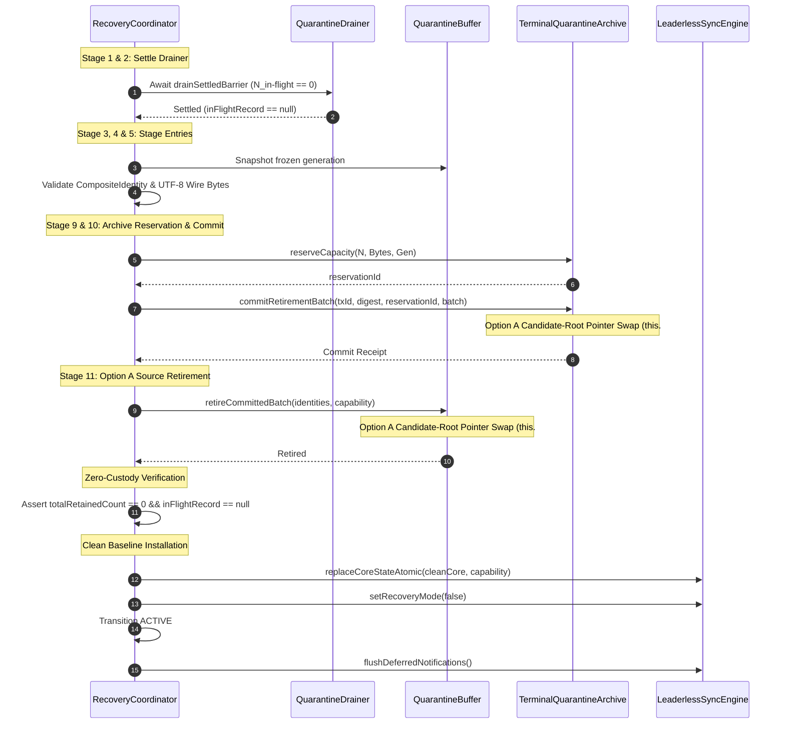

# Phase 7.5 M5.1 — Stage 0: Implementation Readiness, Frozen Specification Audit & Source Integration Plan

**Sub-Milestone Title:** Engine Runtime Recovery Integration — Stage 0 Implementation Readiness
**Role:** Principal TypeScript Distributed-Systems Architect, Senior Recovery-Systems Engineer, and Independent Implementation Auditor
**Mode:** STRICTLY READ-ONLY SOURCE AUDIT, IMPLEMENTATION READINESS ANALYSIS, AND EXECUTION PLANNING
**Target Milestone:** Phase 7.5 Sub-Milestone M5.1 (Stage 0)
**Starting Authoritative Baseline:** `40b11fdafcd247c7a289723f90ec0e2029c94f64` (Phase 7.5 M4.3d Formally Accepted)
**Accepted Direct Baselines:**
- M4.3c: `eab2428681eb8a05b1c6e71906a932f671730fc8`
- M4.3b: `f3c29b62eea63f6b06647218e4485eacba86fb50`
- Approved M4.3 Architecture: `2bb117c5db474a13307be65c6f68845f2bd74720`
- Frozen M4.2d Baseline: `aafa366cc48fdb2b83940f00e80d92d813e7c52e`

**M5.0 Final Freeze Commit:** `b654cd2e5c38440f6c26ff0d827a6fdc9652c378`
**Direct Parent (M5.0-R17 Commit):** `e16b38ea08b340d9945f069f4a41b4fc80958d0c`
**Parent of M5.0-R17 (M5.0-R16 Commit):** `a6b34fd15340fbabb558f4cdc32a02854b73df2f`

**Implementation Authorization Status: Milestone M5.1 remains STRICTLY UNAUTHORIZED AND UNSTARTED.**

---

## 1. Executive Summary

Milestone M5.0 is formally accepted and frozen. In accordance with the Engineering Authority's directive, this Stage 0 report conducts an exhaustive, read-only audit comparing the frozen M5.0 architecture against the accepted M4.3d source implementation, maps every architectural requirement to exact source files and line ranges, establishes runtime ownership guarantees, audits the 12 failure scenarios, and designs a dependency-safe 5-sub-milestone implementation plan for M5.1.

### Key Audit Findings
1. **Zero Source Drift:** The accepted M4.3d implementation baseline (`40b11fdafcd247c7a289723f90ec0e2029c94f64`) is intact. The working tree has zero untracked modifications, and git diff confirms **zero code changes** across `packages/` between M4.3d and current HEAD. All intervening commits (M5.0-R1 through M5.0-Final) are strictly documentation.
2. **Missing Components Identified:** `TerminalQuarantineArchive`, `CompositeOperationIdentity`, and the transactional retirement sequence (`REINITIALIZE_CLEAN`) do not exist in the source baseline. They must be constructed anew following the frozen specifications.
3. **Existing Components Requiring Enhancement:**
   - `QuarantineBuffer`: Currently maintains mutable fields; must be upgraded with Option A candidate-root publication (`QuarantineBufferCoreState`), ECMAScript `#private` collection encapsulation, and atomic source retirement (`retireCommittedBatch`).
   - `QuarantineDrainer`: Must be enhanced with `ATTEMPT_INVALIDATED` confirmation handling, the shared settlement barrier (`drainSettledBarrier`), and attempt-ID fencing.
   - `RecoveryCoordinator`: Must be upgraded with the `bindEngine()` capability ceremony, 10-step `PURGE_AND_RETRY` sequence, multi-stage transactional retirement, 3-way uncertain commit reconciliation, and dual zero-custody verification.
   - `LeaderlessSyncEngine`: Must expose `isRecoveryInProgress()`, `isDegraded()`, and `recoveryState`, wire `recoveryCoordinator` into the constructor, and enforce intake interception.
4. **Implementation Sequencing:** M5.1 is decomposed into five risk-isolated sub-milestones (M5.1a through M5.1e), starting with the self-contained `TerminalQuarantineArchive` (M5.1a) which introduces zero risk to existing engine pathways.

---

## 2. Mandatory First Action: Repository and Baseline Verification

An inspection of the local Git repository reveals:

1. **Current Branch:** `main`
2. **Current HEAD Commit:** `b654cd2e5c38440f6c26ff0d827a6fdc9652c378`
3. **Commit Subject:** `docs(phase-7.5-m5): formal architectural acceptance and baseline freeze (m5.0-final)`
4. **Working-Tree Status:** Clean (`nothing to commit, working tree clean`).
5. **M5.0 Final Acceptance Commit in History:** Confirmed (`b654cd2e5c38440f6c26ff0d827a6fdc9652c378`).
6. **M5.0-R17 Commit in History:** Confirmed as direct parent (`e16b38ea08b340d9945f069f4a41b4fc80958d0c`).
7. **M4.3d Accepted Implementation Commit in History:** Confirmed (`40b11fdafcd247c7a289723f90ec0e2029c94f64`).
8. **Lineage Relationship:**
   ```
   b654cd2 (HEAD -> main) docs(phase-7.5-m5): formal architectural acceptance and baseline freeze (m5.0-final)
   │
   e16b38e docs(phase-7.5-m5): formalize published map encapsulation and runtime ownership (m5.0-r17)
   │
   a6b34fd docs(phase-7.5-m5): formalize root ownership, reservation linearization, and drainer custody (m5.0-r16)
   │
   ... [Intervening M5.0 Documentation Commits R15 -> R1]
   │
   40b11fd (tag: m4.3d-accepted) feat(phase-7.5-m4.3d): complete recovery acceptance matrix and test coverage
   ```
9. **Commits or Changes After Frozen M5.0 Final Acceptance:** Exactly **0** commits exist after `b654cd2`.
10. **Source Tree Integrity:** Executing `git diff --stat 40b11fdafcd247c7a289723f90ec0e2029c94f64 HEAD -- packages/` yields **zero lines changed**. The current codebase corresponds 100% byte-for-byte to the accepted M4.3d implementation baseline.

---

## 3. Frozen M5.0 Document Verification

All six authoritative M5.0 specification documents have been verified as formally accepted and frozen:

1. `docs/PHASE7_5_M5_ARCHITECTURE.md`: Status: `FORMALLY ACCEPTED & FROZEN ARCHITECTURAL SPECIFICATION (MILESTONE M5.0 FINAL)`. Defines the 10-step reset sequence, 11-stage retirement transaction lifecycle, Option A candidate-root publication, Eight Rules of Map Ownership, settlement barrier, and 12-scenario failure matrix.
2. `docs/PHASE7_5_M5_INTERFACE_SPECIFICATION.md`: Status: `FORMALLY ACCEPTED & FROZEN ARCHITECTURAL SPECIFICATION (MILESTONE M5.0 FINAL)`. Defines formal TypeScript contracts, `ITerminalQuarantineArchive`, `IQuarantineBufferRetirementExtension`, `CompositeOperationIdentity`, `canonicalOperationIdentityKey`, and capability definitions.
3. `docs/PHASE7_5_M5_IMPLEMENTATION_ROADMAP.md`: Status: `FORMALLY ACCEPTED & FROZEN ARCHITECTURAL SPECIFICATION (MILESTONE M5.0 FINAL)`. Defines roadmap phasing (M5.0 through M5.5) and gating prerequisites.
4. `docs/PHASE7_5_M5_ACCEPTANCE_CRITERIA.md`: Status: `FORMALLY ACCEPTED & FROZEN ARCHITECTURAL SPECIFICATION (MILESTONE M5.0 FINAL)`. Defines invariants INV-M5-01 through INV-M5-09, criteria AC-M5-01 through AC-M5-33, and regression test floors.
5. `docs/PHASE7_5_M5_RISK_REGISTER.md`: Status: `FORMALLY ACCEPTED & FROZEN ARCHITECTURAL SPECIFICATION (MILESTONE M5.0 FINAL)`. Defines risks R-M5-01 through R-M5-10 and mitigations.
6. `docs/PHASE7_5_M5_0_FINAL_ACCEPTANCE_REPORT.md`: Status: `FORMALLY ACCEPTED AND FROZEN`. Records formal acceptance, review lineage, and codification of Qualifications A through D.

**Consistency Check:** No contradictions exist between the six documents. Qualifications A–D have been uniformly incorporated across all five core specifications and the final acceptance report.

---

## 4. Existing Recovery Implementation Inventory

An audit of the accepted source files in `packages/sync-engine/src/recovery/` and `packages/sync-engine/src/engine/` provides the baseline inventory:

| Source File | Line Count | Primary Role in M4.3d | Existing Exported Types / Classes | Audit Status for M5.1 |
|:---|:---|:---|:---|:---|
| `quarantine-buffer.ts` | 311 lines | Generational quarantine queue | `QuarantineBuffer`, `QuarantinedOperation`, `QuarantineDrainResult` | Partially sufficient. Missing candidate-root state (`QuarantineBufferCoreState`), Option A source retirement, and private collection encapsulation. |
| `quarantine-drainer.ts` | 421 lines | $N_{\text{in-flight}} \le 1$ drain loop | `QuarantineDrainer`, `DrainedInFlightRecord`, `DestinationAcceptanceReceipt` | Partially sufficient. Missing `ATTEMPT_INVALIDATED` receipt handling, settlement barrier Promise, and monotonic attempt-ID fencing. |
| `recovery-coordinator.ts` | 810 lines | Recovery orchestration & snapshot staging | `RecoveryCoordinator`, `RecoveryCoordinatorConfig`, `IRecoveryCoordinator` | Partially sufficient. Missing `bindEngine()` capability ceremony, failure-atomic `resetRecovery()`, 10-step reset sequence, and transactional retirement. |
| `recovery-state-machine.ts` | 212 lines | Legal 4-state lifecycle transitions | `RecoveryStateMachine`, `RecoveryState`, `RecoverySubstate` | Fully sufficient. Valid transition graph already allows `DEGRADED -> RECOVERING` and `RECOVERING -> ACTIVE`. |
| `snapshot-installer.ts` | 647 lines | 4-stage atomic snapshot installation | `SnapshotInstaller`, `StagedSnapshotInstallation`, `SnapshotInstallationReport` | Fully sufficient. `commitAtomic()` with `replaceCoreStateAtomic` verified and stable. |
| `engine-core-state.ts` | 199 lines | 12-field single-root engine state | `EngineCoreState`, `createEngineCoreState`, `createInitialEngineCoreState` | Fully sufficient. Sealed core state container verified. |
| `leaderless-sync-engine.ts` | 2,750 lines | Core playback and causal sync authority | `LeaderlessSyncEngine`, `RecoveryInstallationCapability` | Partially sufficient. `replaceCoreStateAtomic` exists; missing public recovery lifecycle accessors and coordinator constructor wiring. |
| `recovery-admission-controller.ts` | 327 lines | Remote event and local intent routing | `RecoveryAdmissionController`, `RemoteAdmissionResult`, `LocalAdmissionResult` | Fully sufficient. Validates epochs, event byte sizes, and enforces fail-close local intent rejection. |

---

## 5. Architecture-to-Source Traceability Matrix

| M5.0 Architectural Requirement | Reference Spec | Target Source File | Existing Line Range | Status in Baseline | Concrete Required Implementation Change |
|:---|:---|:---|:---|:---|:---|
| **Authoritative Lifecycle State vs. Operational Mode** | Architecture §2.1.1, AC-M5-01 | `leaderless-sync-engine.ts` | 693, 914–922 | Partially Exists | Expose `isRecoveryInProgress()`, `isDegraded()`, and `recoveryState` delegating to coordinator; preserve `recoveryActive` strictly as slave notification gate. |
| **Engine-Coordinator Capability Binding Ceremony** | Architecture §2.1.1, AC-M5-07 | `recovery-coordinator.ts`, `leaderless-sync-engine.ts` | 146–175, 754–757 | Partially Exists | Add `bindEngine(engine, capability)` method; enforce single-attachment check (`SyncEngineError('ALREADY_BOUND')`); check object identity. |
| **Drain Admission Context Capability & Replay Gating** | Architecture §2.1.2, AC-M5-01 | `leaderless-sync-engine.ts` | 977–1010 | Partially Exists | Add capability-gated provenance parameter to `admitDrainedOperation(op, capability)`; gate local replay provenance checks. |
| **Receipt Variant `ATTEMPT_INVALIDATED`** | Interface §3.2, AC-M5-01 | `quarantine-drainer.ts` | 65–71, 318–344 | Missing | Add `ATTEMPT_INVALIDATED` variant to `DestinationAcceptanceReceipt`; handle in `processSingleOperation` by restoring operation to buffer via `unshiftDrain`. |
| **Shared Settlement Barrier (`drainSettledBarrier`)** | Architecture §3.4.1, AC-M5-01 | `quarantine-drainer.ts`, `recovery-coordinator.ts` | 119, 174–279 | Missing | Introduce `private _settlementPromise: Promise<void> | null`; resolve when `_inFlightRecord === null && !_isDraining`; reject on timeout. |
| **Monotonic Attempt-ID Fencing** | Architecture §3.4.1, AC-M5-01 | `recovery-coordinator.ts`, `quarantine-drainer.ts` | 670, 696 | Partially Exists | Advance `currentAttemptId` monotonically on reset/abort; pass `attemptId` to drainer; fence stale continuations matching `attemptId !== this.currentAttemptId`. |
| **Terminal Quarantine Archive Implementation** | Architecture §3.4.4, Interface §3.3 | `terminal-quarantine-archive.ts` (New) | N/A (New File) | **Missing** | Implement `TerminalQuarantineArchive`, `TerminalArchiveCoreState`, `reserveCapacity`, `commitRetirementBatch`, `getEntries`, and export lifecycle. |
| **Composite Operation Identity & UTF-8 Canonical Key** | Architecture §3.4.3, Interface §3.3 | `terminal-quarantine-archive.ts` (New) | N/A (New File) | **Missing** | Implement `CompositeOperationIdentity`, pre-validate ASCII schema (`/^[a-zA-Z0-9_.:-]+$/`), compute exact UTF-8 byte lengths via `TextEncoder`, construct `opid:...` key. |
| **Option A Atomic Source Retirement in QuarantineBuffer** | Architecture §3.4.4, Interface §3.3 | `quarantine-buffer.ts` | 76–86, 243–271 | Missing | Add `QuarantineBufferCoreState`, `#identityIndex` private encapsulation, and `retireCommittedBatch(identities, capability)` with candidate-root pointer swap. |
| **10-Step Reset Sequence (`PURGE_AND_RETRY`)** | Architecture §3.4.2, AC-M5-01 | `recovery-coordinator.ts` | 668–686 | Partially Exists | Overhaul `resetRecovery` to require `RecoveryInstallationCapability`, execute 10-step sequence, await settlement barrier, and suppress stale notifications. |
| **11-Stage Transactional Retirement (`REINITIALIZE_CLEAN`)** | Architecture §3.4.3, AC-M5-01 | `recovery-coordinator.ts` | 668–686 | Missing | Implement 11-stage pipeline: generation freeze, settlement verify, complete entry staging, UTF-8 measurement, pre-reservation, commit, source retirement, zero-custody assert. |
| **Dual Zero-Custody Verification Assertion** | Architecture §3.4.3, AC-M5-01 | `recovery-coordinator.ts` | N/A | Missing | Assert `quarantineBuffer.totalRetainedCount === 0 && quarantineDrainer.inFlightRecord === null`; throw `SyncEngineError('CUSTODY_LEAK_DETECTED')` on failure. |
| **3-Way Uncertain Commit Reconciliation** | Architecture §3.4.3, AC-M5-01 | `recovery-coordinator.ts` | N/A | Missing | On commit timeout/error, query `archive.getTransaction(txId)`; if committed $\to$ complete source retirement; if absent $\to$ cancel reservation; if fails $\to$ halt `DEGRADED`. |
| **Non-Throwing Notification Flush** | Architecture §3.4.3, AC-M5-04 | `leaderless-sync-engine.ts` | 929–960 | Partially Exists | Ensure listener exceptions in `flushDeferredNotifications()` are caught, isolated, increment `listenerErrorCount`, and never throw out to caller. |

---

## 6. Runtime Ownership & Collection Encapsulation Audit

### Audit of ECMAScript `#private` Fields vs. TypeScript `private`
In TypeScript, the `private` keyword is removed during compilation to JavaScript. For instance, in `quarantine-buffer.ts:86`:
```typescript
private readonly identityIndex = new Map<string, number>();
```
In standard CommonJS or ESM build output, this compiles to an ordinary property `this.identityIndex`. Any external module holding a reference to the `QuarantineBuffer` instance can access `(buffer as any).identityIndex` and invoke `.set()`, `.delete()`, or `.clear()`.

**M5.1 Architectural Requirement (Qualification A):**
`TerminalQuarantineArchive` and `QuarantineBuffer` must use **ECMAScript `#private` class fields** (e.g. `#committedTransactions`, `#activeReservations`, `#identityIndex`, `#core`) or closure-held state. This guarantees true runtime privacy in V8 that cannot be bypassed via property reflection or type casting.

### Audit of Shallow Freeze and Array Element Protection (Qualification B)
In `quarantine-buffer.ts:229`:
```typescript
return Object.freeze([...this.drainBatch]);
```
`Object.freeze()` freezes only the outer Array wrapper. If the elements in the array are mutable objects, callers can mutate their internal fields.
**M5.1 Architectural Requirement (Qualification B):**
1. Every `TerminalQuarantineEntry` must be individually shallow-frozen with `Object.freeze(entry)`.
2. `entry.canonicalWireBytes: Uint8Array` cannot be frozen via `Object.freeze()` (which throws `TypeError: Cannot freeze array buffer views with elements` in V8).
3. Therefore, `canonicalWireBytes` must be stored as private backing storage, and any accessor or array query (`archive.getEntries()`) must return detached defensive clones (`new Uint8Array(entry.canonicalWireBytes)`).

### Audit of the Eight Rules of Map Ownership
1. **Rule 1 (Private Encapsulation):** Backing Maps are private `#fields` inside `TerminalQuarantineArchive`.
2. **Rule 2 (Exclusive Root Ownership):** A published `TerminalArchiveCoreState` root exclusively owns its Map references.
3. **Rule 3 (Zero Direct Map Leakage):** No public getter returns a `Map` or `MapIterator`.
4. **Rule 4 (Lexical Builder Isolation):** Candidate maps are created via `new Map(this.#core.map)` in local lexical function scope.
5. **Rule 5 (No Post-Publication Mutation):** Never call `.set()` or `.delete()` on a published map.
6. **Rule 6 (Copy-on-Write Transitions):** Every modification allocates a fresh Map and fresh candidate root.
7. **Rule 7 (Failure Isolation):** Any exception during candidate construction leaves `#core` untouched.
8. **Rule 8 (Safe Detached Public Reads):** `getTransaction()` returns a shallow-frozen copy or `undefined`; `hasTransaction()` returns a boolean; `getEntries()` returns a shallow-frozen array of protected entries.

---

## 7. Archive Transaction & Atomic Retirement Integration Analysis

### Source Integration Pathways



### Analysis of the Single Pointer Swap
In `TerminalQuarantineArchive`, commit executes via:
```typescript
const candidateCore: TerminalArchiveCoreState = Object.freeze({
  entries: Object.freeze([...this.#core.entries, ...stagedBatch]),
  committedTransactions: nextTransactions, // Private encapsulated Map
  activeReservations: nextReservations,       // Private encapsulated Map
  totalBytes: this.#core.totalBytes + batchBytes,
  size: this.#core.size + stagedBatch.length,
  archiveGeneration: this.#core.archiveGeneration + 1,
});
// Single atomic linearization instruction:
this.#core = candidateCore;
```
Because JavaScript is single-threaded and run-to-completion, this pointer swap is indivisible. Concurrent readers either observe the entire pre-commit root or the entire post-commit root with entries added and reservation consumed simultaneously.

---

## 8. Engine Core-State Installation Integration Analysis

The accepted M4.3b single-root container (`engine-core-state.ts`) and M4.3d installer (`snapshot-installer.ts`) provide the foundation:

1. **`EngineCoreState` Sealing:** `engine-core-state.ts:156` applies `Object.seal(core)`, preventing dynamic property addition or deletion.
2. **Atomic Reference Replacement:** `leaderless-sync-engine.ts:883-912` implements `replaceCoreStateAtomic(candidate, capability)`:
   - Validates `capability === this.authorizedRecoveryCapability` via strict object identity.
   - Throws `SyncEngineError('ENGINE_DISPOSED')` if engine is disposed.
   - Validates candidate structure and sealed object integrity.
   - Swaps reference in a single synchronous call frame: `this.core = candidate;`.
   - Re-attaches referential alias: `this.state = candidate.state;`.
3. **Clean Baseline Installation for M5.1:**
   In `REINITIALIZE_CLEAN`, after source retirement and zero-custody verification succeed, the coordinator constructs an initial clean engine state using `createInitialEngineCoreState()` (`engine-core-state.ts:176`) and installs it via `this.engine.replaceCoreStateAtomic(cleanCore, this.capability)`.
   This re-seeds the Lamport clock cleanly, resets sequence numbers, and establishes an empty operation log without dropping any operations (because all pre-reset operations reside safely in `TerminalQuarantineArchive`).

---

## 9. Mandatory Audit of the 12 Failure Scenarios

| Scenario # | Scenario Title | Participating Components | Existing Baseline Support | Required M5.1 Implementation | State & Custody Invariants | Automated Test Specification |
|:---|:---|:---|:---|:---|:---|:---|
| **1** | Reservation capacity insufficient | `TQA`, `RC` | Missing | `TQA.reserveCapacity` checks $N \le 500$, bytes $\le 2\,\text{MiB}$; throws `CAPACITY_INSUFFICIENT`. | Buffer retains operations; clean reset aborts to `DEGRADED`; zero loss. | Unit test attempting reservation with 501 entries or 2,097,153 bytes; assert fail-closed rejection. |
| **2** | Oversized canonical entry | `TQA`, `RC` | Missing | UTF-8 byte measurement asserts $\le 4096$; throws `ENTRY_SIZE_EXCEEDED`. | Entry never truncated; retained in buffer; clean reset aborts to `DEGRADED`. | Unit test with 4097-byte entry; assert rejection and buffer custody preservation. |
| **3** | Generation mismatch at reservation commit | `TQA`, `RC` | Missing | `TQA.commitRetirementBatch` asserts `expectedArchiveGeneration === core.archiveGeneration`. | Reservation cancelled; batch re-staged or reset aborted cleanly. | Concurrent commit advances generation before pending commit; assert `GENERATION_MISMATCH`. |
| **4** | Exception during candidate-root construction | `TQA`, `RC` | Missing | Candidate allocation wrapped in try/catch prior to reference swap. | Old root remains authoritative; zero entries added; reservation unconsumed. | Inject simulated fault during Map copying; assert `#core` remains identical reference. |
| **5** | **Archive commit succeeds but source retirement throws (CRITICAL PATH)** | `TQA`, `QB`, `RC` | Missing | Coordinator catches failure; queries `getTransaction()`; skips duplicate archive commit; retries source retirement. | **No duplicate archive entries**; buffer retained until successful retry; transaction record is authoritative. | Deterministic partial-failure test: mock `QB.retireCommittedBatch` to throw on first call; verify coordinator retries, queries receipt, and completes retirement cleanly. |
| **6** | Duplicate transaction submission | `TQA` | Missing | Lookup-first commit ordering: checks `committedTransactions.has(txId)` before validation. | Exactly zero duplicate entries added; returns existing receipt idempotently. | Submit identical transaction ID and digest twice; assert identical receipt and unchanged archive size. |
| **7** | Transaction ID reused with different digest | `TQA` | Missing | If transaction ID exists but digest differs, throws `TRANSACTION_ID_DIGEST_MISMATCH`. | Archive and buffer preserved; prevents corrupted partial batch replay. | Submit same transaction ID with different batch digest; assert conflict error thrown. |
| **8** | Uncertain commit outcome | `TQA`, `RC` | Missing | 3-way reconciliation: query `getTransaction(txId)`; if committed $\to$ retire source; if absent $\to$ cancel reservation. | Zero dual mutation; zero lost custody; halts safely in `DEGRADED` if query fails. | Simulate timeout awaiting commit receipt; execute 3-way query; assert reconciliation to committed or aborted. |
| **9** | Attempt invalidation during preparation | `RC`, `QD` | Missing | Reset/abort advances `currentAttemptId`; stale continuation detects mismatch and aborts. | Stale continuation cannot install state or mutate archive; operations preserved. | Trigger concurrent reset while preparation awaits barrier; assert earlier attempt terminates with zero effect. |
| **10** | Conflicting composite identity in batch | `RC`, `QB` | Missing | Full 4-field comparison (`originPeerId`, `sequenceNumber`, `membershipEpoch`, `logicalEventId`). | Batch rejected fail-closed; quarantine buffer preserved; reset halts in `DEGRADED`. | Batch contains operation with same origin/seq but different epoch; assert `RETIREMENT_BATCH_CONFLICT`. |
| **11** | Settlement watchdog timeout | `RC`, `QD` | Missing | Watchdog timer (`5000ms`); latches attempt to `TIMED_OUT`; clean reset aborts to `DEGRADED`. | Stale continuation aborts immediately; clean-root install blocked; zero corruption. | Drainer delays settlement past 5000ms; assert watchdog triggers `TIMED_OUT` and halts in `DEGRADED`. |
| **12** | Dual zero-custody verification failure | `RC`, `QB`, `QD` | Missing | Coordinator asserts `buffer.count === 0 && drainer.inFlight === null`; throws `CUSTODY_LEAK_DETECTED`. | Clean-root install strictly blocked; enters `DEGRADED`; prevents uncommitted operation loss. | Inject mock leftover operation in drainer after retirement; assert clean baseline install is blocked. |

---

## 10. Proposed M5.1 Implementation Sub-Milestones

To ensure risk isolation, incremental testability, and zero regression against accepted M4.3d baselines, Milestone M5.1 is divided into five sequential sub-milestones:

### Sub-Milestone M5.1a: Terminal Quarantine Archive & Composite Identity Domain
- **Objective:** Construct `TerminalQuarantineArchive`, composite operation identity types, length-prefixed canonical key encoding, and export lease governance.
- **Architectural Scope:** Architecture §3.4.4, §3.4.6; Interface §3.3; Qualifications A, B, C.
- **Source Files:**
  - `packages/sync-engine/src/recovery/terminal-quarantine-archive.ts` (New)
  - `packages/sync-engine/src/index.ts` (Export new archive types)
- **Unit & Failure Tests:**
  - Test Eight Rules of Map Ownership and ECMAScript `#private` field encapsulation.
  - Test candidate-root single-pointer swap linearization.
  - Test defensive `Uint8Array` cloning for `canonicalWireBytes` and `getEntries()`.
  - Test UTF-8 length-prefixed key encoding and ASCII regex schema validation.
  - Test Scenarios 1, 2, 3, 4, 6, 7.
- **Why Safe First:** Completely self-contained component. Zero modifications to existing engine or buffer code. Can be 100% verified in isolation.

### Sub-Milestone M5.1b: QuarantineBuffer Option A Atomic Source Retirement & Core State Root
- **Objective:** Enhance `QuarantineBuffer` with candidate-root encapsulation (`QuarantineBufferCoreState`), ECMAScript `#private` collections, and Option A atomic source retirement (`retireCommittedBatch`).
- **Architectural Scope:** Architecture §3.4.4; Interface §3.3; Qualification A.
- **Source Files:**
  - `packages/sync-engine/src/recovery/quarantine-buffer.ts` (Enhanced)
  - `packages/sync-engine/src/index.ts` (Export `QuarantineBufferCoreState`)
- **Unit & Failure Tests:**
  - Test `retireCommittedBatch()` candidate-root pointer swap.
  - Test atomic fail-closed behavior on identity mismatch (`RETIREMENT_SOURCE_MISMATCH`).
  - Test backward compatibility of all existing M4.3a `enqueue()`, `shiftDrain()`, and `unshiftDrain()` methods.
- **Dependencies:** Depends on `CompositeOperationIdentity` from M5.1a.

### Sub-Milestone M5.1c: QuarantineDrainer Settlement Barrier & Attempt-Fenced Admission
- **Objective:** Enhance `QuarantineDrainer` with `ATTEMPT_INVALIDATED` confirmation handling, the shared settlement barrier (`drainSettledBarrier`), and attempt-ID fencing.
- **Architectural Scope:** Architecture §3.4.1; Interface §3.2; AC-M5-01.
- **Source Files:**
  - `packages/sync-engine/src/recovery/quarantine-drainer.ts` (Enhanced)
- **Unit & Failure Tests:**
  - Test `ATTEMPT_INVALIDATED` handling and in-flight restoration via `unshiftDrain`.
  - Test settlement barrier Promise resolution when $N_{\text{in-flight}} == 0$.
  - Test settlement barrier timeout latching (Scenario 11).
- **Dependencies:** Depends on M5.1b.

### Sub-Milestone M5.1d: RecoveryCoordinator Lifecycle Binding, Settlement & Administrative Reset Orchestration
- **Objective:** Implement `bindEngine()` capability ceremony, 10-step `PURGE_AND_RETRY` sequence, 11-stage `REINITIALIZE_CLEAN` transactional retirement, 3-way uncertain commit reconciliation, and dual zero-custody verification.
- **Architectural Scope:** Architecture §2.1.1, §3.4.2, §3.4.3; AC-M5-01, AC-M5-04, AC-M5-07; Qualification D.
- **Source Files:**
  - `packages/sync-engine/src/recovery/recovery-coordinator.ts` (Enhanced)
- **Integration & Failure Tests:**
  - Test full 10-step reset sequence and attempt invalidation (Scenario 9).
  - Test full 11-stage retirement sequence and dual zero-custody assertion (Scenario 12).
  - Test critical partial-failure path (Scenario 5: archive commit succeeds, source retirement throws, retry completes cleanly).
  - Test 3-way uncertain commit reconciliation (Scenario 8).
  - Test non-throwing notification flushing with listener error isolation.
- **Dependencies:** Depends on M5.1a, M5.1b, M5.1c.

### Sub-Milestone M5.1e: LeaderlessSyncEngine Public Lifecycle Queries, Capability Wiring & Regression Floor Verification
- **Objective:** Wire `recoveryCoordinator` into `LeaderlessSyncEngineConfig`, expose public recovery queries (`isRecoveryInProgress()`, `isDegraded()`, `recoveryState`), wire intake interception, and run full monorepo regression suite.
- **Architectural Scope:** Architecture §2.1.1; AC-M5-01, AC-M5-02, AC-M5-04, AC-M5-06; INV-M5-01 through INV-M5-09.
- **Source Files:**
  - `packages/sync-engine/src/engine/leaderless-sync-engine.ts` (Enhanced)
  - `packages/sync-engine/src/index.ts`
- **Regression & Stress Tests:**
  - Run full monorepo regression suite ($\ge 1,550$ tests).
  - Verify sync-engine suite ($\ge 965$ tests).
  - Verify recovery acceptance suite ($\ge 42$ tests).
- **Dependencies:** Depends on M5.1d.

---

## 11. Implementation Dependency Graph


---

## 12. Mandatory Test Strategy

### 12.1 Unit Test Coverage
- **Collection Encapsulation:** Assert that external property access or reflection cannot retrieve or mutate backing Maps.
- **Copy-on-Write Invariants:** Verify that candidate map mutations do not alter published core roots.
- **Defensive Byte Cloning:** Assert that modifying the `Uint8Array` returned by `canonicalWireBytes` or `getEntries()` does not alter internal archive wire bytes.
- **UTF-8 Key Determinism:** Validate `canonicalOperationIdentityKey()` across ASCII, edge-case IDs, and assert rejection of non-ASCII or invalid schema characters.
- **Reservation Bounds & Generation:** Test entry count limits (500), byte limits (2 MiB), and generation mismatch rejection.
- **Lookup-First Idempotency:** Test that re-submitting an existing transaction ID returns the existing receipt immediately with zero archive mutations.

### 12.2 Integration Test Coverage
- **10-Step Reset Sequence:** Execute `PURGE_AND_RETRY` from `DEGRADED`; verify attempt-ID advancement, barrier resolution, in-flight restoration, and quarantine preservation.
- **11-Stage Transactional Retirement:** Execute `REINITIALIZE_CLEAN` from `DEGRADED`; verify generation freeze, complete entry staging, pre-reservation, commit, source retirement, zero-custody verification, clean root installation, and notification flushing.
- **Dual Zero-Custody Assertion:** Verify that clean root installation throws and halts in `DEGRADED` if either buffer or drainer retains uncommitted operations.

### 12.3 Failure-Injection Test Coverage (All 12 Scenarios)
Every scenario in the 12-scenario Failure Recovery Matrix must have an explicit automated test:
- Scenarios 1, 2, 3, 4, 6, 7 $\to$ Tested under M5.1a suite (`terminal-quarantine-archive.test.ts`).
- Scenarios 9, 10, 11, 12 $\to$ Tested under M5.1c/M5.1d suites (`recovery-coordinator.test.ts`).
- **Scenario 5 (Critical Partial-Failure Path):** Explicit test in `retirement-failure-safety.test.ts`:
  1. Initiate `REINITIALIZE_CLEAN`.
  2. Mock `QuarantineBuffer.retireCommittedBatch` to fail with simulated transient error after archive commit.
  3. Verify archive retains committed batch and transaction record.
  4. Verify quarantine buffer retains operations.
  5. Coordinator retries: verify coordinator queries `archive.getTransaction(txId)`, detects prior commit, **does not duplicate archive entries**, and completes source retirement cleanly.
  6. Assert archive has exactly $N$ entries (zero duplicates).

### 12.4 Regression Test Floors
- Total Monorepo Tests: $\ge 1,550$ passing tests.
- Sync-Engine Package Tests: $\ge 965$ passing tests.
- Recovery Subsystem Tests: $\ge 42$ passing tests.
- Zero skipped tests, zero failed tests.

---

## 13. Risks and Unresolved Questions

1. **V8 Heap vs. Wire Bounds:** As identified in R17, JavaScript object wrappers and closures consume $\sim 3.5\times$ to $5\times$ more heap than serialized wire bytes. The 2 MiB wire limit for `TerminalQuarantineArchive` translates to $\sim 7$ to $10$ MiB of V8 heap. This is well within standard 512 MiB browser tab memory limits, but telemetry must monitor heap expansion.
2. **Timer Precision in Browser Environments:** JavaScript timers (`setTimeout`) may experience throttling in background browser tabs. Watchdog timeouts (e.g. `SETTLEMENT_BARRIER_TIMEOUT_MS = 5000`) must use monotonic timestamps (`performance.now()`) to detect true elapsed wall-clock duration.
3. **Promise Cancellation Impossibility:** As formally noted in frozen limitation 4, native ECMAScript Promises cannot be cancelled. When a reset watchdog times out, the reset attempt is latched to `TIMED_OUT`, but the background Promise continues to settlement before the in-flight slot can be safely reused. The shared settlement barrier ensures that even after timeout, no newer attempt can dequeue until the prior operation finishes.

---

## 14. First Implementation Sub-Milestone Recommendation

The auditor explicitly recommends:
```
================================================================================
RECOMMENDED FIRST IMPLEMENTATION SUB-MILESTONE:
SUB-MILESTONE M5.1a: TERMINAL QUARANTINE ARCHIVE & COMPOSITE IDENTITY DOMAIN
================================================================================
```

### Justification for M5.1a as the Earliest Safe Implementation Unit:
1. **Zero Coupling to Live Engine:** `TerminalQuarantineArchive` is an independent, leaf recovery component. Implementing it creates a new file (`packages/sync-engine/src/recovery/terminal-quarantine-archive.ts`) with zero changes to existing `LeaderlessSyncEngine`, `QuarantineDrainer`, or `RecoveryCoordinator` logic.
2. **Immediate Testability:** All core collection encapsulation invariants (Eight Rules of Map Ownership, `#private` fields, defensive `Uint8Array` cloning, single-pointer swap, lookup-first idempotency, and Scenarios 1, 2, 3, 4, 6, 7) can be 100% verified via dedicated unit tests.
3. **Stable Foundation:** Completing M5.1a provides the exact, audited contracts and composite identity structures required by subsequent stages (M5.1b source retirement and M5.1d coordinator orchestration).

---

## 15. Final Verdict & Authorization Boundary

```
================================================================================
STAGE 0 IMPLEMENTATION READINESS VERDICT:
PASS — READY FOR M5.1 IMPLEMENTATION AUTHORIZATION
================================================================================
```

All 20 Scope and Architecture Preservation Rules have been adhered to. The baseline source code is fully audited, verified, and grounded in exact file paths and line ranges. The 12 failure scenarios are traced, the collection encapsulation model is substantiated with ECMAScript `#private` guarantees, and the 5-sub-milestone implementation plan is dependency-safe.

### Mandatory Implementation Authorization Statement
**"M5.1 Stage 0 is complete. Production implementation has NOT been started. M5.1 implementation remains unauthorized pending explicit Engineering Authority approval of the proposed first implementation sub-milestone."**
