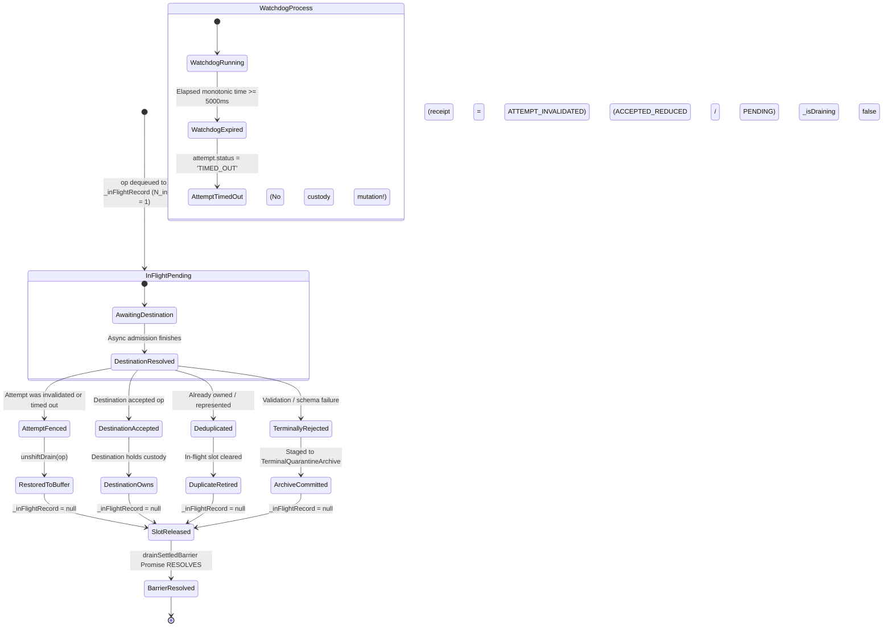
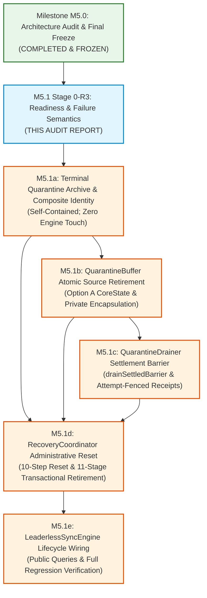

# Phase 7.5 M5.1 — Stage 0-R3: Implementation Readiness, Reset Arbitration Authority & Custody Reconciliation Failure Semantics

**Sub-Milestone Title:** Engine Runtime Recovery Integration — Stage 0-R3 Implementation Readiness
**Role:** Principal TypeScript Distributed-Systems Architect, Senior Recovery-Systems Engineer, and Independent Implementation Auditor
**Mode:** STRICTLY READ-ONLY SOURCE AUDIT, IMPLEMENTATION READINESS ANALYSIS, AND EXECUTION PLANNING
**Target Milestone:** Phase 7.5 Sub-Milestone M5.1 (Stage 0-R3 Correction)
**Revision:** Stage 0-R3 (Reset Arbitration Authority & Custody Reconciliation Failure Semantics)
**Starting Baseline Commit:** `5dbb87826c1655e27205af22b88d4479f88518fe` (Stage 0-R2 Commit)
**Authoritative Historical Baselines:**
- Stage 0-R2 Commit: `5dbb87826c1655e27205af22b88d4479f88518fe`
- Stage 0-R1 Commit: `3cbf60c113e1760ad58388baab0005ecdbf0a73e`
- Initial Stage 0 Commit: `260647707edbdc0b0faa78b05cf870424330583e`
- M5.0 Final Freeze Commit: `b654cd2e5c38440f6c26ff0d827a6fdc9652c378`
- M5.0-R17 Commit: `e16b38ea08b340d9945f069f4a41b4fc80958d0c`
- Formally Accepted M4.3d Baseline: `40b11fdafcd247c7a289723f90ec0e2029c94f64`
- M4.3c Baseline: `eab2428681eb8a05b1c6e71906a932f671730fc8`
- M4.3b Baseline: `f3c29b62eea63f6b06647218e4485eacba86fb50`
- Approved M4.3 Architecture: `2bb117c5db474a13307be65c6f68845f2bd74720`
- Frozen M4.2d Baseline: `aafa366cc48fdb2b83940f00e80d92d813e7c52e`

**Implementation Authorization Status: Milestone M5.1 remains STRICTLY UNAUTHORIZED AND UNSTARTED.**

---

## 1. Executive Summary & R3 Audit Findings

Milestone M5.0 is formally accepted and frozen. Following the Stage 0-R2 review, this Stage 0-R3 report investigates the exact architectural authority for concurrent reset arbitration and defines complete failure-safe custody reconciliation semantics:

1. **Reset Arbitration Authority Audit (§6.4, §12.2 Scenario F, §13):**
   - An audit of frozen M5.0 specifications reveals that while `PHASE7_5_M5_INTERFACE_SPECIFICATION.md:423-424` and `PHASE7_5_M5_0_R9_CORRECTION_REPORT.md:40-75` specify concurrent reset serialization for homogeneous reset requests (where later attempts re-validate `attemptId === currentAttemptId` post-settlement), frozen M5.0 **does NOT define an arbitration policy for concurrent resets of differing actions** (`REINITIALIZE_CLEAN` vs. `PURGE_AND_RETRY`).
   - Furthermore, frozen Interface Specification Table line 1046 mandates that `resetRecovery()` throws `SyncEngineError('INVALID_STATE')` if invoked from a non-`DEGRADED` state. Because Step 3 of administrative reset transitions the coordinator to `RECOVERING`, any subsequent concurrent reset arriving before settlement faces an unresolved contradiction: does it throw `INVALID_STATE`, or does it advance `currentAttemptId` and supersede?
   - Therefore, Scenario F is corrected: the shared settlement barrier invariant is preserved, but cross-mode reset arbitration is formally identified as an **unresolved architectural gap and implementation-readiness blocker**.
2. **Receipt Schema Verification (§12.6):**
   - Audited the exact contract of `DestinationAcceptanceReceipt` across `quarantine-drainer.ts:65-72` (M4.3d source) and `PHASE7_5_M5_INTERFACE_SPECIFICATION.md:313-320` (M5.0 frozen).
   - In M5.0, `ATTEMPT_INVALIDATED` is a typed variant defined strictly as:
     `{ readonly status: 'ATTEMPT_INVALIDATED'; readonly vectorAdvanced: false; readonly attemptId: number; readonly reason: 'STALE_ATTEMPT_FENCED' | 'COORDINATOR_NOT_RECONCILING' }`.
   - The R2 example snippet inadvertently omitted `vectorAdvanced: false`; this is now formally corrected.
   - Crucially, attempt fencing is independently established inside the drainer via `_inFlightRecord.invalidated = true` (latched by `coordinator.fenceActiveDrain()`), meaning attempt fencing does not rely solely on untrusted external receipts.
3. **Comprehensive Custody Reconciliation Failure Matrix (§12.3):**
   - Formally defined fail-close custody behavior for every receipt variant when restoration, archive publication, or destination admission encounters an exception or inconclusive outcome.
   - In all failure modes: drainer custody is retained ($N_{\text{in-flight}} = 1$), in-flight slot is NOT cleared, barrier remains pending, and coordinator transitions to `DEGRADED`.
4. **Settlement Barrier Failure Semantics & Eight Distinct Settlement Outcomes (§12.4):**
   - Formally decoupled actual Promise settlement from custody disposition. The barrier resolves **only** after drainer custody has been safely reconciled.
   - Distinctly specified eight operational outcomes covering destination rejection, reconciliation exceptions, archive commit confirmations, commit absences, inconclusive queries, and idempotent retries.
5. **Deterministic Failure Test Suite (§12.5):**
   - Extended the deterministic test plan with eight controlled failure-injection scenarios verifying that no operations are lost, duplicated, or prematurely released.
6. **Readiness Verdict (§15):**
   - Because the frozen architecture does not define cross-mode reset arbitration, the readiness verdict is declared as **`BLOCKED — FROZEN ARCHITECTURE DOES NOT ESTABLISH A REQUIRED RECOVERY RULE`**.

---

## 2. Mandatory First Action: Repository and Baseline Verification

An inspection of the local Git repository reveals:

1. **Current Branch:** `main`
2. **Starting Baseline Commit for R3:** `5dbb87826c1655e27205af22b88d4479f88518fe` (Stage 0-R2 Commit)
3. **Working-Tree Status:** Clean (`nothing to commit, working tree clean`).
4. **Stage 0-R2 Commit in History:** Confirmed (`5dbb87826c1655e27205af22b88d4479f88518fe`).
5. **Stage 0-R1 Commit in History:** Confirmed (`3cbf60c113e1760ad58388baab0005ecdbf0a73e`).
6. **Initial Stage 0 Commit in History:** Confirmed (`260647707edbdc0b0faa78b05cf870424330583e`).
7. **M5.0 Final Acceptance Commit in History:** Confirmed (`b654cd2e5c38440f6c26ff0d827a6fdc9652c378`).
8. **Lineage Relationship:**
   ```
   5dbb878 (Stage 0-R2) docs(phase-7.5-m5.1): stage 0-r2 settlement barrier test completeness and late-continuation fencing
   │
   3cbf60c (Stage 0-R1) docs(phase-7.5-m5.1): stage 0-r1 settlement barrier semantics and watchdog separation correction
   │
   2606477 (Initial Stage 0) docs(phase-7.5-m5.1): stage 0 implementation readiness and source integration plan
   │
   b654cd2 (M5.0 Final Freeze) docs(phase-7.5-m5): formal architectural acceptance and baseline freeze (m5.0-final)
   │
   e16b38e (M5.0-R17) docs(phase-7.5-m5): formalize published map encapsulation and runtime ownership (m5.0-r17)
   │
   ... [Intervening M5.0 Documentation Commits R16 -> R1]
   │
   40b11fd (tag: m4.3d-accepted) feat(phase-7.5-m4.3d): complete recovery acceptance matrix and test coverage
   ```
9. **Source Tree Integrity:** Executing `git diff --stat 40b11fdafcd247c7a289723f90ec0e2029c94f64 HEAD -- packages/` yields **zero lines changed**. The current codebase corresponds 100% byte-for-byte to the accepted M4.3d implementation baseline.

---

## 3. Frozen M5.0 Document Verification

All six authoritative M5.0 specification documents remain formally accepted and frozen:

1. `docs/PHASE7_5_M5_ARCHITECTURE.md`: Status: `FORMALLY ACCEPTED & FROZEN ARCHITECTURAL SPECIFICATION (MILESTONE M5.0 FINAL)`. Defines the 10-step reset sequence, 11-stage retirement transaction lifecycle, Option A candidate-root publication, Eight Rules of Map Ownership, settlement barrier, and 12-scenario failure matrix.
2. `docs/PHASE7_5_M5_INTERFACE_SPECIFICATION.md`: Status: `FORMALLY ACCEPTED & FROZEN ARCHITECTURAL SPECIFICATION (MILESTONE M5.0 FINAL)`. Defines formal TypeScript contracts, `ITerminalQuarantineArchive`, `IQuarantineBufferRetirementExtension`, `CompositeOperationIdentity`, `canonicalOperationIdentityKey`, and capability definitions.
3. `docs/PHASE7_5_M5_IMPLEMENTATION_ROADMAP.md`: Status: `FORMALLY ACCEPTED & FROZEN ARCHITECTURAL SPECIFICATION (MILESTONE M5.0 FINAL)`. Defines roadmap phasing (M5.0 through M5.5) and gating prerequisites.
4. `docs/PHASE7_5_M5_ACCEPTANCE_CRITERIA.md`: Status: `FORMALLY ACCEPTED & FROZEN ARCHITECTURAL SPECIFICATION (MILESTONE M5.0 FINAL)`. Defines invariants INV-M5-01 through INV-M5-09, criteria AC-M5-01 through AC-M5-33, and regression test floors.
5. `docs/PHASE7_5_M5_RISK_REGISTER.md`: Status: `FORMALLY ACCEPTED & FROZEN ARCHITECTURAL SPECIFICATION (MILESTONE M5.0 FINAL)`. Defines risks R-M5-01 through R-M5-10 and mitigations.
6. `docs/PHASE7_5_M5_0_FINAL_ACCEPTANCE_REPORT.md`: Status: `FORMALLY ACCEPTED AND FROZEN`. Records formal acceptance, review lineage, and codification of Qualifications A through D.

---

## 4. Existing Recovery Implementation Inventory

The accepted source files in `packages/sync-engine/src/recovery/` and `packages/sync-engine/src/engine/` were audited:

| Source File | Line Count | Existing Role in M4.3d | Existing Classes / Types | Audit Status for M5.1 |
|:---|:---|:---|:---|:---|
| `quarantine-buffer.ts` | 311 lines | Generational quarantine queue | `QuarantineBuffer`, `QuarantinedOperation`, `QuarantineDrainResult` | Partially sufficient. Missing candidate-root state (`QuarantineBufferCoreState`), Option A source retirement, and private collection encapsulation. |
| `quarantine-drainer.ts` | 421 lines | $N_{\text{in-flight}} \le 1$ drain loop | `QuarantineDrainer`, `DrainedInFlightRecord`, `DestinationAcceptanceReceipt` | Partially sufficient. Missing `ATTEMPT_INVALIDATED` receipt handling, settlement barrier Promise, and monotonic attempt-ID fencing. |
| `recovery-coordinator.ts` | 810 lines | Recovery orchestration & snapshot staging | `RecoveryCoordinator`, `RecoveryCoordinatorConfig`, `IRecoveryCoordinator` | Partially sufficient. Missing `bindEngine()` capability ceremony, failure-atomic `resetRecovery()`, 10-step reset sequence, and transactional retirement. |
| `recovery-state-machine.ts` | 212 lines | Legal 4-state lifecycle transitions | `RecoveryStateMachine`, `RecoveryState`, `RecoverySubstate` | Fully sufficient. Valid transition graph already allows `DEGRADED -> RECOVERING` and `RECOVERING -> ACTIVE`. |
| `snapshot-installer.ts` | 647 lines | 4-stage atomic snapshot installation | `SnapshotInstaller`, `StagedSnapshotInstallation`, `SnapshotInstallationReport` | Fully sufficient. `commitAtomic()` with `replaceCoreStateAtomic` verified and stable. |
| `engine-core-state.ts` | 199 lines | 12-field single-root engine state | `EngineCoreState`, `createEngineCoreState`, `createInitialEngineCoreState` | Fully sufficient. Sealed core state container verified. |
| `leaderless-sync-engine.ts` | 2,750 lines | Core playback and causal sync authority | `LeaderlessSyncEngine`, `RecoveryInstallationCapability` | Partially sufficient. `replaceCoreStateAtomic` exists; missing public recovery lifecycle accessors and coordinator constructor wiring. |
| `recovery-admission-controller.ts` | 327 lines | Remote event and local intent routing | `RecoveryAdmissionController`, `RemoteAdmissionResult`, `LocalAdmissionResult` | Fully sufficient. Validates epochs, event byte sizes, and enforces fail-close local intent rejection. |

---

## 5. Architecture-to-Source Traceability Matrix & Settlement Semantics

| M5.0 Architectural Requirement | Reference Spec | Target Source File | Existing Line Range | Status in Baseline | Concrete Required Implementation Change |
|:---|:---|:---|:---|:---|:---|
| **Authoritative Lifecycle State vs. Operational Mode** | Architecture §2.1.1, AC-M5-01 | `leaderless-sync-engine.ts` | 693, 914–922 | Partially Exists | Expose `isRecoveryInProgress()`, `isDegraded()`, and `recoveryState` delegating to coordinator; preserve `recoveryActive` strictly as slave notification gate. |
| **Engine-Coordinator Capability Binding Ceremony** | Architecture §2.1.1, AC-M5-07 | `recovery-coordinator.ts`, `leaderless-sync-engine.ts` | 146–175, 754–757 | Partially Exists | Add `bindEngine(engine, capability)` method; enforce single-attachment check (`SyncEngineError('ALREADY_BOUND')`); check object identity. |
| **Drain Admission Context Capability & Replay Gating** | Architecture §2.1.2, AC-M5-01 | `leaderless-sync-engine.ts` | 977–1010 | Partially Exists | Add capability-gated provenance parameter to `admitDrainedOperation(op, capability)`; gate local replay provenance checks. |
| **Receipt Variant `ATTEMPT_INVALIDATED`** | Interface §3.2, AC-M5-01 | `quarantine-drainer.ts` | 65–71, 318–344 | Missing | Add `ATTEMPT_INVALIDATED` variant to `DestinationAcceptanceReceipt`; handle in `processSingleOperation` by restoring operation to buffer via `unshiftDrain`. |
| **Shared Settlement Barrier (`drainSettledBarrier`)** | Architecture §3.4.1, AC-M5-01 | `quarantine-drainer.ts`, `recovery-coordinator.ts` | 119, 174–279 | Missing | Implement `drainSettledBarrier(): Promise<void>`. Resolves **strictly and only** upon actual settlement and custody reconciliation. **Never resolves or rejects on watchdog timeout.** |
| **Monotonic Attempt-ID Fencing & Watchdog Separation** | Architecture §3.4.1, AC-M5-01 | `recovery-coordinator.ts`, `quarantine-drainer.ts` | 670, 696 | Partially Exists | Coordinator advances `currentAttemptId` monotonically on reset/abort. Watchdog latches attempt to `TIMED_OUT` without touching drainer custody. Actual continuation fences on attempt ID before root replacement. |
| **Terminal Quarantine Archive Implementation** | Architecture §3.4.4, Interface §3.3 | `terminal-quarantine-archive.ts` (New) | N/A (New File) | **Missing** | Implement `TerminalQuarantineArchive`, `TerminalArchiveCoreState`, `reserveCapacity`, `commitRetirementBatch`, `getEntries`, and export lifecycle. |
| **Composite Operation Identity & UTF-8 Canonical Key** | Architecture §3.4.3, Interface §3.3 | `terminal-quarantine-archive.ts` (New) | N/A (New File) | **Missing** | Implement `CompositeOperationIdentity`, pre-validate ASCII schema (`/^[a-zA-Z0-9_.:-]+$/`), compute exact UTF-8 byte lengths via `TextEncoder`, construct `opid:...` key. |
| **Option A Atomic Source Retirement in QuarantineBuffer** | Architecture §3.4.4, Interface §3.3 | `quarantine-buffer.ts` | 76–86, 243–271 | Missing | Add `QuarantineBufferCoreState`, `#identityIndex` private encapsulation, and `retireCommittedBatch(identities, capability)` with candidate-root pointer swap. |
| **10-Step Reset Sequence (`PURGE_AND_RETRY`)** | Architecture §3.4.2, AC-M5-01 | `recovery-coordinator.ts` | 668–686 | Partially Exists | Overhaul `resetRecovery` to require `RecoveryInstallationCapability`, execute 10-step sequence, await settlement barrier, and suppress stale notifications. |
| **11-Stage Transactional Retirement (`REINITIALIZE_CLEAN`)** | Architecture §3.4.3, AC-M5-01 | `recovery-coordinator.ts` | 668–686 | Missing | Implement 11-stage pipeline: generation freeze, settlement verify, complete entry staging, UTF-8 measurement, pre-reservation, commit, source retirement, zero-custody assert. |
| **Dual Zero-Custody Verification Assertion** | Architecture §3.4.3, AC-M5-01 | `recovery-coordinator.ts` | N/A | Missing | Assert `quarantineBuffer.totalRetainedCount === 0 && quarantineDrainer.inFlightRecord === null`; throw `SyncEngineError('CUSTODY_LEAK_DETECTED')` on failure. |
| **3-Way Uncertain Commit Reconciliation** | Architecture §3.4.3, AC-M5-01 | `recovery-coordinator.ts` | N/A | Missing | On commit timeout/error, query `archive.getTransaction(txId)`; if committed $\to$ complete source retirement; if absent $\to$ cancel reservation; if fails $\to$ halt `DEGRADED`. |
| **Non-Throwing Notification Flush** | Architecture §3.4.3, AC-M5-04 | `leaderless-sync-engine.ts` | 929–960 | Partially Exists | Ensure listener exceptions in `flushDeferredNotifications()` are caught, isolated, increment `listenerErrorCount`, and never throw out to caller. |

---

## 6. Settlement Barrier, Late Settlement & Watchdog Separation (The Core Contract)

### 6.1 The Ten Mandatory Rules of Settlement

To guarantee absolute custody safety across asynchronous engine boundaries, the implementation must adhere to ten invariant rules:

1. **Actual Settlement Representation:** The settlement barrier (`drainSettledBarrier(): Promise<void>`) represents actual drainer settlement, not watchdog completion.
2. **Watchdog Latching:** The 5,000 ms watchdog (`SETTLEMENT_BARRIER_TIMEOUT_MS`) may latch an attempt as `TIMED_OUT` and transition recovery health to `DEGRADED`.
3. **Watchdog Barrier Invariance:** Watchdog expiry must **never** resolve or reject the settlement barrier.
4. **Custody Invariance on Timeout:** Watchdog expiry must **never** clear `_inFlightRecord`, falsely set `_isDraining` to `false`, or release operation custody.
5. **Promise Continuation Invariance:** The underlying destination Promise remains active until it actually settles; Promise timeout is never interpreted as Promise cancellation.
6. **Late-Continuation Fencing:** A timed-out attempt's continuation must be strictly fenced from performing stale commit, root replacement, or notification-flush work.
7. **Frozen M5.0 Receipt Disposition:** The drainer must process the actual late receipt according to the frozen M5.0 disposition rules.
8. **Custody Reconciliation Precedence:** Operation custody must be restored (`unshiftDrain`), transferred, or retired according to that receipt **before** the in-flight slot is released.
9. **Barrier Resolution Condition:** The settlement barrier resolves **only** after actual settlement and completion of the corresponding custody reconciliation ($this.\_inFlightRecord === \text{null} \land this.\_isDraining === \text{false}$).
10. **Serialized Reset Sharing:** Concurrent reset requests must share or await the same outstanding settlement condition. They must never create independent paths that bypass the original in-flight operation.

### 6.2 Independent State Transitions



### 6.3 Clarification of the Late-ACK Case and Four-Layer Separation

When an asynchronous drain destination settles after a watchdog timeout has expired, four distinct architectural layers must be strictly distinguished:

1. **Destination-Level Acceptance $\ne$ Recovery Authorization:** Even if a remote peer or destination engine returns `ACCEPTED_REDUCED`, this receipt merely acknowledges that the destination admitted the operation into its log. It provides **zero authorization** for an invalidated or timed-out recovery attempt to resume its execution sequence.
2. **Attempt Fencing Checks Before Every Protected Mutation:** Every asynchronous suspension point (`await`) in `RecoveryCoordinator` must re-verify `attempt.status !== 'TIMED_OUT'` and `attempt.attemptId === this.currentAttemptId`. If invalidated, the continuation halts immediately without calling `engine.replaceCoreStateAtomic()`, without committing archive batches, and without calling `engine.flushDeferredNotifications()`.
3. **Custody Reconciliation is Pre-Requisite to Barrier Resolution:** Custody disposition (restoring to buffer, committing to archive, or logging acceptance) must complete before `this._inFlightRecord = null` is executed. The settlement barrier promise resolves only when both `_inFlightRecord === null` and `_isDraining === false`.

### 6.4 Analysis of Reset Arbitration Authority in Frozen M5.0

A rigorous audit of the frozen specification baseline reveals an unresolved specification gap regarding concurrent reset arbitration:

1. **Homogeneous Serialization in R9-01:**
   `docs/PHASE7_5_M5_INTERFACE_SPECIFICATION.md:423-424` and `docs/PHASE7_5_M5_0_R9_CORRECTION_REPORT.md:40-75` define concurrent reset serialization for multiple reset invocations of the same type:
   - Each invocation increments `currentAttemptId`;
   - All invocations await `drainSettledBarrier()`;
   - Post-settlement continuations validate `attemptId === currentAttemptId`;
   - Non-matching earlier attempts abort silently, allowing the newest attempt to execute.
2. **The `INVALID_STATE` State-Guard Rule:**
   In direct tension with continuous supersession, `docs/PHASE7_5_M5_INTERFACE_SPECIFICATION.md:1046` specifies:
   `Throws SyncEngineError('INVALID_STATE') if resetRecovery() is invoked from non-DEGRADED state.`
   Under the 10-step reset sequence (`Architecture §3.4.2`), Step 3 immediately transitions the coordinator to `RECOVERING`. Consequently, a second reset request arriving while Step 4 awaits settlement arrives when the coordinator is in `RECOVERING`, not `DEGRADED`.
3. **The Mixed-Mode Priority Vacuum:**
   Frozen M5.0 specifies zero arbitration priority between differing reset actions:
   - Does a subsequent `REINITIALIZE_CLEAN` supersede an in-flight `PURGE_AND_RETRY`?
   - Does a subsequent `PURGE_AND_RETRY` supersede an in-flight `REINITIALIZE_CLEAN`?
   - Or must the second request reject fail-closed with `INVALID_STATE`?

**Conclusion:** The frozen architecture does not establish an unambiguous arbitration policy for concurrent reset requests across differing actions or during `RECOVERING` settlement waits. This missing decision is a blocking prerequisite for M5.1 implementation.

---

## 7. Runtime Ownership & Collection Encapsulation Audit

### 7.1 Real Runtime Private Encapsulation (Qualification A)
`TerminalQuarantineArchive` and `QuarantineBuffer` must enforce genuine runtime privacy via **ECMAScript `#private` class fields** (`#committedTransactions`, `#activeReservations`, `#identityIndex`, `#core`) or closure-held state:
- TypeScript's compile-time `private` compiles to ordinary enumerable/accessible JavaScript properties.
- `ReadonlyMap<K, V>` is completely erased at compile time.
- `#private` class fields guarantee that external callers and reflection cannot retrieve or call `.set()`, `.delete()`, or `.clear()` on backing collections.

### 7.2 Protected Elements & Defensive Cloning (Qualification B)
- `Object.freeze([...this._core.entries])` protects only the outer array structure.
- Every `TerminalQuarantineEntry` must be individually shallow-frozen with `Object.freeze(entry)`.
- `entry.canonicalWireBytes: Uint8Array` is held as private backing storage.
- All public accessors and `archive.getEntries()` return defensively cloned `Uint8Array` instances (`new Uint8Array(entry.canonicalWireBytes)`).

---

## 8. Archive Transaction & Atomic Retirement Integration Analysis

`TerminalQuarantineArchive` commits staged retirement batches via candidate-root reference replacement:
```typescript
const candidateCore: TerminalArchiveCoreState = Object.freeze({
  entries: Object.freeze([...this.#core.entries, ...stagedBatch]),
  committedTransactions: nextTransactions, // Private encapsulated Map
  activeReservations: nextReservations,       // Private encapsulated Map
  totalBytes: this.#core.totalBytes + batchBytes,
  size: this.#core.size + stagedBatch.length,
  archiveGeneration: this.#core.archiveGeneration + 1,
});
// Single atomic linearization instruction:
this.#core = candidateCore;
```
Concurrent readers observe either the pre-commit root or the complete post-commit root with entries added and reservation consumed together.

---

## 9. Mandatory Audit of the 12 Failure Scenarios

| Scenario # | Scenario Title | Participating Components | Existing Baseline Support | Required M5.1 Implementation | State & Custody Invariants | Automated Test Specification |
|:---|:---|:---|:---|:---|:---|:---|
| **1** | Reservation capacity insufficient | `TQA`, `RC` | Missing | `TQA.reserveCapacity` checks $N \le 500$, bytes $\le 2\,\text{MiB}$; throws `CAPACITY_INSUFFICIENT`. | Buffer retains operations; clean reset aborts to `DEGRADED`; zero loss. | Unit test attempting reservation with 501 entries or 2,097,153 bytes; assert fail-closed rejection. |
| **2** | Oversized canonical entry | `TQA`, `RC` | Missing | UTF-8 byte measurement asserts $\le 4096$; throws `ENTRY_SIZE_EXCEEDED`. | Entry never truncated; retained in buffer; clean reset aborts to `DEGRADED`. | Unit test with 4097-byte entry; assert rejection and buffer custody preservation. |
| **3** | Generation mismatch at reservation commit | `TQA`, `RC` | Missing | `TQA.commitRetirementBatch` asserts `expectedArchiveGeneration === core.archiveGeneration`. | Reservation cancelled; batch re-staged or reset aborted cleanly. | Concurrent commit advances generation before pending commit; assert `GENERATION_MISMATCH`. |
| **4** | Exception during candidate-root construction | `TQA`, `RC` | Missing | Candidate allocation wrapped in try/catch prior to reference swap. | Old root remains authoritative; zero entries added; reservation unconsumed. | Inject simulated fault during Map copying; assert `#core` remains identical reference. |
| **5** | **Archive commit succeeds but source retirement throws (CRITICAL PATH)** | `TQA`, `QB`, `RC` | Missing | Coordinator catches failure; queries `getTransaction()`; skips duplicate archive commit; retries source retirement. | **No duplicate archive entries**; buffer retained until successful retry; transaction record is authoritative. | Deterministic partial-failure test: mock `QB.retireCommittedBatch` to throw on first call; verify coordinator retries, queries receipt, and completes retirement cleanly. |
| **6** | Duplicate transaction submission | `TQA` | Missing | Lookup-first commit ordering: checks `committedTransactions.has(txId)` before validation. | Exactly zero duplicate entries added; returns existing receipt idempotently. | Submit identical transaction ID and digest twice; assert identical receipt and unchanged archive size. |
| **7** | Transaction ID reused with different digest | `TQA` | Missing | If transaction ID exists but digest differs, throws `TRANSACTION_ID_DIGEST_MISMATCH`. | Archive and buffer preserved; prevents corrupted partial batch replay. | Submit same transaction ID with different batch digest; assert conflict error thrown. |
| **8** | Uncertain commit outcome | `TQA`, `RC` | Missing | 3-way reconciliation: query `getTransaction(txId)`; if committed $\to$ retire source; if absent $\to$ cancel reservation. | Zero dual mutation; zero lost custody; halts safely in `DEGRADED` if query fails. | Simulate timeout awaiting commit receipt; execute 3-way query; assert reconciliation to committed or aborted. |
| **9** | Attempt invalidation during preparation | `RC`, `QD` | Missing | Reset/abort advances `currentAttemptId`; stale continuation detects mismatch and aborts. | Stale continuation cannot install state or mutate archive; operations preserved. | Trigger concurrent reset while preparation awaits barrier; assert earlier attempt terminates with zero effect. |
| **10** | Conflicting composite identity in batch | `RC`, `QB` | Missing | Full 4-field comparison (`originPeerId`, `sequenceNumber`, `membershipEpoch`, `logicalEventId`). | Batch rejected fail-closed; quarantine buffer preserved; reset halts in `DEGRADED`. | Batch contains operation with same origin/seq but different epoch; assert `RETIREMENT_BATCH_CONFLICT`. |
| **11** | **Settlement watchdog timeout & Failure Semantics** | `RC`, `QD` | Missing | Watchdog timer (`5000ms`); latches attempt to `TIMED_OUT`; clean reset aborts to `DEGRADED`. **Barrier remains pending.** | In-flight slot remains occupied; barrier does NOT settle on timeout; continuation restores custody upon actual settlement. | 17-step sequence (§12.1), Scenarios A–E (§12.2), and Failure Tests 1–8 (§12.5). |
| **12** | Dual zero-custody verification failure | `RC`, `QB`, `QD` | Missing | Coordinator asserts `buffer.count === 0 && drainer.inFlight === null`; throws `CUSTODY_LEAK_DETECTED`. | Clean-root install strictly blocked; enters `DEGRADED`; prevents uncommitted operation loss. | Inject mock leftover operation in drainer after retirement; assert clean baseline install is blocked. |

---

## 10. Proposed M5.1 Implementation Phasing

To guarantee risk isolation, incremental testability, and zero regression, M5.1 is partitioned into five sequential sub-milestones:

### Sub-Milestone M5.1a: Terminal Quarantine Archive & Composite Identity Domain
- **Scope:** New file `packages/sync-engine/src/recovery/terminal-quarantine-archive.ts`. Implements `TerminalQuarantineArchive`, `CompositeOperationIdentity`, `canonicalOperationIdentityKey()`, `TerminalArchiveCoreState`, Eight Rules of Map Ownership, ECMAScript `#private` fields, defensive `Uint8Array` cloning, single-pointer candidate-root publication (`this.#core = candidateCore`), reservation allocation/consumption/cancellation, lookup-first idempotency, and single-lease export governance.
- **Why Safe First:** Completely self-contained leaf component. Zero changes to existing engine, buffer, or drainer code. 100% testable via isolated unit tests and failure-injection tests (covering Scenarios 1, 2, 3, 4, 6, 7).

### Sub-Milestone M5.1b: QuarantineBuffer Option A Atomic Source Retirement & Core State Root
- **Scope:** Enhance `quarantine-buffer.ts` with candidate-root encapsulation (`QuarantineBufferCoreState`), ECMAScript `#private` identity index, and Option A atomic source retirement method `retireCommittedBatch(identities, capability)`.

### Sub-Milestone M5.1c: QuarantineDrainer Settlement Barrier & Attempt-Fenced Admission
- **Scope:** Enhance `quarantine-drainer.ts` with `ATTEMPT_INVALIDATED` confirmation handling, the shared settlement barrier (`drainSettledBarrier(): Promise<void>`), and attempt-ID fencing.
- **Settlement Invariant:** The barrier resolves **only** when `_inFlightRecord === null && !_isDraining`. It does **NOT** resolve or reject on watchdog timeout.

### Sub-Milestone M5.1d: RecoveryCoordinator Lifecycle Binding, Settlement & Administrative Reset Orchestration
- **Scope:** Enhance `recovery-coordinator.ts` with `bindEngine()` capability ceremony, 10-step `PURGE_AND_RETRY` sequence, 11-stage `REINITIALIZE_CLEAN` transactional retirement, independent watchdog timeout latching (`attempt.status = 'TIMED_OUT'`), 3-way uncertain commit reconciliation, and dual zero-custody verification.

### Sub-Milestone M5.1e: LeaderlessSyncEngine Public Lifecycle Queries, Capability Wiring & Regression Floor Verification
- **Scope:** Enhance `leaderless-sync-engine.ts` with constructor coordinator binding, public queries (`isRecoveryInProgress()`, `isDegraded()`, `recoveryState`), wire intake interception, and run full monorepo regression suite ($\ge 1,550$ tests).

---

## 11. Implementation Dependency Graph



---

## 12. Mandatory Test Strategy, Failure Semantics & Deterministic Sequences

### 12.1 Baseline Deterministic Settlement Barrier & Watchdog Timeout Test Sequence (Retained from R1)
To verify that watchdog timeout and actual settlement are completely independent and that in-flight custody cannot be leaked or bypassed, Sub-Milestone M5.1c/M5.1d must include an explicit deterministic test executing the following 17-step sequence:

```
1. Start a drain operation whose destination Promise remains unresolved (pending).
2. Begin a recovery reset and await its settlement barrier (drainSettledBarrier()).
3. Advance the watchdog timer beyond 5,000 ms using deterministic injected fake timers.
4. Assert that the reset attempt transitions to and latches as TIMED_OUT.
5. Assert that the underlying destination Promise remains pending.
6. Assert that _inFlightRecord remains occupied (N_in-flight == 1).
7. Assert that _isDraining remains true (consistent with actual active drain ownership).
8. Assert that the settlement barrier Promise remains pending (unresolved and unrejected).
9. Attempt to start a second recovery reset attempt.
10. Assert that the second reset cannot acquire a new drain owner or bypass the pending barrier.
11. Resolve the original destination Promise.
12. Allow the asynchronous drain continuation to execute in the microtask queue.
13. Assert that stale-attempt fencing intercepts the continuation (receipt = ATTEMPT_INVALIDATED).
14. Assert that operation custody is restored to QuarantineBuffer via unshiftDrain().
15. Assert that _inFlightRecord is cleared to null ONLY AFTER actual settlement and ownership restoration.
16. Assert that the settlement barrier Promise NOW resolves.
17. Assert that a subsequent authorized reset attempt can now proceed cleanly.
```

---

### 12.2 Deterministic Scenarios A through E & Revised Scenario F

#### Scenario A — Watchdog Expiry with Unresolved Destination Promise
- **Objective:** Verify that exceeding 5,000 ms latches Attempt 1 to `TIMED_OUT` without resolving the barrier and without releasing drainer custody.
- **Steps:** Enqueue `op1`, start drain with unsettled deferred Promise (`destinationDeferred`), trigger clean reset (Attempt 1). Advance virtual time by 4,999 ms $\to$ assert status `WAITING_FOR_SETTLEMENT`, barrier pending, `_inFlightRecord` occupied. Advance by 2 ms (reaching 5,001 ms) $\to$ assert coordinator watchdog latches Attempt 1 to `TIMED_OUT` and moves to `DEGRADED`.
- **Invariants:** Barrier remains pending (`barrierSettled === false`), `_inFlightRecord` remains occupied, `_isDraining === true`. Advance virtual time by +100,000 ms $\to$ assert neither timeout nor virtual timer advancement releases custody.

#### Scenario B — Second Reset Cannot Bypass Outstanding Settlement
- **Objective:** Verify that a subsequent reset attempt arriving while an earlier destination Promise is pending cannot start a new drain, cannot replace roots, and must share/await the existing settlement condition.
- **Steps:** Continue from Scenario A. Initiate second reset request (Attempt 2).
- **Invariants:** Attempt 2 detects drainer occupied ($N_{\text{in-flight}} = 1$) and joins the existing settlement condition (`drainSettledBarrier()`). Attempt 2 cannot dequeue a new operation, cannot create a second in-flight record ($N_{\text{in-flight}}$ remains strictly 1), and cannot commit roots. Original operation `op1` remains accounted for exactly once in system custody.

#### Scenario C — Late Settlement and Stale-Attempt Fencing
- **Objective:** Verify that when the original destination Promise settles post-timeout, Attempt 1 continuation is fenced from performing root replacement or notification flushes.
- **Steps:** Continue from Scenario B. Resolve original `destinationDeferred` with schema-compliant `{ status: 'ATTEMPT_INVALIDATED', vectorAdvanced: false, attemptId: 1, reason: 'STALE_ATTEMPT_FENCED' }`.
- **Invariants:** Drainer processes receipt, executes `quarantineBuffer.unshiftDrain(op1)`, clears `_inFlightRecord = null`, sets `_isDraining = false`, and resolves the barrier. Attempt 1 wakes up, detects `attempt.status === 'TIMED_OUT'`, and terminates immediately without calling `replaceCoreStateAtomic`, without committing archive batches, and without flushing notifications. `op1` is safely residing in `QuarantineBuffer` with zero duplication or loss.

#### Scenario D — Custody Reconciliation Before Barrier Resolution
- **Objective:** Verify that the settlement barrier resolves ONLY AFTER custody disposition is completely finished.
- **Steps:** Setup drainer with controlled deferred Promise, attach execution hooks to `quarantineBuffer.unshiftDrain` and `drainSettledBarrier().then(...)`. Resolve destination Promise with `ATTEMPT_INVALIDATED`.
- **Invariants:** Asserts that when `quarantineBuffer.unshiftDrain` executes, `drainer.hasInFlightRecord() === true` (custody transfer precedes slot release). Barrier promise handler does not execute during `unshiftDrain`. Barrier resolves strictly after `_inFlightRecord = null` and `_isDraining = false`.

#### Scenario E — Subsequent Authorized Recovery
- **Objective:** Verify that after actual settlement and custody reconciliation, a fresh authorized recovery attempt can proceed cleanly.
- **Steps:** Continue following completion of Scenarios C and D (Attempt 1 timed out and fenced, custody safely restored to buffer).
- **Invariants:** Attempt 2 proceeds to Step 7: pre-condition confirms `inFlightRecord === null` and `isDraining === false`. Executes 11-stage atomic retirement transaction (Option A), executes dual zero-custody verification, calls `replaceCoreStateAtomic(cleanBaseline, capability)`, transitions state machine to `ACTIVE` with `attempt.status = 'COMPLETED'`, and dispatches deferred notifications. Stale Attempt 1 cannot perform any subsequent mutation.

#### Revised Scenario F — Concurrent Reset Arbitration Analysis (Unresolved Specification Blocker)
- **Objective:** Verify shared settlement barrier preservation under concurrent reset requests, while identifying reset arbitration policy as an unresolved specification blocker.
- **Deterministic Invariants Verified:**
  1. All concurrent reset requests share and await the identical outstanding `drainSettledBarrier()`.
  2. Exactly one in-flight record exists ($N_{\text{in-flight}} \le 1$); no concurrent drains are dequeued.
  3. Drainer custody reconciliation must settle before any waiting reset continuation resumes.
- **Identified Specification Blocker:**
  - Frozen M5.0 does not specify which request wins when concurrent resets specify conflicting actions (`REINITIALIZE_CLEAN` vs `PURGE_AND_RETRY`), nor does it reconcile concurrent invocation with the `INVALID_STATE` guard (Interface Table line 1046) when state is `RECOVERING`.
  - The implementation must NOT silently invent latest-wins, first-wins, or queuing policies. This decision is blocked pending Engineering Authority resolution.

---

### 12.3 Complete Custody Reconciliation Failure Matrix

| Receipt Variant | Receipt Meaning | Custody Action on Success | Failure Mode Encountered | Failure Reconciliation Behavior | In-Flight Slot & Barrier State |
|:---|:---|:---|:---|:---|:---|
| **`ATTEMPT_INVALIDATED`** | Destination rejected op due to attempt fencing (`STALE_ATTEMPT_FENCED`). | `quarantineBuffer.unshiftDrain(op)` restores op to buffer head. | `unshiftDrain()` throws or fails (e.g. memory exhaustion). | Retain op in `_inFlightRecord`; do NOT release slot; coordinator latches in `DEGRADED` (`CUSTODY_RESTORATION_FAILED`). | Slot remains OCCUPIED ($N_{\text{in-flight}} = 1$); barrier REMAINS PENDING. |
| **`ACCEPTED_REDUCED` / `ACCEPTED_PENDING`** | Destination admitted op into causal log or pending queue. | Destination assumes custody; drainer clears slot. | Destination Promise rejects or throws uncaught exception. | Op was NOT admitted. Drainer catches rejection, attempts fallback buffer restoration via `unshiftDrain(op)`; if fallback fails, retains `_inFlightRecord`. | Slot remains OCCUPIED until safe disposition confirmed; barrier REMAINS PENDING. |
| **`ALREADY_REPRESENTED` / `ALREADY_OWNED_DUPLICATE`** | Op is confirmed duplicate (frontier or log). | Op is deduplicated; drainer safely releases slot. | Deduplication receipt cannot be verified or parsed. | Drainer treats ownership as uncertain; retains op in `_inFlightRecord`; halts drain. | Slot remains OCCUPIED; barrier REMAINS PENDING; coordinator to `DEGRADED`. |
| **`TERMINALLY_REJECTED`** | Op failed schema validation, epoch, or malformed payload. | Construct entry; reserve capacity; commit to `TerminalQuarantineArchive`; release slot. | Archive pre-reservation or publication throws before commit. | Candidate root discarded; no archive mutation; op NOT retired; retained in `_inFlightRecord`. | Slot remains OCCUPIED ($N_{\text{in-flight}} = 1$); barrier REMAINS PENDING. |
| **`TERMINALLY_REJECTED` (Uncertain Commit)** | Op failed validation; commit call returned uncertain. | Query `archive.getTransaction(txId)`: if committed $\to$ release slot; if absent $\to$ cancel reservation. | 3-way reconciliation query fails, times out, or returns inconclusive. | Drainer CANNOT confirm archive publication; retains op in `_inFlightRecord`; locks recovery in `DEGRADED`. | Slot remains OCCUPIED; barrier REMAINS PENDING; zero duplicate archive entries. |
| **`CAPACITY_REJECTED`** | Destination queue full (transient backpressure). | `quarantineBuffer.unshiftDrain(op)` restores op; drain halts. | `unshiftDrain()` throws or fails. | Retain op in `_inFlightRecord`; do NOT release slot; coordinator transitions to `DEGRADED`. | Slot remains OCCUPIED ($N_{\text{in-flight}} = 1$); barrier REMAINS PENDING. |

---

### 12.4 Settlement Barrier Failure Semantics & Eight Distinct Settlement Outcomes

The settlement barrier (`drainSettledBarrier(): Promise<void>`) resolves **only** when the drainer has completed a known, safe custody disposition. The engine runtime distinguishes eight distinct operational outcomes:

1. **Outcome 1: Successful Settlement & Successful Reconciliation:** Destination settles; custody successfully transferred or restored; `_inFlightRecord = null`; `_isDraining = false`; **Barrier Resolves**.
2. **Outcome 2: Destination Promise Rejection Followed by Safe Disposition:** Destination rejects; drainer catches error, unshifts op to buffer; confirmed restored; `_inFlightRecord = null`; `_isDraining = false`; **Barrier Resolves**; Coordinator moves to `DEGRADED`.
3. **Outcome 3: Custody Reconciliation Exception:** Thrown error during receipt processing or staging; slot NOT cleared (`_inFlightRecord !== null`); **Barrier Remains Pending**; Coordinator moves to `DEGRADED`.
4. **Outcome 4: Archive Commit Confirmed (via 3-Way Query):** Query confirms transaction committed in archive; slot cleared (`_inFlightRecord = null`); `_isDraining = false`; **Barrier Resolves**.
5. **Outcome 5: Archive Commit Confirmed Absent (via 3-Way Query):** Query confirms transaction absent; reservation cancelled; op retained in `_inFlightRecord`; **Barrier Remains Pending**; Coordinator moves to `DEGRADED`.
6. **Outcome 6: Archive Commit Outcome Inconclusive:** Query throws or times out; state uncertain; op retained in `_inFlightRecord`; **Barrier Remains Pending**; Coordinator locks in `DEGRADED`.
7. **Outcome 7: Restoration Failure:** `unshiftDrain()` throws; op retained in `_inFlightRecord`; **Barrier Remains Pending**; Coordinator locks in `DEGRADED`.
8. **Outcome 8: Duplicate or Idempotent Reconciliation Retry:** Retry of existing transaction ID; archive returns existing receipt idempotently; zero duplicate entries; slot cleared; **Barrier Resolves**.

---

### 12.5 Deterministic Failure Test Scenarios

To ensure exhaustive test coverage of all failure modes without leaking private state, the test suite must implement the following eight deterministic failure tests using Vitest fake timers:

- **Failure Test 1: Restoration Throws After `ATTEMPT_INVALIDATED`:** Mock `quarantineBuffer.unshiftDrain` to throw an exception. Resolve destination Promise with `ATTEMPT_INVALIDATED`. Assert that `drainer.hasInFlightRecord() === true`, barrier remains pending, and coordinator transitions to `DEGRADED`.
- **Failure Test 2: Terminal Archive Commit Throws Before Publication:** Mock `archive.commitRetirementBatch` to throw during candidate-root creation. Assert candidate root is discarded, archive size is unchanged, `_inFlightRecord` remains occupied, and barrier remains pending.
- **Failure Test 3: Terminal Archive Commit With Uncertain Outcome (Confirmed Committed):** Mock commit to simulate a timeout/network drop; mock `archive.getTransaction(txId)` to return committed receipt. Assert coordinator performs 3-way query, detects committed record, safely releases slot, and barrier resolves.
- **Failure Test 4: Terminal Archive Commit With Uncertain Outcome (Confirmed Absent):** Mock commit to fail; mock `archive.getTransaction(txId)` to return absent (`undefined`). Assert reservation is cancelled, operation is retained in `_inFlightRecord`, barrier remains pending, and coordinator enters `DEGRADED`.
- **Failure Test 5: Terminal Archive Commit With Inconclusive Query:** Mock both commit and subsequent `getTransaction` query to throw. Assert operation is strictly retained in `_inFlightRecord`, barrier remains pending, and coordinator locks in `DEGRADED` without losing custody.
- **Failure Test 6: Duplicate Reconciliation Retry:** Submit identical transaction ID twice to archive. Assert second submission returns existing receipt idempotently with zero duplicate entries added to archive.
- **Failure Test 7: Destination Promise Rejection with Fallback Disposition:** Destination Promise rejects with `Error('CONNECTION_RESET')`. Assert drainer catches rejection, safely unshifts operation back to buffer, clears in-flight slot, and barrier resolves.
- **Failure Test 8: Second Reset Request Arrives While Custody Reconciliation Fails:** Trigger a reset while a drain is failing reconciliation. Assert second reset cannot acquire drainer custody, cannot clear the occupied in-flight record, and halts safely without creating dual ownership.

---

### 12.6 Exact Receipt Schema Compliance

Every receipt instance utilized in implementation and tests must strictly conform to `docs/PHASE7_5_M5_INTERFACE_SPECIFICATION.md:313-320`:

```typescript
// 1. ACCEPTED_REDUCED:
{ status: 'ACCEPTED_REDUCED', vectorAdvanced: true, newSequence: 42 }

// 2. ACCEPTED_PENDING:
{ status: 'ACCEPTED_PENDING', vectorAdvanced: false, reason: 'MISSING_DEPENDENCY' }

// 3. ALREADY_REPRESENTED:
{ status: 'ALREADY_REPRESENTED', vectorAdvanced: false }

// 4. ALREADY_OWNED_DUPLICATE:
{ status: 'ALREADY_OWNED_DUPLICATE', vectorAdvanced: false }

// 5. ATTEMPT_INVALIDATED (M5.0 Formal Contract):
{
  status: 'ATTEMPT_INVALIDATED',
  vectorAdvanced: false,
  attemptId: 1,
  reason: 'STALE_ATTEMPT_FENCED' // or 'COORDINATOR_NOT_RECONCILING'
}

// 6. TERMINALLY_REJECTED:
{ status: 'TERMINALLY_REJECTED', vectorAdvanced: false, error: 'MALFORMED_PAYLOAD', operationId: 'op-001' }

// 7. CAPACITY_REJECTED:
{ status: 'CAPACITY_REJECTED', vectorAdvanced: false, currentQueueSize: 100, maxCapacity: 100 }
```

---

### 12.7 Preserving Testability Without Exposing Private State (Qualification A & E)
To ensure 100% testability while strictly enforcing the Eight Rules of Map Ownership:
1. **Public Observable Behavior:** Unit and integration tests verify state transitions, returned receipts, thrown error codes, and exported snapshots via public API methods only.
2. **Structural & Encapsulation Verification:** ECMAScript `#private` fields (`#committedTransactions`, `#activeReservations`, `#identityIndex`, `#core`) are verified via compile-time syntax enforcement and static AST checks, asserting that reflection (`Object.getOwnPropertyNames`, `Object.getOwnPropertySymbols`) reveals zero internal collection handles.
3. **Defensive Copy Verification:** Tests verify defensive cloning by explicitly mutating returned values (e.g. calling `bytes[0] = 0xFF` on the `Uint8Array` returned by `entry.canonicalWireBytes` or pushing to the array returned by `archive.getEntries()`) and asserting that subsequent public queries return unaltered data.
4. **Zero Test-Only Leaks:** No test-only public getters, backdoor inspection handles, or debug accessors may be added to expose backing Maps, core roots, or internal buffer references.

---

### 12.8 Regression Test Floors
- Total Monorepo Tests: $\ge 1,550$ passing tests.
- Sync-Engine Package Tests: $\ge 965$ passing tests.
- Recovery Subsystem Tests: $\ge 42$ passing tests.
- Zero skipped tests, zero failed tests.

---

## 13. Risks and Unresolved Questions (Blockers)

1. **Unresolved Specification Gap: Reset Arbitration Policy (BLOCKER):**
   - As established in §6.4 and §12.2 Scenario F, frozen M5.0 does not specify arbitration priority between differing reset modes (`REINITIALIZE_CLEAN` vs. `PURGE_AND_RETRY`) or reconcile concurrent reset calls with the `INVALID_STATE` guard (Interface Table line 1046).
   - This architectural gap prevents authorizing runtime reset dispatch. An explicit Engineering Authority determination is required.
2. **V8 Heap vs. Wire Bounds:** As identified in R17, JavaScript object wrappers and closures consume $\sim 3.5\times$ to $5\times$ more heap than serialized wire bytes. The 2 MiB wire limit for `TerminalQuarantineArchive` translates to $\sim 7$ to $10$ MiB of V8 heap. Telemetry must track heap expansion during long-running sessions.
3. **Monotonic Elapsed Duration & Browser Throttling:**
   - `performance.now()` measures monotonic elapsed time, not wall-clock time. Production implementations must record start timestamps and compare elapsed monotonic duration.
   - Background browser tabs clamp timer scheduling; unit and failure tests must strictly utilize Vitest fake timers (`vi.useFakeTimers()`).
4. **Promise Cancellation Impossibility:** ECMAScript Promises cannot be aborted. The shared settlement barrier guarantees that in-flight slots are retained until real settlement and safe custody reconciliation occur.

---

## 14. First Implementation Sub-Milestone Recommendation

The auditor explicitly recommends:
```
================================================================================
RECOMMENDED FIRST IMPLEMENTATION SUB-MILESTONE:
SUB-MILESTONE M5.1a: TERMINAL QUARANTINE ARCHIVE & COMPOSITE IDENTITY DOMAIN
================================================================================
```

### Justification for M5.1a:
1. **Zero Coupling to Live Engine:** `TerminalQuarantineArchive` is an independent leaf component. Implementing it creates a new file (`packages/sync-engine/src/recovery/terminal-quarantine-archive.ts`) with **zero modifications** to existing `LeaderlessSyncEngine`, `QuarantineDrainer`, or `RecoveryCoordinator` logic.
2. **Immediate Testability:** All core collection encapsulation invariants (Eight Rules of Map Ownership, `#private` fields, defensive `Uint8Array` cloning, single-pointer swap, lookup-first idempotency, and Scenarios 1, 2, 3, 4, 6, 7) can be verified via dedicated unit tests.
3. **Firm Architectural Anchor:** Establishing M5.1a provides the exact, audited contracts and composite identity structures required by subsequent stages (M5.1b source retirement and M5.1d coordinator orchestration).

---

## 15. Final Stage 0-R3 Verdict & Mandatory Authorization Boundary

```
================================================================================
STAGE 0-R3 IMPLEMENTATION READINESS VERDICT:
BLOCKED — FROZEN ARCHITECTURE DOES NOT ESTABLISH A REQUIRED RECOVERY RULE
================================================================================
```

### Statement of Blocking Issue:
While all custody reconciliation failure semantics, schema compliances, and deterministic failure test plans have been fully established, **the frozen M5.0 architecture does not establish an unambiguous reset arbitration policy for concurrent reset requests of differing modes (`REINITIALIZE_CLEAN` vs. `PURGE_AND_RETRY`) or resolve the contradiction between continuous supersession (R9-01) and the non-`DEGRADED` `INVALID_STATE` guard (Interface Table line 1046)**.

Until an authoritative Engineering Authority decision resolves this reset arbitration specification gap, Milestone M5.1 implementation remains formally blocked.

### Mandatory Implementation Authorization Statement
**"M5.1 Stage 0-R3 documentation correction is complete. No production implementation has been started. M5.1a remains unauthorized pending explicit Engineering Authority approval."**
