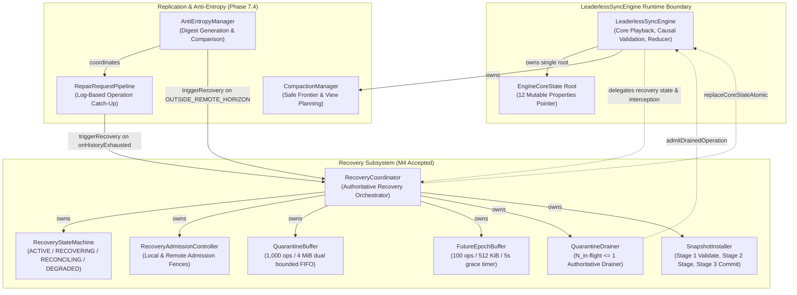
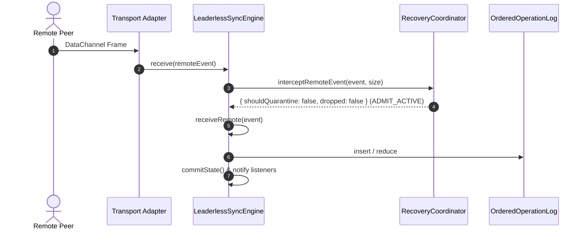
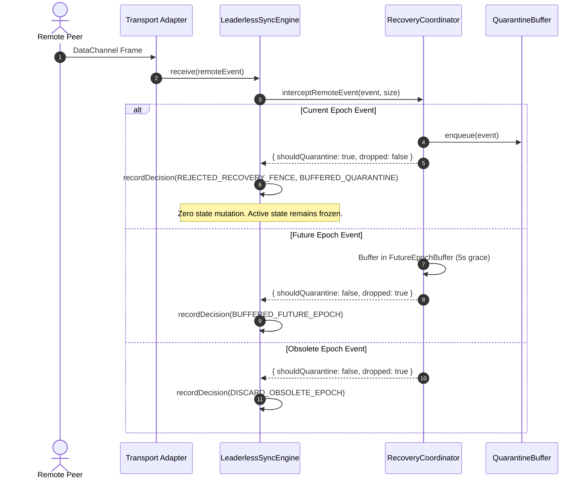
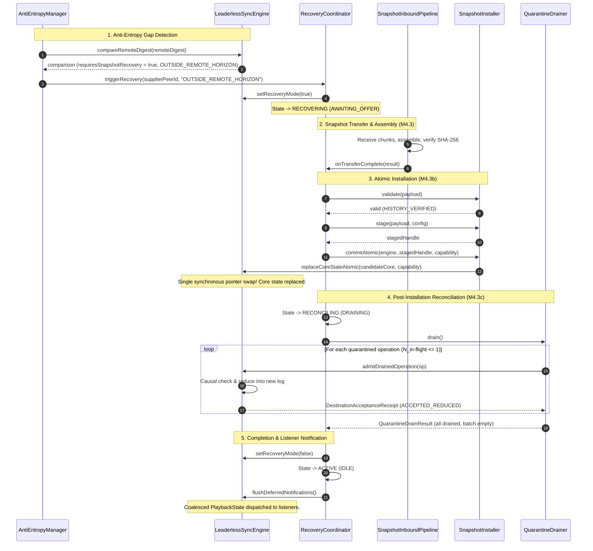

# Phase 7.5 Milestone M5 — Engine Runtime Recovery Integration Architecture

**Status:** APPROVED ARCHITECTURAL SPECIFICATION (MILESTONE M5.0)  
**Date:** 2026-11-25  
**Authoritative Starting Baseline:** `40b11fdafcd247c7a289723f90ec0e2029c94f64` (Phase 7.5 M4.3d Formally Accepted)  
**Accepted Baselines:** M4.3c (`eab2428`), Approved Architecture (`2bb117c`), Frozen M4.2d (`aafa366`)  
**Scope:** Architecture planning and runtime integration specification for Milestone M5. Strictly read-only audit and design.

---

## 1. Executive Summary & Objective

Milestone M4 established complete implementation and verification evidence for chunked snapshot transfers, sliding window pipelining, candidate offer registries, active supplier failover, and quarantine buffering across 42 acceptance and multi-peer scenarios.

**Milestone M5** integrates this accepted recovery subsystem into the active runtime lifecycle of `LeaderlessSyncEngine`.

Prior to M5, the engine and recovery components operated with an explicit integration boundary: `RecoveryCoordinator` and `LeaderlessSyncEngine` were instantiated independently in test harnesses, with recovery triggered manually and drained operations submitted explicitly via test fixtures. Milestone M5 bridges this boundary so that:
1. Anti-entropy gap evaluation (`compareRemoteDigest`) and repair exhaustion (`onHistoryExhausted`) autonomously trigger snapshot recovery when operations fall outside the retained operation-log compaction horizon.
2. The engine's live ingestion path (`receive()`) routes incoming remote operations into the recovery subsystem's quarantine and future-epoch buffers whenever recovery is active, guaranteeing zero active state mutation during snapshot staging and installation.
3. Local user inputs (`receiveLocal()`) are fail-closed synchronously during recovery states, preventing concurrent local divergence and clock skew.
4. Snapshot installation synchronously and atomically replaces the engine's core state root (`EngineCoreState`) across all 12 mutable components, preserving exact Lamport monotonicity ($L_{\text{local}} = \max(L_{\text{local}}, L_{\text{snapshot}})$ without $+1$) and causal replication frontiers.
5. The post-installation quarantine drain protocol sequentially submits quarantined operations through the engine's causal admission pipeline (`admitDrainedOperation()`), advancing replication vectors and emitting coalesced state notifications only after reconciliation reaches `ACTIVE`.

---

## 2. Component Architecture & Ownership Model

The runtime recovery integration connects nine distinct architectural subsystems, organized in a clear, non-circular ownership hierarchy:



### Component Responsibility & Invariant Matrix

| Component | Authoritative State Owned | Invariants Enforced in M5 | External Dependencies |
|---|---|---|---|
| `LeaderlessSyncEngine` | `EngineCoreState` (playback state, replication vector, clock manager, operation log, pending queue) | Zero state mutation during recovery; local inputs rejected; atomic core swap via capability; notification deferral. | `RecoveryCoordinator`, `CompactionManager`. |
| `RecoveryCoordinator` | Recovery state, attempt ID, timers (`overall`, `offerAwait`, `reconciliation`), metrics. | Single source of recovery lifecycle truth; strict attempt ID fencing; autonomous degradation on timeout/overflow. | `LeaderlessSyncEngine`, `RecoveryInstallationCapability`. |
| `RecoveryStateMachine` | `RecoveryState` (`ACTIVE`, `RECOVERING`, `RECONCILING`, `DEGRADED`), `RecoverySubstate`. | Valid deterministic state transitions; monotonic attempt increment; terminal fencing. | None. |
| `RecoveryAdmissionController` | Admission decision mapping based on state machine and epoch. | Fail-close local intents during recovery; route remote events to quarantine or future-epoch; discard obsolete epoch. | `RecoveryStateMachine`, `QuarantineBuffer`, `FutureEpochBuffer`. |
| `QuarantineBuffer` | Dual-bounded operation queue (max 1,000 ops, max 4 MiB total, max 4 KiB per event). | Bounded memory; no silent eviction; generational detachment for isolated draining; stable key deduplication. | None. |
| `FutureEpochBuffer` | Grouped future epoch buckets (max 100 ops, max 512 KiB, max 4 KiB per event, 5s grace). | Future epoch staging; deterministic expiration to `DEGRADED` after 5s grace; requires capability to release. | None. |
| `QuarantineDrainer` | Single in-flight tracking record (`inFlightRecord`), drain state. | Strictly $N_{\text{in-flight}} \le 1$; unshift on capacity rejection; zero operation loss; reentrancy exclusion. | `IDrainDestination` (`LeaderlessSyncEngine`), `QuarantineBuffer`. |
| `SnapshotInstaller` | Staged root map (`stagedRoots`), validation caches. | 4-outcome prefix compatibility check; Stage 2 out-of-band staging; Stage 3 capability-gated atomic swap; exact Lamport reseed without $+1$. | `RecoveryInstallationCapability`. |
| `AntiEntropyManager` | Digest schedules, rate limits, peer digest knowledge. | Proactive snapshot recovery triggering upon detecting `OUTSIDE_REMOTE_HORIZON`; reactive triggering via `onHistoryExhausted`. | `LeaderlessSyncEngine`, `RecoveryCoordinator`. |

---

## 3. Runtime Event Flow & Control Plane

### 3.1 Normal Active Ingestion vs. Active Recovery Interception

When recovery is inactive (`ACTIVE`), the engine behaves identically to Phase 7.4:



When recovery is active (`RECOVERING` or `RECONCILING`), incoming remote operations are safely intercepted:



### 3.2 Autonomous Recovery Triggering & End-to-End Recovery Flow



---

## 4. Architectural Analysis & Design Resolutions (Questions A–G)

### A. Recovery Lifecycle Ownership
- **Principle:** Single source of truth. The engine must not maintain an independent, duplicate state machine or mutable boolean flags that can desynchronize from `RecoveryCoordinator`.
- **Resolution:**
  - `RecoveryCoordinator.stateMachine` is the sole authoritative state machine for recovery lifecycle (`ACTIVE`, `RECOVERING`, `RECONCILING`, `DEGRADED`).
  - `LeaderlessSyncEngine.isRecoveryActive()` delegates dynamically:
    ```typescript
    public isRecoveryActive(): boolean {
      if (this.recoveryCoordinator) {
        const s = this.recoveryCoordinator.state;
        return s === 'RECOVERING' || s === 'RECONCILING';
      }
      return this.recoveryActive;
    }
    ```
  - `LeaderlessSyncEngine.setRecoveryMode(active)` remains a subordinate synchronization hook called by the coordinator when entering recovery or returning to active.
  - Listener buffering (`deferredStateChanges`, `deferredDecisions`) is gated directly by `isRecoveryActive()`.
  - When returning to `ACTIVE`, `engine.flushDeferredNotifications()` emits the final coalesced `PlaybackState`.

### B. Remote Inbound Operation Interception
- **Principle:** Zero active state mutation during recovery. No remote event may enter `OrderedOperationLog`, trigger `reduce()`, or advance `replicationVector` while snapshot staging or reassembly is underway.
- **Resolution:**
  - In `LeaderlessSyncEngine.receive()`, if `isLocal === false` and `this.recoveryCoordinator` is present, the event is submitted to `coordinator.interceptRemoteEvent(event, rawLength)`.
  - If `shouldQuarantine === true`, the event is held in `QuarantineBuffer`.
  - If `dropped === true`, the event is dropped (obsolete epoch, degraded, or duplicate of an in-flight draining op).
  - Only if the coordinator is in `ACTIVE` state (returning `ADMIT_ACTIVE`) does the event proceed to standard `receiveRemote()`.

### C. Local Input Gating
- **Principle:** Local actions must fail-close synchronously. Silent queuing of local actions is strictly prohibited.
- **Why Queuing is Prohibited:**
  1. A local action created during recovery would capture an obsolete causal frontier ($V_{\text{local}}$) and obsolete Lamport clock ($L_{\text{local}}$). Applying it after a snapshot jump of hundreds of operations would violate causal monotonicity and cause clock regression.
  2. The user's action (e.g. seek to 10s) was based on obsolete media state, whereas the snapshot may advance playback to 120s. Applying the seek retroactively produces state corruption.
- **Resolution:**
  - In `LeaderlessSyncEngine.receiveLocal()`, the engine invokes `coordinator.interceptLocalSubmission()`.
  - If `allowed === false`, the engine throws a synchronous `SyncEngineError('REJECTED_RECOVERING', reason)`.
  - Calling applications receive an immediate error and can disable transport UI controls until recovery completes.

### D. Anti-Entropy Recovery Trigger
- **Principle:** Autonomous gap bridging without bootstrap authority.
- **Resolution:**
  - **Path 1 (Reactive Exhaustion):** In `RepairRequestPipeline`, when all suppliers reject with `OUTSIDE_HORIZON` or retry budgets are exhausted, `callbacks.onHistoryExhausted` is invoked.
  - **Path 2 (Proactive Horizon Detection):** In `AntiEntropyManager.evaluateRemoteDigest()`, if `compareRemoteDigest()` returns `requiresSnapshotRecovery === true` and `outsideRemoteHorizon === true`, anti-entropy immediately detects that operation repair is impossible.
  - In both paths, the engine checks `coordinator.stateMachine.canTransition('RECOVERING')`. If true, it calls `coordinator.triggerRecovery(supplierPeerId, reason)`. If recovery is already in flight, the call is an idempotent no-op.
  - The supplier peer with the highest validated `snapshotFrontier` in the current epoch is selected as candidate supplier.

### E. Snapshot Installation & Core State Replacement
- **Principle:** Synchronous atomic pointer replacement across all 12 core engine fields with exact Lamport monotonicity.
- **Lamport Invariant:**
  $$L_{\text{local}} = \max(L_{\text{local}}, L_{\text{snapshot}})$$
  *Strict rule:* No $+1$ increment during snapshot installation.
- **Atomic Swap Mechanism:**
  - `SnapshotInstaller.stage()` constructs `candidateCore: EngineCoreState` out-of-band.
  - `SnapshotInstaller.commitAtomic()` executes:
    `engine.replaceCoreStateAtomic(candidateCore, capability)`
  - Under JavaScript run-to-completion semantics, this executes in 0 ticks with zero possible interleaving.
  - Core fields replaced atomically:
    1. `state` (PlaybackState, stateVersion + 1)
    2. `playbackState`
    3. `baseSnapshot`
    4. `baseSnapshotFrontier`
    5. `operationLog` (reset with compacted checkpoints)
    6. `clockManager` (reseeded)
    7. `pendingQueue` (fresh)
    8. `replicationVector` (set to snapshot frontier)
    9. `localCausalContext` (set to snapshot frontier)
    10. `localOriginSequence` (preserved)
    11. `currentEpoch` (snapshot membership epoch)
    12. `lastAppliedEventId` (`snap-${snapshotId}`)

### F. Quarantine Drain
- **Principle:** Single in-flight ownership ($N_{\text{in-flight}} \le 1$), causal dependency validation, and backpressure safety.
- **Resolution:**
  - `RecoveryCoordinator.reconcileQuarantine()` invokes `QuarantineDrainer.drain()`.
  - `quarantineBuffer.detachActiveGeneration()` isolates the current batch.
  - For each op, `quarantineDrainer` sets `inFlightRecord` and calls `engine.admitDrainedOperation(op)`.
  - `admitDrainedOperation()`:
    - Checks base frontier $\to$ `ALREADY_REPRESENTED` (discarded).
    - Checks replication vector $\to$ `ALREADY_OWNED_DUPLICATE` (discarded).
    - Checks causal dependencies $\to$ if missing, enqueues into engine's `pendingQueue` with `ACCEPTED_PENDING`.
    - If dependencies satisfied $\to$ calls `admitOperation()` and returns `ACCEPTED_REDUCED` (replication vector advances!).
    - If `pendingQueue` exceeds capacity $\to$ returns `CAPACITY_REJECTED`.
  - If `CAPACITY_REJECTED`, the drain halts, the operation is unshifted, and recovery aborts to `DEGRADED`.
  - Iterative drain handles events that arrived in the active generation during drain pass 1.

### G. Concurrency & Atomicity Boundaries
- **Attempt Fencing:** Every async pipeline callback, timer, and failover event is tagged with `activeAttemptId`. Any event whose ID does not match the coordinator's current attempt is dropped as a strict no-op.
- **Disposal Safety:** Disposing the engine disposes the coordinator, which cancels all timers (`overallTimer`, `offerAwaitTimer`, `reconciliationTimer`) and permanently fences all state transitions.

---

## 5. Summary Architecture Verdict

Milestone M5 architecture is completely specified, respects all approved Phase 7.5 safety invariants, and introduces zero circular dependencies. Ready for formal interface specification and roadmap breakdown.
