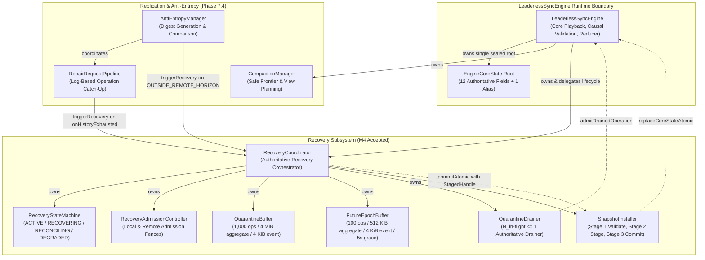
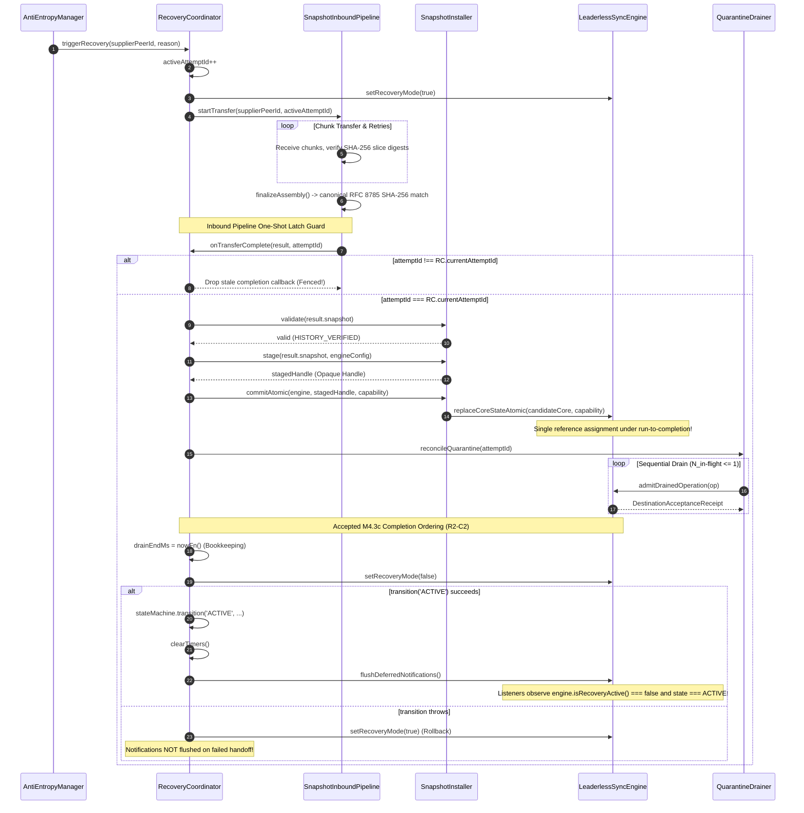

# Phase 7.5 Milestone M5 — Engine Runtime Recovery Integration Architecture

**Status:** APPROVED ARCHITECTURAL SPECIFICATION (MILESTONE M5.0-R2 AMENDED)
**Date:** 2026-11-25
**Authoritative Starting Baseline:** `40b11fdafcd247c7a289723f90ec0e2029c94f64` (Phase 7.5 M4.3d Formally Accepted)
**Accepted Baselines:** M4.3c (`eab2428`), M4.3b (`f3c29b6`), Approved Architecture (`2bb117c`), Frozen M4.2d (`aafa366`)
**Scope:** Architecture planning and runtime integration specification for Milestone M5. Strictly read-only audit and design.

---

## 1. Executive Summary & Objective

Milestone M4 established complete implementation and verification evidence for chunked snapshot transfers, sliding window pipelining, candidate offer registries, active supplier failover, single-root atomic installation, and quarantine buffering across 42 acceptance and multi-peer scenarios.

**Milestone M5** integrates this accepted recovery subsystem into the active runtime lifecycle of `LeaderlessSyncEngine`.

Prior to M5, the engine and recovery components operated with an explicit integration boundary: `RecoveryCoordinator` and `LeaderlessSyncEngine` were instantiated independently in test harnesses, with recovery triggered manually and drained operations submitted explicitly via test fixtures. Milestone M5 bridges this boundary so that:
1. Anti-entropy gap evaluation (`compareRemoteDigest`) and repair exhaustion (`onHistoryExhausted`) autonomously trigger snapshot recovery when operations fall outside the retained operation-log compaction horizon.
2. The engine's live ingestion path (`receive()`) routes incoming remote operations through a discriminated admission controller, ensuring current-epoch events enter quarantine, future-epoch events enter an independent 5-second staged buffer, and obsolete events are dropped, guaranteeing zero active state mutation during snapshot staging and installation.
3. Local user inputs (`receiveLocal()`, `submit()`) fail-close synchronously during recovery and degraded states, preventing concurrent local divergence and causal clock skew.
4. Snapshot installation synchronously and atomically replaces the engine's core state root (`EngineCoreState`) across all 12 authoritative components through M4.3b's opaque staged handle design, preserving exact Lamport monotonicity ($L_{\text{local}} = \max(L_{\text{local}}, L_{\text{snapshot}})$ without $+1$) and causal replication frontiers in one synchronous reference replacement under JavaScript run-to-completion semantics.
5. The post-installation quarantine drain protocol sequentially submits quarantined operations through the engine's causal admission pipeline (`admitDrainedOperation()`), enforcing bounded single-in-flight ownership ($N_{\text{in-flight}} \le 1$), advancing replication vectors, and emitting coalesced state notifications only after reconciliation successfully clears engine recovery mode and reaches `ACTIVE`.

---

## 2. Component Architecture & Ownership Model

The runtime recovery integration connects nine distinct architectural subsystems, organized in a clear, non-circular ownership hierarchy:



### 2.1 Construction Ownership vs. Lifecycle Ownership (Closing F5, R2-H5)

To eliminate any ambiguity regarding component lifetimes, construction parameters, capability custody, and circular references:

1. **Construction Ownership:**
   - **Option A (Autonomous Internal Construction — Standard Production):** The caller provides `recoveryOptions?: EngineRecoveryOptions` in `LeaderlessSyncEngineConfig`. The engine constructs its own `RecoveryCoordinator`, mints an unforgeable in-process `RecoveryInstallationCapability` (branded with a module-private Symbol), binds itself to the coordinator via `coordinator.bindEngine(engine, capability)`, and retains private ownership.
   - **Option B (External Coordinator Injection — Advanced Testing):** The caller provides an already constructed `recoveryCoordinator?: IRuntimeRecoveryCoordinator` and an authorized `authorizedRecoveryCapability?: RecoveryInstallationCapability`. The engine binds to the injected coordinator during initialization.
   - **Mutual Exclusion Invariant:** Supplying *both* `recoveryCoordinator` and `recoveryOptions` throws `SyncEngineError('INVALID_CONFIG', 'Cannot supply both recoveryCoordinator and recoveryOptions')`.
2. **Single-Attachment Invariant:** A `RecoveryCoordinator` can be bound to at most one engine. Calling `coordinator.bindEngine(engine, capability)` when already bound throws `SyncEngineError('ALREADY_BOUND')`. A coordinator cannot be detached, replaced, or swapped across engines at runtime. Sharing one coordinator across multiple engines is strictly prohibited. If attachment fails during engine construction (e.g. invalid capability or already bound), capability custody is revoked, engine construction throws, and the coordinator remains in its prior state.
3. **Lifecycle Ownership After Attachment:** Once successfully bound, the engine assumes **exclusive lifecycle ownership** of the coordinator. Invoking `engine.dispose()` synchronously disposes the attached `RecoveryCoordinator`.
4. **Disposal Semantics:** Coordinator disposal is **synchronous and idempotent**. Multiple invocations of `dispose()` are safe no-ops. On disposal, the coordinator immediately cancels all active attempt and reconciliation timers, releases buffer memory, clears listeners, and transitions permanently to `DISPOSED`. Unreachable reference cycles between engine and coordinator are safely reclaimed by the JavaScript garbage collector.

---

## 3. Authoritative Lifecycle & Admission Policy (Closing F1, F3, R2-C2, R2-H2)

To ensure the engine and coordinator never maintain divergent lifecycle state, Milestone M5 defines three strictly separated concepts:

1. **`recoveryState`:** The authoritative state owned exclusively by `RecoveryCoordinator.stateMachine.state`:
   - `'ACTIVE'` — Normal operational replication.
   - `'RECOVERING'` — Snapshot transfer, verification, staging, and atomic commit in progress.
   - `'RECONCILING'` — Post-snapshot quarantine draining in progress.
   - `'DEGRADED'` — Terminal recovery failure, partition conflict, or buffer overflow; requires application-level reset.
   - `'DISPOSED'` — Engine or coordinator has been permanently shut down.
2. **`isRecoveryInProgress()`:** A derived boolean helper returning `true` **if and only if** `recoveryState === 'RECOVERING' || recoveryState === 'RECONCILING'`. (`isRecoveryActive()` is retained purely as a backward-compatible alias of `isRecoveryInProgress()`).
3. **`admissionPolicy`:** A comprehensive, deterministic decision matrix enforced across all five lifecycle states.

### 3.1 Comprehensive Lifecycle Admission Matrix

| Lifecycle State (`recoveryState`) | Local Intent Policy (`submit` / `receiveLocal`) | Remote Event Ingestion Policy (`receive`) | Public Ingestion Outcome |
|---|---|---|---|
| **`ACTIVE`** | **Admitted.** Sequenced contiguously ($S_{\text{local}} += 1$), advances Lamport clock, captures causal context, reduces into log. | **Admitted.** Synchronous $O(1)$ check ($\le 5\,\mu\text{s}$). Passes directly to `receiveRemote()`, admitted to log, reduces state. | `ADMIT_ACTIVE` |
| **`RECOVERING`** | **Synchronously Rejected.** Throws `SyncEngineError('REJECTED_RECOVERING')`. Zero sequence advance, zero clock advance. Local intent fails closed. | **Intercepted & Segregated.**<br/>• Current Epoch $\to$ `QuarantineBuffer`<br/>• Future Epoch ($E > E_{\text{local}}$) $\to$ `FutureEpochBuffer` (5s grace)<br/>• Obsolete Epoch ($E < E_{\text{local}}$) $\to$ Discarded<br/>• In-flight duplicate $\to$ Dropped<br/>Zero mutation of operation log or active playback state. | `QUARANTINED`<br/>`BUFFERED_FUTURE_EPOCH`<br/>`DISCARDED_OBSOLETE_EPOCH`<br/>`DROPPED_DRAINER_DUPLICATE` |
| **`RECONCILING`** | **Synchronously Rejected.** Throws `SyncEngineError('REJECTED_RECOVERING')`. Zero sequence advance, zero clock advance. | **Intercepted & Segregated.** Identical to `RECOVERING`. Newly arriving events enter the active generation of `QuarantineBuffer` while the detached generation is drained. | `QUARANTINED`<br/>`BUFFERED_FUTURE_EPOCH`<br/>`DISCARDED_OBSOLETE_EPOCH`<br/>`DROPPED_DRAINER_DUPLICATE` |
| **`DEGRADED`** | **Synchronously Rejected.** Throws `SyncEngineError('REJECTED_DEGRADED')`. Engine is halted; requires explicit application session reset. | **Intercepted & Dropped.** Dropped immediately with decision `REJECTED_DEGRADED`. Zero buffer allocation, zero log insertion. | `REJECTED_DEGRADED` |
| **`DISPOSED`** | **Synchronously Rejected.** Throws `SyncEngineError('DISPOSED')`. | **Rejected.** Engine is shut down. Zero activity. | `REJECTED_DISPOSED` |

### 3.2 Discriminated Interception Result & Unified Overflow Contract (Closing F3, F9, R2-H2)

The interception contract between `LeaderlessSyncEngine` and `RecoveryCoordinator` is structured as follows:

```typescript
export type RemoteAdmissionDecision =
  | { readonly outcome: 'ADMIT_ACTIVE' }
  | { readonly outcome: 'QUARANTINED'; readonly sequenceNumber: number; readonly originPeerId: string; readonly rawSerializedLength: number }
  | { readonly outcome: 'BUFFERED_FUTURE_EPOCH'; readonly targetEpoch: number; readonly expiresAtMs: number }
  | { readonly outcome: 'DISCARDED_OBSOLETE_EPOCH'; readonly eventEpoch: number; readonly currentEpoch: number }
  | { readonly outcome: 'DROPPED_DRAINER_DUPLICATE'; readonly originPeerId: string; readonly sequenceNumber: number }
  | { readonly outcome: 'REJECTED_DEGRADED'; readonly failureReason?: string }
  | { readonly outcome: 'REJECTED_DISPOSED' };
```

#### Unified Overflow Handling Across Boundaries (R2-H2)
To eliminate any conflict between thrown exceptions and returned decision outcomes:
1. **`QuarantineBuffer.enqueue(op)` and `FutureEpochBuffer.enqueue(op)`:** When capacity or aggregate byte boundaries are exceeded, the buffer throws `SyncEngineError('QUARANTINE_OVERFLOW')` or `SyncEngineError('FUTURE_EPOCH_OVERFLOW')`.
2. **`RecoveryCoordinator.interceptRemoteEvent()`:** Catches `QUARANTINE_OVERFLOW` / `FUTURE_EPOCH_OVERFLOW`, autonomously aborts active recovery via `this.abortRecovery(failureReason, err.message)` (driving the state machine to `DEGRADED`), and re-throws the `SyncEngineError`. Overflow is an exceptional fault condition, not a normal admission decision.
3. **`LeaderlessSyncEngine.receive()`:** Preserves the Phase 7.2/7.4 remote error isolation invariant. Remote events **never throw** unhandled exceptions to transport callers. The engine catches `QUARANTINE_OVERFLOW` / `FUTURE_EPOCH_OVERFLOW`, isolates the error, maps it to a rejection decision `code: 'REJECTED_CAPACITY'`, and records it via `recordDecision()`. Local actions (`receiveLocal` / `submit`) synchronously throw `SyncEngineError('REJECTED_DEGRADED')`.

---

## 4. Single-Root State Inventory & Opaque Staged-Handle Contract (Closing F2, R2-C1, R2-M2)

Inspection of `packages/sync-engine/src/recovery/engine-core-state.ts` confirms that the engine's core state root encompasses **exactly 12 distinct authoritative fields**, exposed across 13 property keys on the sealed interface:

```typescript
export interface EngineCoreState {
  // ── 12 Authoritative Stored Fields ──────────────────────────────────────────
  state: PlaybackState;                        // 1. Primary active playback state (deeply frozen)
  baseSnapshot: PlaybackState;                 // 2. Compaction base anchor for speculative replay
  baseSnapshotFrontier: Record<string, number>;// 3. Highest compacted sequence numbers per origin
  operationLog: OrderedOperationLog;           // 4. Authoritative totally-ordered operation log
  clockManager: LogicalClockManager;           // 5. Authoritative Lamport logical clock manager
  pendingQueue: PendingDependencyQueue;        // 6. Missing-dependency queue for causal operations
  replicationVector: Record<string, number>;   // 7. Highest contiguous applied sequences per peer
  localCausalContext: Record<string, number>;  // 8. Observed causal horizon for local event generation
  localOriginSequence: number;                 // 9. Monotonic sequence counter for local events
  currentEpoch: number;                        // 10. Current membership configuration epoch
  lastAppliedEventId: string | undefined;      // 11. Identity of most recently applied operation
  stateVersion: number;                        // 12. Monotonic state version counter

  // ── Referential Alias (Property 13) ────────────────────────────────────────
  playbackState: PlaybackState;                // 13. Invariant alias: playbackState === state
}
```

### 4.1 Authoritative Mapping Against Accepted Baseline (R2-C1)
- **12 Stored Properties:** `state`, `baseSnapshot`, `baseSnapshotFrontier`, `operationLog`, `clockManager`, `pendingQueue`, `replicationVector`, `localCausalContext`, `localOriginSequence`, `currentEpoch`, `lastAppliedEventId`, `stateVersion`.
- **1 Referential Alias:** `playbackState === state`. `createEngineCoreState(params)` enforces `core.playbackState = core.state` and seals the root container via `Object.seal()`.
- **Encapsulation & Readers/Writers:** All engine property getters and setters (`this.state`, `this.baseSnapshot`, `this.operationLog`, `this.clockManager`, `this.replicationVector`, etc.) delegate exclusively to `this.core.*`. Zero duplicate state exists outside `this.core`.
- **Omitted Non-Core Fields:** Infrastructure fields (`sessionId`, `localPeerId`, `clock`, `conflictResolver`, `logCapacity`, `eventListeners`, `disposed`) and ephemeral recovery state (`recoveryActive`, `quarantineDrainer`) are intentionally excluded from `EngineCoreState` because they are immutable configuration or connection lifecycle variables.

### 4.2 Preservation of M4.3b Opaque Staged-Handle Architecture (R2-C1)
To ensure memory safety and prevent live reference leaking:
1. `SnapshotInstaller.stage()` constructs candidate operational collections (`candidateLog`, `candidateClock`, `candidatePendingQueue`) and candidate `EngineCoreState` completely out-of-band.
2. The candidate `EngineCoreState` is stored in a module-private `WeakMap<StagedSnapshotInstallation, EngineCoreState>()` owned by `SnapshotInstaller`.
3. The method returns ONLY the immutable, opaque `StagedSnapshotInstallation` handle (`handleId`, `sessionId`, `targetEpoch`, `targetFrontier`, `canonicalDigest`, `maxLogicalTimestamp`).
4. External callers, including `RecoveryCoordinator`, never receive, hold, or inspect the mutable candidate `EngineCoreState`.
5. In Stage 3, `commitAtomic(engine, stagedHandle, capability)` retrieves the candidate from private storage and executes capability-gated replacement. Ordinary consumers cannot bypass this contract.

### 4.3 Precise Atomicity Semantics (R2-M2)
Snapshot state replacement executes via `replaceCoreStateAtomic(candidateCore, capability)` as **one synchronous root-reference replacement (`this.core = candidateCore;`) under JavaScript run-to-completion semantics, with no intermediate root visible to other JavaScript tasks**.
Under JavaScript's single-threaded event loop, run-to-completion guarantees that no microtask, macrotask, or callback can interleave during this reference assignment. This provides absolute task-level atomicity without claiming multi-threaded hardware transaction locking.

---

## 5. Supplier Selection, Lattice Ordering & Trust Model (Closing F4, R2-C3, R2-C4, R2-H1)

Snapshot replication frontiers form a product lattice ($\mathbb{N}^k$) under component-wise ordering, which is only a **partial order**. Two vectors $V_1, V_2$ may be:
- Strictly ordered: $V_1 < V_2$ ($V_1 \le V_2 \land V_1 \ne V_2$)
- Equal: $V_1 = V_2$
- Incomparable: $V_1 \parallel V_2$ ($\exists p_1, p_2 : V_1[p_1] < V_2[p_1] \land V_1[p_2] > V_2[p_2]$)

### 5.1 Protocol-Stable Peer-ID Comparison (R2-H1)
To prevent platform- or locale-dependent ordering discrepancies, peer IDs are compared strictly using deterministic, locale-independent UTF-16 code unit comparison:
```typescript
export function comparePeerIds(a: string, b: string): number {
  return a < b ? -1 : (a > b ? 1 : 0);
}
```
`String.prototype.localeCompare()` is strictly prohibited across all protocol and selection logic.

### 5.2 Lattice Evaluation & Candidate Eligibility Taxonomy (R2-C3)
Incomparable vectors ($V_A \parallel V_B$) are **not automatically treated as proven forks**. In a leaderless system, incomparable vectors naturally arise from concurrent operational progress across independent peers.

Milestone M5 classifies candidate offers across seven distinct architectural cases:

| Case | Relationship | Condition | Architectural Action |
|---|---|---|---|
| **Case 1** | `IDENTICAL` | $V_P = V_{\text{local}}$ and intermediate checkpoint history verified (or $k \le 1$). | Installation unnecessary. Candidate discarded. |
| **Case 2** | `FRONTIER_AGREEMENT_ONLY` | $V_P = V_{\text{local}}$ at $k > 1$, but intermediate history unverified. | Cannot overwrite local state without proof. Candidate discarded. |
| **Case 3** | `STRICTLY_DOMINATES` | $V_P \ge V_{\text{local}}$ on all origins, and $V_P > V_{\text{local}}$ on at least one origin. | **Eligible candidate.** Ranked by strict domination; tie-break by RTT, then `comparePeerIds`. |
| **Case 4** | `INCOMPARABLE_COMPATIBLE` | $V_P \parallel V_{\text{local}}$ or $V_A \parallel V_B$, but common-prefix history is identical ($H(op_A) == H(op_B)$ for all shared sequences). | Concurrent branches are compatible. If candidate subsumes missing history or is repairable, proceed with recovery or delta sync. |
| **Case 5** | `REPAIRABLE_WITHIN_HORIZON` | Missing operation gap $\le \text{logCapacity}$ (e.g. $\le 256$ ops). | Bypass snapshot transfer; delegate to `RepairRequestPipeline` anti-entropy log repair. |
| **Case 6** | `PROVEN_CONFLICT_FORK` | Common prefix history diverges for same origin and sequence ($H(op_A) \ne H(op_B)$), or conflicting unresolvable snapshots under recovery policy. | **True causal fork.** Abort recovery deterministically to `DEGRADED` (`FORK_DETECTED_INCOMPARABLE`). |
| **Case 7** | `DOMINATED` / `INSUFFICIENT_EVIDENCE` | $V_P < V_{\text{local}}$, epoch is older, or evidence is outside repair horizon without verifiable ancestry. | Candidate rejected; retry discovery or degrade if no candidates remain. |

### 5.3 Cryptographic Digest & Trust Model Clarification (R2-C4)
To eliminate any ambiguity regarding security and verification guarantees:
1. **SHA-256 Byte Integrity:** Slice digests and snapshot canonical digests (RFC 8785) verify **byte-level transfer integrity** against network corruption and reassembly errors.
2. **Session & Epoch Binding:** Verified by inspecting header metadata (`sessionId`, `membershipEpoch`, `connectionGeneration`) to ensure payloads belong to the active cluster configuration.
3. **Historical Consistency:** Verified by validating compacted checkpoint chains and frontier timestamps.
4. **Cooperative Non-Byzantine Trust Model:** The SyncPlay protocol operates under a **cooperative non-Byzantine trust model**. The system assumes cluster participants are authorized and non-malicious. **SHA-256 digests do NOT provide digital signatures, non-repudiation, or cryptographic author authentication.** SHA-256 proves payload consistency and formatting, but does not prove semantic correctness or authentic provenance against an active Byzantine attacker.

---

## 6. End-to-End Snapshot Recovery Integration Boundary (Closing F10, R2-C2, R2-H4, R2-H6)



### 6.1 Separate Timer Ownership & Lifecycle Fencing (R2-H4)
Timers are categorized into four distinct ownership classes:
1. **Snapshot-Attempt Timers:** `overallTimer` (`overallRecoveryTimeoutMs`). Scoped to `activeAttemptId`. Cancelled on attempt success, retry, abort to `DEGRADED`, transition to `ACTIVE`, or disposal.
2. **Reconciliation Timers:** `reconciliationTimer` (`reconciliationTimeoutMs`). Scoped to post-install drain. Cancelled on drain completion, abort to `DEGRADED`, transition to `ACTIVE`, or disposal.
3. **Offer/Transfer Timers:** `offerAwaitTimer` (`offerAwaitTimeoutMs`). Scoped to offer discovery. Cancelled on offer selection, transfer initiation, abort to `DEGRADED`, or disposal.
4. **Future-Epoch Convergence Timers:** `futureEpochGraceTimer` (`futureEpochGracePeriodMs`, 5s). Owned by `FutureEpochBuffer`. **Crucial Invariant:** This timer is scoped to target epoch convergence and is **completely independent of snapshot attempts**. It is NOT cancelled when a snapshot attempt completes, resets, or retries. It is cancelled ONLY when local epoch advances to match/exceed the target epoch, when grace period expires (triggering `UNRESOLVED_FUTURE_EPOCH`), or upon coordinator disposal.
- **Fencing:** Attempt-scoped callbacks verify `attemptId === coordinator.activeAttemptId`. Epoch-scoped callbacks verify `targetEpoch === buffer.targetEpoch`.

### 6.2 Bounded In-Flight Drain Ownership (R2-H6)
Quarantine draining strictly adheres to the accepted M4.3c protocol:
- **Single In-Flight Cardinality:** At most one operation ($N_{\text{in-flight}} \le 1$) is in flight between `QuarantineDrainer` and `LeaderlessSyncEngine`.
- **Destination Receipts:** The engine returns typed `DestinationAcceptanceReceipt` (`ACCEPTED_REDUCED`, `ACCEPTED_PENDING`, `ALREADY_REPRESENTED`, `ALREADY_OWNED_DUPLICATE`, `TERMINALLY_REJECTED`, `CAPACITY_REJECTED`).
- **Bounded Pending Queue:** If `pendingQueue` capacity is exhausted, the engine returns `CAPACITY_REJECTED`. The operation is preserved in `inFlightRecord`, drain halts immediately (`haltedOnCapacity = true`), and recovery aborts to `DEGRADED`.
- **Zero Loss / No Eager Dequeue:** An operation is never marked applied merely because it was dequeued from quarantine. Ownership transitions only upon receipt confirmation.

---

## 7. Authoritative Transition & Notification Sequence (Closing F7, R2-C2)

To preserve the accepted M4.3c listener-observation guarantee:

1. **Quarantine Drain Completes:** `quarantineBuffer.totalRetainedCount === 0`.
2. **Recovery Bookkeeping Completes:** `drainEndMs = nowFn()`, metrics compiled.
3. **Clear Engine Recovery Mode:** `this.engine.setRecoveryMode(false)`.
4. **Transition Coordinator to `ACTIVE`:** `this.stateMachine.transition('ACTIVE', 'Recovery completed', 'IDLE')`.
   - **Failure Rollback:** If clearing recovery mode or the state transition throws, the catch block immediately reverts `this.engine.setRecoveryMode(true)`, aborts recovery, and re-throws. Staged completion notifications are **never flushed on a failed handoff**.
5. **Clear Timers & Dispatch Notifications:** Coordinator invokes `this.clearTimers()` and `this.engine.flushDeferredNotifications()` strictly **after** state is `'ACTIVE'` and engine recovery mode is cleared.
6. **Notification Guarantees:**
   - Any `onStateChange` listener observing `'ACTIVE'` is guaranteed to observe `engine.isRecoveryActive() === false`.
   - `stateChangeListeners`: Coalesced to exactly ONE notification with final reconciled `PlaybackState`.
   - `decisionListeners`: All decisions accumulated during drain are dispatched sequentially in FIFO order.

---

## 8. Measurable Active-State Performance Requirement (Closing F6, R2-M1)

Invariant `INV-M5-01` is governed by a rigorous performance measurement contract:
- **Reference Hardware:** Standard 4 vCPU / 8 GiB RAM environment (cloud runner or modern developer workstation).
- **Runtime Environment:** Node.js 20 LTS (or 22 LTS), V8 TurboFan JIT enabled.
- **Event Shape & Size:** Canonical 512-byte `SyncOperationPayload` / `ControlSyncEvent`.
- **Warm-Up:** 10,000 warm-up iterations to allow JIT tier-up.
- **Benchmark Iterations:** 100,000 consecutive remote events evaluated in `ACTIVE` state.
- **Measurement Method:** High-resolution timing via `process.hrtime.bigint()`.
- **Target Overhead:** p99 execution overhead $\le 5\,\mu\text{s}$ per event (mean overhead $\le 2\,\mu\text{s}$).
- **Queue Allocation Constraint:** Zero quarantine buffer array or wrapper heap allocations in the active state fast-path. (Hardware-specific benchmark figures represent reference targets and are not universal runtime guarantees across arbitrary constrained devices).

---

## 9. Memory Bounds & Accounting Contract (Closing R2-H3)

All recovery buffers enforce strict, verifiable memory bounds:

### 9.1 Explicit Buffer Boundaries
| Buffer Component | Maximum Operation Count | Maximum Aggregate Bytes | Maximum Individual Event Size | Expiration Grace Period |
|---|:---:|:---:|:---:|:---:|
| **QuarantineBuffer** | **1,000 operations** | **4 MiB** (4,194,304 bytes) | **4 KiB** (4,096 bytes) | None (drained post-commit) |
| **FutureEpochBuffer** | **100 operations** | **512 KiB** (524,288 bytes) | **4 KiB** (4,096 bytes) | **5,000 ms** (autonomous timer) |

### 9.2 Byte Representation & Lifecycle Accounting
1. **Byte Representation:** Sized according to raw UTF-8 serialized JSON length: `Buffer.byteLength(rawJson, 'utf8')` or supplied `rawSerializedLength`.
2. **Admission Accounting:** Retained byte counters (`_activeBytes`) increment immediately upon valid admission.
3. **Release Accounting:** Bytes are decremented upon dequeue/drain (`_drainBytes -= size`), upon generational clearing, or upon buffer disposal.
4. **Duplicate Handling:** Duplicates detected via identity index are rejected without incrementing retained bytes or operation counts.
5. **Rejection & Overflow:** Operations exceeding individual event size (4 KiB) or causing aggregate byte/count breaches are rejected before queue insertion, retaining 0 bytes and throwing `SyncEngineError`.
