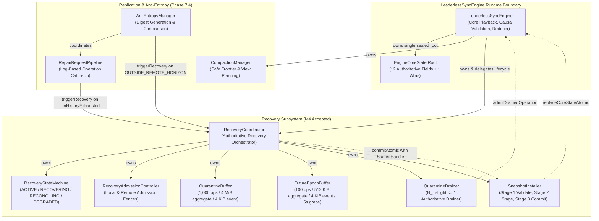
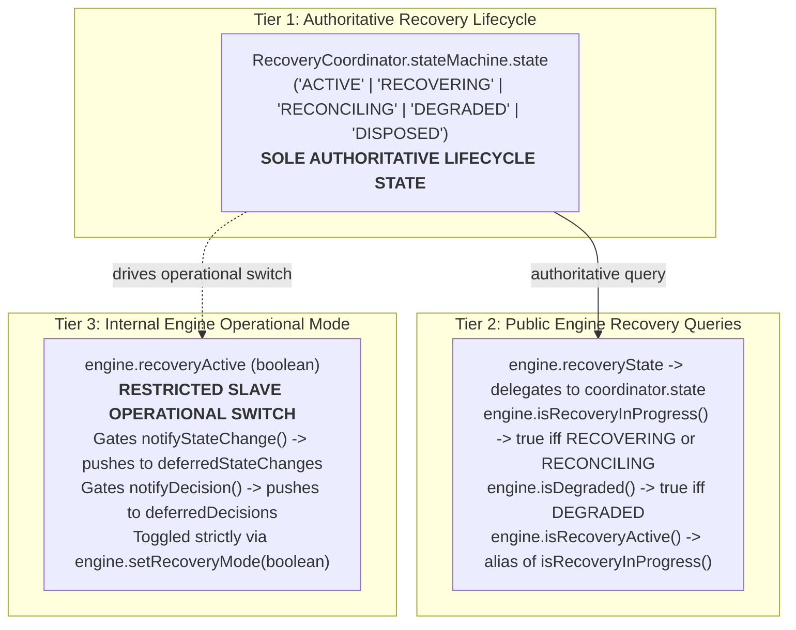
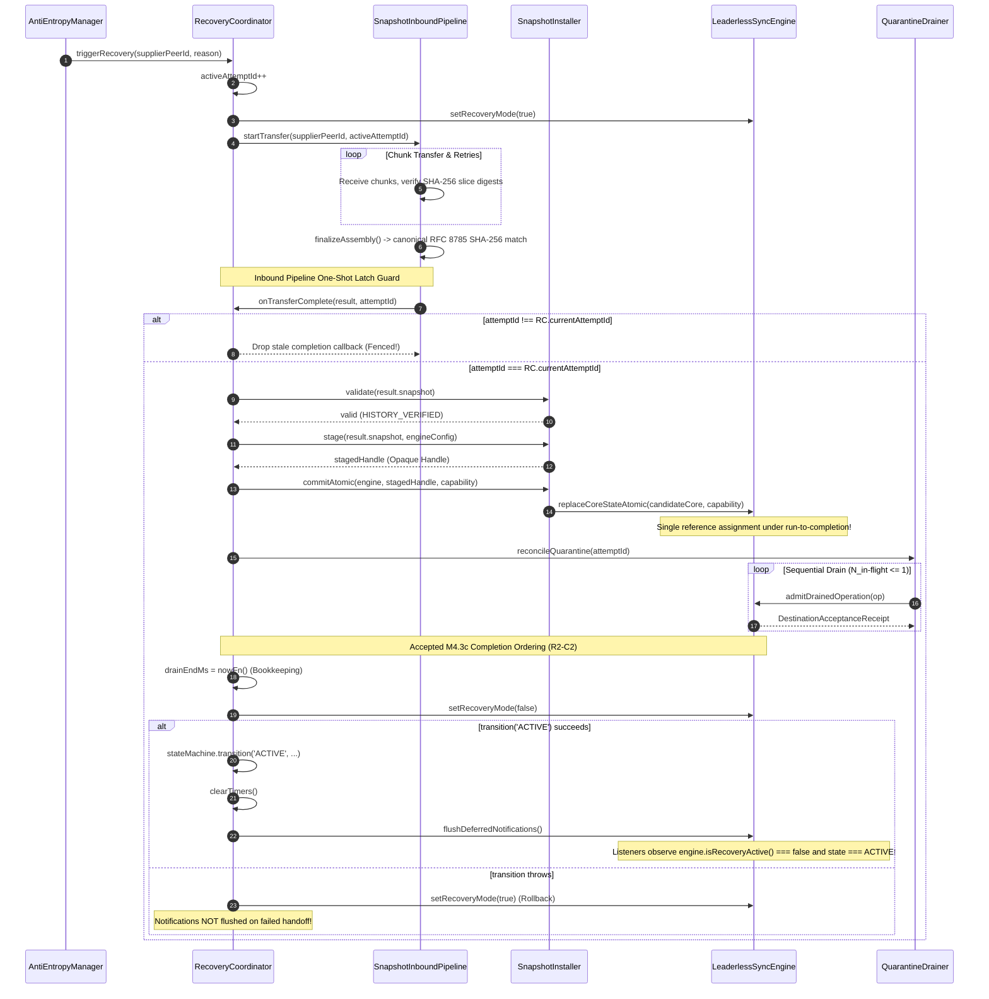

# Phase 7.5 Milestone M5 — Engine Runtime Recovery Integration Architecture

**Status:** APPROVED ARCHITECTURAL SPECIFICATION (MILESTONE M5.0-R14 AMENDED)
**Date:** 2026-11-25
**Authoritative Starting Baseline:** `40b11fdafcd247c7a289723f90ec0e2029c94f64` (Phase 7.5 M4.3d Formally Accepted)
**Accepted Baselines:** M4.3c (`eab2428`), M4.3b (`f3c29b6`), Approved Architecture (`2bb117c`), Frozen M4.2d (`aafa366`)
**Scope:** Architecture planning and runtime integration specification for Milestone M5. Strictly read-only audit and design.

---

## 1. Executive Summary & Objective

Milestone M4 established complete implementation and verification evidence for chunked snapshot transfers, sliding window pipelining, candidate offer registries, active supplier failover, single-root atomic installation, and quarantine buffering across 42 acceptance and multi-peer scenarios.

**Milestone M5** integrates this accepted recovery subsystem into the active runtime lifecycle of `LeaderlessSyncEngine`.

Prior to M5, the engine and recovery components operated with an explicit integration boundary: `RecoveryCoordinator` and `LeaderlessSyncEngine` were instantiated independently in test harnesses, with recovery triggered manually and drained operations submitted explicitly via test fixtures. Milestone M5 bridges this boundary so that:
1. Anti-entropy gap evaluation (`compareRemoteDigest`) and repair exhaustion (`onHistoryExhausted`) autonomously trigger snapshot recovery when operations fall outside the retained operation-log compaction horizon.
2. The engine's live ingestion path (`receive()`) routes incoming remote operations through a discriminated admission controller, ensuring current-epoch events enter quarantine, future-epoch events enter an independent 5-second staged buffer, and obsolete events are dropped, guaranteeing zero active state mutation during snapshot staging and installation. Original transport wire byte sizes are preserved throughout admission without reparsing or re-serialization.
3. Local user inputs (`receiveLocal()`, `submit()`) fail-close synchronously during recovery and degraded states, preventing concurrent local divergence and causal clock skew.
4. Snapshot installation synchronously and atomically replaces the engine's core state root (`EngineCoreState`) across all 12 authoritative components through M4.3b's opaque staged handle design, preserving exact Lamport monotonicity ($L_{\text{local}} = \max(L_{\text{local}}, L_{\text{snapshot}})$ without $+1$) and causal replication frontiers in one synchronous reference replacement under JavaScript run-to-completion semantics.
5. Incomparable but compatible histories ($V_A \parallel V_B$) are reconciled safely without discarding local operations that are ahead of the candidate snapshot, prioritizing anti-entropy delta repair or pre-install local operation stashing.
6. The post-installation quarantine drain protocol sequentially submits quarantined operations through the engine's causal admission pipeline (`admitDrainedOperation()`), enforcing bounded single-in-flight ownership ($N_{\text{in-flight}} \le 1$), advancing replication vectors, and emitting coalesced state notifications only after reconciliation successfully clears engine recovery mode and reaches `ACTIVE`.

---

## 2. Component Architecture & Ownership Model

The runtime recovery integration connects nine distinct architectural subsystems, organized in a clear, non-circular ownership hierarchy:



### 2.1 Capability Custody, Attachment Semantics & Failure Behavior (Closing F5, R2-H5, R3-07, R6-01)

Milestone M5 follows the established capability-custody architecture of Phase 7.5 (e.g. `RecoveryInstallationCapability`, `InboundTransportCapability`), relying on branded symbols, frozen objects, and strict reference identity verification.

#### 2.1.1 Recovery Installation Capability
The accepted installation capability model relies on frozen object identity:
`export interface RecoveryInstallationCapability { readonly authority: string; readonly sessionId: string; readonly token: string; }`.
To preserve exact capability custody and single-attachment guarantees without claiming un-modeled capability "revocation":

1. **Custody & Object Identity:**
   - `LeaderlessSyncEngine` creates and stores `private readonly authorizedRecoveryCapability?: RecoveryInstallationCapability;`.
   - `replaceCoreStateAtomic(candidate, capability)` enforces strict object-reference identity: `if (capability !== this.authorizedRecoveryCapability) throw new SyncEngineError('UNAUTHORIZED')`.
   - No dynamic revocation token or membrane exists in the accepted baseline; security rests strictly on in-process reference confinement.
2. **Construction Options:**
   - **Option A (Autonomous Internal Construction — Standard Production):** The engine constructs its own `RecoveryCoordinator`, mints an authorized capability via `createRecoveryInstallationCapability()`, binds the coordinator via `coordinator.bindEngine(engine, capability)`, and retains private custody.
   - **Option B (External Coordinator Injection — Advanced Testing):** The caller provides an already constructed `recoveryCoordinator` and authorized capability. The engine binds to it during initialization. Supplying both `recoveryOptions` and `recoveryCoordinator` throws `SyncEngineError('INVALID_CONFIG')`.
3. **Attachment Lifecycle Matrix:**
   - **Invalid Capability:** If `capability !== this.authorizedRecoveryCapability`, `replaceCoreStateAtomic` rejects immediately with `SyncEngineError('UNAUTHORIZED')`.
   - **Already-Bound Coordinator:** Calling `coordinator.bindEngine()` when already attached throws `SyncEngineError('ALREADY_BOUND')`. A coordinator cannot be re-bound or shared across multiple engines.
   - **Successful Binding:** Coordinator stores the engine reference and authorized capability in private fields.
   - **Failure During Engine Construction:** If engine initialization throws after `bindEngine()` has run (e.g. invalid configuration or constructor failure), engine construction unwinds; the engine reference is never published, and the partially constructed engine is reclaimed by garbage collection. An externally injected coordinator bound during a failed constructor call cannot be safely reused and must be discarded.
   - **Engine Disposal:** Invoking `engine.dispose()` invokes `coordinator.dispose()`. Calling `replaceCoreStateAtomic` on a disposed engine throws `SyncEngineError('ENGINE_DISPOSED')`, effectively dead-ending the capability even if a reference is retained externally.

#### 2.1.2 Drain Admission Context Capabilities: Unforgeable Provenance & Package-Boundary Contract (Closing R6-01, R7-01, R8-05, R9-07, R10-01, R10-03, R11-A, R11-B, R12-C, R13-A–R13-E, R14-A–R14-E)
A typed string (`'LOCAL_REPLAY' | 'REPAIR_BATCH'`) is a declaration of context, not proof of provenance: any caller can supply a string. To prevent accidental trust escalation where untrusted remote operations bypass arrival-rate limits and clock-inflation checks, post-snapshot drain admission is capability-gated:

```typescript
// Declared in module packages/sync-engine/src/recovery/drain-admission-custody.ts
// Module-private: NEVER re-exported from packages/sync-engine/src/index.ts
const DRAIN_ADMISSION_BRAND: unique symbol = Symbol('DRAIN_ADMISSION_BRAND');

export interface TrustedLocalReplayCapability {
  readonly [DRAIN_ADMISSION_BRAND]: true;
  readonly kind: 'LOCAL_REPLAY';
  readonly sessionId: string;
  readonly authority: string;
  readonly token: string;
}

export interface TrustedRepairBatchCapability {
  readonly [DRAIN_ADMISSION_BRAND]: true;
  readonly kind: 'REPAIR_BATCH';
  readonly sessionId: string;
  readonly authority: string;
  readonly token: string;
}

export type DrainAdmissionContext =
  | TrustedLocalReplayCapability
  | TrustedRepairBatchCapability;

export interface AuthorizedDrainCapabilities {
  readonly localReplayCapability: TrustedLocalReplayCapability;
  readonly repairBatchCapability: TrustedRepairBatchCapability;
}
```

#### Seven Non-Negotiable Capability & Custody Properties:
1. **Module-Private Branding Symbol:** `DRAIN_ADMISSION_BRAND` is declared in internal module `drain-admission-custody.ts` and is **strictly prohibited from being exported** in the public package entry point (`packages/sync-engine/src/index.ts`). Ordinary SDK consumers cannot import or fabricate a branded capability literal with `[DRAIN_ADMISSION_BRAND]: true`.
2. **Internal Factories & Runtime Shallow Immutability (R8-05):** Capability instances are minted strictly by internal module factories (`createLocalReplayCapability`, `createRepairBatchCapability`) and shallow-frozen with `Object.freeze()` so they are immutable at runtime. Shallow freezing is completely sufficient because all capability properties (`kind`, `sessionId`, `authority`, `token`) are primitive values. The containing `AuthorizedDrainCapabilities` container object is likewise shallow-frozen with `Object.freeze()`.
3. **Private Transfer via Composition Root & Scope of `bindEngine()` (R8-05):**
   - `LeaderlessSyncEngine` mints its own authorized `localReplayCapability` and `repairBatchCapability` during initialization, bundled into an immutable `AuthorizedDrainCapabilities` container (`Object.freeze(...)`).
   - The capabilities are transferred privately to `RecoveryCoordinator` via `coordinator.bindEngine(this, this.authorizedRecoveryCapability, drainCapabilities)`.
   - `bindEngine()` is strictly an internal composition-root binding method, NOT an open public reconfiguration API. It enforces the single-attachment invariant (`if (this.engine !== null) throw new SyncEngineError('ALREADY_BOUND')`) and rejects unauthorized rebinding.
   - **Zero Public Accessors:** Neither `LeaderlessSyncEngine` nor `RecoveryCoordinator` nor `QuarantineDrainer` provides ANY public getter, method, or property exposing these capability references (`engine.localReplayCapability` and `coordinator.repairBatchCapability` do not exist). Capabilities cannot be retrieved through getters, diagnostics, state snapshots, debug introspection, or event objects.
4. **Physical Custody Segregation & Least Privilege (R8-05):**
   - `QuarantineDrainer` is initialized strictly with `TrustedRepairBatchCapability`. It has **zero reference** to `TrustedLocalReplayCapability`. Remote quarantine draining can NEVER obtain or present local replay capability.
   - The local stashed reconciliation workflow is held privately by `RecoveryCoordinator` and provided with `TrustedLocalReplayCapability`.
   - Neither component receives or retains unnecessary capabilities.
5. **Exact Reference Identity Check:** `admitDrainedOperation(op, capability, attemptId)` evaluates the presented capability using strict object-reference identity (`capability === this.authorizedLocalReplayCapability` or `capability === this.authorizedRepairBatchCapability`).
6. **Package-Boundary Export Guarantee (R8-05, R9-07):**
   - The package entry manifest (`packages/sync-engine/package.json`) defines strictly:
     ```json
     "exports": {
       ".": {
         "types": "./dist/index.d.ts",
         "import": "./dist/index.js"
       }
     }
     ```
     Under standard Node.js and TypeScript module resolution, root `.` is the ONLY supported package entry point. There are NO wildcard subpaths (`"./*"`), NO `./recovery/*` exports, and NO internal deep-import paths.
   - **Wording Qualification:** This guarantee is an API package boundary against supported package-specifier imports (e.g. `import ... from '@syncplay/sync-engine/recovery/...'` throws `ERR_PACKAGE_PATH_NOT_EXPORTED` at runtime and fails compilation). It is not claimed to be an OS-level file permission sandbox against an attacker with direct local filesystem access to `node_modules` files.
   - The public package entry point (`packages/sync-engine/src/index.ts`) exports **strictly TypeScript type declarations** (`export type { DrainAdmissionContext, TrustedLocalReplayCapability, TrustedRepairBatchCapability, AuthorizedDrainCapabilities }`), never runtime values, symbols, or factory functions. Type-only exports pose zero runtime risk because the engine validates exact object identity against privately retained capability instances.
7. **In-Realm Defensive Trust Model Clarification:** In a cooperative JavaScript runtime, unique symbols and opaque objects provide structural encapsulation and defensiveness against API misuse, configuration errors, and duck-typing, but do not construct a cryptographic sandbox against hostile code running in the identical JavaScript realm. Actual protection is achieved through private capability custody, exact object-reference checks, package export gating, and fail-closed validation.

---

## 3. Authoritative Lifecycle vs. Operational Recovery Mode (Closing F1, F3, R2-C2, R3-03)

To prevent contradictory or duplicate recovery authorities, Milestone M5 defines three strictly distinguished tiers:



### 3.1 Strict Separation of Lifecycle State and Operational Mode (R3-03, R5-03)
1. **Tier 1 — Authoritative Coordinator Lifecycle State (`coordinator.stateMachine.state`):** The sole system authority for recovery state (`ACTIVE`, `RECOVERING`, `RECONCILING`, `DEGRADED`, `DISPOSED`). Owns state transitions, recovery substates, attempt sequence IDs, and timeout controllers.
2. **Tier 2 — Public Engine State Queries:**
   - `engine.recoveryState`: Readonly getter delegating directly to `coordinator.stateMachine.state` (or `'ACTIVE'` if unattached, `'DISPOSED'` if engine is disposed).
   - `engine.isRecoveryInProgress()`: Derived boolean helper returning `true` **if and only if** `recoveryState === 'RECOVERING' || recoveryState === 'RECONCILING'`. It returns `false` in `ACTIVE`, `DEGRADED`, and `DISPOSED`.
   - `engine.isDegraded()`: Derived boolean helper returning `true` **if and only if** `recoveryState === 'DEGRADED'`.
   - `engine.isRecoveryActive()`: Retained strictly as a backward-compatible alias of `isRecoveryInProgress()`.
   - **Crucial Caller Contract:** Callers and external clients must NEVER treat `!isRecoveryInProgress()` as an indicator of healthy, operational active state. In the `DEGRADED` state, `isRecoveryInProgress()` returns `false` because recovery is no longer actively executing; however, the engine is halted and rejecting operations. To determine whether the engine is ready for normal operation, callers must check `engine.recoveryState === 'ACTIVE'` (or `!engine.isRecoveryInProgress() && !engine.isDegraded()`).
3. **Tier 3 — Internal Operational Mode (`this.recoveryActive` in `LeaderlessSyncEngine`):**
   - An engine-internal operational switch that gates event notification dispatch.
   - When `this.recoveryActive === true`, `notifyStateChange` buffers into `this.deferredStateChanges` and `notifyDecision` buffers into `this.deferredDecisions`.
   - **Locked Deferral in `DEGRADED` State:** If recovery terminates unrecoverably or is aborted into `DEGRADED`, `engine.setRecoveryMode(true)` is **strictly maintained**. Operational notification deferral remains locked; `deferredStateChanges` and `deferredDecisions` are NEVER flushed. The engine remains fail-closed to local inputs (`submit` throws `REJECTED_DEGRADED`) and drops remote events (`REJECTED_DEGRADED`).
   - **No Lifecycle Authority:** `this.recoveryActive` has zero awareness of `RECOVERING` vs `RECONCILING` vs `DEGRADED`. It is strictly a slave operational gate toggled by the coordinator via `engine.setRecoveryMode(boolean)`. No independently mutable engine boolean may serve as a second recovery lifecycle authority.

### 3.2 Comprehensive Lifecycle Admission Matrix

| Lifecycle State (`recoveryState`) | Local Intent Policy (`submit` / `receiveLocal`) | Remote Event Ingestion Policy (`receive`) | Public Ingestion Outcome |
|---|---|---|---|
| **`ACTIVE`** | **Admitted.** Sequenced contiguously ($S_{\text{local}} += 1$), advances Lamport clock, captures causal context, reduces into log. | **Admitted.** Synchronous $O(1)$ check. Passes directly to `receiveRemote()`, admitted to log, reduces state. | `ADMIT_ACTIVE` |
| **`RECOVERING`** | **Synchronously Rejected.** Throws `SyncEngineError('REJECTED_RECOVERING')`. Zero sequence advance, zero clock advance. Local intent fails closed. | **Intercepted & Segregated.**<br/>• Current Epoch $\to$ `QuarantineBuffer`<br/>• Future Epoch ($E > E_{\text{local}}$) $\to$ `FutureEpochBuffer` (5s grace)<br/>• Obsolete Epoch ($E < E_{\text{local}}$) $\to$ Discarded<br/>• In-flight duplicate $\to$ Dropped<br/>Zero mutation of operation log or active playback state. | `QUARANTINED`<br/>`BUFFERED_FUTURE_EPOCH`<br/>`DISCARDED_OBSOLETE_EPOCH`<br/>`DROPPED_DRAINER_DUPLICATE` |
| **`RECONCILING`** | **Synchronously Rejected.** Throws `SyncEngineError('REJECTED_RECOVERING')`. Zero sequence advance, zero clock advance. | **Intercepted & Segregated.** Identical to `RECOVERING`. Newly arriving events enter active generation of `QuarantineBuffer` while detached generation is drained. | `QUARANTINED`<br/>`BUFFERED_FUTURE_EPOCH`<br/>`DISCARDED_OBSOLETE_EPOCH`<br/>`DROPPED_DRAINER_DUPLICATE` |
| **`DEGRADED`** | **Synchronously Rejected.** Throws `SyncEngineError('REJECTED_DEGRADED')`. Engine is halted; requires explicit application session reset. | **Intercepted & Dropped.** Dropped immediately with decision `REJECTED_DEGRADED`. Zero buffer allocation, zero log insertion. | `REJECTED_DEGRADED` |
| **`DISPOSED`** | **Synchronously Rejected.** Throws `SyncEngineError('DISPOSED')`. | **Rejected.** Engine is shut down. Zero activity. | `REJECTED_DISPOSED` |

### 3.3 Complete Overflow Decision Contract Across Boundaries (R2-H2, R3-04)

```typescript
export type RemoteAdmissionDecision =
  | { readonly outcome: 'ADMIT_ACTIVE' }
  | { readonly outcome: 'QUARANTINED'; readonly sequenceNumber: number; readonly originPeerId: string; readonly rawSerializedLength: number }
  | { readonly outcome: 'BUFFERED_FUTURE_EPOCH'; readonly targetEpoch: number; readonly expiresAtMs: number }
  | { readonly outcome: 'DISCARDED_OBSOLETE_EPOCH'; readonly eventEpoch: number; readonly currentEpoch: number }
  | { readonly outcome: 'DROPPED_DRAINER_DUPLICATE'; readonly originPeerId: string; readonly sequenceNumber: number }
  | { readonly outcome: 'REJECTED_DEGRADED'; readonly failureReason?: string }
  | { readonly outcome: 'REJECTED_DISPOSED' };
```

#### Precise Boundary Exception & Return Behavior (R3-04)
1. **Buffer Boundary (`QuarantineBuffer` / `FutureEpochBuffer`):**
   - On limit breach (count > 1000 or aggregate bytes > 4 MiB for quarantine; count > 100 or bytes > 512 KiB for future epoch), `enqueue()` throws `SyncEngineError('QUARANTINE_OVERFLOW')` or `SyncEngineError('FUTURE_EPOCH_OVERFLOW')`.
   - **Zero Retention Proof:** The rejected operation is rejected *before* array push and identity indexing. Retained byte counters (`_activeBytes`) and count counters (`totalRetainedCount`) are not incremented. The operation is not retained or partially owned by the buffer.
2. **Coordinator Boundary (`RecoveryCoordinator.interceptRemoteEvent()`):**
   - Catches `QUARANTINE_OVERFLOW` / `FUTURE_EPOCH_OVERFLOW`.
   - Autonomously transitions to `DEGRADED`: calls `this.abortRecovery(failureReason, err.message)`.
   - Re-throws the `SyncEngineError`, preserving complete diagnostic context (error code, message, active byte totals, and breached threshold).
   - For non-overflow paths, returns one of the 7 declared `RemoteAdmissionDecision` outcomes above.
3. **Engine Boundary (`LeaderlessSyncEngine.receive()`):**
   - Preserves remote error isolation: remote operations **never throw** unhandled exceptions out of `receive()`.
   - Catches `SyncEngineError('QUARANTINE_OVERFLOW')` / `FUTURE_EPOCH_OVERFLOW`.
   - Maps the error to an `EngineDecision`: `accepted: false`, `code: 'REJECTED_CAPACITY'`, with message and diagnostic details preserved from the caught error.
   - Records the decision via `recordDecision(event, decision)` and drops the remote event.
   - **Contract Clarity:** `REJECTED_CAPACITY` is a declared `EngineDecision.code` emitted by the engine, NOT a variant of `RemoteAdmissionDecision`.
   - For local user actions (`receiveLocal` / `submit`), local inputs **do throw** `SyncEngineError('REJECTED_DEGRADED')` synchronously.

### 3.4 Administrative Recovery Reset Semantics, Canonical Entry Accounting, Composite Identity & Publication Atomicity (Closing R6-02, R7-02, R8-01–R8-05, R9-01–R9-06, R10-01–R10-04, R11-A–R11-D, R12-A–R12-D, R13-A–R13-E, R14-A–R14-E)

`resetRecovery()` exists strictly as an administrative recovery reset, NOT as a general-purpose escape hatch to clear degradation while leaving incomplete or corrupted state in place.

#### 1. Strict State Guard, Capability Authorization & State-Machine Transition Paths (R13-E)
- `resetRecovery(capability, resetAction)` is permitted **strictly from the `DEGRADED` state** (`this.stateMachine.state === 'DEGRADED'`). Calling it from `ACTIVE`, `RECOVERING`, `RECONCILING`, or `DISPOSED` throws `SyncEngineError('INVALID_STATE')`.
- Requires an authorized `RecoveryInstallationCapability` checked via strict object-reference identity (`capability === this.authorizedRecoveryCapability`). Unauthorized invocations throw `SyncEngineError('UNAUTHORIZED')`.
- **Authoritative State-Machine Transition Path (R13-E):**
  Inspection of the accepted M4.3 `RecoveryStateMachine` (`recovery-state-machine.ts:49-54`) establishes the authoritative transition graph:
  ```typescript
  const VALID_STATE_TRANSITIONS: Readonly<Record<RecoveryState, ReadonlySet<RecoveryState>>> = {
    ACTIVE: new Set<RecoveryState>(['RECOVERING', 'DEGRADED']),
    RECOVERING: new Set<RecoveryState>(['RECONCILING', 'DEGRADED', 'ACTIVE']),
    RECONCILING: new Set<RecoveryState>(['ACTIVE', 'DEGRADED']),
    DEGRADED: new Set<RecoveryState>(['RECOVERING']),
  };
  ```
  `DEGRADED` permits transition **only to `RECOVERING`**. A direct transition from `DEGRADED` to `ACTIVE` is prohibited and throws a state machine error. Therefore, the administrative reset lifecycle strictly executes:
  - **For `REINITIALIZE_CLEAN`:** `DEGRADED` $\to$ `RECOVERING` (with substate `RESET_STAGING` or `COMMITTING`) $\to$ `ACTIVE` (strictly after clean root replacement and disengaging recovery mode).
  - **For `PURGE_AND_RETRY`:** `DEGRADED` $\to$ `RECOVERING` (with substate `IDLE` / `AWAITING_OFFER`) $\to$ `RECONCILING` (once new transfer/staging completes and drain resumes).

#### 2. Safe Reset Actions, Monotonic Attempt Sequence & Latched Attempt States (R13-B, R14-E)
- **Monotonic Attempt Advance:** Every invocation of `resetRecovery` advances the attempt counter: `const newAttemptId = ++this.currentAttemptId;`. All pending asynchronous recovery workflows check `attemptId === this.currentAttemptId`.
- **Latched Reset Attempt State Machine:**
  Each reset attempt is tracked by an explicit record with latched terminal outcomes:
  ```typescript
  export type ResetAttemptState =
    | 'INITIATED'              // 1. Reset invoked, attempt ID minted
    | 'WAITING_FOR_SETTLEMENT' // 2. Drainer fenced, settlement barrier awaited
    | 'SETTLED'                // 3. In-flight work settled, barrier resolved (N_in-flight == 0)
    | 'TIMED_OUT'              // 4. Watchdog expired. Latched terminal failure; cannot proceed
    | 'INVALIDATED'            // 5. Superseded by newer reset or abort. Latched terminal failure
    | 'COMPLETED';             // 6. Root replaced, lifecycle active, notifications released
  ```
- **Latched Terminal Outcome (R13-B):** Once an attempt transitions to `TIMED_OUT` or `INVALIDATED`, it is **permanently latched**: it can never transition to `SETTLED` or `COMPLETED`. A late-settling barrier or late-arriving callback is strictly prevented from reviving or continuing that attempt.
- **Independent Verification for New Reset Attempts (R14-E):**
  When a new reset attempt is initiated, it must independently verify:
  1. Old asynchronous work actually settled on the event loop.
  2. Old operation custody was resolved (restored to buffer head or retired).
  3. Old in-flight slot is verified empty ($N_{\text{in-flight}} == 0$).
  4. Old continuations cannot perform state mutation or external side-effects (attempt-ID fencing).
  5. The new attempt remains current, authorized, and non-terminal.
  A barrier resolution alone NEVER authorizes a reset continuation; continuation requires current attempt authorization.

#### 3. Complete 10-Step Lifecycle Sequence for Administrative Reset (R12-B, R13-B, R13-E, R14-A, R14-C)

To reconcile asynchronous settlement with the settlement barrier, canonical entry accounting, transactional retirement, and clean-reset commit, the protocol specifies an authoritative 10-step sequence:

1. **Step 1: Administrative Reset Requested:** Invocation of `resetRecovery(capability, resetAction)` strictly from `DEGRADED`.
2. **Step 2: Attempt Allocation & Monotonic Advance:** Coordinator increments `this.currentAttemptId` (`newAttemptId = ++this.currentAttemptId`) and mints `attempt = { attemptId: newAttemptId, status: 'INITIATED', action: resetAction }`.
3. **Step 3: State-Machine Transition & Drainer Fencing:**
   - Coordinator transitions state machine: `this.stateMachine.transition('RECOVERING', 'Administrative reset initiated', 'RESET_STAGING')`.
   - Coordinator flags drainer: `this.quarantineDrainer.fenceActiveDrain(newAttemptId)`. Drainer sets `_inFlightRecord.invalidated = true` (if an operation is in flight) and prohibits any new dequeue ($N_{\text{in-flight}} \le 1$).
   - `attempt.status = 'WAITING_FOR_SETTLEMENT'`.
4. **Step 4: Mandatory Settlement Barrier Execution:** Coordinator awaits `await this.quarantineDrainer.drainSettledBarrier()`.
   - **Watchdog Timeout Invariant (R13-B):** The barrier is guarded by `SETTLEMENT_BARRIER_TIMEOUT_MS = 5000`. If the watchdog expires before settlement:
     - Coordinator marks `attempt.status = 'TIMED_OUT'` with `terminalReason = 'SETTLEMENT_WATCHDOG_EXPIRED'`.
     - The attempt is **permanently latched**; it cannot enter archive retirement or replace the engine root.
     - The in-flight slot remains owned ($N_{\text{in-flight}} = 1$); the timeout does NOT cancel the underlying Promise and does NOT clear the in-flight slot.
     - Coordinator aborts to `DEGRADED` (`DRAIN_HANG_TIMEOUT`). Engine root remains untouched.
5. **Step 5: In-Flight Operation Settlement & Custody Resolution:** The underlying asynchronous operation finishes on the JavaScript event loop.
   - Destination admission boundary checks `attemptId === coordinator.currentAttemptId`. Because the attempt was fenced/invalidated, the engine returns typed receipt `ATTEMPT_INVALIDATED` (`STALE_ATTEMPT_FENCED`) with **zero engine state mutation**!
   - In-flight custody is resolved: operation is restored to `QuarantineBuffer` head via `unshiftDrain(op)`.
   - In-flight slot is released: `this._inFlightRecord = null` ($N_{\text{in-flight}} \to 0$).
6. **Step 6: Settlement Barrier Resolution:** The barrier promise resolves. The in-flight slot is verified empty ($N_{\text{in-flight}} == 0$).
   - If the attempt was previously latched as `TIMED_OUT` or `INVALIDATED`, continuation execution terminates immediately with zero side-effects.
   - If valid, coordinator transitions `attempt.status = 'SETTLED'`.
7. **Step 7: Transactional Quarantine Ownership Transfer (R13-A, R14-A, R14-B, R14-C):**
   - Under `REINITIALIZE_CLEAN`, executes the 11-stage canonical retirement transaction (Section 3.4.4): discovers composite operation identities, stages complete `TerminalQuarantineEntry` records, measures canonical RFC 8785 UTF-8 entry bytes, pre-reserves archive capacity against the exact complete entry byte total, atomically commits the batch under `retirementTransactionId`, retires source operations, and verifies zero remaining retirement set entries.
   - Under `PURGE_AND_RETRY`, operations remain safely in `QuarantineBuffer` for the new recovery attempt.
8. **Step 8: State Replacement (Irrevocable Single Root Pointer Replacement):**
   - Under `REINITIALIZE_CLEAN`, `engine.replaceCoreStateAtomic(cleanBaseline, capability)` executes single synchronous root-pointer replacement under JavaScript run-to-completion semantics across all 12 core state fields.
   - Under `PURGE_AND_RETRY`, the existing log is preserved.
9. **Step 9: Lifecycle Transition:**
   - Under `REINITIALIZE_CLEAN`, `engine.setRecoveryMode(false)`. Coordinator transitions `this.stateMachine.transition('ACTIVE', 'Clean re-initialization complete', 'IDLE')`. `attempt.status = 'COMPLETED'`.
   - Under `PURGE_AND_RETRY`, coordinator resets to `RECOVERING` (substate `IDLE` / `AWAITING_OFFER`) under `newAttemptId`, maintaining `setRecoveryMode(true)`. Once new transfer completes, moves to `RECONCILING` to resume drain.
10. **Step 10: Notification Release:**
    - Under `REINITIALIZE_CLEAN`, `engine.flushDeferredNotifications()` dispatches deferred notifications via non-throwing dispatch (delivering 0 notifications if none were enqueued, preserving the zero-notification contract).

#### 4. R14-A — Canonical Terminal-Entry Byte Accounting & R14-B — Composite Retirement Identity

##### Problem Statement
In R13, byte measurement in Stage 4 was performed on original operations before terminal archive entry construction in Stage 6. However, `TerminalQuarantineEntry` includes additional terminal metadata (`id`, `rejectionStatus`, `archivedAtMs`, `originalEpoch`, `peerId`, `logicalEventId`, `error`, `reason`). Measuring only the original operation's bytes underestimated archive capacity consumption, creating potential capacity overflows. Furthermore, identifying operations solely by `logicalEventId` failed to reflect the protocol's distributed causal identity model.

##### Composite Operation Identity (R14-B)
Grounded in `quarantine-buffer.ts:43-50` and `leaderless-sync-engine.ts:982-995`, an operation in the SyncPlay protocol is authoritatively identified by a 4-field composite tuple:
```typescript
export interface CompositeOperationIdentity {
  readonly originPeerId: string;    // Generating peer domain identifier
  readonly originSequence: number;  // Strictly monotonic sequence counter for originPeerId
  readonly membershipEpoch: number; // Membership configuration epoch
  readonly logicalEventId: string;  // Unique logical event identifier
}
```
- **Canonical Serialized String Key:**
  `canonicalIdentityKey(id: CompositeOperationIdentity): string`
  Produces the deterministic format:
  `op-id:${originPeerId}:${originSequence}:${membershipEpoch}:${logicalEventId}` (e.g. `op-id:peer-A:42:1:evt_9a8b7c`).
- **Identity Properties:**
  1. *Immutable and Canonically Serializable:* Fully serializable under RFC 8785.
  2. *Stable Across Transport Retries:* Independent of transient forwarding peer (`senderPeerId`).
  3. *Consistent with Deduplication Semantics:* Aligns with `OrderedOperationLog` frontier indexing (`originPeerId`, `originSequence`) and membership epoch fencing (`membershipEpoch`).
  4. *Audit Trail Traceability:* Incorporates `logicalEventId` for deterministic debugging.
- **Single-Batch Duplicate Conflict Handling:** If duplicate composite identities or conflicting records for the same `(originPeerId, originSequence, membershipEpoch)` appear within one retirement set, the transaction **rejects ambiguous conflicting records fail-closed** (throws `SyncEngineError('RETIREMENT_BATCH_CONFLICT')`) rather than silently selecting one.

##### Explicit Idempotent Retirement Transaction Record (R14-A, R14-B)
```typescript
export interface QuarantineRetirementTransaction {
  readonly retirementTransactionId: string; // e.g. "retire-tx-${quarantineGen}-${attemptId}-${uuid}"
  readonly quarantineGeneration: number;     // Exact generation of QuarantineBuffer being retired
  readonly operationIdentities: readonly CompositeOperationIdentity[]; // Composite identities
  readonly entryCount: number;               // Exact count of complete terminal entries in batch
  readonly completeArchiveEntryBytes: number;// Exact sum of RFC 8785 UTF-8 bytes of complete entries
  readonly archiveReservationId: string;     // Reservation token returned by TerminalQuarantineArchive
  readonly batchDigest: string;              // SHA-256 digest of canonically serialized staged entries
  status:
    | 'PREPARING'
    | 'RESERVED'
    | 'STAGED'
    | 'COMMITTED_ARCHIVE'
    | 'RETIRED_SOURCE'
    | 'COMPLETED'
    | 'FAILED'
    | 'ROLLED_BACK';
  terminalOutcome?:
    | 'SUCCESS'
    | 'CAPACITY_INSUFFICIENT'
    | 'GENERATION_MISMATCH'
    | 'INSERTION_FAILED'
    | 'ATTEMPT_FENCED'
    | 'TIMEOUT';
}
```

##### Authoritative 11-Stage Transaction Lifecycle (R14-A)
1. **Stage 1 (Quarantine Generation Freeze):** Coordinator freezes the current quarantine generation (`quarantineBuffer.freezeGeneration()`).
2. **Stage 2 (Settle All In-Flight Work):** Confirms Step 6 has resolved and $N_{\text{in-flight}} == 0$. Restored in-flight operations are locked inside the frozen generation.
3. **Stage 3 (Retirement Set Discovery):** Constructs an immutable snapshot of all operations in the frozen generation without mutating buffer ownership.
4. **Stage 4 (Composite Identity & Metadata Validation):** Validates each operation's `CompositeOperationIdentity`. Asserts uniqueness; duplicate or conflicting records throw `RETIREMENT_BATCH_CONFLICT`.
5. **Stage 5 (Complete Detached Entry Construction):** Constructs complete detached `TerminalQuarantineEntry` records (`rejectionStatus: 'REINITIALIZE_CLEAN_PURGED'`), incorporating all envelope metadata.
6. **Stage 6 (Canonical Serialization):** Canonically serializes each complete `TerminalQuarantineEntry` using RFC 8785 JCS (`canonicalEntryJson = canonicalize(entry)`).
7. **Stage 7 (Exact UTF-8 Byte Measurement):** Measures exact wire bytes of each complete entry (`byteLength = Buffer.byteLength(canonicalEntryJson, 'utf8')`). Multi-byte Unicode characters are handled correctly.
8. **Stage 8 (Individual Entry Boundary Check):** Asserts that each complete entry satisfies `byteLength <= MAX_TERMINAL_ENTRY_BYTES` (4096). An entry exceeding 4096 bytes fails closed (`TERMINAL_ENTRY_OVERSIZED`). No identity field is truncated to fit!
9. **Stage 9 (Aggregate Byte Calculation):** Computes `completeArchiveEntryBytes = sum(byteLength)`. Computes `batchDigest = sha256(canonicalBatchJson)`.
10. **Stage 10 (Capacity Pre-Reservation):** Requests reservation from archive using exact measurements:
    `reservationId = terminalArchive.reserveCapacity(entryCount, completeArchiveEntryBytes, terminalArchive.archiveGeneration)`.
    If available entries ($500 - \text{size}$) or available bytes ($2\text{ MiB} - \text{totalBytes}$) are insufficient, throws `CAPACITY_INSUFFICIENT`.
11. **Stage 11 (Idempotent Archive Batch Commit & Acknowledged Retirement):** Commits the exact staged records whose sizes were measured. Upon confirmation, buffer retires exactly `operationIdentities`. Coordinator asserts zero remaining entries in buffer custody.

##### Retention & Reserialization Proof
- The archive retains the immutable detached `TerminalQuarantineEntry` records along with their pre-computed `canonicalSerializedBytes` and pre-rendered canonical UTF-8 bytes (`canonicalWireBytes: Uint8Array`).
- **Reserialization Determinism Proof:** Because RFC 8785 (JSON Canonicalization Scheme) specifies strict lexicographical key sorting, IEEE 754 number canonicalization, and deterministic UTF-8 escaping, canonical serialization is an idempotent mathematical function: $f(f(x)) = f(x)$. If reserialization ever occurs, the resulting byte sequence and UTF-8 byte length are bit-for-bit identical to the measured bytes at Stage 7.

#### 5. R14-C — Atomic Archive Batch Publication, Uncertain Outcomes & Reservation Lifecycle

##### Archive-Side Commit Contract
1. **Reservation Validation:** Validates `reservationId` against active reservations. Asserts `reservation.archiveGeneration === this.archiveGeneration` and reservation lease has not expired.
2. **Exact Size Match:** Asserts `stagedBatch.length === reservation.entryCount` and `batchBytes === reservation.byteCount` bit-for-bit. Any mismatch rejects the commit without publication.
3. **Idempotent Transaction ID Reconciliation:**
   - If `retirementTransactionId` was already committed with matching `batchDigest`: returns original `TerminalBatchCommitReceipt` without inserting duplicates.
   - If `retirementTransactionId` was already committed with a *different* `batchDigest`: throws `SyncEngineError('TRANSACTION_ID_DIGEST_MISMATCH')`.
4. **Single-Tick Atomic Publication:** In-memory insertion of all batch entries into `this._entries` and recording of the transaction in `this._committedTransactions` occur synchronously within one JavaScript execution turn. No partially published batch is externally observable.
5. **Reservation Consumption & Generation Increment:** Deletes active reservation and increments `this._archiveGeneration += 1`.
6. **Pre-Publication Failure Atomicity:** If any assertion fails or allocation throws prior to publication, reservation is cancelled or marked failed; zero batch entries appear in `this._entries`; no committed transaction record is published.
7. **Source Retirement Gating:** Source operations are removed from `QuarantineBuffer` strictly after receiving the committed receipt.

##### Explicit Transaction Outcomes
```typescript
export type QuarantineRetirementTransactionOutcome =
  | 'NOT_COMMITTED'                       // Initial state before commit invocation
  | 'COMMITTED'                           // Batch and transaction record published atomically
  | 'COMMIT_OUTCOME_UNKNOWN'              // Exception/timeout during commit; requires query
  | 'COMMITTED_SOURCE_RETIREMENT_PENDING' // Archive committed; source retirement executing
  | 'COMPLETED'                           // Source retired, zero-custody verified
  | 'FAILED';                             // Terminal failure; transaction aborted
```

##### Uncertain Outcome Reconciliation
If an unhandled exception or timeout occurs while invoking `commitRetirementBatch()`, the coordinator enters `COMMIT_OUTCOME_UNKNOWN`:
1. Coordinator invokes `receipt = terminalArchive.getTransaction(retirementTransactionId)`.
2. **If Record Exists (`COMMITTED`):** Coordinator verifies `receipt.batchDigest === myBatchDigest`. Advances to `COMMITTED_SOURCE_RETIREMENT_PENDING` and executes source retirement (Stage 11).
3. **If Record Missing (`NOT_COMMITTED`):** Coordinator cancels reservation, marks transaction `FAILED`, and aborts to `DEGRADED`. A subsequent retry begins afresh from Stage 1.

##### Reservation Lifecycle
- **Identity & Ownership:** `reservationId = res-${archiveGeneration}-${sequence}-${cryptoRandomHex(16)}`. Bound to `retirementTransactionId`.
- **Generation Fencing:** Valid strictly for the `archiveGeneration` at which it was minted. If archive generation changes before commit, reservation is invalidated (`GENERATION_MISMATCH`).
- **Reservation Lease Timeout:** `RESERVATION_LEASE_TIMEOUT_MS = 10000` (10 seconds). An uncommitted reservation expires after 10s.
- **Active Capacity Accounting:** Active reservations deduct from available archive capacity:
  $$\text{Available Entries} = MAX\_ENTRIES - \text{size} - \sum \text{reservedEntries}$$
  $$\text{Available Bytes} = MAX\_BYTES - \text{totalBytes} - \sum \text{reservedBytes}$$
  This strictly prevents two concurrent reservations from consuming the same headroom!
- **Cancellation:** Explicitly cancelled via `cancelReservation(reservationId, capability)` or on transaction abort.

##### Complete Transaction Failure Recovery Matrix (R14-C)

| Failure Scenario | Engine Core State | QuarantineBuffer State | TerminalArchive State | Outcome Status | Recovery Behavior |
|---|---|---|---|---|---|
| **1. Capacity reservation failure** | Untouched | Retains all operations ($N$) | Untouched (0 reserved) | `FAILED` (`CAPACITY_INSUFFICIENT`) | Aborts to `DEGRADED`; zero buffer mutation; diagnostic logged |
| **2. Archive generation changed after reservation** | Untouched | Retains all operations ($N$) | Reservation invalidated | `FAILED` (`GENERATION_MISMATCH`) | Releases reservation; restarts transaction afresh at Stage 5 |
| **3. Quarantine generation changed after staging** | Untouched | Gated / preserved | Untouched | `FAILED` (`GENERATION_MISMATCH`) | Aborts transaction; verifies buffer invariants; transitions `DEGRADED` |
| **4. Archive insertion throws before commit** | Untouched | Retains all operations ($N$) | Batch discarded; reservation freed | `FAILED` (`INSERTION_FAILED`) | Aborts to `DEGRADED` (`TERMINAL_ARCHIVE_INSERTION_FAILED`); zero loss |
| **5. Archive commit succeeds but source retirement throws** | Untouched | Retains operations | Batch committed under `retirementTxId` | `COMMITTED_SOURCE_RETIREMENT_PENDING` | Retry queries `getTransaction(txId)`; skips duplicate archive insert; retries Stage 11 source retirement |
| **6. Duplicate transaction submission** | Untouched | Intact | Returns existing receipt | `COMPLETED` | Idempotent; zero duplicate entries; returns success |
| **7. Transaction ID reused with different digest** | Untouched | Retains operations | Rejects with conflict | `FAILED` (`TRANSACTION_ID_DIGEST_MISMATCH`) | Throws error; preserves archive and buffer; prevents corruption |
| **8. Uncertain commit outcome (timeout/exception)** | Untouched | Retains operations | Query via `getTransaction()` | `COMMIT_OUTCOME_UNKNOWN` | Reconciles via query: if committed $\to$ retires source; if uncommitted $\to$ restarts Stage 1 |
| **9. Attempt invalidation during preparation** | Untouched | Retains operations | Reservation cancelled | `FAILED` (`ATTEMPT_FENCED`) | Stale continuation aborts immediately; zero mutations |
| **10. Conflicting composite identity in batch** | Untouched | Retains operations | Untouched | `FAILED` (`RETIREMENT_BATCH_CONFLICT`) | Rejects batch fail-closed; preserves buffer; halts reset |
| **11. Process termination before source retirement** | Heap destroyed | Heap destroyed | Heap destroyed | Process death | Node process restart reboots from clean baseline; memory limitation stated directly |

**Hard Invariant:** Clean-root installation is strictly forbidden until every operation in the retirement set has unambiguous terminal custody.

#### 6. R14-D — Export Acknowledgement Tombstone and Lease Governance

##### Dedicated Capability Contract
Archive administration requires `TerminalArchiveAdministrationCapability` (`TERMINAL_ARCHIVE_BRAND`). Possession of `RecoveryInstallationCapability` does NOT grant archive export authority.

##### Single-Lease Concurrency Governance (`MAX_OUTSTANDING_EXPORTS = 1`)
- `TerminalQuarantineArchive` enforces at most **one** active export lease at any time.
- Calling `prepareArchiveExport()` while an unacknowledged lease exists is rejected with `SyncEngineError('ARCHIVE_EXPORT_IN_PROGRESS')`.

##### Export Lease Expiration & Abandoned Lease Recovery
- **Lease Timeout:** `EXPORT_LEASE_TIMEOUT_MS = 30000` (30 seconds).
- If an administrative caller prepares an export but does not acknowledge or cancel within 30s, the lease expires.
- **Inviolable Invariant:** Lease expiration does NOT delete or mutate archive entries! All entries remain safely retained. An expired batch can be prepared again under a new export ID without losing any data.
- An abandoned lease can be explicitly released via `cancelArchiveExport(exportId, capability)`.

##### Acknowledgement Tombstones & Deterministic Eviction
- When an export is acknowledged, a tombstone record is recorded:
  ```typescript
  export interface ArchiveExportTombstone {
    readonly exportId: string;
    readonly archiveGeneration: number;
    readonly entryIdsDigest: string;
    readonly acknowledgedAtMs: number;
    readonly clearedCount: number;
  }
  ```
- **Bounded Tombstone Capacity:** `MAX_ACKNOWLEDGEMENT_TOMBSTONES = 50`.
- **Tombstone Lifetime:** `TOMBSTONE_TTL_MS = 600000` (10 minutes).
- **Deterministic Eviction Policy:** Maintained as a bounded FIFO ring buffer. When tombstone count reaches 50 or records exceed 10 minutes TTL, the oldest tombstone is evicted.
- **Inviolable Invariant:** Tombstone eviction deletes **ONLY tombstone metadata**. It **NEVER** deletes archive entries!
- **Repeated Acknowledgement Semantics:**
  - Repeated acknowledgement while tombstone exists returns idempotent receipt: `{ acknowledged: true, alreadyAcknowledged: true, clearedCount: 0 }`.
  - Repeated acknowledgement after tombstone eviction returns `SyncEngineError('ARCHIVE_EXPORT_UNKNOWN')` or `SyncEngineError('ARCHIVE_EXPORT_EXPIRED')`.
- **Generation-Fenced Acknowledgement:** Acknowledgement validates `batch.archiveGeneration === archive.archiveGenerationAtExport`. Clears strictly and exclusively the exact composite identities captured in that immutable batch.
- **Preservation Boundary:** Protocol guarantees in-memory custody until explicit acknowledgement. External durability remains the responsibility of the administrative caller.

#### 7. R14-E — Reset Continuation and Ownership Consistency
- **Latched Timeout Preservation:** When `SETTLEMENT_BARRIER_TIMEOUT_MS = 5000` expires, `attempt.status` is permanently latched to `TIMED_OUT`. The in-flight slot remains owned ($N_{\text{in-flight}} = 1$); the timeout does not cancel the underlying Promise and does not clear the slot.
- **Late Settlement Halts:** When the slow operation settles later, continuation observes `TIMED_OUT`, resolves custody to buffer head, releases the slot ($N_{\text{in-flight}} \to 0$), and strictly terminates with zero lifecycle continuation.
- **New Attempt Independent Verification:** A new attempt must independently verify: (1) old async work settled, (2) old custody resolved, (3) old slot empty, (4) old continuations fenced, (5) new attempt current, authorized, and non-terminal.
- **Clean Root Gating:** Under `REINITIALIZE_CLEAN`, clean-root installation remains strictly forbidden until the retirement transaction reaches `COMPLETED` and zero-custody verification succeeds.
- **Preservation of M4.3c Notification Sequence:**
  Quarantine draining/retirement $\to$ Bookkeeping $\to$ `setRecoveryMode(false)` $\to$ Coordinator to `ACTIVE` $\to$ `flushDeferredNotifications()`.

#### 8. Enforceable Memory Bounds & Heap Limitations (R13-D, R14-A)

##### Explicit Hard Bound Constants
| Metric | Hard Bound Constant | Value | Description |
|---|---|---|---|
| **Maximum Archive Entries** | `MAX_TERMINAL_ARCHIVE_ENTRIES` | 500 entries | Hard ceiling on retained terminal entries |
| **Maximum Aggregate Serialized Bytes** | `MAX_TERMINAL_ARCHIVE_TOTAL_BYTES` | 2,097,152 bytes (2.0 MiB) | Enforceable canonical wire payload ceiling |
| **Maximum Serialized Entry Bytes** | `MAX_TERMINAL_ENTRY_BYTES` | 4,096 bytes (4.0 KiB) | Maximum serialized byte length per individual entry |
| **Maximum Error String Length** | `MAX_TERMINAL_ERROR_LENGTH` | 512 characters | Diagnostic error text length ceiling |
| **Maximum Reason String Length**| `MAX_TERMINAL_REASON_LENGTH` | 256 characters | Rejection reason description ceiling |
| **Maximum Peer Identifier Length**| `MAX_TERMINAL_PEER_ID_LENGTH` | 128 characters | Printable ASCII peer domain identifier limit |
| **Maximum Event Identifier Length**| `MAX_TERMINAL_LOGICAL_EVENT_ID_LENGTH`| 128 characters | Logical event identifier limit |
| **Maximum Outstanding Exports** | `MAX_OUTSTANDING_EXPORTS` | 1 export lease | Single active export lease ceiling |
| **Maximum Export Batch Wire Bytes** | `MAX_EXPORT_BATCH_TOTAL_BYTES` | 2,097,152 bytes (2.0 MiB) | Separate explicit memory budget for export snapshot |
| **Maximum Acknowledgement Tombstones** | `MAX_ACKNOWLEDGEMENT_TOMBSTONES` | 50 records | Bounded FIFO ring buffer ceiling for tombstones |
| **Tombstone Lifetime TTL** | `TOMBSTONE_TTL_MS` | 600,000 ms (10 min) | Time-to-live for export acknowledgement tombstones |
| **Reservation Lease Timeout** | `RESERVATION_LEASE_TIMEOUT_MS` | 10,000 ms (10 s) | Active capacity reservation lease duration |
| **Export Lease Timeout** | `EXPORT_LEASE_TIMEOUT_MS` | 30,000 ms (30 s) | Active export lease duration before expiry |

##### Enforceable Serialized-Data Calculation vs. V8 Heap Reality
1. **Enforceable Serialized Payload Bound:**
   $$\text{Max Serialized Wire Bytes} = \min(500 \times 4096, 2097152) = 2,048,000 \text{ bytes} \le 2.0 \text{ MiB}$$
2. **V8 JavaScript Object Heap Reality Disclaimer:**
   In garbage-collected runtimes like Node.js and V8, JavaScript object heap overhead cannot be deterministically enforced by application code due to hidden classes, string internalization, 32-bit pointer compression, generational GC cycles, and heap fragmentation.
   - The protocol **strictly enforces hard bounds on serialized wire payloads and string lengths**.
   - The previously estimated $\approx 2.56\text{ MiB}$ heap footprint is an **empirical approximation**, NOT an enforceable theoretical guarantee. The protocol explicitly disclaims any theoretical guarantee of portable V8 heap memory ceilings.
3. **Canonical Serialization & UTF-8 Byte Counting:**
   - **Serialization Standard:** RFC 8785 JSON Canonicalization Scheme (JCS). Deterministic key sorting, standard number formatting, UTF-8 output.
   - **Byte Measurement:** Wire bytes are measured using `Buffer.byteLength(canonicalJson, 'utf8')` (Node.js) or `new TextEncoder().encode(canonicalJson).length` (browser/universal).
   - **Unicode & Multi-Byte Handling:** String fields must satisfy character length limits AND serialized entry must satisfy `byteLength <= 4096`. Multi-byte characters (2–4 bytes) cannot bypass the 4096 byte ceiling.
4. **Detached Representations & Peak Memory Budget:**
   - The archive retains detached, deeply frozen canonical records.
   - Detached export batches hold independent immutable snapshots.
   - With `MAX_OUTSTANDING_EXPORTS = 1` and `MAX_EXPORT_BATCH_TOTAL_BYTES = 2.0 MiB`, peak serialized payload is strictly bounded to:
     $$\text{Peak Wire Bytes} = 2.0 \text{ MiB (Archive)} + 2.0 \text{ MiB (Export Snapshot)} = 4.0 \text{ MiB}$$
5. **Fail-Closed Overflow Behavior:**
   - Any entry exceeding 4096 serialized bytes or string length bounds is rejected fail-closed (`TERMINAL_ENTRY_OVERSIZED`). Identity fields are **NEVER** truncated to make an entry fit.
   - Capacity overflow breaches trigger fail-closed transition to `DEGRADED` (`TERMINAL_ARCHIVE_OVERFLOW`). Silent eviction is strictly prohibited.

#### 9. Candidate Isolation, Deep Immutability & Capability-Gated Commit (R11-B)
`Object.seal()` prevents property addition/deletion on the container, but does NOT prevent mutation of nested objects (`operationLog`, `clockManager`, `pendingQueue`, `replicationVector`, `localCausalContext`). To guarantee absolute exception atomicity and prevent partial commits:
1. **Required Future M5.1 Invariant:** Candidate staging must enforce strict reference disjointness. Every mutable nested structure modified during staging must be newly allocated or copy-on-write cloned. Staging functions must NEVER mutate any object reachable from the current authoritative `this.core`.
2. **Side-Effect Free Staging (Phase 1):** Causal checks, Lamport validation, and SMR reduction dry-run execute purely against candidate instances. If staging fails or throws, active `this.core` remains completely pristine.
3. **Pre-Commit Fencing & CAS Verification:** Immediately before replacement, the commit asserts:
   - Attempt identity: `attemptId === this.coordinator.currentAttemptId` and `this.coordinator.state === 'RECONCILING'`.
   - Expected root verification: `this.core === expectedPriorRoot` (CAS-style reference check ensuring no concurrent task replaced the root during staging).
   - Capability authorization: `capability === this.authorizedRecoveryCapability`.
4. **Atomic Linearization Point (Phase 2):** Synchronous root pointer swap:
   ```typescript
   this.core = candidateCore;
   ```
   Commits all 12 core state fields simultaneously in 1 call frame. Zero fallible mutations may execute after this assignment as part of the logical commit.
5. **Post-Commit Encapsulation:** Candidate structures are encapsulated inside the engine boundary; no external SDK consumer retains writable references.

#### 10. Receipt-Outcome Ownership & Vector Matrix (R11-A)

| Receipt Outcome | Status Classification | Vector Advanced? | Destination Core Mutated? | Next Custody Holder | Drainer Next Action |
|---|---|---|---|---|---|
| `ACCEPTED_REDUCED` | Successful Admission | Yes | Yes (Log + Vector + State) | `EngineCoreState.operationLog` | Releases in-flight slot ($N_{\text{in-flight}} \to 0$); continues drain |
| `ACCEPTED_PENDING` | Missing Dependency | No | Yes (Pending Queue) | `EngineCoreState.pendingQueue` | Releases in-flight slot ($N_{\text{in-flight}} \to 0$); continues drain |
| `ALREADY_REPRESENTED` | Deduplicated (Frontier) | No | No (Covered by base) | None (Retired) | Releases in-flight slot ($N_{\text{in-flight}} \to 0$); continues drain |
| `ALREADY_OWNED_DUPLICATE`| Deduplicated (Log) | No | No (Present in log) | None (Retired) | Releases in-flight slot ($N_{\text{in-flight}} \to 0$); continues drain |
| `ATTEMPT_INVALIDATED` | Attempt Fenced (M5 New) | No | No (Zero mutation) | `QuarantineBuffer` (head via `unshiftDrain`) | Releases slot after acknowledged transfer; preserves op for next attempt |
| `CAPACITY_REJECTED` | Transient Backpressure | No | No (Zero mutation) | `QuarantineBuffer` (head via `unshiftDrain`) | Releases slot after acknowledged transfer; halts drain (`HALTED_CAPACITY`) |
| `TERMINALLY_REJECTED` | Permanent Validation Failure | No | No (Zero mutation) | `TerminalQuarantineArchive` | Releases slot after acknowledged archive; continues drain |

#### 11. Reset-Policy Quarantine Fate Matrix (R11-D, R12-A, R13-A, R14-A, R14-B)

| Reset Strategy | In-Flight Un-linearized Operation Fate | QuarantineBuffer Pending Operations Fate | Already-Linearized Log Operations Fate | When Can Draining Resume? |
|---|---|---|---|---|
| **`PURGE_AND_RETRY`** | Receives `ATTEMPT_INVALIDATED`; restored to head of `QuarantineBuffer` via `unshiftDrain(op)` | Retained in buffer custody; re-evaluated against new recovery attempt | Retained in `operationLog`; deduplicated during retry (`ALREADY_REPRESENTED` / `ALREADY_OWNED_DUPLICATE`) | Only after settlement barrier resolves, slot is empty ($N_{\text{in-flight}} = 0$), and new attempt enters `RECONCILING` |
| **`REINITIALIZE_CLEAN`** | Settles at Step 5 prior to commit; restored to buffer; included in Step 7 atomic retirement transaction | All pending operations atomically committed to `TerminalQuarantineArchive` via Stage 11 transaction (`REINITIALIZE_CLEAN_PURGED`) | Entire engine root replaced with clean baseline anchor via `replaceCoreStateAtomic`; prior log discarded | Pre-reset quarantine is permanently retired; live operation ingestion begins fresh in `ACTIVE` state |

#### 12. Clean Notification Contract & Zero-Notification Clarification (R10-04, R11-D, R13-E)
In existing accepted source (`leaderless-sync-engine.ts:883-960`), neither `replaceCoreStateAtomic` nor `setRecoveryMode(false)` pushes to `deferredStateChanges`. Therefore, Step 10 may deliver **zero notifications** unless an explicit clean baseline state change notification is specifically enqueued by caller or implementation. No clean baseline notification is guaranteed to exist automatically.
- **Observer Boundary Invariant:** No notification is EVER delivered to external listeners before Step 9 reaches `ACTIVE` and recovery mode is `false`. If pre-ACTIVE steps fail, recovery mode is restored, deferred notifications are never flushed, and the engine halts in `DEGRADED`.

---

## 4. Single-Root State Inventory & Opaque Staged-Handle Contract (Closing F2, R2-C1, R2-M2)

Inspection of `packages/sync-engine/src/recovery/engine-core-state.ts` confirms that the engine's core state root encompasses **exactly 12 distinct authoritative fields**, exposed across 13 property keys on the sealed interface:

```typescript
export interface EngineCoreState {
  // ── 12 Authoritative Stored Fields ──────────────────────────────────────────
  state: PlaybackState;                        // 1. Primary active playback state (deeply frozen)
  baseSnapshot: PlaybackState;                 // 2. Compaction base anchor for speculative replay
  baseSnapshotFrontier: Record<string, number>;// 3. Highest compacted sequence numbers per origin
  operationLog: OrderedOperationLog;           // 4. Authoritative totally-ordered operation log
  clockManager: LogicalClockManager;           // 5. Authoritative Lamport logical clock manager
  pendingQueue: PendingDependencyQueue;        // 6. Missing-dependency queue for causal operations
  replicationVector: Record<string, number>;   // 7. Highest contiguous applied sequences per peer
  localCausalContext: Record<string, number>;  // 8. Observed causal horizon for local event generation
  localOriginSequence: number;                 // 9. Monotonic sequence counter for local events
  currentEpoch: number;                        // 10. Current membership configuration epoch
  lastAppliedEventId: string | undefined;      // 11. Identity of most recently applied operation
  stateVersion: number;                        // 12. Monotonic state version counter

  // ── Referential Alias (Property 13) ────────────────────────────────────────
  playbackState: PlaybackState;                // 13. Invariant alias: playbackState === state
}
```

### 4.1 Authoritative Mapping Against Accepted Baseline (R2-C1)
- **12 Stored Properties:** `state`, `baseSnapshot`, `baseSnapshotFrontier`, `operationLog`, `clockManager`, `pendingQueue`, `replicationVector`, `localCausalContext`, `localOriginSequence`, `currentEpoch`, `lastAppliedEventId`, `stateVersion`.
- **1 Referential Alias:** `playbackState === state`. `createEngineCoreState(params)` enforces `core.playbackState = core.state` and seals the root container via `Object.seal()`.
- **Encapsulation & Readers/Writers:** All engine property getters and setters delegate exclusively to `this.core.*`. Zero duplicate state exists outside `this.core`.
- **Omitted Non-Core Fields:** Infrastructure fields (`sessionId`, `localPeerId`, `clock`, `conflictResolver`, `logCapacity`, `eventListeners`, `disposed`) and ephemeral recovery state (`recoveryActive`, `quarantineDrainer`) are excluded from `EngineCoreState` as they are immutable configuration or connection lifecycle variables.

### 4.2 Preservation of M4.3b Opaque Staged-Handle Architecture (R2-C1)
To ensure memory safety and prevent live reference leaking:
1. `SnapshotInstaller.stage()` constructs candidate collections and candidate `EngineCoreState` completely out-of-band.
2. The candidate `EngineCoreState` is stored in a module-private `WeakMap<StagedSnapshotInstallation, EngineCoreState>()` owned by `SnapshotInstaller`.
3. The method returns ONLY the immutable, opaque `StagedSnapshotInstallation` handle (`handleId`, `sessionId`, `targetEpoch`, `targetFrontier`, `canonicalDigest`, `maxLogicalTimestamp`).
4. External callers, including `RecoveryCoordinator`, never receive, hold, or inspect the mutable candidate `EngineCoreState`.
5. In Stage 3, `commitAtomic(engine, stagedHandle, capability)` retrieves the candidate from private storage and executes capability-gated replacement. Ordinary consumers cannot bypass this contract.

### 4.3 Precise Atomicity Semantics (R2-M2)
Snapshot state replacement executes via `replaceCoreStateAtomic(candidateCore, capability)` as **one synchronous root-reference replacement (`this.core = candidateCore;`) under JavaScript run-to-completion semantics, with no intermediate root visible to other JavaScript tasks**.
Under JavaScript's single-threaded event loop, run-to-completion guarantees that no microtask, macrotask, or callback can interleave during this reference assignment.

---

## 5. Supplier Selection, Lattice Ordering & Safe Incomparable Recovery (Closing F4, R2-C3, R2-C4, R2-H1, R3-02, R3-05)

### 5.1 Protocol-Stable Peer-ID Domain & Ordinal ASCII Ordering (R2-H1, R3-05)
1. **Character Domain:** All peer IDs across SyncPlay are strictly validated against `ASCII_IDENTIFIER_REGEX = /^[a-zA-Z0-9_.:-]+$/` (`packages/protocol/src/constants.ts:87`), with lengths bounded between 1 and 64 or 128 characters.
2. **Ordinal ASCII Comparison:** Because peer IDs are strictly constrained to this printable ASCII subset, peer ID comparison is defined as **ordinal ASCII code point comparison**:
```typescript
export function comparePeerIds(a: string, b: string): number {
  return a < b ? -1 : (a > b ? 1 : 0);
}
```
`String.prototype.localeCompare()` is strictly prohibited across all protocol and selection logic.

### 5.2 Safe Incomparable-Compatible Recovery, Canonical Ordering Feasibility & Deterministic Replay Contract (Closing R2-C3, R3-02, R4-02, R5-01, R5-02)
Vector frontiers form a product lattice ($\mathbb{N}^k$). In a leaderless system, incomparable frontiers ($V_A \parallel V_B$) naturally arise from concurrent progress across independent peers.

**Fundamental Safety Invariant:** A snapshot must NEVER replace active state if doing so would discard compatible local operations! If the local node has operations that the candidate snapshot lacks ($S_{\text{local}} > S_{\text{snapshot}}$), blindly overwriting state with the snapshot would irreversibly wipe out local progress.

#### Normative Procedure for Incomparable Frontiers (R3-02, R4-02)
1. **Priority 1 — Anti-Entropy Log Repair (Delta Catch-Up):**
   If the missing operations from the remote candidate fall within the active log horizon ($\text{gap} \le \text{logCapacity}$), the engine **must not** perform snapshot replacement. Instead, it delegates to `RepairRequestPipeline` to fetch only the missing delta operations. When applied, the local vector advances without overwriting local progress.
2. **Priority 2 — Compatible History Reconciliation (Local Operation Stashing & Deterministic Replay):**
   If missing remote operations exceed the log horizon and snapshot recovery is strictly necessary:
   - The engine extracts all local operations whose sequence numbers are ahead of the candidate snapshot's frontier ($S_{\text{local}} > S_{\text{snapshot}}$) from `OrderedOperationLog`.
   - These local operations are stashed into a temporary reconciliation queue (`stashedLocalQueue`) prior to snapshot replacement.
   - The candidate snapshot is installed atomically via `replaceCoreStateAtomic()`.
   - Following installation, stashed local operations and quarantined remote operations are reconciled through the deterministic replay contract.
3. **Rigorous Evidence Requirement for History Compatibility (R3-02):**
   A matching frontier fingerprint alone is NOT proof of historical identity! To establish history compatibility across shared prefix ranges:
   - Full checkpoint hash chain verification (`compactedCheckpoints` SHA-256 chain), or
   - Bit-exact matching frontier timestamps (`originFrontierTimestamps`) across all shared origins, or
   - Verified operation digest chains across the shared prefix range are required.
   If common prefix history cannot be verified, the candidate is classified as `INSUFFICIENT_EVIDENCE` and cannot overwrite local state.
4. **Proven Conflict Forks:** If divergent operations are detected for the same origin and sequence ($H(op_A) \ne H(op_B)$), the histories are conflicting forks. Recovery aborts deterministically to `DEGRADED` (`FORK_DETECTED_INCOMPARABLE`).

#### The $A \prec B$ Compacted Snapshot Reordering Hazard & Canonical Ordering Feasibility (R5-02)
A central challenge in state machine replication over compacted snapshots is the potential for **ordering inversion**:

1. **The Ordering Hazard:**
   Suppose the local node committed an operation $A$ with ordering key $K(A) = \langle 10, \text{peerA}, \text{eventA} \rangle$.
   A remote peer committed a concurrent operation $B$ with ordering key $K(B) = \langle 11, \text{peerB}, \text{eventB} \rangle$.
   Under canonical total ordering (`compareOperations`), $K(A) \prec K(B)$, meaning canonical SMR requires evaluating $A \to B$.
   If the remote candidate snapshot has already compacted operation $B$ into its base playback state ($S_{\text{snap}}$), replaying $A$ on top of $S_{\text{snap}}$ evaluates the state transition sequence:
   $$S_{\text{snap}} \to A \implies B \to A$$
   Because SyncPlay's conflict resolution policies in `ConflictResolver` (`packages/sync-engine/src/conflict/conflict-resolver.ts`) are **not universally commutative** (e.g. `PAUSE` takes priority over concurrent `PLAY`; later timestamp `PLAY` resumes playback over earlier `PAUSE`; LWW applies on `SEEK` and `RATE_CHANGE`), applying $B \to A$ instead of $A \to B$ yields an incorrect, divergent playback state.
   The total-order comparator `compareOperations` cannot retroactively interleave $A$ before operations that were already irreversibly reduced into the compacted snapshot base!

2. **Canonical Ordering Feasibility Check:**
   To guarantee deterministic convergence, the engine must verify that replaying stashed local operations preserves canonical SMR total ordering:
   - In `StateSnapshotPayloadV2`, the compacted base state is bounded by `originFrontierTimestamps: Record<string, number>` and `maxLogicalTimestamp: number`.
   - Prior to snapshot installation, the engine evaluates each stashed local operation $A$:
     - If $L(A) \le \text{snapshot.maxLogicalTimestamp}$ and $A$ is concurrent with operations folded into the snapshot base ($\exists p \in \text{compacted origins},\ L(A) \le \text{snapshot.originFrontierTimestamps}[p]$), an **Explicit Ordering Hazard** exists: at least one operation compacted into the snapshot base canonically succeeds $A$.
   - **Hazard Resolution:**
     - **Priority 1 (Delta Log Repair):** The engine rejects snapshot replacement and initiates anti-entropy log repair (`RepairRequestPipeline`) from a common ancestor so that all uncompacted operations from all peers can be placed into `OrderedOperationLog` and ordered canonically by `compareOperations` before compaction.
     - **Priority 2 (Explicit Incompatibility Gate):** If anti-entropy log repair is not possible (history has been truncated across all peers and cannot be fetched), the engine **must not** apply the snapshot and replay $A$ out of order. Recovery detects that canonical SMR order cannot be guaranteed and **aborts safely to `DEGRADED`** with error code `INCOMPATIBLE_COMPACTED_HISTORY` (`SyncEngineError('INCOMPATIBLE_COMPACTED_HISTORY')`).
   - **Replay-Safe Conditions & Precise Semantics:**
     - **Conservative Sufficient Condition:**
       $$L(A) > \text{snapshot.maxLogicalTimestamp}$$
       provided `snapshot.maxLogicalTimestamp` genuinely represents the maximum Lamport timestamp across the entire compacted history.
     - **Per-Origin Frontier Condition:**
       $$\forall p \in \text{compacted origins},\ L(A) > \text{snapshot.originFrontierTimestamps}[p]$$
       with the non-negotiable guarantees that:
       1. Every compacted origin is explicitly represented in `originFrontierTimestamps`.
       2. Each origin's frontier timestamp is the exact Lamport timestamp of its highest compacted sequence (not an approximation or an unrelated later checkpoint).
     - **Critical Qualification on Causal Dependencies:** The canonical ordering feasibility check proves that $A$ sorts strictly after all compacted operations in the canonical total order. It does NOT independently prove that all causal dependencies of $A$ are satisfied. Causal dependencies must still be validated by the engine's causal admission pipeline upon replay.

#### Capability-Gated Replay Trust Contexts: Authority vs. Provenance (Closing R5-01, R6-01, R6-03, R7-03)
A typed string parameter (e.g. `'LOCAL_REPLAY'`) is merely a declaration of context, not proof of provenance: any caller can supply a string. To eliminate accidental trust escalation where untrusted remote operations bypass arrival-rate limits and clock-inflation checks, post-snapshot reconciliation enforces capability-gated admission:

```typescript
admitDrainedOperation(
  op: QuarantinedOperation,
  capability: DrainAdmissionContext,
  attemptId: number,
): DestinationAcceptanceReceipt;
```

#### 1. Inviolable Distinction: Capability Authority vs. Operation Provenance (R6-03, R7-03)
A fundamental distributed-systems principle governs post-snapshot admission: **Capability possession establishes caller authority to request an admission mode, but does NOT independently validate operation data provenance.**

To enforce this distinction and prevent payload forgery:
- **`stashedLocalQueue` Provenance Exclusivity:** Operations admitted under `TrustedLocalReplayCapability` must originate **strictly and exclusively** from the private `stashedLocalQueue`.
- **Immutable Log Extraction Only:** `stashedLocalQueue` is populated strictly by extracting previously committed, immutable local operations from `OrderedOperationLog` where `originPeerId === this.localPeerId` and `originSequenceNumber > baseSnapshotFrontier[this.localPeerId]`.
- **Prohibition of Remote Injection or Relabeling:**
  - Remote operations can **NEVER** be inserted into `stashedLocalQueue`.
  - Remote operations can **NEVER** be relabeled or masqueraded as local operations through metadata, headers, or property mutations.
  - Capability possession alone is never treated as proof that arbitrary operation data has valid provenance.
- **Identity Hash & Causal Context Verification:** Even when presented with `TrustedLocalReplayCapability`, each replayed operation is verified against committed history:
  - Identity hash verification: $H(op) == H(log)$. The operation's `logicalEventId`, `originPeerId`, `originSequenceNumber`, `logicalTimestamp`, `causalContext`, and `payload` must match the committed log record.
  - Causal context check: Causal dependencies must be satisfied by the snapshot base checkpoints or preceding replayed operations.
  - Any identity conflict or unsatisfied dependency proves history divergence; recovery **immediately aborts to `DEGRADED`**. Local operations are never dropped.

#### 2. Subsystem Custody & Trust Boundaries
1. **Unforgeable In-Process Custody:**
   - **Subsystem Custody:** Trust context is determined exclusively by the authorized capability held by the calling subsystem:
     - Draining `stashedLocalQueue` presents `this.authorizedLocalReplayCapability` (`TrustedLocalReplayCapability`).
     - Draining `quarantineBuffer` presents `this.repairBatchCapability` (`TrustedRepairBatchCapability`).
   - `QuarantineDrainer` is constructed with and holds strictly `TrustedRepairBatchCapability`. It has **zero access** to `TrustedLocalReplayCapability`. Remote quarantine draining can never obtain or present local replay trust.
   - **No Metadata Inference:** Trust context is **NEVER read, inferred, or accepted from:**
     - Network wire frames, payload properties, or message headers.
     - Mutable operation object fields.
     - User input or peer-supplied metadata.
   - Any invocation with an invalid, forged, or mismatched capability throws `SyncEngineError('UNAUTHORIZED')` immediately.

2. **Locally Committed Stashed Operations (`TrustedLocalReplayCapability`):**
   - **Nature:** Operations that were already validated, accepted, and committed in the local `OrderedOperationLog` prior to snapshot installation.
   - **Trust Boundary:** Trusted internal replay. Cannot introduce new origin peer IDs, new sequence numbers, or altered payloads.
   - **Validation Semantics:** Evaluated upon presenting `TrustedLocalReplayCapability` (verified via `capability === this.authorizedLocalReplayCapability`). Exempt from token-bucket arrival rate limits and remote clock inflation checks (`LogicalClockManager.validateAndAdvanceRemote` with `context === 'LOCAL_REPLAY'` returns `this.currentClock` without mutating Lamport clocks).
   - **Admission Evaluation:** Evaluated on top of the newly installed snapshot base. Their causal dependencies must be satisfied by the snapshot base checkpoints or earlier replayed operations.
   - **Fork / Failure Action:** If a locally committed stashed operation encounters a sequence collision, identity conflict ($H(op) \ne H(log)$), or missing dependency that cannot be resolved, this proves an irreconcilable history divergence between local committed state and the snapshot. Recovery **must immediately abort to `DEGRADED`**. Locally committed progress is NEVER silently dropped.

3. **Remotely Quarantined Operations (`TrustedRepairBatchCapability`):**
   - **Nature:** Remote operations that arrived over the network while recovery was in progress (`RECOVERING` or `RECONCILING`). They were buffered in `QuarantineBuffer` and have never been admitted to the local log.
   - **Trust Boundary:** Untrusted remote historical/repair operations.
   - **Validation Semantics:** Evaluated upon presenting `TrustedRepairBatchCapability` (verified via `capability === this.authorizedRepairBatchCapability`). They bypass wall-clock token-bucket arrival rate limits, but must pass complete structural validation: epoch fencing, per-origin Lamport monotonicity, dependency resolution across snapshot checkpoints and log, and collision checks.
   - **Admission Evaluation:** Admitted into `OrderedOperationLog` only upon satisfying all causal dependencies (`ACCEPTED_REDUCED`) or buffered in `PendingDependencyQueue` (`ACCEPTED_PENDING`).

#### Deterministic Replay Decision Contract & Total Ordering (R4-02, R5-02)
Post-snapshot operation evaluation operates strictly under **Deterministic Total-Order State Machine Replication (SMR)** with operation-specific conflict resolution (not generic CRDT or OT).

The deterministic total ordering key is:
$$\text{OperationOrderingKey} = \langle \text{logicalTimestamp}, \text{originPeerId}, \text{logicalEventId} \rangle$$
enforced by `compareOperations(e1, e2)` (`packages/sync-engine/src/ordering/comparator.ts`):
1. Primary order: Lamport `logicalTimestamp` (ascending numerical).
2. Secondary order: Deterministic ordinal ASCII `originPeerId` tie-breaker.
3. Tertiary order: Stable `logicalEventId` tie-breaker.

Reducer entry points:
- **Incremental Admission:** `ConflictResolver.reduce(currentState, operation, monotonicNow, context, priorOperations)` (`packages/sync-engine/src/conflict/conflict-resolver.ts:40`).
- **Base Snapshot Replay:** `ConflictResolver.replay(baseState, operations, monotonicNow, context)` (`packages/sync-engine/src/conflict/conflict-resolver.ts:403`).

Operations are deterministically classified into six exhaustive categories:

| Category | Description & Condition | Engine Admission Check | Typed Receipt | Drain Action | Invariants Preserved |
|---|---|---|---|---|---|
| **Cat 1: Already Represented** | Covered by newly installed snapshot base (`originSeq <= baseSnapshotFrontier[originPeerId]`). | `baseFrontier` check | `ALREADY_REPRESENTED` | **Discarded.** Safe retirement; in-flight custody released. | Never applied twice; idempotent retirement. |
| **Cat 2: Not Represented (Satisfied)** | Ahead of snapshot base (`originSeq > baseFrontier`), causal dependencies satisfied (`originSeq === haveSeq + 1` and all $reqSeq \le repVec$). | Causal context check | `ACCEPTED_REDUCED` | **Retained & Reduced.** Admitted into `operationLog`, reduced into state, vector advanced. | Zero operation loss; deterministic reduction on snapshot base. |
| **Cat 3: Concurrent with Frontier** | Concurrent with snapshot frontier ($V_{\text{op}} \parallel V_{\text{snapshot}}$), causal dependencies satisfied by snapshot, passes canonical ordering feasibility check ($L(op) > \text{frontierTimestamp}$). | Total-order SMR evaluation (`compareOperations`) | `ACCEPTED_REDUCED` | **Retained & Reduced.** Deterministic reduction via `ConflictResolver.reduce()` / `replay()`. | Total order tie-break on $\langle L, \text{peerId}, \text{eventId} \rangle$ strictly preserved. |
| **Cat 4: Missing Dependencies** | Causal dependencies not yet satisfied (`originSeq !== haveSeq + 1` or missing dependency in $repVec$). | Missing dependency check | `ACCEPTED_PENDING` (or `CAPACITY_REJECTED`) | **Retained in Queue.** Buffered in `PendingDependencyQueue`. Anti-entropy log repair requested. If queue full ($K=256$), drain halts immediately on `CAPACITY_REJECTED` $\to$ **Abort to `DEGRADED`**. | Never fabricate dependencies; in-flight custody preserved on queue overflow. |
| **Cat 5: Duplicate / Existing Ownership** | Already present in `replicationVector`, `operationLog`, or `pendingQueue`. | Duplicate index check | `ALREADY_OWNED_DUPLICATE` | **Discarded.** In-flight custody released without duplicate execution. | Exactly-once reduction guarantee; duplicate-safe. |
| **Cat 6: Validation / Reduction Failure** | Fails schema, epoch mismatch, identity conflict ($H(op) \ne H(log)$), or pre-horizon dependency breach. | Validation / clock checks | `TERMINALLY_REJECTED` or throws | **Action depends on trust context:**<br/>• Quarantined remote (`REPAIR_BATCH`): Discarded (`DISCARDED`).<br/>• **Locally committed stashed (`LOCAL_REPLAY`):** **Abort to `DEGRADED`**. | **Never silently discard committed local progress!** Abort recovery if local history cannot safely reduce. |

#### Eight Non-Negotiable Replay Invariants (R4-02, R5-01, R5-02)
1. **Never Silently Discard Committed Local Operations:** A locally committed operation that cannot be safely reduced onto the snapshot base must cause recovery to abort into `DEGRADED`. Silent dropping is strictly prohibited.
2. **Never Invert Canonical SMR Order on Compacted Snapshots:** Stashed local operations must satisfy the canonical ordering feasibility condition ($L(A) > \text{originFrontierTimestamps}[p]$). If an ordering hazard exists, prioritize delta log repair; if impossible, abort to `DEGRADED` with `INCOMPATIBLE_COMPACTED_HISTORY`.
3. **Never Apply an Operation Twice:** Re-admission strictly fences against `baseSnapshotFrontier`, `replicationVector`, and `operationLog`, preventing duplicate state mutations.
4. **Never Fabricate Causal Dependencies:** If causal dependencies are missing, the operation enters `PendingDependencyQueue` and triggers delta repair; dependencies are never synthesized or assumed.
5. **Preserve Original Identity & Sequence:** Stashed operations retain their immutable `logicalEventId`, `originPeerId`, `originSequenceNumber`, `logicalTimestamp`, `causalContext`, and `payload`. Re-numbering or rewriting event identity is strictly forbidden.
6. **Preserve Capability-Gated Trust Distinction:** Replay trust is derived strictly from unforgeable capability custody (`DrainAdmissionContext`). `TrustedLocalReplayCapability` applies strictly to already-accepted local operations re-anchoring on the new base state. `TrustedRepairBatchCapability` applies to unadmitted network arrivals. Trust context is never inferred from wire messages, headers, or mutable operation fields. Any invalid, forged, or mismatched capability fails closed with `SyncEngineError('UNAUTHORIZED')`.
7. **Reuse Accepted M4.3c Single-Owner Drain:** Quarantined and stashed operations are processed with single-in-flight custody ($N_{\text{in-flight}} \le 1$) via `QuarantineDrainer`.
8. **Abort When Safe Replay Is Unprovable:** If historical compatibility cannot be proven, or if stashed operations cannot reduce cleanly, snapshot recovery must abort to `DEGRADED` rather than risking divergence or data loss.

#### Snapshot Installation Atomicity vs. Replay Completion & Degraded State (R4-02, R5-03)
- **Installation Atomicity:** Snapshot installation (`SnapshotInstaller.commitAtomic()`) is a **synchronous, indivisible, single-pointer swap** (`this.core = candidateCore;`) under JavaScript run-to-completion semantics. Intermediate states are impossible.
- **Irrevocable Base Replacement:** Once `replaceCoreStateAtomic(candidateCore, capability)` executes, the previous `EngineCoreState` is permanently superseded by the candidate `EngineCoreState`. The engine core now holds the newly installed base snapshot state.
- **Replay Completion:** Replay and quarantine drain are **asynchronous, multi-step batch operations** executed post-commit.
- **Post-Installation Failure Behavior:** If replay subsequently fails or halts (e.g. `CAPACITY_REJECTED`, validation failure on stashed local operation, canonical ordering hazard with history exhaustion, unhandled exception, or timeout):
  1. The engine does NOT roll back to the pre-installation state (the previous root is permanently unanchored). The engine remains anchored on the newly installed base snapshot with an incomplete replay log.
  2. `RecoveryCoordinator` transitions immediately to `state: 'DEGRADED'`, `substate: 'DRAIN_FAILED'`.
  3. `engine.setRecoveryMode(true)` is **maintained** (operational deferral remains locked; recovery mode is NOT cleared).
  4. `engine.flushDeferredNotifications()` is **NEVER called**. External listeners receive zero intermediate or corrupted notifications.
  5. The failing operation remains preserved in `QuarantineDrainer.inFlightRecord`.
  6. Un-drained operations remain in `QuarantineBuffer` custody.
  7. Public engine queries expose `isRecoveryInProgress() === false`, `isDegraded() === true`, and `recoveryState === 'DEGRADED'`. Under no circumstances can recovery report or transition to `'ACTIVE'`.
  8. Coordinator exposes diagnostics via `getMetrics()` and error events for operator inspection or automated session reset.

### 5.3 Candidate Eligibility Taxonomy

| Case | Relationship | Condition | Architectural Action |
|---|---|---|---|
| **Case 1** | `IDENTICAL` | $V_P = V_{\text{local}}$ and intermediate checkpoint history verified (or $k \le 1$). | Installation unnecessary. Candidate discarded. |
| **Case 2** | `FRONTIER_AGREEMENT_ONLY` | $V_P = V_{\text{local}}$ at $k > 1$, but intermediate history unverified. | Cannot overwrite local state without proof. Candidate discarded. |
| **Case 3** | `STRICTLY_DOMINATES` | $V_P \ge V_{\text{local}}$ on all origins, and $V_P > V_{\text{local}}$ on at least one origin. | **Eligible candidate.** Ranked by strict domination; tie-break by RTT, then `comparePeerIds`. |
| **Case 4** | `INCOMPARABLE_COMPATIBLE` | $V_P \parallel V_{\text{local}}$, common prefixes verified compatible ($H(op_A) == H(op_B)$). | Priority 1: log repair. Priority 2: local operation stashing before snapshot install. No local loss. |
| **Case 5** | `REPAIRABLE_WITHIN_HORIZON` | Missing operation gap $\le \text{logCapacity}$ (e.g. $\le 256$ ops). | Bypass snapshot transfer; delegate to `RepairRequestPipeline` anti-entropy log repair. |
| **Case 6** | `PROVEN_CONFLICT_FORK` | Common prefix history diverges for same origin and sequence ($H(op_A) \ne H(op_B)$). | **True causal fork.** Abort recovery deterministically to `DEGRADED` (`FORK_DETECTED_INCOMPARABLE`). |
| **Case 7** | `DOMINATED` / `INSUFFICIENT_EVIDENCE` | $V_P < V_{\text{local}}$, epoch is older, or evidence is outside repair horizon without verifiable ancestry. | Candidate rejected; retry discovery or degrade if no candidates remain. |

### 5.4 Cryptographic Digest & Trust Model Clarification (R2-C4)
1. **SHA-256 Byte Integrity:** Slice digests and snapshot canonical digests (RFC 8785) verify **byte-level transfer integrity** against network corruption and reassembly errors.
2. **Session & Epoch Binding:** Verified by inspecting header metadata (`sessionId`, `membershipEpoch`, `connectionGeneration`).
3. **Historical Consistency:** Verified by validating compacted checkpoint chains and frontier timestamps.
4. **Cooperative Non-Byzantine Trust Model:** SyncPlay operates under a **cooperative non-Byzantine trust model**. Cluster participants are trusted to be authorized and non-malicious. **SHA-256 digests do NOT provide digital signatures, non-repudiation, or cryptographic author authentication against an active Byzantine adversary.**

---

## 6. End-to-End Recovery Boundary & Drain Ownership (Closing F10, R2-C2, R2-H4, R2-H6, R3-06)



### 6.1 Separate Timer Ownership & Lifecycle Fencing (R2-H4)
1. **Snapshot-Attempt Timers:** `overallTimer` (`overallRecoveryTimeoutMs`). Scoped to `activeAttemptId`. Cancelled on attempt success, retry, abort to `DEGRADED`, transition to `ACTIVE`, or disposal.
2. **Reconciliation Timers:** `reconciliationTimer` (`reconciliationTimeoutMs`). Scoped to post-install drain. Cancelled on drain completion, abort to `DEGRADED`, transition to `ACTIVE`, or disposal.
3. **Offer/Transfer Timers:** `offerAwaitTimer` (`offerAwaitTimeoutMs`). Scoped to offer discovery. Cancelled on offer selection, transfer initiation, abort to `DEGRADED`, or disposal.
4. **Future-Epoch Convergence Timers:** `futureEpochGraceTimer` (`futureEpochGracePeriodMs`, 5s). Owned by `FutureEpochBuffer`. **Crucial Invariant:** Scoped to epoch identity; **independent of snapshot attempts**. NOT cancelled when a snapshot attempt completes, resets, or retries. Cancelled ONLY when local epoch advances $\ge$ target epoch, on grace expiration, or upon disposal.

### 6.2 Bounded In-Flight Drain Ownership & Pending-Queue Capacity (R2-H6, R3-06)
- **Single In-Flight Rule:** Exactly $N_{\text{in-flight}} \le 1$ operation in flight between `QuarantineDrainer` and `LeaderlessSyncEngine`. No dequeue alone implies acceptance.
- **Destination Acceptance Receipts (R11-A, R11-C):**
  - `ACCEPTED_REDUCED`: Admitted to `operationLog`. Vector advanced. `inFlightRecord` cleared.
  - `ACCEPTED_PENDING`: Admitted to `PendingDependencyQueue`. Vector not advanced. `inFlightRecord` cleared.
  - `ALREADY_REPRESENTED`: Covered by base snapshot frontier. `inFlightRecord` cleared.
  - `ALREADY_OWNED_DUPLICATE`: Already present in log or pending queue. `inFlightRecord` cleared.
  - `ATTEMPT_INVALIDATED` [Proposed M5 Extension]: Rejected due to stale recovery attempt fencing. Vector not advanced. Transferred back to `QuarantineBuffer` head via `unshiftDrain(op)`; `inFlightRecord` cleared strictly after acknowledged custody transfer.
  - `TERMINALLY_REJECTED`: Fails validation, obsolete epoch, or malformed payload. Vector not advanced. Transferred to bounded `TerminalQuarantineArchive` (capped at 500 entries); `inFlightRecord` cleared strictly after acknowledged archive insertion. If archive full, fails closed to `DEGRADED`.
  - `CAPACITY_REJECTED`: Destination queue full. Vector not advanced. Transferred to `QuarantineBuffer` head via `unshiftDrain(op)`; `inFlightRecord` cleared strictly after acknowledged transfer. Drain halts immediately (`haltedOnCapacity = true`), and recovery transitions safely to `DEGRADED`.
- **Pending-Queue Bound Inspection & Identified Open Design Issue (R3-06):**
  - Accepted source inspection of `PendingDependencyQueue` (`packages/sync-engine/src/log/pending-dependency-queue.ts`) reveals a strict **count bound** (`capacity: number = 256`, set from `engineConfig.logCapacity`).
  - **Identified Open Design Issue:** `PendingDependencyQueue` enforces **NO aggregate byte limit** (unlike `QuarantineBuffer` which enforces both count and 4 MiB aggregate bytes). This missing byte bound on `PendingDependencyQueue` is formally documented as an open design issue for post-M5 hardening.

---

## 7. Authoritative Transition & Notification Sequence (Closing F7, R2-C2)

To preserve the accepted M4.3c listener-observation guarantee:
1. **Quarantine Drain Completes:** `quarantineBuffer.totalRetainedCount === 0`.
2. **Recovery Bookkeeping Completes:** `drainEndMs = nowFn()`, metrics compiled.
3. **Clear Engine Recovery Mode:** `this.engine.setRecoveryMode(false)`.
4. **Transition Coordinator to `ACTIVE`:** `this.stateMachine.transition('ACTIVE', 'Recovery completed', 'IDLE')`.
   - **Failure Rollback:** If clearing recovery mode or the state transition throws, the catch block immediately restores `this.engine.setRecoveryMode(true)`, aborts recovery, and re-throws. Staged completion notifications are **never flushed on a failed handoff**.
5. **Clear Timers & Dispatch Notifications:** Coordinator invokes `this.clearTimers()` and `this.engine.flushDeferredNotifications()` strictly **after** state is `'ACTIVE'` and engine recovery mode is cleared.
6. **Notification Guarantees:**
   - Any `onStateChange` listener observing `'ACTIVE'` is guaranteed to observe `engine.isRecoveryActive() === false`.
   - `stateChangeListeners`: Coalesced to exactly ONE notification with final reconciled `PlaybackState`.
   - `decisionListeners`: All decisions accumulated during drain are dispatched sequentially in FIFO order.

---

## 8. Measurable Active-State Performance Requirement (Closing F6, R2-M1, R3-08)

Invariant `INV-M5-01` is governed by a rigorous performance measurement contract:
- **Reference Target Environment (R3-08):** The $\le 5\,\mu\text{s}$ p99 execution overhead target applies strictly to **Node.js LTS on a dedicated reference CI runner / developer workstation (4 vCPU / 8 GiB RAM, V8 TurboFan tier-up)**.
- **Browser Runtime Characterization (R3-08):** In browser execution contexts, execution latency varies with hardware capabilities, mobile throttling, and UI thread contention; browser targets are characterized by non-blocking synchronous execution rather than fixed microsecond guarantees.
- **Event Shape & Size:** Canonical 512-byte `SyncOperationPayload` / `ControlSyncEvent`.
- **Warm-Up:** 10,000 warm-up iterations to allow JIT tier-up.
- **Benchmark Iterations:** 100,000 consecutive remote events evaluated in `ACTIVE` state.
- **Measurement Method:** High-resolution timing via `process.hrtime.bigint()`.
- **Queue Allocation Constraint (R3-08):** In the `ACTIVE` fast path, `interceptRemoteEvent()` performs synchronous state checks without allocating entries in `QuarantineBuffer` or `FutureEpochBuffer`, without pushing to internal arrays, and without retaining buffer wrapper heap objects. Short-lived result descriptors are subject to V8 escape analysis or young-generation reclamation.

---

## 9. Browser-Compatible Exact Byte Accounting Contract (Closing R2-H3, R3-01)

All recovery buffers enforce strict, verifiable memory bounds using browser-compatible byte accounting:

### 9.1 Explicit Buffer Boundaries & Verified Source Limits (Closing R2-H3, R3-01, R4-01)
The exact memory bounds of `QuarantineBuffer` and `FutureEpochBuffer` are verified directly from accepted source code (`packages/sync-engine/src/recovery/quarantine-buffer.ts:26-30` and `future-epoch-buffer.ts:20-24`):

| Buffer Component | Maximum Operation Count | Maximum Aggregate Bytes | Maximum Individual Event Size | Expiration Grace Period |
|---|:---:|:---:|:---:|:---:|
| **QuarantineBuffer** | **1,000 operations** (`MAX_QUARANTINE_OPERATIONS = 1000`) | **4 MiB** (`MAX_QUARANTINE_TOTAL_BYTES = 4194304`) | **4 KiB** (`MAX_QUARANTINE_EVENT_BYTES = 4096`) | None (drained post-commit) |
| **FutureEpochBuffer** | **100 operations** (`DEFAULT_MAX_OPERATIONS = 100`) | **512 KiB** (`DEFAULT_MAX_TOTAL_BYTES = 524288`) | **4 KiB** (`DEFAULT_MAX_EVENT_BYTES = 4096`) | **5,000 ms** (autonomous timer) |

#### Exact Implemented QuarantineBuffer Contracts (R4-01):
1. **Maximum Retained Operation Count:** Strictly bounded to **1,000 operations** across both active generation queue and detached drain batch (`this.totalRetainedCount + 1 > this.maxOperations` throws `SyncEngineError('QUARANTINE_OVERFLOW')`).
2. **Maximum Aggregate Retained Wire Bytes:** Strictly bounded to **4 MiB** (4,194,304 bytes) across both active and drain storage (`this.totalRetainedBytes + op.serializedByteLength > this.maxTotalBytes` throws `SyncEngineError('QUARANTINE_OVERFLOW')`). Warning threshold triggers at 80% (3,355,443 bytes / ~3.2 MiB).
3. **Maximum Individual Operation Wire Bytes:** Strictly bounded to **4 KiB** (4,096 bytes) (`op.serializedByteLength > this.maxEventBytes` throws `SyncEngineError('REJECTED_INVALID')`).
4. **Configurability:** Configurable via constructor interface `QuarantineBufferConfig { maxOperations?: number; maxTotalBytes?: number; maxEventBytes?: number; }`. When omitted, default constants (`MAX_QUARANTINE_OPERATIONS = 1000`, `MAX_QUARANTINE_TOTAL_BYTES = 4 * 1024 * 1024`, `MAX_QUARANTINE_EVENT_BYTES = 4096`) are enforced. `RecoveryCoordinator` instantiates `this.quarantineBuffer = config.quarantineBuffer ?? new QuarantineBuffer()`, inheriting the standard 1,000 ops / 4 MiB / 4 KiB defaults.
5. **Zero Retention on Rejection:** When `enqueue()` throws (`REJECTED_INVALID` or `QUARANTINE_OVERFLOW`), the operation is NOT added to `activeQueue` or `identityIndex`, and `_activeBytes` is NOT incremented. Rejected operations retain **0 bytes** and **0 ownership** in the buffer.
6. **Discrepancy Reconciliation Note (R4-01):** The errant text reference to "64 MB" appearing in M5.0-R3 report sections 4.6 and 6 was an accidental drafting typo. The actual accepted implementation has always enforced 4 MiB (`MAX_QUARANTINE_TOTAL_BYTES = 4194304`), matching the original M4.3a implementation and M5.0-R2 specifications. All documents are now 100% reconciled to the 4 MiB source baseline.
7. **Serialized Wire Weight vs. JavaScript Heap Footprint (R4-01):** The 4 MiB bound strictly constrains the retained serialized UTF-8 wire byte weight as received from transport frames, ensuring a deterministic, platform-independent boundary. In-memory JavaScript object graph allocations (V8 object headers, hidden class descriptors, internal array slots) naturally incur additional runtime heap overhead beyond raw wire bytes; this heap footprint is strictly bounded by the concurrent count limit ($K=1,000$ operations) and is completely reclaimed upon post-commit generational drain.

### 9.2 Browser-Compatible Wire Byte Accounting (R3-01)
1. **Preserving Original Transport Wire Size:**
   - The transport layer delivers raw wire bytes or UTF-8 strings. The original byte size is captured at network ingestion (`rawSerializedLength` from WebRTC `ArrayBuffer`, `Uint8Array`, or `new TextEncoder().encode(wireString).length`).
   - **No Parse & Reserialize:** The engine **does NOT re-serialize** parsed JSON messages with `JSON.stringify()` to compute byte lengths. Re-serialization alters key ordering, whitespace, and Unicode formatting, falsifying byte accounting. Original transport wire length is passed directly through admission and buffering.
2. **Admission Accounting:** Retained byte counters (`_activeBytes`) increment immediately upon valid admission using `rawSerializedLength`.
3. **Release Accounting:** Bytes are decremented upon dequeue/drain (`_drainBytes -= size`), upon generational clearing, or upon buffer disposal.
4. **Duplicate Handling:** Duplicates detected via identity index are rejected without incrementing retained bytes or operation counts.
5. **Rejection & Overflow:** Operations exceeding individual event size (4 KiB) or causing aggregate byte/count breaches are rejected before queue insertion, retaining 0 bytes and throwing `SyncEngineError`.
