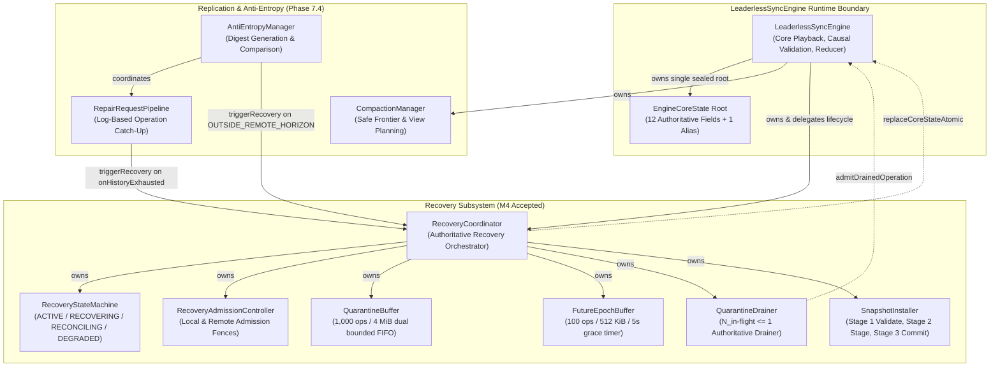
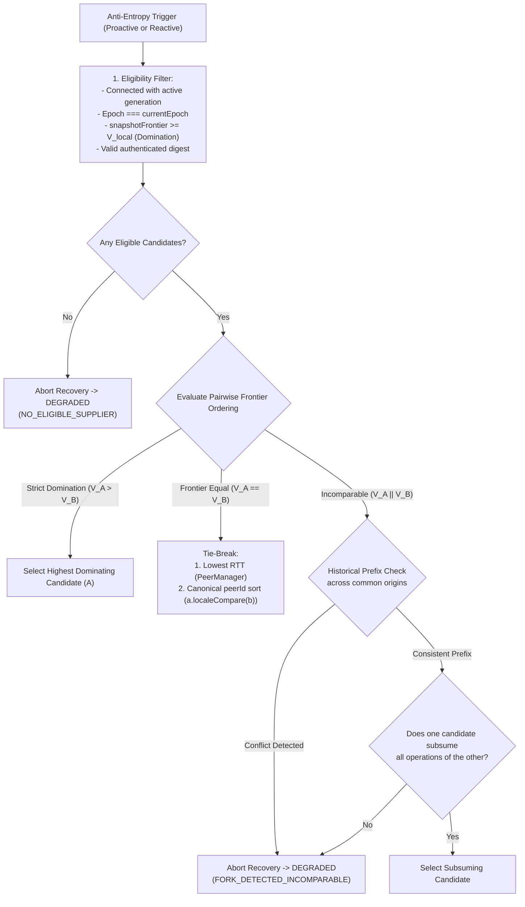
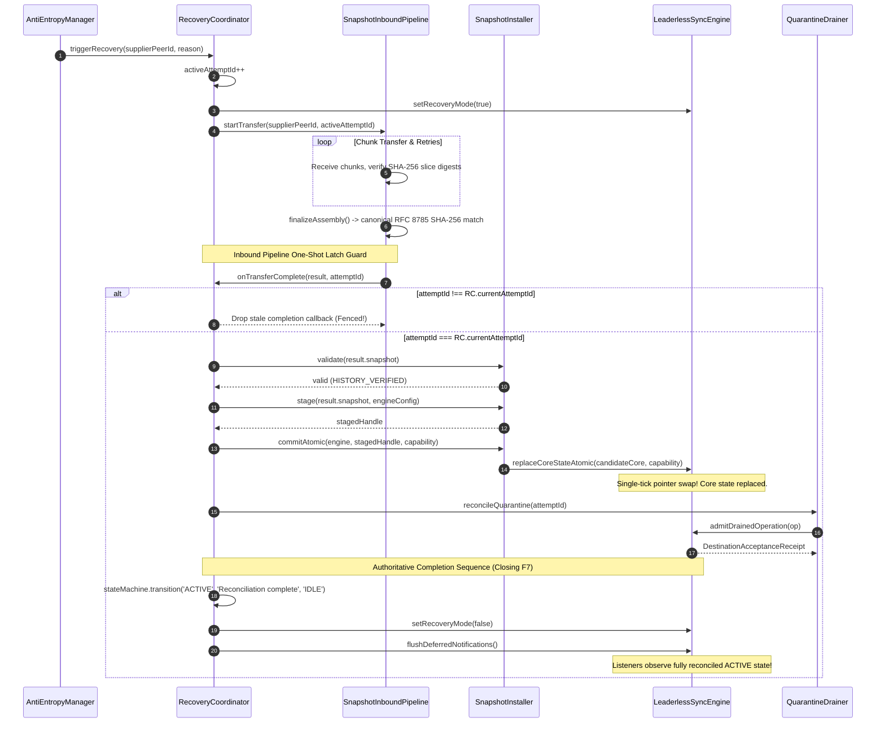

# Phase 7.5 Milestone M5 — Engine Runtime Recovery Integration Architecture

**Status:** APPROVED ARCHITECTURAL SPECIFICATION (MILESTONE M5.0-R1 AMENDED)  
**Date:** 2026-11-25  
**Authoritative Starting Baseline:** `40b11fdafcd247c7a289723f90ec0e2029c94f64` (Phase 7.5 M4.3d Formally Accepted)  
**Accepted Baselines:** M4.3c (`eab2428`), Approved Architecture (`2bb117c`), Frozen M4.2d (`aafa366`)  
**Scope:** Architecture planning and runtime integration specification for Milestone M5. Strictly read-only audit and design.

---

## 1. Executive Summary & Objective

Milestone M4 established complete implementation and verification evidence for chunked snapshot transfers, sliding window pipelining, candidate offer registries, active supplier failover, and quarantine buffering across 42 acceptance and multi-peer scenarios.

**Milestone M5** integrates this accepted recovery subsystem into the active runtime lifecycle of `LeaderlessSyncEngine`.

Prior to M5, the engine and recovery components operated with an explicit integration boundary: `RecoveryCoordinator` and `LeaderlessSyncEngine` were instantiated independently in test harnesses, with recovery triggered manually and drained operations submitted explicitly via test fixtures. Milestone M5 bridges this boundary so that:
1. Anti-entropy gap evaluation (`compareRemoteDigest`) and repair exhaustion (`onHistoryExhausted`) autonomously trigger snapshot recovery when operations fall outside the retained operation-log compaction horizon.
2. The engine's live ingestion path (`receive()`) routes incoming remote operations through a discriminated admission controller, ensuring current-epoch events enter quarantine, future-epoch events enter a 5-second staged buffer, and obsolete events are dropped, guaranteeing zero active state mutation during snapshot staging and installation.
3. Local user inputs (`receiveLocal()`, `submit()`) fail-close synchronously during recovery and degraded states, preventing concurrent local divergence and causal clock skew.
4. Snapshot installation synchronously and atomically replaces the engine's core state root (`EngineCoreState`) across all 12 authoritative components, preserving exact Lamport monotonicity ($L_{\text{local}} = \max(L_{\text{local}}, L_{\text{snapshot}})$ without $+1$) and causal replication frontiers.
5. The post-installation quarantine drain protocol sequentially submits quarantined operations through the engine's causal admission pipeline (`admitDrainedOperation()`), advancing replication vectors and emitting coalesced state notifications only after reconciliation reaches `ACTIVE`.

---

## 2. Component Architecture & Ownership Model

The runtime recovery integration connects nine distinct architectural subsystems, organized in a clear, non-circular ownership hierarchy:



### 2.1 Construction, Capability Custody, and Ownership Model (Closing F5)

To eliminate any ambiguity regarding component lifetimes, construction parameters, capability custody, and circular references:

1. **Single Construction Authority:** `LeaderlessSyncEngine` is the root component. It owns the lifecycle of `RecoveryCoordinator`.
2. **Configuration Mutually Exclusive Options:**
   - **Option A (Autonomous Internal Construction — Standard Production):** The caller provides `recoveryOptions?: EngineRecoveryOptions` in `LeaderlessSyncEngineConfig`. The engine instantiates its own `RecoveryCoordinator`, mints an unforgeable in-process `RecoveryInstallationCapability` (branded with a module-private Symbol), binds itself to the coordinator, and retains private ownership.
   - **Option B (External Coordinator Injection — Advanced Testing):** The caller provides an already constructed `recoveryCoordinator?: IRuntimeRecoveryCoordinator` and an authorized `authorizedRecoveryCapability?: RecoveryInstallationCapability`.
   - **Mutual Exclusion Invariant:** Supplying *both* `recoveryCoordinator` and `recoveryOptions` throws `SyncEngineError('INVALID_CONFIG', 'Cannot supply both recoveryCoordinator and recoveryOptions')`.
3. **Single Attachment Invariant:** A `RecoveryCoordinator` can be bound to at most one engine. Calling `coordinator.bindEngine(engine)` when already bound throws `SyncEngineError('ALREADY_BOUND')`. A coordinator cannot be detached, replaced, or swapped at runtime.
4. **Disposal Ownership:** Invoking `engine.dispose()` synchronously disposes the attached `RecoveryCoordinator`. The coordinator cancels all active timers (`overallTimer`, `offerAwaitTimer`, `reconciliationTimer`), disposes internal buffers (`quarantineBuffer`, `futureEpochBuffer`), clears all listener references, and transitions permanently to `DISPOSED`. Unreachable reference cycles between engine and coordinator are safely collected by the JavaScript garbage collector.

---

## 3. Authoritative Lifecycle & Admission Policy (Closing F1 & F3)

To ensure the engine and coordinator never maintain divergent lifecycle state, Milestone M5 defines three strictly separated concepts:

1. **`recoveryState`:** The authoritative state owned exclusively by `RecoveryCoordinator.stateMachine.state`:
   - `'ACTIVE'` — Normal operational replication.
   - `'RECOVERING'` — Snapshot transfer, verification, staging, and atomic commit in progress.
   - `'RECONCILING'` — Post-snapshot quarantine draining in progress.
   - `'DEGRADED'` — Terminal recovery failure, partition conflict, or buffer overflow; requires application-level reset.
   - `'DISPOSED'` — Engine or coordinator has been permanently shut down.
2. **`isRecoveryInProgress()`:** A derived boolean helper returning `true` **if and only if** `recoveryState === 'RECOVERING' || recoveryState === 'RECONCILING'`. (`isRecoveryActive()` is retained purely as a backward-compatible alias of `isRecoveryInProgress()`).
3. **`admissionPolicy`:** A comprehensive, deterministic decision matrix enforced across all five lifecycle states.

### 3.1 Comprehensive Lifecycle Admission Matrix

| Lifecycle State (`recoveryState`) | Local Intent Policy (`submit` / `receiveLocal`) | Remote Event Ingestion Policy (`receive`) | Discriminated Decision Outcome |
|---|---|---|---|
| **`ACTIVE`** | **Admitted.** Sequenced contiguously ($S_{\text{local}} += 1$), advances Lamport clock, captures causal context, reduces into log. | **Admitted.** Synchronous $O(1)$ check ($\le 5\,\mu\text{s}$). Passes directly to `receiveRemote()`, admitted to log, reduces state. | `ADMIT_ACTIVE` |
| **`RECOVERING`** | **Synchronously Rejected.** Throws `SyncEngineError('REJECTED_RECOVERING')`. Zero sequence advance, zero clock advance. Local intent fails closed. | **Intercepted & Segregated.**<br/>• Current Epoch $\to$ `QuarantineBuffer`<br/>• Future Epoch ($E > E_{\text{local}}$) $\to$ `FutureEpochBuffer` (5s grace)<br/>• Obsolete Epoch ($E < E_{\text{local}}$) $\to$ Discarded<br/>• In-flight duplicate $\to$ Dropped<br/>Zero mutation of operation log or active playback state. | `QUARANTINED`<br/>`BUFFERED_FUTURE_EPOCH`<br/>`DISCARDED_OBSOLETE_EPOCH`<br/>`DROPPED_DRAINER_DUPLICATE` |
| **`RECONCILING`** | **Synchronously Rejected.** Throws `SyncEngineError('REJECTED_RECOVERING')`. Zero sequence advance, zero clock advance. | **Intercepted & Segregated.** Identical to `RECOVERING`. Newly arriving events enter the active generation of `QuarantineBuffer` while the detached generation is drained. | `QUARANTINED`<br/>`BUFFERED_FUTURE_EPOCH`<br/>`DISCARDED_OBSOLETE_EPOCH`<br/>`DROPPED_DRAINER_DUPLICATE` |
| **`DEGRADED`** | **Synchronously Rejected.** Throws `SyncEngineError('REJECTED_DEGRADED')`. Engine is halted; requires explicit application session reset. | **Intercepted & Dropped.** Dropped immediately with decision `REJECTED_DEGRADED`. Zero buffer allocation, zero log insertion. | `REJECTED_DEGRADED` |
| **`DISPOSED`** | **Synchronously Rejected.** Throws `SyncEngineError('DISPOSED')`. | **Rejected.** Engine is shut down. Zero activity. | `REJECTED_DISPOSED` |

### 3.2 Discriminated Interception Result (Closing F3 & F9)

The previous optional-boolean result (`{ shouldQuarantine, dropped, duplicate }`) is replaced with an unambiguous discriminated union:

```typescript
export type RemoteAdmissionDecision =
  | { readonly outcome: 'ADMIT_ACTIVE' }
  | { readonly outcome: 'QUARANTINED'; readonly sequenceNumber: number; readonly originPeerId: string }
  | { readonly outcome: 'BUFFERED_FUTURE_EPOCH'; readonly targetEpoch: number; readonly expiresAtMs: number }
  | { readonly outcome: 'DISCARDED_OBSOLETE_EPOCH'; readonly eventEpoch: number; readonly currentEpoch: number }
  | { readonly outcome: 'DROPPED_DRAINER_DUPLICATE'; readonly originPeerId: string; readonly sequenceNumber: number }
  | { readonly outcome: 'REJECTED_DEGRADED'; readonly failureReason?: string }
  | { readonly outcome: 'REJECTED_DISPOSED' }
  | { readonly outcome: 'ABORTED_OVERFLOW'; readonly overflowType: 'QUARANTINE_OVERFLOW' | 'FUTURE_EPOCH_OVERFLOW'; readonly detail: string };
```

---

## 4. Single-Root State Inventory & Referential Alias Invariant (Closing F2)

Inspection of `packages/sync-engine/src/recovery/engine-core-state.ts` confirms that the engine's core state root encompasses **exactly 12 distinct authoritative fields**, exposed across 13 property keys on the sealed interface:

```typescript
export interface EngineCoreState {
  // ── 12 Authoritative Stored Fields ──────────────────────────────────────────
  state: PlaybackState;                        // 1. Primary active playback state (deeply frozen)
  baseSnapshot: PlaybackState;                 // 2. Compaction base anchor for speculative replay
  baseSnapshotFrontier: Record<string, number>;// 3. Highest compacted sequence numbers per origin
  operationLog: OrderedOperationLog;           // 4. Authoritative totally-ordered operation log
  clockManager: LogicalClockManager;           // 5. Authoritative Lamport logical clock manager
  pendingQueue: PendingDependencyQueue;        // 6. Missing-dependency queue for causal operations
  replicationVector: Record<string, number>;   // 7. Highest contiguous applied sequences per peer
  localCausalContext: Record<string, number>;  // 8. Observed causal horizon for local event generation
  localOriginSequence: number;                 // 9. Monotonic sequence counter for local events
  currentEpoch: number;                        // 10. Current membership configuration epoch
  lastAppliedEventId: string | undefined;      // 11. Identity of most recently applied operation
  stateVersion: number;                        // 12. Monotonic state version counter

  // ── Referential Alias (Property 13) ────────────────────────────────────────
  playbackState: PlaybackState;                // 13. Invariant alias: playbackState === state
}
```

### Referential Alias Invariant
- **Contract:** For any valid `EngineCoreState` instance, the referential equality `root.playbackState === root.state` is strictly required and enforced.
- **Enforcement:** `createEngineCoreState(params)` assigns `playbackState: state` and seals the object with `Object.seal()`.
- **Atomic Replacement:** `SnapshotInstaller.stage()` produces candidate roots strictly through `createEngineCoreState()`, ensuring that when `replaceCoreStateAtomic(candidateCore, capability)` executes, both `engine.playbackState` and `engine.state` update atomically to the exact same frozen reference in 0 ticks.

---

## 5. Supplier Selection & Vector Ordering Architecture (Closing F4)

Snapshot replication frontiers form a product lattice ($\mathbb{N}^k$) under component-wise ordering, which is only a **partial order**. Two vectors $V_1, V_2$ may be:
- Strictly ordered: $V_1 < V_2$ ($V_1 \le V_2 \land V_1 \ne V_2$)
- Equal: $V_1 = V_2$
- Incomparable: $V_1 \parallel V_2$ ($\exists p_1, p_2 : V_1[p_1] < V_2[p_1] \land V_1[p_2] > V_2[p_2]$)

### 5.1 Deterministic Candidate Selection Protocol



1. **Eligibility Filter:** A peer $P$ is eligible if and only if:
   - $P$ has an active connection generation in `peerGenerations`.
   - $P$'s advertised `membershipEpoch === engine.epoch`.
   - $P$'s advertised `snapshotFrontier` **dominates** the local replication vector: $\forall \text{origin}, V_P[\text{origin}] \ge V_{\text{local}}[\text{origin}]$ (missing origins treated as 0).
   - $P$'s digest is cryptographically valid.
2. **Ranking Rule (Strict Domination):** If candidate $A$ strictly dominates candidate $B$ ($V_A > V_B$), $A$ is ranked higher than $B$.
3. **Deterministic Tie-Breaking:** If $V_A = V_B$, rank by:
   - Connection stability: lowest RTT from `PeerManager.getRTT(peerId)`.
   - Deterministic fallback: canonical lexicographical sort on `peerId` (`a.localeCompare(b)`).
4. **Incomparable Vectors Prohibition:** The coordinator **NEVER** fabricates a total order between mutually incomparable dominating frontiers ($V_A \parallel V_B$) using timestamps or arbitrary peer IDs. Mutually incomparable dominating frontiers indicate an unbridgeable causal fork. The coordinator verifies historical prefix fingerprints; if a conflict exists or neither candidate subsumes the other, it transitions safely to `DEGRADED` (`FORK_DETECTED_INCOMPARABLE_SNAPSHOTS`).
5. **Discovery Paths:**
   - *Reactive (`onHistoryExhausted`):* Triggered when log repair receives `OUTSIDE_HORIZON`. Queries `AntiEntropyManager`'s cached digests for dominating suppliers.
   - *Proactive (`compareRemoteDigest`):* Triggered when digest evaluation detects `OUTSIDE_REMOTE_HORIZON`. The sender of that digest is immediately evaluated against the Eligibility Filter.

---

## 6. End-to-End Snapshot Recovery Integration Boundary (Closing F10)



### Lifecycle Guarantees & Resource Cleanup
- **Ownership:** `RecoveryCoordinator` owns the lifecycle of `SnapshotInboundPipeline`.
- **Attempt Fencing:** Every transfer callback and timer is tagged with `activeAttemptId`. Stale completions are dropped as no-ops.
- **One-Shot Completion Latch:** `SnapshotInboundPipeline` implements a boolean `hasCompleted` latch ensuring `onTransferComplete` fires at most once per transfer attempt.
- **Resource Cleanup:** Upon completion, abort, or disposal, `SIP.dispose()` immediately clears reassembly chunk arrays, deletes active supplier contexts, and dereferences byte buffers.

---

## 7. Authoritative Transition & Notification Sequence (Closing F7)

To guarantee that external listeners never observe an inconsistent or partially reconciled engine:

1. **Drain Completion:** `QuarantineDrainer.drain()` completes; `quarantineBuffer.totalRetainedCount === 0`.
2. **Bookkeeping Finalization:** Coordinator finalizes transfer metrics, releases leases, and updates in-flight records.
3. **Authoritative State Transition:** Coordinator transitions its state machine:
   `stateMachine.transition('ACTIVE', 'Reconciliation complete', 'IDLE')`.
4. **Engine Mode Sync:** Coordinator updates engine: `engine.setRecoveryMode(false)`.
5. **Notification Dispatch:** Coordinator invokes `engine.flushDeferredNotifications()` strictly **AFTER** state is `'ACTIVE'`.
6. **Notification Semantics:**
   - **`stateChangeListeners`:** Coalesced. Intermediate states are dropped; exactly ONE notification is emitted with the final reconciled `PlaybackState`.
   - **`decisionListeners`:** Preserved. All decisions generated during quarantine drain are queued in `deferredDecisions` and dispatched sequentially in FIFO order to preserve complete audit trails.

---

## 8. Measurable Active-State Performance Requirement (Closing F6)

Invariant `INV-M5-01` is defined with rigorous, measurable engineering criteria:
- **Zero Asynchronous Work:** In `ACTIVE` state, `interceptRemoteEvent()` is strictly synchronous, in-process, non-blocking, and executes in $O(1)$ time and $0$ heap allocations.
- **Execution Budget:** The admission check adds $\le 5\,\mu\text{s}$ per remote event on reference hardware, verified via micro-benchmarks.
- **Zero Quarantine Overhead:** Under `ACTIVE` state, exactly zero events enter `QuarantineBuffer` or `FutureEpochBuffer`.
- **Semantic Invariance:** All event ordering, causal validation, and reducer execution paths match Phase 7.4 bit-exact.
