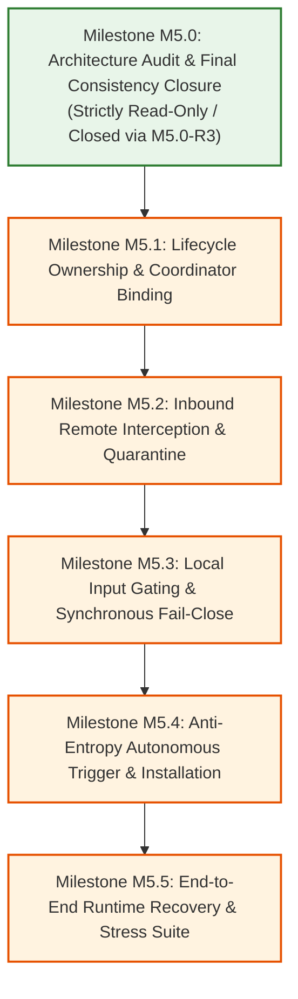

# Phase 7.5 Milestone M5 — Implementation Roadmap

**Status:** APPROVED ARCHITECTURAL SPECIFICATION (MILESTONE M5.0-R17 AMENDED)
**Date:** 2026-11-25
**Authoritative Starting Baseline:** `40b11fdafcd247c7a289723f90ec0e2029c94f64` (Phase 7.5 M4.3d Formally Accepted)
**Accepted Baselines:** M4.3c (`eab2428`), M4.3b (`f3c29b6`), Approved Architecture (`2bb117c`), Frozen M4.2d (`aafa366`)
**Scope:** Staged execution plan and gating procedures for Milestone M5 Engine Runtime Recovery Integration.

---

## 1. Roadmap Phasing Strategy & Dependency Order

Milestone M5 integrates the accepted snapshot recovery subsystem (`RecoveryCoordinator`, `SnapshotInstaller`, `QuarantineBuffer`) directly into `LeaderlessSyncEngine`.

Because `LeaderlessSyncEngine` is the core playback, causal ordering, and replication authority, M5 is divided into six sequential, risk-isolated sub-milestones (M5.0 through M5.5). Each sub-milestone has explicit entry prerequisites, strict scope constraints, and automated verification gates:

---

## 2. Sub-Milestone Detailed Specifications

### Milestone M5.0: Runtime Integration Architecture Audit & Final Consistency Closure (Amended M5.0-R17)
- **Role:** Independent Senior TypeScript Distributed-Systems Architect
- **Status:** CURRENT MILESTONE (Planning Only)
- **Objective:** Complete source audit, close review findings across R1 through R6, and author final consistent architecture specifications for M5.
- **Scope:**
  - Standardize browser-compatible exact byte accounting without re-serialization, preserving original transport wire length (`TextEncoder` / raw byte length) (R3-01).
  - Specify safe incomparable-compatible recovery procedure: prioritize anti-entropy log repair; if snapshot replacement is necessary, stash local unrepresented operations before install and re-drain, guaranteeing zero local operation loss. Enforce rigorous checkpoint hash chain / frontier timestamps evidence (matching frontier fingerprint alone insufficient) (R3-02).
  - Define three-tier distinction between authoritative coordinator lifecycle state, public engine queries (`recoveryState`, `isRecoveryInProgress()`, `isDegraded()`), and internal notification-deferral operational flag (`this.recoveryActive`), prohibiting dual lifecycle authorities and locking notification deferral in `DEGRADED` (R3-03, R5-03).
  - Formalize complete overflow decision contract across buffer, coordinator, and engine boundaries, confirming `REJECTED_CAPACITY` as an `EngineDecision.code`, zero buffer retention, and diagnostic preservation (R3-04).
  - Standardize protocol-stable ordinal ASCII peer ID comparison over the validated ASCII domain `/^[a-zA-Z0-9_.:-]+$/` (R3-05).
  - Inspect `PendingDependencyQueue` capacity ($K = 256$), define drain ownership ($N_{\text{in-flight}} \le 1$), and explicitly identify missing aggregate byte limit as an unresolved design issue (R3-06).
  - Define capability custody checked via object identity, unwinding on constructor failure, and disposal dead-ending without claiming un-modeled revocation (R3-07).
  - Qualify performance benchmark contract (Node.js LTS reference environment vs browser runtimes) and clarify young-gen / escape analysis allocation claims (R3-08).
  - Specify capability-gated trust context provenance (`DrainAdmissionContext = TrustedLocalReplayCapability | TrustedRepairBatchCapability`) verified via strict reference identity, eliminating caller-supplied string vulnerability and preventing accidental trust escalation (R6-01).
  - Enforce canonical ordering feasibility check against compacted snapshots ($L(A) > \text{snapshot.maxLogicalTimestamp}$ and $\forall p,\ L(A) > \text{originFrontierTimestamps}[p]$) and explicit incompatibility gate (`INCOMPATIBLE_COMPACTED_HISTORY` aborting to `DEGRADED`) to prevent SMR total-order inversion ($A \prec B$ hazard), preserving causal dependency validation (R5-02).
  - Formalize published Map encapsulation across `TerminalArchiveCoreState` and `QuarantineBufferCoreState` under the Eight Rules of Map Ownership (distinguishing shallow `Object.freeze` from Map encapsulation, R17-A), private typed array storage with detached `Uint8Array` accessor cloning (R17-B), Option A archive reservation linearization integrating `activeReservations` directly into the candidate root (R16-B), QuarantineBuffer and QuarantineDrainer physical custody separation, settlement barrier synchronization, and dual zero-custody verification (R16-C), and portable UTF-8 length-prefixed composite identity encoding (`opid:...`) with full 4-field verification on index hits (R16-D).
  - Resolve `REINITIALIZE_CLEAN` exact notification ordering (Step 1 purges stale notifications; Step 2 installs clean baseline; Step 3 disengages recovery mode; Step 4 transitions coordinator to ACTIVE; Step 5 dispatches clean baseline notifications) and define non-throwing listener dispatch with isolated error handling, explicit irreversible external effect boundaries, and zero-notification delivery clarification (R8-03, R8-04, R9-06, R10-04, R11-D).
  - Formalize package boundary guarantee (`package.json` root `.` export only, prohibiting supported public package subpath imports of internal custody module), runtime shallow immutability (`Object.freeze`), private transfer bundle (`AuthorizedDrainCapabilities`), `bindEngine()` single-attachment composition root scope, and absence of capability getters (R6-01, R7-01, R8-05, R9-07).
  - Formalize capability custody and operation provenance distinction: capability grants admission authority, but payload provenance is strictly enforced (`stashedLocalQueue` exclusivity, prohibition of remote relabeling, and identity hash verification $H(op) == H(log)$) (R6-03, R7-03).
- **Affected Files:** Documentation files only (`docs/PHASE7_5_M5_*.md`). Zero production or test code modified.
- **Exit Condition:** Clean audit report; zero production diff; documentation committed; engineering authority approval.

---

### Milestone M5.1: Lifecycle Ownership, Coordinator Construction, Attachment & Disposal
- **Objective:** Establish the authoritative recovery lifecycle coupling between `RecoveryCoordinator` and `LeaderlessSyncEngine`.
- **Scope:**
  - Update `LeaderlessSyncEngineConfig` with mutually exclusive options: `recoveryOptions?: EngineRecoveryOptions` vs. `recoveryCoordinator?: IRuntimeRecoveryCoordinator`. Throw `SyncEngineError('INVALID_CONFIG')` if both are supplied.
  - Refactor `LeaderlessSyncEngine`:
    - Add `readonly recoveryState: RecoveryState` delegating to coordinator (or returning `'ACTIVE'` if unattached, `'DISPOSED'` if disposed).
    - Implement `isRecoveryInProgress()` returning `true` strictly for `'RECOVERING'` and `'RECONCILING'`.
    - Implement `isDegraded()` returning `true` strictly for `'DEGRADED'`.
    - Retain `isRecoveryActive()` as a backward-compatible alias of `isRecoveryInProgress()`.
    - Clarify internal `this.recoveryActive` boolean strictly as a notification-deferral operational switch slaved to coordinator, locked in `DEGRADED`.
    - Mint and retain private custody of `authorizedLocalReplayCapability` and `authorizedRepairBatchCapability` (deeply frozen via `Object.freeze()`).
    - Author module-internal `packages/sync-engine/src/recovery/drain-admission-custody.ts` defining module-private `DRAIN_ADMISSION_BRAND: unique symbol` (strictly non-exported in public package entry point).
    - Bundle drain capabilities into immutable `AuthorizedDrainCapabilities` for private transfer to `RecoveryCoordinator` via `bindEngine(engine, recoveryCapability, drainCapabilities)` without public getters.
  - Implement single-attachment invariant in `coordinator.bindEngine(engine, capability)`: throw `SyncEngineError('ALREADY_BOUND')` if already attached. Prohibit sharing coordinators across engines.
  - Implement capability-authorized `resetRecovery(capability, resetAction)` strictly from `DEGRADED` state with failure-atomic lifecycle semantics:
    - `PURGE_AND_RETRY`: monotonic attempt counter increment (`currentAttemptId++`), concurrent reset serialization with post-settlement attempt re-validation, in-flight invalidation with retained ownership slot and drain settlement barrier ($N_{\text{in-flight}} \le 1$), 10-step settlement reconciliation (R12-B), `ATTEMPT_INVALIDATED` receipt handling (R11-A), candidate isolation with CAS expected-root verification (R11-B), terminal archive overflow fail-closed protection (R11-C, R12-D), quarantine buffer fate preservation (R11-D), watchdog timeout independence without cancellation (R10-02), mandatory acceptance-boundary attempt-ID fencing, and permanent suppression of deferred notifications.
    - `REINITIALIZE_CLEAN`: multi-stage atomic retirement transaction with capacity pre-reservation (R12-A), 10-step settlement barrier reconciliation (R12-B), dedicated `TerminalArchiveAdministrationCapability` (R12-C), strict archive bounds (R12-D), quarantine retirement to `TerminalQuarantineArchive` (`REINITIALIZE_CLEAN_PURGED`), atomic clean baseline install via `replaceCoreStateAtomic`, and non-throwing `flushDeferredNotifications()` strictly after ACTIVE (acknowledging zero notifications may be delivered). Once `ACTIVE` is reached in step 4, state transition is externally observable; if pre-ACTIVE steps fail, catch block restores `setRecoveryMode(true)`, suppresses notifications, and locks engine in `DEGRADED` anchored on the clean baseline without rolling back.
  - Wire coordinator lifecycle completion sequence:
    1. Quarantine drain completes (`totalRetainedCount === 0`).
    2. Recovery bookkeeping completes.
    3. `engine.setRecoveryMode(false)`.
    4. Coordinator transitions to `ACTIVE`. If transition throws, catch and rollback `engine.setRecoveryMode(true)`, aborting recovery without flushing notifications.
    5. Coordinator clears timers and invokes `engine.flushDeferredNotifications()` strictly **after** state is `'ACTIVE'`.
  - Ensure `engine.dispose()` synchronously disposes the attached `RecoveryCoordinator`, clearing all timers and listeners.
- **Affected Files:**
  - `packages/sync-engine/src/engine/leaderless-sync-engine.ts`
  - `packages/sync-engine/src/recovery/recovery-coordinator.ts`
  - New test file: `packages/sync-engine/src/__tests__/recovery-lifecycle-binding.test.ts`
- **Invariants Enforced:**
  - Single authoritative recovery state source of truth (`RecoveryCoordinator.stateMachine.state`).
  - Strict mutual exclusion in engine configuration.
  - Clean disposal with zero lingering timers or detached listeners.
- **Prohibited Work:** Do not implement remote interception (M5.2) or local input gating (M5.3) in this milestone.
- **Exit Condition:** Unit tests verify lifecycle coupling, configuration mutual exclusion, single attachment, and disposal.

---

### Milestone M5.2: Inbound Remote-Event Interception & Quarantine
- **Objective:** Route incoming remote operations through `RecoveryCoordinator.interceptRemoteEvent()` returning discriminated `RemoteAdmissionDecision`.
- **Scope:**
  - In `LeaderlessSyncEngine.receive()`, route remote events (`isLocal === false`) to `coordinator.interceptRemoteEvent(event, size)` when coordinator is attached. Pass original wire serialized length directly without re-serializing.
  - Handle discriminated outcomes:
    - `ADMIT_ACTIVE`: proceed to normal `receiveRemote()` without added latency ($\le 5\,\mu\text{s}$).
    - `QUARANTINED`: record decision `BUFFERED_QUARANTINE`, bypass `receiveRemote()`, zero log/state mutation.
    - `BUFFERED_FUTURE_EPOCH`: record decision `BUFFERED_FUTURE_EPOCH`, staged in `FutureEpochBuffer` with independent 5s grace timer.
    - `DISCARDED_OBSOLETE_EPOCH`: drop event with zero state or log side effects.
    - `DROPPED_DRAINER_DUPLICATE`: drop event matching currently in-flight draining operation.
    - `REJECTED_DEGRADED`: drop event with decision `REJECTED_DEGRADED`.
    - `REJECTED_DISPOSED`: reject event on disposed engine.
  - Unified overflow handling: `QuarantineBuffer.enqueue` and `FutureEpochBuffer.enqueue` throw `QUARANTINE_OVERFLOW` / `FUTURE_EPOCH_OVERFLOW`. Coordinator catches, aborts to `DEGRADED`, and rethrows. `LeaderlessSyncEngine.receive()` catches, isolates remote error, maps to rejection decision `code: 'REJECTED_CAPACITY'`, and records it without throwing to transport callers.
- **Affected Files:**
  - `packages/sync-engine/src/engine/leaderless-sync-engine.ts`
  - `packages/sync-engine/src/recovery/recovery-coordinator.ts`
  - `packages/sync-engine/src/recovery/recovery-admission-controller.ts`
  - New test file: `packages/sync-engine/src/__tests__/recovery-remote-interception.test.ts`
- **Invariants Enforced:**
  - Zero state mutation or causal advancement while recovery is in progress.
  - In-flight draining operations are deduplicated against newly arriving remote events.
  - Memory bounds (1,000 ops / 4 MiB quarantine; 100 ops / 512 KiB future epoch; 4 KiB event limit) are strictly enforced.
- **Exit Condition:** Unit tests prove remote events are quarantined during recovery, overflow triggers degradation and remote isolation, and normal events are admitted when active.

---

### Milestone M5.3: Local Input Gating & Synchronous Fail-Close
- **Objective:** Gate local user actions during recovery and degraded states, synchronously rejecting inputs.
- **Scope:**
  - In `LeaderlessSyncEngine.receiveLocal()`, call `coordinator.interceptLocalSubmission()`.
  - If `allowed === false`: throw synchronous `SyncEngineError(admission.code, admission.reason)`.
    - Throws `REJECTED_RECOVERING` during `RECOVERING` or `RECONCILING`.
    - Throws `REJECTED_DEGRADED` during `DEGRADED`.
  - Implement `LeaderlessSyncEngine.submit(intent)` helper that validates intent and calls `receiveLocal()`, fail-closing during recovery.
  - Ensure local sequence numbers (`localOriginSequence`) and local clocks are NOT advanced when local inputs are rejected.
- **Affected Files:**
  - `packages/sync-engine/src/engine/leaderless-sync-engine.ts`
  - New test file: `packages/sync-engine/src/__tests__/recovery-local-gating.test.ts`
- **Invariants Enforced:**
  - Local inputs strictly prohibited during non-ACTIVE states.
  - No silent queuing of local actions (preventing causal skew and intent inversion).
  - Local sequence counter and Lamport clock remain unmutated on rejection.
- **Exit Condition:** Unit tests verify synchronous rejection of all local control events during recovery and degraded states.

---

### Milestone M5.4: Anti-Entropy Autonomous Trigger, Supplier Selection & Snapshot Installation Integration
- **Objective:** Autonomously trigger snapshot recovery from anti-entropy gap detection and execute atomic snapshot installation.
- **Scope:**
  - Implement deterministic supplier selection under lattice partial ordering: strict domination, lowest RTT, and protocol-stable ordinal ASCII peer ID comparison (`comparePeerIds`).
  - Differentiate incomparable vector cases: compatible branches, repairable histories within log horizon, and proven causal forks.
  - Enforce safe incomparable-compatible recovery: prioritize anti-entropy log repair; if snapshot replacement is necessary, stash local unrepresented operations before install and sequentially re-admit strictly via `admitDrainedOperation(op, capability, attemptId: number)`.
  - Enforce canonical ordering feasibility check: verify $L(A) > \text{snapshot.originFrontierTimestamps}[p]$ (or $L(A) > \text{snapshot.maxLogicalTimestamp}$) for all stashed local operations before snapshot replacement. If an ordering hazard is detected and anti-entropy repair cannot resolve it, trigger explicit incompatibility gate: abort recovery to `DEGRADED` with `SyncEngineError('INCOMPATIBLE_COMPACTED_HISTORY')`. Causal dependencies remain strictly validated during replay.
  - Enforce the 6-category deterministic replay contract (R4-02, R5-01, R5-02, R6-01): Category 1 (`ALREADY_REPRESENTED` discarded), Category 2 (`ACCEPTED_REDUCED` applied), Category 3 (deterministic total-order SMR reduction via `compareOperations`), Category 4 (`ACCEPTED_PENDING` buffered in queue / delta repair), Category 5 (`ALREADY_OWNED_DUPLICATE` discarded), Category 6 (validation failures: remote discarded, locally committed aborts to `DEGRADED`). Enforce capability-gated trust context: `QuarantineDrainer` presents strictly `TrustedRepairBatchCapability`, while stashed local replay presents `TrustedLocalReplayCapability`, checked via strict object-reference identity (`===`).
    - Enforce inviolable operation provenance distinction: capability grants admission authority, but payload provenance is strictly enforced: `LOCAL_REPLAY` operations originate exclusively from `stashedLocalQueue` (populated strictly from immutable local log entries; remote operations prohibited from entering or being relabeled as local); identity hash $H(op) == H(log)$ and causal dependencies verified against snapshot base, immediately aborting to `DEGRADED` on conflict.
  - Enforce post-installation replay failure handling: if replay fails after snapshot installation, coordinator transitions to `DEGRADED` (`DRAIN_FAILED`), `engine.setRecoveryMode(true)` is maintained, deferred notifications are NEVER flushed, and `inFlightRecord` is preserved.
  - Require full checkpoint hash chain or frontier timestamps evidence before declaring history compatibility.
  - In `AntiEntropyManager.evaluateRemoteDigest()`, inspect `compareRemoteDigest(digest)`. If `requiresSnapshotRecovery === true` and `outsideRemoteHorizon === true`, invoke `onSnapshotRecoveryRequired` to trigger `coordinator.triggerRecovery(supplierPeerId)`.
  - Wire `RepairRequestPipeline.onHistoryExhausted` into `coordinator.triggerRecovery()`.
  - Wire `SnapshotInboundPipeline.onTransferComplete` to invoke `coordinator.executeRecoveryWithSnapshot(payload)` with one-shot completion latch and `activeAttemptId` fencing.
  - Execute `SnapshotInstaller.stage()` producing opaque `StagedSnapshotInstallation` handle, holding candidate `EngineCoreState` in private `WeakMap`.
  - Execute capability-gated commit: `installer.commitAtomic(engine, stagedHandle, capability)` invoking `engine.replaceCoreStateAtomic(candidateCore, capability)` in one synchronous reference replacement under JavaScript run-to-completion semantics.
  - Enforce exact Lamport clock reseeding: $L_{\text{local}} = \max(L_{\text{local}}, L_{\text{snapshot}})$ strictly without $+1$.
  - Execute post-installation quarantine drain via `reconcileQuarantine()`, iteratively draining quarantined operations until empty with $N_{\text{in-flight}} \le 1$.
- **Affected Files:**
  - `packages/sync-engine/src/replication/anti-entropy-manager.ts`
  - `packages/sync-engine/src/engine/leaderless-sync-engine.ts`
  - `packages/sync-engine/src/recovery/recovery-coordinator.ts`
  - New test file: `packages/sync-engine/src/__tests__/recovery-anti-entropy-trigger.test.ts`
- **Invariants Enforced:**
  - Both reactive repair exhaustion and proactive digest comparison autonomously initiate recovery.
  - Triggering is strictly idempotent.
  - Snapshot installation is single-reference atomic across all 12 authoritative fields via opaque staged handles.
  - Lamport clock is monotonic without artificial $+1$ increment.
  - Drained events advance replication vectors through causal validation.
- **Exit Condition:** Integration tests prove autonomous triggering, atomic install, and post-install drain.

---

### Milestone M5.5: End-to-End Runtime Recovery, Clock, Vector, and Fault Suite
- **Objective:** Comprehensive multi-peer simulation and stress hardening of the fully integrated engine runtime.
- **Scope:**
  - Multi-peer simulation suite covering:
    1. Lagged peer rejoining after 500-op compaction horizon gap.
    2. Concurrent remote event burst during active recovery transfer.
    3. Missing causal dependencies in quarantined events correctly enqueued in `pendingQueue`.
    4. Supplier crash and failover during active recovery with seamless assembly completion.
    5. Future-epoch operation buffering, grace period countdown, and epoch advancement.
    6. Quarantine buffer overflow triggering graceful degradation to `DEGRADED`.
    7. Lamport clock monotonicity across multiple sequential recovery and drain cycles.
  - Reference benchmark suite verifying active-state performance ($\le 5\,\mu\text{s}$ p99 overhead in Node LTS, zero queue allocations).
  - Monorepo regression test run meeting or exceeding minimum floors ($\ge 1,550$ monorepo tests, $\ge 965$ sync-engine tests, $\ge 42$ recovery acceptance tests).
- **Affected Files:**
  - `packages/sync-engine/src/__tests__/recovery-engine-integration.test.ts`
  - Milestone M5 Completion Report: `docs/PHASE7_5_M5_COMPLETION_REPORT.md`
- **Invariants Enforced:**
  - 100% test pass rate across sync-engine and full monorepo with 0 failures and 0 skips.
  - Zero memory leaks, dangling timers, or unhandled promise rejections.
  - Zero regressions against Phase 7.3, 7.4, and M4 baselines.
- **Exit Condition:** All integration tests pass; independent audit sign-off; milestone frozen.

---

## 3. Sub-Milestone Gating Rules

To ensure strict engineering governance, the following gating rules are non-negotiable:

1. **Sequential Authorization:** Implementation of sub-milestone $M5.(n+1)$ may ONLY begin after $M5.n$ is completed, verified, and authorized by the Engineering Authority. M5.1 must not quietly implement M5.2 or M5.3.
2. **Zero Regression Gate:** Every sub-milestone must pass all existing unit tests (minimum regression floor of 965 in `@syncplay/sync-engine`, 1,550 monorepo total) with zero skipped tests and zero warnings. New tests must increase these totals.
3. **TypeScript Build Gate:** `npm run typecheck` and `npm run build` must exit with code 0 across all 6 workspaces on every commit.
4. **Frozen Baseline Preservation:** No commit may modify any file in `@syncplay/protocol`, `@syncplay/peer-mesh`, or `@syncplay/control-events` without explicit architectural re-authorization.
5. **Single-Purpose Commits:** Each sub-milestone must be committed as a clean, focused Git commit with a detailed conventional commit message.
