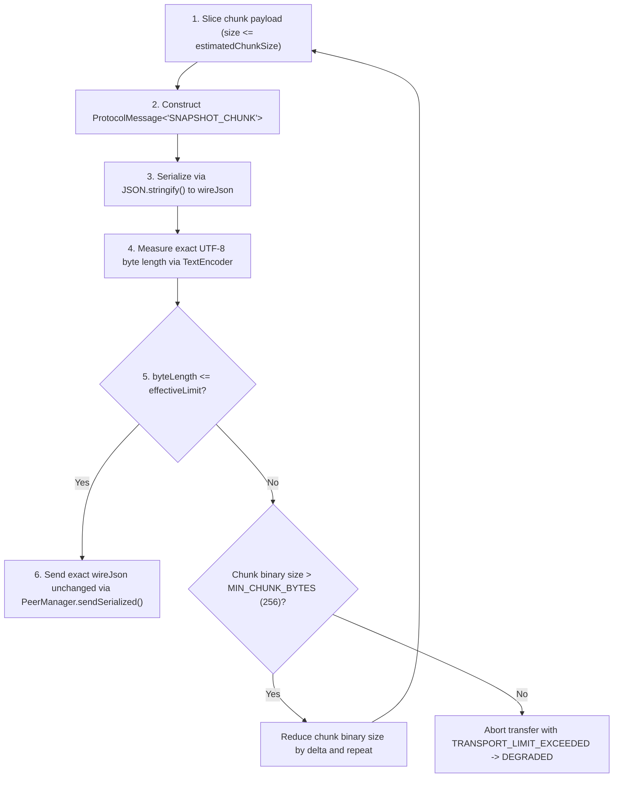

# Phase 7.5 — Fault Tolerance & State Recovery: Research and Problem Definition

**Status:** APPROVED ARCHITECTURAL DESIGN (FINAL CLOSURE)  
**Date:** 2026-11-19  
**Branch Baseline:** `main` at `30b8e5f`  
**Frozen Baselines:** Phase 7.3 (`e49b81a`), Phase 7.4 M1–M5 (`dbd5217`, `3a3d9e5`)  

---

## 1. Problem Statement and Scope

In Phase 7.4, the SyncPlay protocol established a request-driven, peer-to-peer anti-entropy repair protocol capable of reconciling missing operation sequences across active mesh members. However, Phase 7.4 operates under a fundamental constraint: **anti-entropy repair can only service sequence gaps that exist within the active operation logs of connected suppliers.**

In real-world distributed media playback across unstable WebRTC peer meshes, peers routinely experience conditions that exceed the bounded history retention horizon of active logs:
1. **Extended Disconnections / Late Joiners:** A peer joins or rejoins after being disconnected for minutes or hours, during which hundreds or thousands of playback operations occurred and were compacted.
2. **Log Compaction Horizon:** To prevent unbounded memory consumption, operation logs are pruned up to a safe frontier ($V_{\text{epoch\_safe}}$). Operations older than the compaction horizon are collapsed into a base playback snapshot and permanently discarded from memory.
3. **No Supplier Retains History:** When an anti-entropy request triggers `onHistoryExhausted` (due to `OUTSIDE_HORIZON` or `NO_ELIGIBLE_REPAIR_SUPPLIER`), operation repair is mathematically impossible.
4. **Network Partitions and Divergent Snapshots:** Multiple network partitions may independently compact different subsets of history or operate at different frontiers.
5. **Epoch Transitions During Recovery:** Membership changes trigger epoch increments while a recovery handshake is in-flight.

**Phase 7.5 establishes the state recovery architecture** that enables peers to safely catch up across compaction horizons, heal partitions, and recover from extended disconnections without sacrificing causal correctness, Lamport clock monotonicity, or leaderless autonomy.

---

## 2. Invalidation of Common Anti-Patterns

Snapshot recovery in distributed media sync is plagued by several tempting but dangerous shortcuts:

### Anti-Pattern 1: "Downloading the Newest Snapshot"
- **The Fallacy:** A rejoining peer simply queries connected peers for their latest snapshot and adopts the one with the highest `stateVersion` or newest wall-clock timestamp.
- **Why It Fails:** In a leaderless peer-to-peer system, a higher `stateVersion` or timestamp does not imply causal dominance. A partitioned peer could have generated 50 rapid pause/play toggles in isolation, resulting in a high `stateVersion` that is causally stale or conflicted with the main group. Installing the "newest" snapshot can overwrite legitimate group playback with isolated partition noise.

### Anti-Pattern 2: "Matching Hashes Prove Causal Equivalence"
- **The Fallacy:** If two peers calculate the same hash over their current playback state (e.g. `status: paused, position: 45000`), their histories and causal vectors must be identical.
- **Why It Fails:** State convergence can happen coincidentally (e.g. two independent seeks to the same chapter marker). Matching state payloads do not prove identical causal vectors or identical Lamport clocks. Reseeding a clock based solely on state hashes causes causal regressions.

### Anti-Pattern 3: "Replication Vectors Prove Historical Equivalence"
- **The Fallacy:** If $V_A[\text{peer-1}] = V_B[\text{peer-1}] = 100$, both peers have executed the same historical operations.
- **Why It Fails:** Without historical fingerprint chaining or checkpoint verification, a sequence number collision (two conflicting events authored with the same sequence) could exist below the frontier.

### Anti-Pattern 4: "Arbitrary Tie-Breaking on Incomparable Snapshots"
- **The Fallacy:** When two snapshots have incomparable frontiers ($V_A > V_B$ on origin 1, but $V_B > V_A$ on origin 2), resolve the conflict by picking the lowest peer ID or highest timestamp.
- **Why It Fails:** Arbitrary tie-breaking violates causality and creates state divergence. Unless missing operations between the frontiers can be retrieved and reduced in total order, incomparable snapshots represent unresolvable historical divergence that must enter an explicit degraded state.

---

## 3. Deep-Dive Answers to the 18 Core Research Questions

### Q1: What exactly makes a snapshot eligible for installation?
A snapshot $S$ is eligible for atomic installation if and only if all eight conditions hold:
1. **Valid Format Version:** `formatVersion === 2`.
2. **Bit-Exact SHA-256 Digest:** Canonical RFC 8785 JSON representation of $S$ produces a SHA-256 digest identical to $S.\text{sha256Digest}$.
3. **Strict Vector Domination:** For every origin $p$ known locally:
   $$V_S[p] \ge V_{\text{local}}[p]$$
4. **Historical Checkpoint Compatibility Across Prefix:** For every common sequence $i \in [1, \min(V_S[p], V_{\text{local}}[p])]$ retained by either party, checkpoint fingerprints match bit-exact (Section 5).
5. **Exact Lamport Invariant Reinstated:**
   $$S.\text{maxLogicalTimestamp} \equiv \max_{p \in \text{origins}(V_S)} S.\text{originFrontierTimestamps}[p]$$
   and is within integer bounds ($\le \text{Number.MAX\_SAFE\_INTEGER}$).
6. **Epoch Compatibility & Revalidation:** $S.\text{membershipEpoch} \le \text{currentEpoch}$ adhering to formal epoch revalidation rules (Section 6).
7. **Identity Authorization:** $S.\text{authorPeerId}$ is a recognized participant in the session.
8. **Generation Currency:** Arrives over an authenticated DataChannel whose connection generation matches the active generation.

### Q2: How does a peer detect that log repair is impossible?
Log repair is declared impossible when:
- An anti-entropy repair request to all eligible suppliers returns `REPAIR_REJECTED` with reason `OUTSIDE_HORIZON`.
- `ReplicationComparator.compareDigests()` evaluates remote digest as `REQUIRES_SNAPSHOT_RECOVERY`.
- `RepairRequestPipeline` exhausts retries and invokes `callbacks.onHistoryExhausted`.

### Q3: How is the compaction horizon safely determined?
See Section 4. Compaction is bounded by the membership-scoped safe frontier ($V_{\text{epoch\_safe}}$) over a verified, unmutated membership view $\mathcal{V}$, or bounded by local ring buffer capacity ($K=256$).

### Q4: What prevents snapshot corruption during transmission?
- Multi-tier validation: each chunk carries its own SHA-256 hash (`chunkSha256`).
- Full reassembled byte array is verified against $S.\text{sha256Digest}$ prior to parsing.
- Zod schema validation (`StateSnapshotPayloadV2Schema`) executes before staging.

### Q5: How is snapshot chunking bounded for WebRTC?
- WebRTC DataChannel hard ceiling: 65,536 bytes.
- Dynamic chunk sizing (Section 7) uses `calculateDynamicChunkSize` as an initial estimate, with an iterative normative send-boundary loop measuring exact serialized UTF-8 bytes against negotiated SCTP limits.
- Total snapshot size hard-capped at 4,194,304 bytes (4 MB = 128 chunks).

### Q6: How does Lamport clock reseeding avoid clock runaway?
Phase 7.2-R7 and R8 established the exact reseeding invariant:
$$L_{\text{local}} = \max(L_{\text{local}}, S.\text{maxLogicalTimestamp})$$
**Strictly WITHOUT adding $+1$.** Subsequent local events add $+1$, preserving monotonicity without artificial clock inflation across repeated recovery cycles.

### Q7: How are live control events handled during recovery?
Incoming broadcast operations are diverted to an in-memory `QuarantineBuffer` (capacity 1,000 operations). Local control inputs are blocked. Post-installation, the buffer is drained in causal order.

### Q8: What happens when two partitions heal with incomparable snapshots?
Neither snapshot causally dominates. Arbitrary tie-breaking is strictly prohibited. The engine enters `DEGRADED` state and notifies the application via `onRecoveryDegraded`.

### Q9: How is atomic installation guaranteed?
Staged validation (`validateCandidate`) executes purely out-of-engine. Installation uses a **Staged Immutable Engine-State Replacement** pattern, atomically swapping engine references only after all structures and checkpoints are validated (Section 9). Listeners are notified only post-swap.

### Q10: How does a peer verify historical continuity below the compaction horizon?
Via `compactedCheckpoints` tables stored in `StateSnapshotPayloadV2`. Checkpoints across the common sequence prefix are cross-checked (Section 5).

### Q11: How are membership epochs handled during transfer?
If the room epoch increments during an active transfer, the transfer is synchronously aborted (`EPOCH_MISMATCH`) and all intermediate chunk buffers are discarded.

### Q12: How are supplier failures handled mid-transfer?
`SnapshotTransferManager` detects DataChannel close or timeouts and aborts the transfer, allowing failover to an alternative supplier.

### Q13: How is local state version advanced?
$$V_{\text{state, local}} = V_{\text{state, local}} + 1$$
Local sequence monotonicity is preserved; remote `stateVersion` is recorded in metadata.

### Q14: How does a recovering peer prevent replay amplification?
The peer maintains at most ONE active inbound transfer. Duplicate chunks are deduplicated by index bitmask.

### Q15: How does snapshot transfer interact with SCTP backpressure?
Chunk requests are throttled using a sliding window of at most 4 concurrent in-flight chunks (`MAX_CONCURRENT_CHUNK_REQUESTS = 4`).

### Q16: How does the system prevent memory exhaustion during reassembly?
Pre-allocation checks reject snapshots $>4\text{ MB}$ or chunks $>32\text{ KB}$ before allocating buffer memory. Only 1 active transfer is permitted.

### Q17: What metadata must a snapshot retain for future anti-entropy?
`snapshotFrontier`, `originFrontierTimestamps`, and `compactedCheckpoints` are preserved and injected into `OrderedOperationLog`.

### Q18: What is the formal boundary between Ordinary Recovery and Manual Reset?
Ordinary recovery is strictly causally consistent. Manual reset abandons causality and creates a new session identity (Section 6).

---

## 4. Compaction Frontier Procedure & Membership Dynamics

The computation of the compaction horizon must be grounded in the concrete realities of SyncPlay's leaderless architecture.

### 4.1 Formal Captured Membership View $\mathcal{V}$
A local peer captures a formal membership view:
$$\mathcal{V} = \Big(\text{epoch}: E_{\text{local}}, \mathcal{P}: \{ (p, gen_p) \mid p \in \text{connectedPeers}, \text{dataChannelState}(p) === \text{'open'} \} \Big)$$

### 4.2 Current Digest Requirement
For every peer $(p, gen_p) \in \mathcal{P}$:
The local engine must possess an active, authenticated `STATE_DIGEST` $D_p$ satisfying:
1. $D_p.\text{senderPeerId} === p$
2. $D_p.\text{connectionGeneration} === gen_p$
3. $D_p.\text{membershipEpoch} === E_{\text{local}}$

**Behavior when a connected peer has not supplied a current digest:**
- If ANY peer in $\mathcal{P}$ lacks a current digest for view $\mathcal{V}$, the membership view is **INCOMPLETE**.
- `V_epoch_safe` **CANNOT** be computed over $\mathcal{P}$.
- Compaction at `V_epoch_safe` is **HELD** until all connected peers report.
- The engine does not stall indefinitely: if local memory pressure requires log pruning ($K=256$), the engine may prune oldest operations locally under `V_local_cand`, which explicitly provides **ZERO safety guarantees for remote peers**.

### 4.3 Pre-Commit Revalidation
Immediately prior to committing `compactAtFrontier(V_epoch_safe)`:
1. Re-read active epoch: `assert(engine.epoch === V.epoch)`.
2. Re-read connected peer table from `PeerManager`:
   $$\text{currentConnected} = \{ (p, gen_p) \mid \text{dataChannelState}(p) === \text{'open'} \}$$
   `assert(currentConnected === V.P)`
3. If ANY peer in $\mathcal{P}$ disconnected, closed its channel, incremented its generation, or if an epoch increment occurred:
   - **ABORT the compaction attempt immediately.**
   - Do NOT prune operations based on the invalidated view.
   - Wait for a new view $\mathcal{V}'$ and new digests.

### 4.4 The Three Compaction Frontiers
```
+----------------------------------------------------------------------------------------------------+
| 1. Local Compaction Candidate (V_local_cand):                                                      |
|    Operations older than capacity K=256 that the local peer prunes for local memory bounds.        |
|    SAFETY: Purely local. Provides zero safety guarantees for remote peers.                         |
+----------------------------------------------------------------------------------------------------+
                                                 │
                                                 ▼
+----------------------------------------------------------------------------------------------------+
| 2. Membership-Scoped Safe Frontier (V_epoch_safe):                                                 |
|    Component-wise GLB of replication vectors received from all currently connected peers in V:     |
|    V_epoch_safe[p] = min_{m in P union {local}} D_m.replicationVector[p]                           |
|    SAFETY: Safe ONLY for peers actively connected in P during epoch E_local.                       |
|    LIMITATION: Does NOT protect disconnected, partitioned, or newly joining peers.                |
+----------------------------------------------------------------------------------------------------+
                                                 │
                                                 ▼
+----------------------------------------------------------------------------------------------------+
| 3. Globally Agreed Stable Frontier (V_stable):                                                     |
|    A frontier certified by an atomic consensus round or total-order commit across all peers.       |
|    STATUS IN SYNCPLAY: DOES NOT EXIST. SyncPlay is leaderless without Raft/Paxos rounds.          |
+----------------------------------------------------------------------------------------------------+
```

---

## 5. Historical Compatibility Proof: The Checkpoint Commitment Reality

### 5.1 What Does a Phase 7.3 Operation Fingerprint Actually Commit To?
Inspection of `packages/sync-engine/src/log/operation-fingerprint.ts` shows:
```typescript
const preimage = {
  originPeerId: op.originPeerId,
  originSequenceNumber: op.originSequenceNumber,
  logicalEventId: op.logicalEventId,
  logicalTimestamp: op.logicalTimestamp,
  causalContext: op.causalContext,
  messageType: op.messageType,
  payload: op.payload,
  membershipEpoch: op.membershipEpoch ?? 1,
};
return sha256(canonicalizeJson(preimage));
```

**Critical Architectural Insight:**
- `op.causalContext` records only sequence integers: `{ [peerId]: sequenceNumber }`.
- `computeOperationFingerprint` **does NOT chain previous operation hashes** ($H_k \ne \text{hash}(H_{k-1}, op_k)$).
- A fingerprint at sequence $k$ commits strictly to the identity of **that single operation at sequence $k$** and the sequence watermarks in its causal context.
- **Equality of one operation fingerprint at sequence $k$ DOES NOT prove equality of preceding operations $i < k$.**

### 5.2 Concrete Counterexample: Concealed Intermediate Divergence
Consider origin $P$ authoring three operations in two divergent network partitions:
- **Partition 1:**
  - $op_1$: `PAUSE`
  - $op_2$: `PLAY`
  - $op_3$: `SEEK(100)` with `causalContext: { P: 2 }`
- **Partition 2:**
  - $op_1$: `RATE_CHANGE(2.0)`  *(Divergent operation!)*
  - $op_2$: `PLAY`
  - $op_3$: `SEEK(100)` with `causalContext: { P: 2 }`

Notice that at sequence 3, both partitions produced an operation $op_3$ with identical fields:
`{ originPeerId: 'P', originSequenceNumber: 3, logicalEventId: 'seek-100', logicalTimestamp: 10, causalContext: { P: 2 }, messageType: 'SEEK', payload: { positionMs: 100 }, membershipEpoch: 1 }`.

If the compatibility check evaluates **only** $k = \min(V_1[P], V_2[P]) = 3$:
$$\text{fingerprint}_1(P, 3) === \text{fingerprint}_2(P, 3)$$
The fingerprints at sequence 3 match bit-for-bit, yet at sequence 1 the partitions executed conflicting operations (`PAUSE` vs `RATE_CHANGE`). Evaluating only sequence $k$ would falsely claim causal compatibility!

### 5.3 Formally Defensible Compatibility Strategy
Because Phase 7.3 checkpoints are not a Merkle chain, full historical compatibility must be proven through **comprehensive prefix verification**:

1. **Prefix Checkpoint Scan:**
   For every origin $p \in \text{origins}(V_L) \cap \text{origins}(V_S)$, evaluate the common sequence prefix $[1, k]$ where $k = \min(V_L[p], V_S[p])$:
   - For every sequence $i \in [1, k]$ where a checkpoint or stored operation is retained by both sides:
     $$\text{fingerprint}_S(p, i) == \text{fingerprint}_L(p, i)$$
     If any pair differs $\implies$ **REJECTED (History Fork Detected)**.
2. **Completeness of Retained Coverage:**
   - If BOTH parties retain checkpoints or stored operations for all sequences in $[1, k]$, historical compatibility is proven.
   - If an intermediate sequence $j \in [1, k]$ has been pruned on either side without a retained checkpoint or stored operation to compare against:
     The local engine **cannot prove** that sequence $j$ was identical.
     Result: **REQUIRES_HISTORY_REPAIR** (attempt to fetch missing checkpoints/operations from connected peers via anti-entropy).
     If missing proof cannot be retrieved $\implies$ transition to **DEGRADED**.
3. **Strict Non-Assumption Invariant:**
   The protocol NEVER assumes unverified historical prefixes are identical based on vector domination or single-sequence checkpoint matches.

---

## 6. Snapshot Epoch Compatibility & Fencing

### 6.1 Reconciling Epoch Fencing with Historical Snapshots
In Phase 7.3-R3, live operation broadcasts are strictly epoch-fenced: an operation authored in epoch $E_1$ is discarded by peers in epoch $E_2 > E_1$.

However, state snapshots represent compacted historical bases. A room that has been idle in epoch 1 may transition to epoch 2 due to a member leaving. Discarding the epoch 1 snapshot would discard the only record of historical state.

### 6.2 Formal Epoch Revalidation Rules
A snapshot $S$ is valid for installation across epochs if and only if all four conditions hold:

1. **Strict Session Identity Binding:**
   $$S.\text{sessionId} === \text{engine.sessionId}$$
   Cross-session snapshots are unconditionally rejected.
2. **Current Transport Envelope Currency:**
   The snapshot must be served inside recovery wire envelopes (`SNAPSHOT_OFFER`, `SNAPSHOT_REQUEST`, `SNAPSHOT_CHUNK`) that carry the **CURRENT active epoch** ($E_{\text{local}}$) and current connection generation. Stale transport messages carrying epoch $< E_{\text{local}}$ are dropped at the transport boundary.
3. **Current Supplier Certification:**
   The supplier must certify in its current-epoch `SNAPSHOT_OFFER` (signed and sent at $E_{\text{local}}$) that $S$ represents its active, committed base snapshot.
4. **Epoch Monotonicity & Superseded Branch Fencing:**
   - If $S.\text{membershipEpoch} === E_{\text{local}}$: Standard current-epoch validation.
   - If $S.\text{membershipEpoch} < E_{\text{local}}$:
     The snapshot is eligible ONLY IF the local engine has committed **ZERO** operations in epoch $E_{\text{local}}$ that conflict with or supersede $S$. If any local operation exists with `membershipEpoch > S.membershipEpoch` whose sequence is not subsumed by $S$, $S$ is strictly **REJECTED** as an obsolete historical branch.

---

## 7. Exact Transport Sizing & Iterative Send Boundary

### 7.1 Initial Heuristic vs Normative Send Loop
`calculateDynamicChunkSize(sctpMaxMessageSize)` is an **initial estimation heuristic** used to slice binary buffers.

The **normative transport requirement** reuses Phase 7.4 M5's send boundary via an exact 7-step iterative loop:



### 7.2 Transport Invariants
1. `PeerManager.sendSerialized()` verifies `entry.generation === expectedGeneration` and `entry.transport.dataChannelState === 'open'` immediately before `RTCDataChannel.send()`.
2. The exact string measured is the exact string passed to `RTCDataChannel.send()`.
3. If negotiated SCTP limit $< 2048$ bytes, transfer aborts safely without attempting transmission.

---

## 8. Metadata and Lifecycle Consistency

### 8.1 Reinstatement of Exact Phase 7.2 Invariant
The exact Phase 7.2-R7 / R9 Lamport snapshot invariant is reinstated:
$$S.\text{maxLogicalTimestamp} \equiv \max_{p \in \text{origins}(V_S)} S.\text{originFrontierTimestamps}[p]$$
*(For empty frontiers, $\text{maxLogicalTimestamp} = 0$.)*

### 8.2 Cross-Metadata Consistency Checks
Candidate snapshot $S$ must pass all cross-metadata consistency rules:
1. $\text{origins}(V_S) == \text{origins}(FT_S)$ for all origins where $V_S[p] > 0$.
2. $\forall p: FT_S[p] \le S.\text{maxLogicalTimestamp}$, with at least one origin attaining the maximum.
3. $\forall (p, s) \in CP_S: s \le V_S[p]$ and $CP_S(p, s).\text{logicalTimestamp} \le FT_S[p]$.
4. Upon installation, local $V_L$ and `localCausalContext` are both updated to $V_S$.

### 8.3 Authorship vs Supplier Identity
- **`authorPeerId`:** Immutable author of base snapshot.
- **`supplierPeerId`:** Active connected peer transmitting chunks. A supplier may serve its own snapshot or forward a snapshot authored by another peer.

### 8.4 Transition from `RECONCILING` to `ACTIVE`
The engine transitions from `RECONCILING` to `ACTIVE` if and only if:
1. `QuarantineBuffer` is completely drained ($0$ pending operations).
2. All drained operations have been causally applied or filtered.
3. Any sequence gaps between $V_S$ and live events have been resolved via Phase 7.4 anti-entropy.
4. Engine replication vector is contiguous with zero unfulfilled dependencies.

---

## 9. Atomic Snapshot Installation: Staged Immutable Instance Replacement

### 9.1 Why `try/catch` Rollback is Insufficient
`importSnapshotV2()` mutates multiple internal state maps and arrays in place (`operationLog`, `pendingQueue`, `localCausalContext`, `clockManager`). If a failure occurs midway (e.g. checkpoint insertion failure or memory limit breach), rolling back mutated in-memory state via `catch` blocks is error-prone, fragile, and risks leaving corrupted references.

### 9.2 Staged Immutable Engine-State Replacement Pattern
Phase 7.5 adopts a true atomic replacement pattern:

```
+----------------------------------------------------------------------------------------------------+
| STAGE 1: Pure Dry-Run Validation (validateCandidate)                                               |
| - Validates StateSnapshotPayloadV2Schema, canonical SHA-256, epoch, vector domination, and         |
|   complete common checkpoint prefix.                                                               |
| - ZERO engine state is touched.                                                                    |
+----------------------------------------------------------------------------------------------------+
                                                 │
                                                 ▼ Validation Passed
+----------------------------------------------------------------------------------------------------+
| STAGE 2: Staged Instance Construction                                                              |
| - Construct new StagedPlaybackState with stateVersion = localVersion + 1.                          |
| - Construct new OrderedOperationLog instance, pre-populated with snapshot base and checkpoints.    |
| - Construct new replicationVector, localCausalContext, and empty pendingQueue.                     |
| - If any constructor or ingestion step fails, the staged instances are discarded.                 |
| - Engine remains 100% active and untouched on previous state.                                      |
+----------------------------------------------------------------------------------------------------+
                                                 │
                                                 ▼ Staging Succeeded
+----------------------------------------------------------------------------------------------------+
| STAGE 3: Atomic Reference Swap (installSnapshotAtomic)                                             |
| - In a single synchronous run-to-completion step without microtask interleaving:                  |
|     this.state = stagedState;                                                                      |
|     this.baseSnapshot = stagedState;                                                               |
|     this.operationLog = stagedLog;                                                                 |
|     this.replicationVector = stagedVector;                                                         |
|     this.localCausalContext = stagedCausalContext;                                                 |
|     this.clockManager.reseed(snapshot.maxLogicalTimestamp);                                        |
|     this.pendingQueue = stagedQueue;                                                               |
| - Transition state to RECONCILING.                                                                 |
+----------------------------------------------------------------------------------------------------+
                                                 │
                                                 ▼ Post-Swap
+----------------------------------------------------------------------------------------------------+
| STAGE 4: Quarantine Drain & Deferred Listener Notification                                         |
| - Drain QuarantineBuffer in causal order.                                                          |
| - Upon successful drain and transition to ACTIVE:                                                  |
|     Notify registered stateChangeListeners(this.state).                                            |
| - Listeners NEVER observe intermediate recovery states.                                            |
+----------------------------------------------------------------------------------------------------+
```
