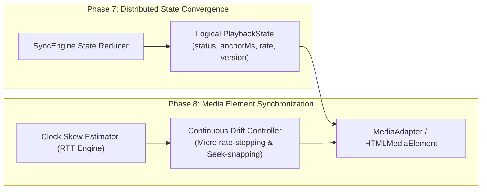

# Phase 7 — Architectural Principles & System Invariants

> **Document Version:** 1.0.0  
> **Status:** APPROVED ARCHITECTURAL SPECIFICATION  
> **Context:** SyncPlay Protocol — Phase 7 Distributed Synchronization Engine  

---

## 1. Foundational Architecture Principles

Every technical decision, interface definition, and algorithmic candidate evaluated in Phase 7 must comply with the following non-negotiable principles. If a proposed design contradicts any of these principles, it must be rejected or explicitly escalated for architectural review.

---

### Principle 1: No Permanent Playback Leader

**Definition:** No participating peer in a SyncPlay session shall hold permanent or exclusive authority over playback state.

- **Symmetry of Participation:** Every authenticated peer in a room possesses equal rights to initiate control intents (`PLAY`, `PAUSE`, `SEEK`, `RATE_CHANGE`).
- **Temporary Coordination Constraints:** If an algorithm employs temporary coordination (such as a transient sequencer or term-based lease):
  - **Bounded Lease:** The coordinator role must have an explicit, short timeout lease.
  - **Fail-Safe Election:** Failure or disconnection of the coordinator must automatically trigger a deterministic, distributed election without relying on an external authority.
  - **Zero Monopolization:** A coordinator may only sequence or timestamp operations; it must not unilaterally censor or reject valid user operations.
- **Preference for Pure Leaderless:** A fully symmetric, leaderless coordination design (where peers order operations via deterministic logical timestamps or conflict-free data structures) is strongly preferred over coordinator-based models for small-room browser sessions.

---

### Principle 2: No Centralized Playback Authority (Server-Minimized)

**Definition:** The Bootstrap Server must never become a playback state authority, event sequencer, or consensus mediator.

- **Boundary Separation:**
  - **Server Owns:** Room creation, membership rosters, access token validation, and WebRTC signaling relay (SDP offer/answer and ICE candidate exchange).
  - **Server Does NOT Own:** Playback position, playback status, playback rate, conflict resolution, message ordering, or continuous event routing.
- **Server-Minimized vs. Serverless:** Be technically precise in all specifications. SyncPlay is **server-minimized**, not literally serverless. The Bootstrap Server is required to establish peer sessions and handle reconnections, but once WebRTC DataChannels are open, playback synchronization is 100% peer-to-peer.
- **Signaling Outage Resilience:** If the Bootstrap Server crashes or becomes temporarily unreachable, established peers connected via WebRTC DataChannels must continue synchronizing playback without interruption.

---

### Principle 3: Peer-to-Peer Full-Mesh Synchronization

**Definition:** All synchronization messages, operation logs, state digests, and repair batches must travel directly between browser peers over WebRTC DataChannels.

- **Direct Transport:** Peers utilize the reliable, ordered DataChannels (`'syncplay-data'`) provided by `@syncplay/peer-mesh`.
- **Honest Mesh Scalability Limits:**
  - A full-mesh topology requires $N(N-1)/2$ peer connections and $N(N-1)$ directional communication paths.
  - In a browser environment, WebRTC connection overhead, CPU utilization, and upstream bandwidth scale quadratically with room size.
  - SyncPlay Phase 7 targets small rooms ($N = 2 \text{ to } 8$ peers).
  - Specifications and reports must never claim internet-scale or arbitrary peer scalability for full-mesh operation.
- **TURN Transparency:** If a TURN server is used to relay WebRTC packets through symmetric NATs, it operates purely at the transport relay level (RFC 5766). It has zero access to decrypted protocol semantics and never acts as a synchronization authority.

---

### Principle 4: Replaceable Synchronization Algorithms

**Definition:** The distributed synchronization algorithm must be completely decoupled and replaceable behind stable, typed interfaces.

- **Stable Engine Boundary:** The synchronization engine must implement the established `SyncEngine` contract and extend the Phase 5 `SyncEventReceiver` boundary:
  ```ts
  export interface SyncEngine extends SyncEventReceiver {
    receive(event: AnyControlSyncEvent): void;
    getState(): Readonly<PlaybackState>;
    getCurrentPositionMs(atTimestamp?: number): number;
    // ...
  }
  ```
- **Zero Ripple Effect:** Switching between algorithms (e.g., from `BaselineSyncEngine` to `LamportTotalOrderSyncEngine` to a `CRDTSyncEngine`) must require **zero modifications** to:
  - `@syncplay/protocol` envelope schemas
  - `@syncplay/peer-mesh` connection management
  - `@syncplay/control-events` intent pipeline
  - `@syncplay/bootstrap-server` signaling routes
  - Demo application UI controls
- **Reference Preservation:** The pure deterministic `BaselineSyncEngine` developed in Phase 6 must remain intact in the codebase as a tested reference baseline and fallback.

---

### Principle 5: Stable Interfaces First

**Definition:** Architectural contracts, message schemas, and failure semantics must be formally documented, reviewed, and approved before any production implementation begins.

- **Strict Phasing:** Phase 7 strictly separates research (P7.1) and interface design (P7.2) from algorithmic implementation (P7.3+).
- **Contract Driven:** Public TypeScript interfaces, method error contracts, and lifecycle invariants are the single source of truth. Implementation details must never leak across package boundaries.

---

### Principle 6: Honest Guarantees & Documented Assumptions

**Definition:** SyncPlay documentation, specifications, and reports must never make exaggerated or unqualified claims of "perfect synchronization," "unconditional consensus," or "instantaneous convergence."

- **The FLP Impossibility Result:** In an asynchronous distributed system with unconstrained network delays, deterministic consensus is impossible in the presence of even a single unannounced crash failure (Fischer, Lynch, Paterson, 1985).
- **Formal Assumption Baseline:** Every guarantee in Phase 7 must explicitly cite its operational model:
  1. **Network Timing:** Partially synchronous network (message transmission delay is bounded by an unknown or time-varying $\Delta$ during non-adversarial periods).
  2. **Failure Model:** Crash-Recovery without Byzantine behavior (peers may crash or temporarily drop off and later recover; peers do not forge messages, tamper with cryptographic signatures, or act maliciously).
  3. **Eventual Convergence:** If network communication is restored, required historical operations are exchanged, and user inputs cease for duration $\tau > 2\Delta$, all non-faulty connected peers will reach identical logical playback states.
- **Explicit Limitations:** Document all scenarios where convergence cannot be guaranteed (e.g., sustained bi-directional network partition, clock regression, Byzantine packet corruption).

---

### Principle 7: Separation of State Convergence vs. Media Synchronization

**Definition:** Distributed state convergence and physical media rendering are separate problems operating at different layers of the stack.



- **Phase 7 Scope (Logical State Agreement):**
  - Peers agree on: `status` (`'playing'` vs `'paused'`), `anchorPositionMs`, `anchorReferenceTime`, `playbackRate`, and the `stateVersion` revision counter.
  - Pure mathematical and logical state reduction. Zero dependency on the DOM, `HTMLMediaElement`, or video decoders.
- **Phase 8 Scope (Physical Playback Synchronization):**
  - Compensating for hardware decode latency, audio buffer underruns, browser frame dropping, and local oscillator clock skew.
  - Applying continuous micro-adjustments ($\pm 1\%$ playback rate) or hard seek-snaps to local media players.

---

### Principle 8: Operation-Specific Semantic Analysis

**Definition:** Different media playback controls represent fundamentally different user intents and must not be treated as uniform, opaque writes.

| Operation | User Intent | Mathematical Property | Conflict Resolution Strategy |
| :--- | :--- | :--- | :--- |
| **`PLAY`** | Resume forward playback from current or explicit position | Semi-idempotent; cumulative with elapsed time | Concurrency with `PAUSE`: user pause intent typically takes precedence to prevent unwanted audio blast. |
| **`PAUSE`** | Halt playback at current observed position | Idempotent; fixes position anchor | Concurrency with `PLAY`: prioritize halting or order by total logical timestamp. |
| **`SEEK`** | Non-linear displacement to target timeline millisecond | Non-commutative ($S_1 \circ S_2 \neq S_2 \circ S_1$) | Deterministic Last-Write-Wins (LWW) based on logical timestamp and peer tie-breaker; or latest timeline displacement. |
| **`RATE_CHANGE`** | Alter speed multiplier without displacing position | Commutative with position calculation; scalar | Total order scalar resolution; validate within strict $[0.25, 4.0]$ bounds. |

---

## 2. Invariant Checklist for Phase 7

Every component developed in Phase 7 must maintain the following six system invariants ($I_1 - I_6$):

- **$I_1$ (Deterministic Replay):** Given identical accepted operation histories in identical logical order, two independent SyncEngine instances initialized with the same configuration must produce byte-for-byte identical `PlaybackState`.
- **$I_2$ (Deduplication Safety):** Processing the same `(senderPeerId, logicalEventId)` multiple times has zero repeated state mutation or version increment.
- **$I_3$ (Semantic Validation Safety):** Malformed, non-finite, negative, or structurally invalid operations must never mutate engine state or advance `stateVersion`.
- **$I_4$ (Bounded Resource Safety):** Operation histories, deduplication sets, anti-entropy digests, and retransmission buffers must enforce strict, configurable upper bounds to prevent browser memory exhaustion.
- **$I_5$ (Conditional Eventual Convergence):** Replicas converge to identical playback states once message delivery quiesces across all connected, non-partitioned peers.
- **$I_6$ (Absence of False Authority):** Neither the Bootstrap Server, the WebRTC transport layer, nor local system wall-clock timestamps can unilaterally dictate playback state or override logical distributed ordering.
