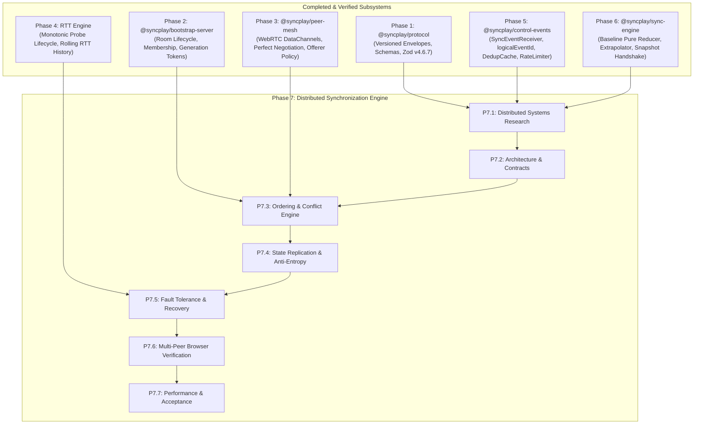

# Phase 7 — Dependency Graph, Governance & Delivery Plan

> **Document Version:** 1.0.0  
> **Status:** APPROVED DELIVERY SPECIFICATION  
> **Context:** SyncPlay Protocol — Phase 7 Leaderless Distributed Synchronization Engine  

---

## 1. Upstream Inputs from Completed Phases (Phases 1–6)

Phase 7 builds directly on top of the battle-tested, verified foundation established in earlier phases (latest commit `2b507a5`):



### Detailed Upstream Interfaces Utilized in Phase 7:
1. **From Phase 1 (`@syncplay/protocol`):**
   - Canonical `ProtocolMessage<TPayload>` envelope structure.
   - Distinct `messageId` (per transmission attempt) and `logicalEventId` (per logical user intent).
   - Validation schemas for `PLAY`, `PAUSE`, `SEEK`, `RATE_CHANGE`, and `STATE_SNAPSHOT`.
2. **From Phase 2 (`@syncplay/bootstrap-server`):**
   - `ConnectionGeneration` tracking: ensures stale connections after rejoining cannot corrupt rooms.
   - Non-authoritative room membership metadata.
3. **From Phase 3 & 4 (`@syncplay/peer-mesh`):**
   - Reliable, ordered WebRTC DataChannels (`'syncplay-data'`).
   - Transport-verified `senderPeerId` derivation from incoming connection context.
   - Monotonic RTT estimates for detecting network asymmetry.
4. **From Phase 5 (`@syncplay/control-events`):**
   - `SyncEventReceiver` boundary interface (`receive(event: AnyControlSyncEvent): void`).
   - Intent-to-event pipeline (`executeIntent` with rate-limiting and deduplication).
5. **From Phase 6 (`@syncplay/sync-engine`):**
   - `reduceState` pure functional reducer implementation.
   - `calculateExtrapolatedPosition` continuous monotonic position mathematics.
   - `exportSnapshot` / `importSnapshot` base serialization schemas.

---

## 2. Milestone Dependencies & Critical Path

```text
CRITICAL PATH ANALYSIS:
[P7.1 Research & Model] (Gate 1)
       │
       ▼
[P7.2 Architecture & Protocol Specs] (Gate 2: IMPLEMENTATION AUTHORIZATION)
       │
       ▼
[P7.3 Distributed Event Ordering & Conflict Engine]
       │
       ▼
[P7.4 State Replication & Anti-Entropy Handshake]
       │
       ▼
[P7.5 Fault Tolerance, Reconnection & Partition Recovery]
       │
       ▼
[P7.6 Adversarial Multi-Peer Chrome Browser Testing]
       │
       ▼
[P7.7 Performance Evaluation & Phase Acceptance] (Gate 3: PHASE 7 SIGN-OFF)
```

### Dependency Rules:
- **Rule 1 (Specification Precedence):** No code may be written in `packages/sync-engine` or `packages/protocol` before P7.1 and P7.2 are fully completed and approved.
- **Rule 2 (Replication requires Ordering):** P7.4 (anti-entropy replication) cannot begin until P7.3 (deterministic ordering and bounded operation log) has passed 100% of headless permutation tests.
- **Rule 3 (Browser Verification requires Recovery):** P7.6 (browser verification) cannot execute multi-peer churn/reconnect tests until P7.5 (generation-aware recovery) is integrated.

---

## 3. Governance, Review Gates & Sign-Off Checkpoints

Phase 7 enforces three mandatory governance gates:

### Gate 1: Research & Problem Definition Sign-Off (Exit from P7.1)
- **Prerequisite:** Delivery of `P7_1_DISTRIBUTED_SYSTEMS_EVALUATION.md` and consistency model specifications.
- **Review Criteria:**
  - Has the distributed ordering trade-off between Lamport Clocks and Vector Clocks been thoroughly defended?
  - Are the network model (partial synchrony, bounded delay $\Delta$) and failure assumptions formally specified?
  - Are operation-specific conflict semantics for `PLAY`, `PAUSE`, `SEEK`, and `RATE_CHANGE` fully agreed upon?
- **Sign-Off Required:** Lead Architect / User approval.

### Gate 2: Architecture & Contract Sign-Off (Exit from P7.2 — Authorization to Code)
- **Prerequisite:** Delivery of `PHASE7_HLD.md`, `PHASE7_LLD.md`, interface contracts, and protocol change proposals.
- **Review Criteria:**
  - Is the `SyncEventReceiver` interface completely preserved without breaking existing Phase 5 and Phase 6 code?
  - Does the protocol evolution proposal maintain strict backward compatibility for v0.1 parsers?
  - Are the deterministic simulation testing requirements sufficiently rigorous?
- **Sign-Off Required:** Formal user authorization to begin P7.3 implementation.

### Gate 3: Phase 7 Final Acceptance Sign-Off (Exit from P7.7)
- **Prerequisite:** Successful execution of all automated test suites, $\ge 40$ real-browser assertions in Chrome CDP, and delivery of performance benchmarks.
- **Review Criteria:**
  - 100% passing tests across all monorepo packages.
  - Zero TypeScript errors (`tsc --noEmit`).
  - Zero security vulnerabilities (`npm audit`).
  - Browser evidence verifying deterministic convergence under concurrent multi-peer operations and generation-2 reconnects.
  - Delivery of Phase 8 Media Synchronization architecture brief.
- **Sign-Off Required:** Phase Acceptance & transition to Phase 8.

---

## 4. Delivery Sequences & Artifact Registry

| Phase Step | Primary Deliverables | Package Impact | Target Directory |
| :--- | :--- | :--- | :--- |
| **P7.1** | Research papers review, trade-off matrix, consistency model specification | None (Docs only) | `docs/research/` |
| **P7.2** | HLD, LLD, Interface Contracts, Protocol Evolution RFC | None (Docs only) | `docs/design/` |
| **P7.3** | `LogicalClockManager`, `OrderedOperationLog`, `ConflictResolver`, Unit & Simulation Tests | `@syncplay/sync-engine`, `@syncplay/protocol` | `packages/sync-engine/src/`, `packages/protocol/src/` |
| **P7.4** | `ReplicationController`, anti-entropy digest handler, missing event fetcher | `@syncplay/sync-engine` | `packages/sync-engine/src/replication/` |
| **P7.5** | State recovery orchestrator, generation-aware reconnect handler, snapshot fallback | `@syncplay/sync-engine` | `packages/sync-engine/src/recovery/` |
| **P7.6** | Multi-peer Chrome CDP test suite (`verify-phase7-adversarial.mjs`), test evidence | `apps/demo`, `scratch/` | `apps/demo/`, `scratch/` |
| **P7.7** | Performance benchmark report, final phase wrap-up, Phase 8 transition brief | None (Docs only) | `docs/reports/` |

---

## 5. Transition Strategy to Phase 8 (Media Synchronization)

Upon successful completion of Phase 7, the project will have proven that multiple browser peers converge deterministically on **logical playback state** ($\text{status}, \text{anchorPositionMs}, \text{playbackRate}, \text{stateVersion}$).

Phase 8 will bridge this logical state to actual browser media hardware:
1. **`HTMLMediaElementAdapter`:** Binds logical state to `<video>` / `<audio>` elements.
2. **Clock Offset Estimation:** Combines Phase 4 monotonic RTT estimates with one-way delay bounds to calculate wall-clock skew across peers.
3. **Continuous Drift Controller:** Implements a PID or bounded-threshold controller:
   - For small time drift ($|p_{\text{media}} - p_{\text{logical}}| \in [25\text{ms}, 250\text{ms}]$): micro-adjust playback rate ($\pm 0.5\% - 1.0\%$) to smoothly align without audio pitch distortion.
   - For large displacements ($> 250\text{ms}$): execute hard seek snaps.

