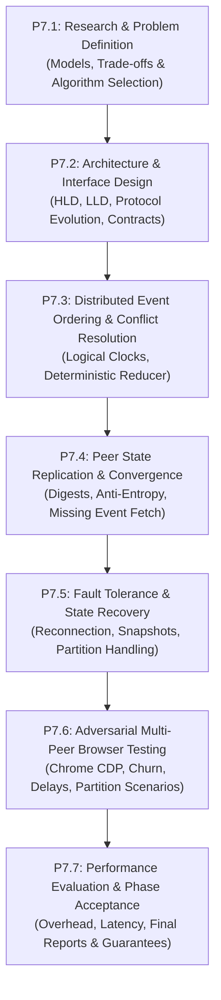

# Phase 7 — Leaderless Distributed Synchronization Engine: Master Roadmap

> **Document Version:** 1.0.0  
> **Status:** PROPOSED & UNDER REVIEW (Planning Phase Only — No Implementation Authorized)  
> **Target Package:** `@syncplay/sync-engine` (and associated protocol message schemas)  
> **Dependencies:** Phases 1–6 complete (`@syncplay/protocol`, `@syncplay/bootstrap-server`, `@syncplay/peer-mesh`, `@syncplay/control-events`, baseline `@syncplay/sync-engine`)  
> **Baseline Commit:** `2b507a5` (Monorepo: 419 unit tests passing, 56 real-browser verification assertions passing)  

---

## 1. Executive Summary & Problem Context

The SyncPlay Protocol provides a modular, peer-to-peer media synchronization protocol and SDK for small-room browser environments. Phases 1 through 6 established a fully functioning communication and state reduction pipeline:
$$\text{Demo UI} \longleftrightarrow \text{ControlEventService} \longleftrightarrow \text{BaselineSyncEngine} \longleftrightarrow \text{PeerMesh} \longleftrightarrow \text{WebRTC DataChannel} \longleftrightarrow \text{Remote Peer}$$

While Phase 6 introduced the `BaselineSyncEngine` with pure deterministic state reduction and continuous position extrapolation, it intentionally processed events according to **local arrival order**.

### The Fundamental Distributed Problem
In an asynchronous network with multiple browser peers communicating over independent WebRTC DataChannels:
1. WebRTC DataChannels provide reliable, ordered delivery **per peer-to-peer pair**, but provide **no global total order** across multiple senders.
2. If Peer A issues $\text{SEEK}(30000)$ and Peer B concurrently issues $\text{SEEK}(60000)$, different network latency or packet interleaving can cause Peer A to process $[\text{SEEK}(30000), \text{SEEK}(60000)]$ while Peer B processes $[\text{SEEK}(60000), \text{SEEK}(30000)]$.
3. Under local arrival ordering, their local playback states diverge ($\text{position} = 60000\text{ms}$ on Peer A, but $30000\text{ms}$ on Peer B).

Phase 7 is dedicated to researching, designing, implementing, and verifying a **leaderless distributed synchronization engine** that guarantees state convergence across participating peers under clearly documented network and failure assumptions.

---

## 2. Core Architectural Principles & Scope Boundaries

Phase 7 strictly preserves the non-negotiable architectural invariants established in the Master HLD:

1. **No Permanent Playback Leader:** No peer possesses permanent authority over playback state. Temporary coordination mechanisms, if evaluated, must have fail-safe crash semantics and bounded tenure.
2. **No Centralized State Authority:** The Bootstrap Server remains strictly non-authoritative for playback state; it manages room lifecycle, peer discovery, and WebRTC signaling only.
3. **Peer-to-Peer Communication:** All synchronization metadata, operation logs, and state digests travel directly over WebRTC DataChannels.
4. **Replaceable Algorithm Boundary:** The distributed synchronization algorithm must sit cleanly behind the existing `SyncEngine` / `SyncEventReceiver` interfaces without modifying `PeerMesh`, `BootstrapServer`, or `ControlEventService`.
5. **Separation of State Convergence vs. Media Synchronization:** Phase 7 achieves **distributed state convergence** (consensus on status, anchor position, playback rate, and timeline revision). HTMLMediaElement playback synchronization, clock drift compensation, and A/V decoding lag belong to Phase 8.
6. **Honest Guarantees:** All convergence and consistency claims must formally state their network assumptions (e.g., partial synchrony, non-Byzantine crash-recovery, bounded delay $\Delta$).

---

## 3. Milestone Breakdown (P7.1 – P7.7)



### P7.1 — Distributed Systems Research & Problem Definition
- **Objective:** Formally define the synchronization problem for interactive media playback, analyze concurrent operation interleavings, compare candidate distributed algorithms, and define the consistency model.
- **Scope & Activities:**
  - Formalize concurrent playback scenarios (e.g., concurrent seeks, play vs. pause races, rate adjustments).
  - Formalize the network model: asynchronous network with partial synchrony assumptions ($\Delta$ bounded delay during stable periods), crash-recovery failure model, non-Byzantine participants.
  - Comparative trade-off evaluation of candidate algorithms: Lamport Timestamps with deterministic tie-breaking, Vector Clocks, State-Machine Replication (SMR), Operation-based / State-based CRDTs, and Bounded Optimistic Rollback.
  - Formulate the SyncPlay Consistency Model: Eventual Consistent Playback State with Causal Precedence.
- **Deliverables:**
  - `docs/research/P7_1_DISTRIBUTED_SYSTEMS_EVALUATION.md`
  - `docs/research/P7_1_CONSISTENCY_MODEL_SPECIFICATION.md`
- **Complexity:** Medium
- **Authorization Gate:** Research & specification only. Zero code modifications.

### P7.2 — Synchronization Architecture & Interface Design
- **Objective:** Design the high-level architecture, low-level component boundaries, protocol message extensions, and interface contracts for the leaderless synchronization engine.
- **Scope & Activities:**
  - Specify the protocol evolution requirements: define new message types (`STATE_DIGEST`, `OPERATION_BATCH`, `REPAIR_REQUEST`) and determine where distributed metadata (e.g., logical clocks) lives without breaking backward compatibility.
  - Define internal engine modularization: Split into `LogicalClockManager`, `OrderedOperationLog`, `ConflictResolver`, and `ReplicationController`.
  - Produce comprehensive sequence diagrams for concurrent broadcast, missing message repair, and state reconciliation.
  - Formulate strict deterministic simulation requirements for headless multi-peer unit testing.
- **Deliverables:**
  - `docs/design/PHASE7_HLD.md`
  - `docs/design/PHASE7_LLD.md`
  - `docs/design/PHASE7_INTERFACE_CONTRACTS.md`
  - Protocol change proposal for `@syncplay/protocol`.
- **Complexity:** High
- **Authorization Gate:** Requires architectural sign-off before entering implementation.

### P7.3 — Distributed Event Ordering & Conflict Resolution
- **Objective:** Implement the selected logical ordering mechanism and deterministic conflict-resolution engine within `@syncplay/sync-engine`.
- **Scope & Activities:**
  - Implement logical clock tracking (Lamport logical timestamp or lightweight causal vector) integrated into outgoing control events.
  - Implement deterministic total-ordering comparator: $\text{Key} = (\text{logicalTimestamp}, \text{senderPeerId}, \text{logicalEventId})$.
  - Implement bounded operation history buffer with deterministic re-ordering and state re-computation for late-arriving (within bounded skew) operations.
  - Define per-operation conflict policies:
    - `SEEK` vs. `SEEK`: Deterministic LWW ordered by logical timestamp and peer ID tie-break.
    - `PLAY` vs. `PAUSE`: Intent-preserving precedence (e.g., explicit pause trumps concurrent play if causally concurrent, or strict logical ordering).
    - `RATE_CHANGE`: Total order scalar resolution.
  - Implement headless simulation test harness validating 100% deterministic convergence across randomized event delivery permutations.
- **Deliverables:**
  - Implementations in `packages/sync-engine/src/ordering/` and `packages/sync-engine/src/conflict/`.
  - Comprehensive unit and permutation simulation test suites ($>50$ automated tests).
- **Complexity:** Very High
- **Dependencies:** P7.1, P7.2

### P7.4 — Peer State Replication & Convergence
- **Objective:** Enable peers to actively detect missing operations, exchange synchronization metadata, and reconcile divergent state representations without full-state thrashing.
- **Scope & Activities:**
  - Design and implement state digest exchange (`STATE_DIGEST` message payload containing version vectors or operation count watermarks).
  - Implement anti-entropy reconciliation: peers periodically or reactively compare digests; if a gap is detected, a `REPAIR_REQUEST` fetches only missing operations from peer logs.
  - Bounded memory controls: prune operation history once all known active peers have acknowledged receipt up to a safe watermark (garbage collection).
  - Integration tests demonstrating multi-peer convergence with simulated packet loss and reordered DataChannel delivery.
- **Deliverables:**
  - Replication and anti-entropy components in `packages/sync-engine/src/replication/`.
  - Multi-peer headless convergence test suite.
- **Complexity:** High
- **Dependencies:** P7.3

### P7.5 — Fault Tolerance & State Recovery
- **Objective:** Implement robust state recovery for peers experiencing transient network dropouts, browser tab backgrounding/throttling, or full WebRTC disconnection and generation-2 rejoin.
- **Scope & Activities:**
  - Integrate with existing Phase 2/3 `ConnectionGeneration` semantics to prevent stale peer connections from injecting outdated historical events.
  - Implement snapshot-assisted recovery: when a rejoining peer is too far behind the active history watermark, transfer a validated `StateSnapshotPayload` followed by recent operations.
  - Guard against split-brain scenarios during network partitions: define partition behavior (e.g., minority partition enters degraded status or continues optimistically with explicit reconciliation upon heal).
  - Verify that imported snapshots preserve untrusted provenance marking and enforce monotonic state revision advances.
- **Deliverables:**
  - Recovery orchestration in `packages/sync-engine/src/recovery/`.
  - Disconnect/reconnect and network partition recovery test suites.
- **Complexity:** High
- **Dependencies:** P7.4

### P7.6 — Adversarial Multi-Peer Browser Testing
- **Objective:** Verify leaderless synchronization in real Google Chrome browser instances using automated Chrome DevTools Protocol (CDP) orchestration under adversarial network conditions.
- **Scope & Activities:**
  - Extend the existing browser verification harness to instantiate 3 to 4 independent browser peer contexts.
  - Simulate adversarial scenarios:
    - Concurrent multi-peer operations (Peer A seeks while Peer B pauses while Peer C changes rate).
    - Artificial latency injection, out-of-order delivery, and temporary message drops.
    - Abrupt peer disconnection and generation-2 rejoin under active playback.
    - Browser tab suspension / timer throttling (simulating background tab behavior).
  - Validate that all browser peer instances reach identical logical playback states and version counters.
- **Deliverables:**
  - Automated browser test runner: `scratch/verify-phase7-adversarial.mjs`.
  - Detailed browser test log artifacts with frame-by-frame assertion records.
- **Complexity:** High
- **Dependencies:** P7.5

### P7.7 — Performance Evaluation & Phase Acceptance
- **Objective:** Empirically measure operational latency, convergence time, network overhead, and CPU/memory consumption to establish definitive protocol guarantees and bounds.
- **Scope & Activities:**
  - Benchmark operation dispatch-to-convergence latency across 2, 4, 6, and 8 peer meshes.
  - Measure WebRTC DataChannel message overhead (bytes per minute for idle state vs. active control bursts).
  - Profile memory usage under continuous operation to verify zero memory leaks and effective operation log garbage collection.
  - Document explicit formal guarantees and known limitations (e.g., maximum recommended room size, maximum tolerable network partition duration).
  - Compile the Phase 7 Acceptance Report and Phase 8 (Media Element Synchronization & Clock Skew Compensation) readiness plan.
- **Deliverables:**
  - `docs/reports/PHASE7_PERFORMANCE_EVALUATION.md`
  - `docs/reports/PHASE7_COMPLETION_REPORT.md`
  - Phase 8 Architecture Brief.
- **Complexity:** Medium
- **Dependencies:** P7.6

---

## 4. Milestone Matrix & Complexity Estimates

| Milestone | Title | Focus Area | Deliverable Type | Relative Complexity | Preceding Milestones |
| :--- | :--- | :--- | :--- | :---: | :--- |
| **P7.1** | Research & Problem Definition | Distributed theory, models, candidate algorithms | Specifications & Evaluation Docs | **Medium** | Phase 6 Approved Baseline |
| **P7.2** | Architecture & Interface Design | Component HLD/LLD, contracts, protocol changes | Architectural Specifications | **High** | P7.1 |
| **P7.3** | Event Ordering & Conflict Engine | Logical clocks, total ordering, tie-breaking | Core Engine Code & Sim Tests | **Very High** | P7.2 |
| **P7.4** | State Replication & Convergence | Anti-entropy, digests, missing event repair | Replication Code & Net Tests | **High** | P7.3 |
| **P7.5** | Fault Tolerance & Recovery | Reconnection, snapshots, partition healing | Recovery Code & Churn Tests | **High** | P7.4 |
| **P7.6** | Adversarial Browser Verification | Real Chrome 3-4 peer CDP adversarial tests | Automated Browser Suite & Evidence | **High** | P7.5 |
| **P7.7** | Performance & Phase Acceptance | Benchmarks, overhead, limits, phase wrap-up | Reports & Phase 8 Brief | **Medium** | P7.6 |

---

## 5. Critical Path & Dependency Analysis

```text
Critical Path:
[Phase 6 Baseline] ➔ P7.1 (Research) ➔ P7.2 (Contracts) ➔ P7.3 (Ordering) ➔ P7.4 (Replication) ➔ P7.5 (Recovery) ➔ P7.6 (Browser Verification) ➔ P7.7 (Acceptance)
```

### Key Architectural Dependencies
1. **P7.3 depends on P7.2 Protocol Contracts:** The total-order algorithm cannot be coded until the wire representation of logical clock metadata is finalized in `@syncplay/protocol`.
2. **P7.4 depends on P7.3 Reducer Immutability:** State reconciliation requires pure deterministic reducers capable of replaying or rolling forward operation sequences from verified history watermarks.
3. **P7.5 depends on Phase 2/3 Connection Generations:** Reconnection recovery relies on transport-verified generation counters to cleanly separate active generation messages from stale zombie connections.
4. **P7.6 depends on P7.5 Recovery Handshakes:** Real browser verification under disconnect/rejoin scenarios requires the full recovery handshake to be operational.

---

## 6. Testing & Verification Strategy

Phase 7 employs a four-tiered verification funnel:

1. **Unit & Invariant Tests (Node.js Vitest):**
   - Pure mathematical testing of logical clock increments, causality tracking, and comparator anti-symmetry ($A < B \iff \neg(B < A)$).
   - Reducer invariance under duplicate and invalid payloads.
2. **Deterministic Simulation Harness (Headless Event Loop):**
   - Simulated network mesh with configurable packet drop rates ($0\% - 30\%$), asymmetric latency ($10\text{ms} - 500\text{ms}$), and out-of-order delivery.
   - Permutation testing: execute $K$ concurrent operations across $N$ simulated peers in randomized order; assert that all $N$ peers reach identical terminal states.
3. **Multi-Peer Adversarial Browser Verification (Google Chrome CDP):**
   - Drive 3 or 4 real browser peers running against a local Bootstrap Server.
   - Inject concurrent user actions simultaneously from multiple tabs.
   - Verify continuous position extrapolation, DOM badge updates, and generation upgrades over real WebRTC DataChannels.
4. **Memory & Long-Running Soak Testing:**
   - Execute continuous control event loops ($>10,000$ operations) to verify that log compaction and garbage collection prevent heap growth.

---

## 7. Entry and Exit Criteria for Phase 7

### Entry Criteria
- [x] Phase 6 completed, verified, and accepted (`2b507a5`).
- [x] 419 unit/integration tests passing cleanly across monorepo.
- [x] 56 browser integration checks passing in Chrome 157.
- [x] Working tree clean; zero known security vulnerabilities.
- [ ] Explicit architectural approval granted for the Phase 7 Master Roadmap.

### Exit Criteria
- [ ] Leaderless ordering and conflict-resolution engine implemented behind stable `SyncEngine` interface.
- [ ] Defined, deterministic conflict behavior verified for all operations (`PLAY`, `PAUSE`, `SEEK`, `RATE_CHANGE`).
- [ ] State convergence achieved across all participating peers under documented network assumptions.
- [ ] Seamless state recovery verified after peer disconnection and generation-2 rejoin.
- [ ] Zero reliance on the Bootstrap Server for playback state decisions.
- [ ] 100% automated test suite pass rate including adversarial permutation simulations.
- [ ] Real-browser multi-peer verification passing on Google Chrome with visual and log evidence.
- [ ] Documented formal consistency model, safety/liveness guarantees, and room-size limitations.

---

## 8. Key Scientific References & Foundational Literature

The Phase 7 research strategy is grounded in established distributed systems literature:

1. **Logical Clocks & Event Ordering:**
   - Lamport, L. (1978). *"Time, Clocks, and the Ordering of Events in a Distributed System."* Communications of the ACM, 21(7), 558–565. [DOI: 10.1145/359545.359563](https://doi.org/10.1145/359545.359563).
   - Mattern, F. (1989). *"Virtual Time and Global States of Distributed Systems."* Parallel and Distributed Algorithms, 215–226.
2. **Conflict-Free Replicated Data Types (CRDTs):**
   - Shapiro, M., Preguiça, N., Baquero, C., & Zawirski, M. (2011). *"Conflict-Free Replicated Data Types."* Symposium on Self-Stabilizing Systems (SSS 2011), LNCS 6976, 386–400. [DOI: 10.1007/978-3-642-24550-3_29](https://doi.org/10.1007/978-3-642-24550-3_29).
3. **State Machine Replication & Consensus Trade-offs:**
   - Schneider, F. B. (1990). *"Implementing Fault-Tolerant Services Using the State Machine Approach: A Tutorial."* ACM Computing Surveys, 22(4), 299–319.
   - Ongaro, D., & Ousterhout, J. (2014). *"In Search of an Understandable Consensus Algorithm."* USENIX Annual Technical Conference (ATC 14), 305–319.
4. **Optimistic Replication & Anti-Entropy:**
   - Saito, Y., & Shapiro, M. (2005). *"Optimistic Replication."* ACM Computing Surveys, 37(1), 42–81. [DOI: 10.1145/1057977.1057980](https://doi.org/10.1145/1057977.1057980).
   - DeCandia, G., et al. (2007). *"Dynamo: Amazon's Highly Available Key-value Store."* ACM SIGOPS Operating Systems Review, 41(6), 205–220.
