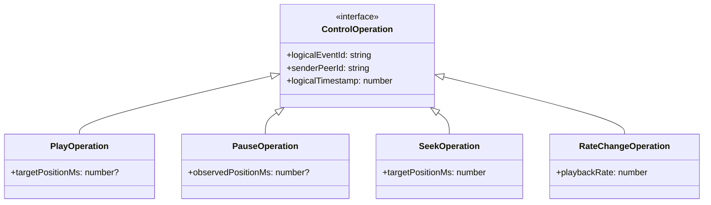

# Phase 7 — Research Questions, Distributed Algorithms & Theoretical Evaluation

> **Document Version:** 1.0.0  
> **Status:** PROPOSED RESEARCH COMPENDIUM  
> **Context:** SyncPlay Protocol — Phase 7 Leaderless Distributed Synchronization Engine  

---

## 1. Core Research Inquiries

The development of a robust, leaderless synchronization engine for small-room browser environments requires rigorous answers to fundamental distributed systems questions prior to implementation.

---

### 1.1. Distributed Event Ordering

#### Question 1.1.1: How can independent browser peers order concurrent operations without a central sequencer?
- **Analysis:** In an asynchronous distributed system with no shared memory and no synchronized physical clock, wall-clock timestamps (e.g., `Date.now()`) cannot be used to determine event order. Browser clocks drift, can be stepped backward via NTP, and differ across devices by tens to hundreds of milliseconds.
- **Solution Space:**
  1. **Logical Clocks (Lamport, 1978):** Monotonically increasing counters advanced on local events and updated upon message receipt ($\max(C_{\text{local}}, C_{\text{remote}}) + 1$).
  2. **Vector Clocks (Mattern, 1989; Fidge, 1988):** $N$-dimensional arrays tracking causal history per peer, distinguishing concurrent ($a \parallel b$) from causally dependent ($a \to b$) operations.
  3. **Hybrid Logical Clocks (Kulkarni et al., 2014):** Bounding logical counters within an envelope of physical time.

#### Question 1.1.2: Are Lamport logical timestamps sufficient, or are Vector Clocks strictly required?
- **Analysis:**
  - Lamport timestamps define a **strict total order** when combined with an arbitrary deterministic tie-breaker (e.g., lexicographic comparison of `senderPeerId`):
    $$e_1 < e_2 \iff (L(e_1) < L(e_2)) \lor (L(e_1) = L(e_2) \land \text{peerId}_1 < \text{peerId}_2)$$
  - However, Lamport clocks do **not** capture causality in the reverse direction: $L(e_1) < L(e_2)$ does *not* imply $e_1 \to e_2$. Two concurrent operations $e_1 \parallel e_2$ are assigned an arbitrary total order.
  - For media controls (`SEEK`, `PAUSE`, `PLAY`), arbitrary deterministic tie-breaking is often completely acceptable and desirable: if Peer A seeks to 30s and Peer B seeks to 60s simultaneously, user experience requires that *all peers converge to the same seek position*, not necessarily that the application reasons about complex causal branching.
  - **Vector Clocks** add $O(N)$ payload overhead to every control message and require dynamic resize when peers join or leave.
  - **Preliminary Assessment:** A Lamport logical clock with deterministic lexicographic tie-breaking provides the highest simplicity-to-correctness ratio for small-room media control, while vector clocks or version vectors are better suited for anti-entropy replication logs.

#### Question 1.1.3: How should equal timestamps be resolved deterministically?
- **Analysis:** When two concurrent operations generate identical Lamport timestamps ($L_A = L_B$), a deterministic tie-breaker is mandatory:
  $$\text{Key}(e) = \langle L(e), \text{senderPeerId}(e), \text{logicalEventId}(e) \rangle$$
  - `L(e)`: Lamport counter (integer).
  - `senderPeerId`: Transport-verified string (lexicographic comparison: ASCII byte order).
  - `logicalEventId`: Unique nano-ID string (breaks rare collisions if same peer generates distinct operations at same logical tick).
- This establishes an irreflexive, antisymmetric, and transitive total order that guarantees every replica evaluates ties identically.

---

### 1.2. State Convergence & Conflict Resolution

#### Question 1.2.1: Under which formal assumptions can peers converge to identical playback states?
- **Theoretical Basis:** Fischer, Lynch, Paterson (FLP, 1985) proved that in an asynchronous system, consensus is impossible if even one process can fail by crashing.
- **SyncPlay's Model:**
  1. We assume **Partial Synchrony** (Dwork, Lynch, Stockmeyer, 1988): after an unknown Global Stabilization Time ($GST$), message transmission delay is bounded by $\Delta$.
  2. We adopt an **Optimistic State Machine Replication** approach: operations are applied optimistically, and late-arriving concurrent operations trigger deterministic state re-evaluation.
  3. **Quiescence Assumption:** If control inputs cease for duration $\tau > 2\Delta$ and the WebRTC mesh remains connected, all peers will receive all outstanding operations and converge to identical state.

#### Question 1.2.2: Does every peer need the complete event history from room creation?
- **Analysis:**
  - Retaining complete event history since room creation causes unbounded memory growth ($O(M)$ where $M$ is total operations), leading to eventual browser tab memory exhaustion.
  - In media playback, operations are often **superseding**: a subsequent $\text{SEEK}(60000)$ renders an earlier $\text{SEEK}(15000)$ obsolete.
  - **Solution: Bounded Rolling Log with Snapshot Compaction:**
    - Peers retain a bounded sliding window of recent operations (e.g., $K = 256$ operations).
    - When a peer acknowledges receipt up to logical timestamp $T_{\text{stable}}$, operations older than $T_{\text{stable}}$ are folded into an authoritative base snapshot (`anchorPositionMs`, `status`, `playbackRate`).
    - Late joiners or deeply partitioned peers recover via the base snapshot rather than replaying from operation zero.

#### Question 1.2.3: How should missing events be discovered without continuous broadcast flooding?
- **Analysis:**
  - Using continuous negative acknowledgments (NACKs) or positive acknowledgments (ACKs) for every message floods the $O(N^2)$ WebRTC mesh.
  - **State Digests / Anti-Entropy (Saito & Shapiro, 2005):**
    - Peers periodically (or reactively upon observing a gap in received sequence numbers) exchange a compact `STATE_DIGEST` containing:
      $$\text{Digest} = \langle \text{highestLamport}, \text{stateVersion}, \text{lastLogicalEventId} \rangle$$
    - If a recipient discovers its local log is behind, it sends a targeted `REPAIR_REQUEST` asking only for the missing range of operations.

---

### 1.3. Network Behavior & WebRTC Transport Realities

#### Question 1.3.1: What does reliable ordered WebRTC DataChannel delivery actually guarantee?
- **Fact:** A single WebRTC DataChannel (`ordered: true`, `maxRetransmits: null`) utilizes SCTP over DTLS over UDP (RFC 8831). It guarantees reliable, in-order packet delivery **between a single pair of peers**.
- **Crucial Limitation:** WebRTC provides **no total ordering across multiple peers**.
  - In a 3-peer mesh (A, B, C), Peer A sending to B and Peer C sending to B travel over independent SCTP associations with independent congestion windows and packet paths.
  - Therefore, Peer B can receive Peer A's message before Peer C's message, while Peer A receives its own message before Peer C's message.
  - **Conclusion:** The transport layer cannot provide distributed event ordering. Total ordering must be established at the protocol/engine layer.

#### Question 1.3.2: What happens when a browser tab is suspended or throttled?
- **Browser Behavior:** Modern browsers (Chrome, Safari, Firefox) aggressively throttle background tabs:
  - `setTimeout` and `setInterval` are throttled to $1000\text{ms}$ or completely suspended.
  - WebRTC DataChannel events may be queued until the tab is focused or wakes up.
- **Engine Requirement:**
  - The SyncEngine must rely on monotonic time readings (`performance.now()`) taken when events are actually received, but must never assume timers fire with millisecond accuracy.
  - When a backgrounded tab wakes up and receives a burst of queued operations, it must process them in total logical order and trigger anti-entropy if operations were dropped by OS socket buffer overruns.

---

### 1.4. Membership, Generations & Epochs

#### Question 1.4.1: How do we prevent stale, disconnected peers from injecting old state upon reconnecting?
- **Analysis:**
  - If Peer B drops off at Generation 1, the remaining peers advance playback to 120s.
  - When Peer B reconnects, if its local engine broadcasts its stale 10s playback state with higher or conflicting timestamps, it could accidentally override current room playback.
- **Solution:**
  - **Bootstrap Connection Generations (Phase 2/3 Baseline):** PeerMesh tags all connections with `ConnectionGeneration`. Reconnecting peers are assigned a strictly incremented generation ($G_{\text{new}} > G_{\text{old}}$).
  - **Rejoin Handshake Protocol:** Upon establishing a new connection generation, the rejoining peer's engine enters `RECOVERING` status. It is prohibited from broadcasting local operations until it has received a `STATE_SNAPSHOT` or `STATE_DIGEST` from an active peer and fast-forwarded its local engine.

---

### 1.5. Playback Operation Semantics & Asymmetric Conflicts

Different media playback controls carry fundamentally different user semantics. They should not be resolved via a naive uniform LWW rule.

#### Detailed Semantic Policies:

1. **`SEEK` vs. `SEEK`:**
   - Two users drag the seek bar simultaneously.
   - **Policy:** Pure Deterministic Total Order (Highest Lamport Timestamp, with Peer ID tie-breaker). The operation that is logically latest wins; the earlier seek is superseded.
2. **`PLAY` vs. `PAUSE`:**
   - User A hits Play while User B hits Pause.
   - **Policy:** **Pause Priority vs. Strict Total Order**:
     - *Alternative A (Safety/UX Priority):* Concurrent `PAUSE` always trumps concurrent `PLAY` to prevent unexpected sound output if one user urgently needs to stop playback.
     - *Alternative B (Strict Total Order):* The operation with the higher logical key wins. If Pause has a higher timestamp, it pauses; if Play has a higher timestamp, it plays.
     - *Research Recommendation:* Evaluate both in P7.1; strict total order provides formal mathematical purity, while pause priority provides superior media UX.
3. **`SEEK` vs. `PLAY` / `PAUSE`:**
   - User A seeks to 45s while the video is playing.
   - **Policy:** Orthogonal composition: a `SEEK` adjusts `anchorPositionMs` to 45s while preserving the current `status` (`'playing'` or `'paused'`), unless the seek payload explicitly bundles a status transition.
4. **`RATE_CHANGE`:**
   - User A sets rate to 1.5x while User B sets rate to 2.0x.
   - **Policy:** Total order scalar resolution. The operation with the highest logical key sets the new rate.

---

## 2. Evaluation of Candidate Technologies and Algorithms

| Algorithm / Paradigm | Mechanism | Strengths | Weaknesses & Trade-offs | Verdict for SyncPlay |
| :--- | :--- | :--- | :--- | :---: |
| **A. Lamport Total Order with Bounded Rollback** | Lamport clocks + tie-break key. Bounded operation log. Re-evaluates state when late operation arrives. | • Simple, elegant implementation. • Zero server involvement. • Low wire overhead ($8$ bytes per event). • Strict deterministic convergence. | • Late events cause brief local state rewinds if delay exceeds latency window. | **STRONG CANDIDATE (Recommended Baseline for P7.3)** |
| **B. Vector Clocks with Causal Broadcast** | $N$-ary vector clock on every message. Buffer messages until causal predecessors arrive. | • Precise causal dependency tracking ($a \to b$ vs $a \parallel b$). • Prevents out-of-order causality violations. | • Vector size scales with room size ($O(N)$). • Complex handling when peers leave/rejoin dynamic rosters. • Overkill for simple seek/pause. | **RESERVE FOR LOG COMPACT / ANTI-ENTROPY** |
| **C. Conflict-Free Replicated Data Types (CRDTs)** | State-based (LWW-Register) or Op-based CRDTs with semilattice merge operators. | • Guaranteed mathematical convergence without total ordering. • Highly partition tolerant. | • Playback state has non-commutative transitions ($\text{Seek} \circ \text{Pause} \neq \text{Pause} \circ \text{Seek}$). • Adapting media state to CRDTs introduces high conceptual complexity. | **EVALUATE FOR P7.1 COMPARISON; NOT DEFAULT** |
| **D. Raft / Multi-Paxos Consensus** | Leader election, log replication, majority quorums ($Q = \lfloor N/2 \rfloor + 1$). | • Linearizable consistency. • Strongest formal guarantees. | • Fails during network partitions if minority. • Heavy leader election overhead in dynamic browser mesh. • Violates leaderless principle. | **REJECTED (Violates Principle 1 & 2)** |
| **E. Temporary Sequencer (Term Lease)** | Peer with lowest ID acts as sequencer with auto-expiring 2s lease. | • True total order broadcast. • Avoids local rollbacks. | • Complex lease renewal. • Stalls during sequencer crash until lease expires. • Risk of split-brain under partition. | **EVALUATE AS ALTERNATIVE IN P7.1** |
| **F. Anti-Entropy Gossip + State Digests** | Periodic digest exchange with targeted missing operation fetching. | • Minimal bandwidth when stable. • Self-healing after packet loss or dropout. • Extremely robust. | • Requires underlying ordering mechanism for applying repairs. | **ADOPT FOR P7.4 REPLICATION** |

---

## 3. Scientific Literature & Foundational Citations

1. **Fischer, M. J., Lynch, N. A., & Paterson, M. S. (1985).** *"Impossibility of Distributed Consensus with One Faulty Process."* Journal of the ACM, 32(2), 374–382. [DOI: 10.1145/3149.214121](https://doi.org/10.1145/3149.214121)
2. **Lamport, L. (1978).** *"Time, Clocks, and the Ordering of Events in a Distributed System."* Communications of the ACM, 21(7), 558–565. [DOI: 10.1145/359545.359563](https://doi.org/10.1145/359545.359563)
3. **Mattern, F. (1989).** *"Virtual Time and Global States of Distributed Systems."* Parallel and Distributed Algorithms, Elsevier Science Publishers, 215–226.
4. **Shapiro, M., Preguiça, N., Baquero, C., & Zawirski, M. (2011).** *"Conflict-Free Replicated Data Types."* In Symposium on Self-Stabilizing Systems (pp. 386–400). Springer, Berlin, Heidelberg.
5. **Dwork, C., Lynch, N., & Stockmeyer, L. (1988).** *"Consensus in the Presence of Partial Synchrony."* Journal of the ACM, 35(2), 288–323.
6. **Saito, Y., & Shapiro, M. (2005).** *"Optimistic Replication."* ACM Computing Surveys (CSUR), 37(1), 42–81.
7. **Kulkarni, S., et al. (2014).** *"Logical Physical Clocks and Consistent Snapshots in Globally Distributed Databases."* Technical Report, University of Texas at Austin.

