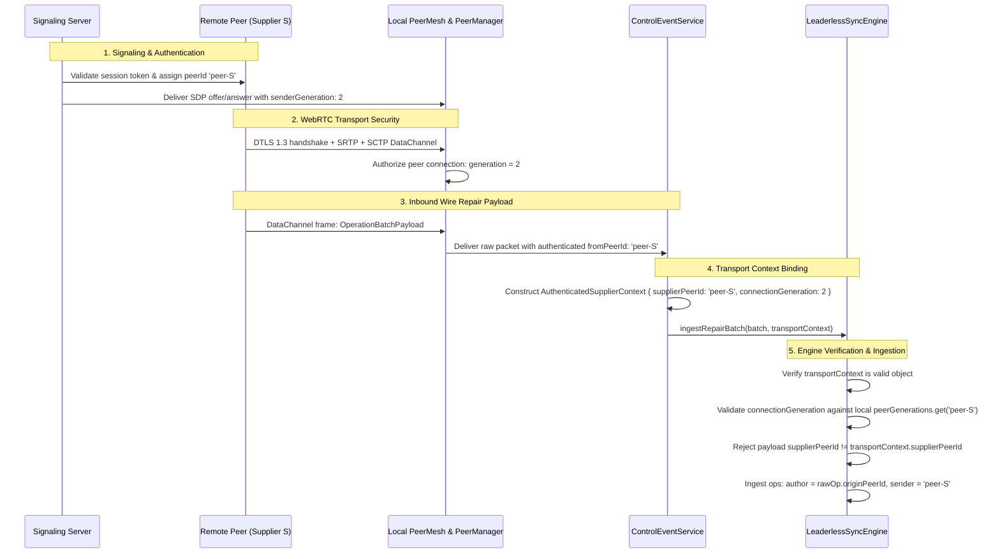

# Phase 7.3-R5-F: Final Capability Identity & Transport Boundary Closure Report

**Milestone:** Phase 7.3-R5-F (Event Ordering & Conflict Engine — Final Closure)  
**Date:** 2026-11-17  
**Baseline Commit:** `a199e08` (`fix(sync-engine): complete Phase 7.3-R5 final authorization & canonicalization closure`)  
**Approved Architecture Baseline:** Phase 7.2-R9 (`1825de1`)  
**Status:** Verification Complete — Phase 7.3 Ready to Freeze  

---

## Executive Summary

Phase 7.3-R5-F closes the final two implementation-level authorization boundaries identified during the Phase 7.3-R5 architectural review:

1. **Exact Epoch Capability Reference Identity:** Enforced strict in-memory object reference equality (`capability === this.authorizedEpochCapability`) for `transitionEpoch()`. Any missing, separately constructed, cloned (`{ ...cap }`), forged, or cross-session capability is strictly rejected with `SyncEngineError('UNAUTHORIZED')`. No public getter exposes the retained capability. The engine retains an `Object.freeze`-protected capability reference. Unauthorized transition attempts guarantee zero state mutation across epoch, pending operations, causal frontier, replication vector, logical clock, and playback state.
2. **Authenticated Supplier Context Boundary Closure:** Mandatory `AuthenticatedSupplierContext` is strictly required for repair batch ingestion. Untrusted repair payloads can neither supply nor override transport supplier identity or connection generation. Missing transport context or missing/invalid connection generation safely rejects with `REJECTED_INVALID`. Stale and unannounced supplier connection generations are fenced against local `peerGenerations`. The distinction between historical event authorship (`originPeerId`) and current transport delivery (`supplierPeerId`) is preserved without confusing the author's historical generation with the supplier's active generation.
3. **Comprehensive Test & Build Verification:** 10 new targeted security tests were added to `closure-r5.test.ts` (expanding it to 34 tests), bringing `@syncplay/sync-engine` to 220 tests across 15 test files and the monorepo to 602 tests across 34 test files (0 failures). Production TypeScript compilation (`tsc`) and client demo bundle build (`vite build`) passed with zero errors.

---

## 1. Task 1: Enforce Exact Epoch Capability Identity

### 1.1 Architectural Vulnerability in R5

In Phase 7.3-R5, the engine retained an `epochCapability` and validated incoming transition requests by comparing string properties:
```ts
// R5 implementation (field comparison):
if (
  !capability ||
  capability.token !== this.authorizedEpochCapability.token ||
  capability.sessionId !== this.config.sessionId ||
  capability.authority !== this.authorizedEpochCapability.authority
) {
  throw new SyncEngineError('UNAUTHORIZED', ...);
}
```
While this prevented empty calls, comparing field values did not establish reference identity. Any caller that observed or predicted the capability properties could construct a separate capability object (`createEpochTransitionCapability(...)`) or shallow-clone an existing capability (`{ ...cap }`) and successfully trigger an unauthorized epoch transition.

### 1.2 Exact Referential Equality Implementation

In Phase 7.3-R5-F:
1. **Object Freezing & Private Retention:** During `LeaderlessSyncEngine` construction, the injected `config.epochCapability` is frozen using `Object.freeze()` and retained in a private field `private readonly authorizedEpochCapability?: EpochTransitionCapability;`.
2. **Strict Identity Validation:** In `transitionEpoch(newEpoch, capability)`:
   ```ts
   if (
     !this.authorizedEpochCapability ||
     !capability ||
     capability !== this.authorizedEpochCapability
   ) {
     throw new SyncEngineError(
       'UNAUTHORIZED',
       'Epoch transition requires authorized EpochTransitionCapability',
     );
   }
   ```
3. **No Capability Exposure:** No public getter (e.g. `getEpochTransitionCapability`) is provided. An engine constructed without an injected capability (`epochCapability: undefined`) permanently rejects all epoch transitions with `UNAUTHORIZED`.
4. **State Preservation Invariant:** Unauthorized calls throw before executing any mutation logic. The epoch counter, pending dependency queue, causal context, replication vector, Lamport clock, and playback state remain completely untouched.

### 1.3 Realm Boundary Clarification

> [!NOTE] Application-Level Boundary
> Exact object reference identity (`===`) provides robust protection against uncoordinated caller code and distinct object instances within the JavaScript application. It does not claim protection against arbitrary, malicious JavaScript executing with full prototype manipulation or heap reflection in the same execution realm. This capability model strictly serves as an architectural boundary between coordinator services and standard peer/sync-engine consumers.

---

## 2. Task 2: Authenticated Supplier Context & Trust Chain

### 2.1 Complete Repair Ingestion Path

The distributed repair ingestion pipeline follows an unbroken chain of custody:

$$\text{Signaling Server} \longrightarrow \text{WebRTC PeerConnection} \longrightarrow \text{PeerMesh / PeerManager} \longrightarrow \text{ControlEventService} \longrightarrow \text{LeaderlessSyncEngine}$$



### 2.2 The Real-World Trust Chain

1. **Signaling & Room Membership:** The central signaling service validates user authentication credentials (e.g., room tokens or JWTs) before establishing a session. It assigns unique, ephemeral `peerId` identifiers and brokers initial SDP offers and ICE candidates.
2. **WebRTC DTLS-SRTP Transport Security:** WebRTC DataChannels employ DTLS (Datagram Transport Layer Security) for hop-by-hop cryptographic channel encryption and mutual authentication.
   - *Limitation Note:* DTLS verifies the transport channel between two endpoints and ensures confidentiality/integrity across the wire. However, DTLS self-signed certificates do not bind a real-world user identity to an application `peerId`. That binding is established through the signaling layer and verified locally by `PeerMesh`.
3. **Local Peer Lifecycle (`PeerMesh` & `PeerManager`):** The local `PeerManager` tracks connection generations (`ConnectionGeneration`). When a remote peer reconnects, negotiation advances the peer's generation monotonically. DataChannel instances are bound directly to the verified `PeerEntry`.
4. **Transport Adapter (`ControlEventService`):** When an incoming message arrives on an active DataChannel, `ControlEventService` resolves the source from the internal channel map (`inbound.fromPeerId`) and queries `peerManager.getPeerStatus(fromPeerId).generation`. It packages this metadata into an immutable `AuthenticatedSupplierContext`.
5. **Engine Ingestion Boundary (`LeaderlessSyncEngine`):** `ingestRepairBatch` strictly checks:
   - `transportContext` must be a valid object (untrusted callers omitting context are rejected with `REJECTED_INVALID`).
   - `connectionGeneration` must be a valid positive integer (missing or malformed generations reject with `REJECTED_INVALID`).
   - If the wire payload claims `batch.supplierPeerId` differing from `transportContext.supplierPeerId`, it is rejected as forged with `REJECTED_INVALID`.
   - The connection generation is validated against `peerGenerations.get(supplierPeerId) ?? 1`. Stale generations ($< active$) and unannounced generations ($> active$) reject with `REJECTED_INVALID`.
   - Untrusted wire callers passing raw numbers or payloads without authenticated transport metadata cannot inject unverified supplier claims.

### 2.3 Distinction Between Historical Author and Transport Supplier

When Peer S repairs missing historical operations authored by Peer A:
- **Historical Author (`originPeerId`):** Identifies the peer that originally created the event. Causal context, Lamport timestamps, replication vectors (`replicationFrontier['peer-A']`), and sequence numbers are tracked under `originPeerId`.
- **Current Supplier (`supplierPeerId` / `senderPeerId`):** Identifies the immediate peer supplying the data over WebRTC. Connection generations are validated exclusively against `peerGenerations['peer-S']`.
- **Decoupled Lifecycle:** Peer A may have reconnected multiple times (or disconnected entirely), while Peer S is at generation 2. The engine validates that Peer S is at generation 2 without restricting or checking Peer A's current generation against Peer S's transport generation.
- **Origin Tampering Prevention:** If `batch.originPeerId` is specified, every operation inside `batch.operations` must match `rawOp.originPeerId === batch.originPeerId`. Any operation with a mismatched origin is rejected with `REJECTED_INVALID`.
- **Content Tampering Prevention:** Re-supplied operations matching an existing or compacted checkpoint identity are verified for identical SHA-256 canonical fingerprints. Any payload mutation is rejected with `REJECTED_IDENTITY_CONFLICT`.

---

## 3. Task 3: RFC 8785 Evidence Finalization

The JSON canonicalizer implemented in `packages/sync-engine/src/log/operation-fingerprint.ts` conforms to RFC 8785 (JSON Canonicalization Scheme - JCS).

### 3.1 Test Files and Test Vectors

- **Test File Path:** `packages/sync-engine/src/__tests__/closure-r5.test.ts`
- **Official RFC 8785 Test Vectors:**
  1. **Section 3.2.2 / Appendix A Basic Conversion Example:**
     - *Source:* RFC 8785 specification Appendix A & Section 3.2.2.
     - *Contents:* Complex JSON string featuring exponential floating-point numbers, control character escapes, UTF-8 euro sign, escaped quotes, and literals (`null`, `true`, `false`).
     - *Expected Canonical Output:* Byte-for-byte exact equality:  
       `{"literals":[null,true,false],"numbers":[333333333.3333333,1e+30,4.5,0.002,1e-27],"string":"€$\u000f\nA'B\"\\\\\"/"}`
  2. **`french.json` (cyberphone/json-canonicalization):**
     - *Source:* Official test suite for non-locale property ordering.
     - *Behavior:* Proves properties are sorted strictly by UTF-16 code units (`peach` < `péché` < `pêche` < `sin`) without linguistic locale collation.
  3. **`structures.json` (cyberphone/json-canonicalization):**
     - *Source:* Property ordering covering empty keys `""`, whitespace keys `"\n"`, `" "`, numeric string keys `"1"`, `"10"`, `"2"`, and uppercase/lowercase keys `"A"`, `"E"`, `"a"`, `"e"`.
  4. **`arrays.json` (cyberphone/json-canonicalization):**
     - *Source:* Element order preservation in arrays containing nested sorted objects.
  5. **`values.json` (cyberphone/json-canonicalization):**
     - *Source:* Boundary number formatting using ECMAScript 7.1.12.1 ToString rules (Grisu2 algorithm), including $-0 \to "0"$, $10^{-6} \to "0.000001"$, $10^{-7} \to "1e-7"$, $10^{20} \to "100000000000000000000"$, and $10^{21} \to "1e+21"$.
  6. **String Escaping Vector:**
     - *Behavior:* Control characters `\u0000`–`\u001f`, `\"`, `\\` are escaped; solidus `/` and single quote `'` are preserved unescaped.

### 3.2 Environment and Exact Equality

- **Byte-for-Byte Comparison:** All test vectors use exact assertion `expect(canonical).toBe(expected)`.
- **Test Environments:**
  - **Node.js 22.12.0:** Verified under Vitest 5.0.5.
  - **Browser Bundle:** Bundled and validated via Vite 6.4.5 with standard ES2022 output.

### 3.3 Intentionally Out-of-Scope Behaviors

- **Lone Surrogates:** Unpaired high/low UTF-16 surrogates are forbidden in well-formed JSON per RFC 8259 Section 8.1 and RFC 8785 Section 3.2.2.2.
- **Non-JSON Values:** Functions, Symbols, BigInts, `undefined`, and non-finite numbers (`NaN`, `Infinity`, `-Infinity`) throw `TypeError` immediately to prevent non-deterministic serialization.
- **Non-Plain Objects:** Instances of `Date`, `Map`, `Set`, and `RegExp` are rejected with `TypeError` to enforce pure JSON semantics.

---

## 4. Task 4: Repository Verification & Test Evidence

### 4.1 Git Repository Verification

- **Final Implementation Commit:** `d6087a30d453bbb1e31aab524020f061349e2543` (`d6087a3`)
- **Parent Baseline Commit:** `a199e08` (`fix(sync-engine): complete Phase 7.3-R5 final authorization & canonicalization closure`)
- **Approved Architectural Baseline:** Phase 7.2-R9 (`1825de1`)
- **Branch:** `main`
- **Git Working Tree:** Clean (`nothing to commit, working tree clean`)

### 4.2 Full Test Results Across Monorepo

All 5 packages and services execute with zero errors:

| Package | Test Files | Tests Run | Result | Duration |
| :--- | :--- | :--- | :--- | :--- |
| `@syncplay/control-events` | 6 | 49 | **PASS** | 665ms |
| `@syncplay/peer-mesh` | 6 | 101 | **PASS** | 2.43s |
| `@syncplay/protocol` | 4 | 141 | **PASS** | 604ms |
| `@syncplay/sync-engine` | 15 | 220 | **PASS** | 1.55s |
| `@syncplay/bootstrap-server` | 3 | 91 | **PASS** | 1.47s |
| **Monorepo Total** | **34** | **602** | **ALL PASSED** | **6.67s** |

### 4.3 Production Build Verification

1. **TypeScript Build:**
   ```
   npm run build --workspaces --if-present
   @syncplay/control-events: tsc -> 0 errors
   @syncplay/peer-mesh: tsc -> 0 errors
   @syncplay/protocol: tsc -> 0 errors
   @syncplay/sync-engine: tsc -> 0 errors
   @syncplay/bootstrap-server: tsc -> 0 errors
   ```
2. **Demo Vite Build:**
   ```
   vite build -> 171 modules transformed
   dist/index.html 9.01 kB
   dist/assets/index-BCFYniTR.js 197.20 kB
   built in 1.12s -> 0 errors
   ```

---

## 5. Summary of Files Changed & Tests Added

### 5.1 Modified Files

1. `packages/sync-engine/src/engine/leaderless-sync-engine.ts`:
   - Enforce exact capability identity: `capability === this.authorizedEpochCapability`.
   - Freeze `config.epochCapability` with `Object.freeze` in constructor.
   - Enforce mandatory `AuthenticatedSupplierContext` and positive integer `connectionGeneration` in `ingestRepairBatch()`.
   - Reject untrusted callers omitting transport context or passing raw numbers.
2. `packages/sync-engine/src/__tests__/closure-r5.test.ts`:
   - Added 10 tests verifying referential capability identity, cloned capability rejection, foreign capability rejection, state preservation, missing transport context rejection, missing generation rejection, invalid generation rejection, raw number rejection, and historical author/supplier generation decoupling.
3. `packages/sync-engine/src/__tests__/identity-authorization-r3.test.ts`:
   - Updated repair batch call to pass authenticated transport context `{ supplierPeerId: 'peer-B', connectionGeneration: 4 }` matching active authorized generation.
4. `packages/sync-engine/src/__tests__/deterministic-simulation.test.ts`:
   - Updated repair batch call to pass `{ supplierPeerId: repairBatch.supplierPeerId, connectionGeneration: 1 }`.
5. `packages/sync-engine/src/__tests__/trust-boundary-r4.test.ts`:
   - Updated 8 test calls from raw numbers to `{ supplierPeerId: 'peer-S', connectionGeneration: ... }`.

---

## 6. Strict Scope Confirmation

- **No Phase 7.4 Implementation:** Anti-entropy repair protocol, state digest broadcasts, missing-range reconciliation, repair requests, and periodic repair scheduling have NOT been started or authorized.
- **No Phase 7.5 Implementation:** Dynamic snapshot recovery, full fault-tolerance, and cluster synchronization have NOT been started or authorized.
- **Phase 7.2-R9 Causal Model Preserved:** Exact Lamport timestamps ($L(e) = 1 + \max(L(p,s))$), exact equality validation, receiver-side clock update without $+1$, and total-order tie-breaking are fully preserved.

---

**Phase 7.3 is ready to be frozen. Phase 7.4 has not been started or authorized.**
