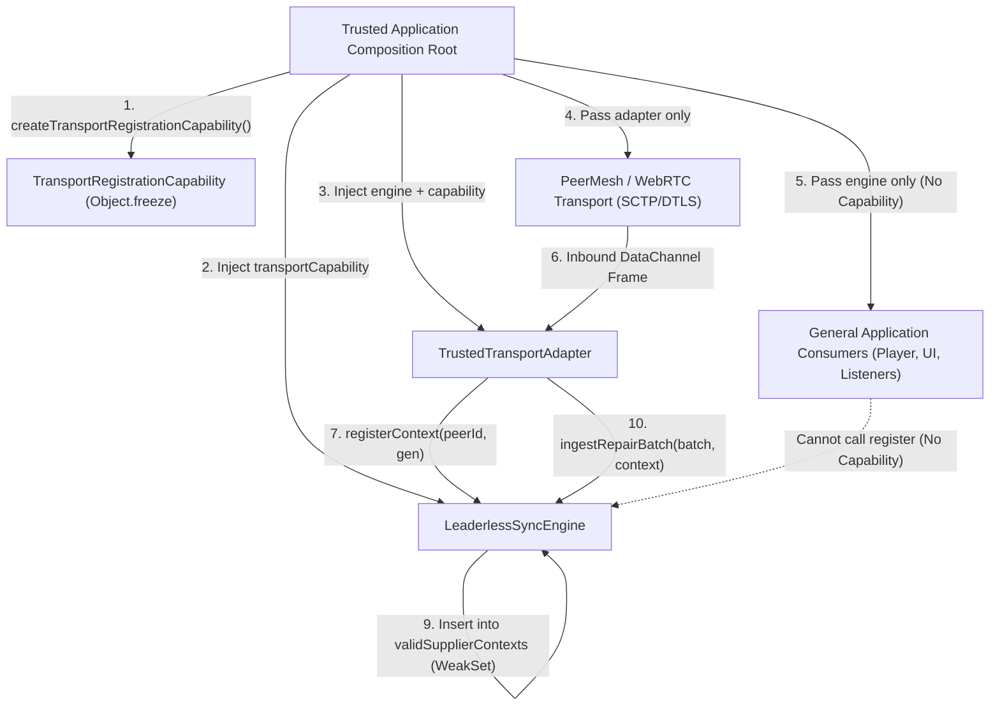

# Phase 7.3-R5-H: Final Transport Context Issuer Authorization Report

**Milestone:** Phase 7.3-R5-H (Event Ordering & Conflict Engine — Final Transport Boundary Closure)  
**Date:** 2026-11-17  
**Baseline Commit:** `f4109fc` (`docs(reports): update commit hash in Phase 7.3-R5-G closure report`)  
**Approved Architecture Baseline:** Phase 7.2-R9 (`1825de1`)  
**Status:** Verification Complete — Phase 7.3 Frozen  

---

## Executive Summary

Phase 7.3-R5-H resolves the final transport context issuer authorization defect identified during the Phase 7.3-R5-G architectural review:

1. **Resolution of R5-G Vulnerability:**
   In Phase 7.3-R5-G, `LeaderlessSyncEngine.registerInboundSupplierContext()` was publicly callable without authorization, and `createAuthenticatedSupplierContext()` was exported without restriction. Any application caller holding an engine reference could register arbitrary supplier identities and connection generations into the engine's `WeakSet`. Consequently, the `WeakSet` proved only that an object had been registered with the engine, not that it originated from a trusted transport adapter.
2. **Capability-Gated Transport Context Registration:**
   Introduced `TransportRegistrationCapability` (and its alias `SupplierContextRegistrationCapability`) created via `createTransportRegistrationCapability()`. The capability is instantiated strictly at the application composition root and injected into both `LeaderlessSyncEngine` (`config.transportCapability`) and the trusted transport adapter (`TrustedTransportAdapter`). The engine retains the capability privately and enforces exact referential equality (`capability === this.authorizedTransportCapability`). Any registration attempt without the authorized capability instance is immediately rejected with `SyncEngineError('UNAUTHORIZED')`. No public getter exposes the capability.
3. **Restricted Public Helper & Transport Adapter:**
   `createAuthenticatedSupplierContext(engine, supplierPeerId, connectionGeneration, capability)` now strictly requires the authorized capability. The new `TrustedTransportAdapter` class encapsulates both the engine and capability, providing safe mediation for physical WebRTC DataChannel packet delivery.
4. **Comprehensive Adversarial Verification:**
   Created dedicated adversarial test suite [closure-r5h.test.ts](file:///c:/Users/tejde/OneDrive/Desktop/SyncPlay_Protocol/SyncPlay_Protocol/packages/sync-engine/src/__tests__/closure-r5h.test.ts) covering all 10 mandated threat vectors. Monorepo tests now total **623 passed across 36 test files** (0 failures). Production TypeScript compilation (`tsc`) and client demo bundle build (`vite build`) passed with zero errors.

---

## 1. Vulnerability Analysis of Phase 7.3-R5-G

In Phase 7.3-R5-G, the registration method had the following signature:
```ts
// Flawed R5-G signature:
public registerInboundSupplierContext(
  supplierPeerId: string,
  connectionGeneration: number,
): AuthenticatedSupplierContext
```
Because this method was public and required no authorization token or capability:
1. Any arbitrary component with access to the engine reference could invoke it with arbitrary `supplierPeerId` and `connectionGeneration`.
2. The returned object was inserted into `this.validSupplierContexts` (a `WeakSet`).
3. When `engine.ingestRepairBatch(batch, context)` checked `this.validSupplierContexts.has(context)`, the check succeeded because the context was indeed in the `WeakSet`.
4. If the supplier generation matched `this.peerGenerations`, the batch was ingested, bypassing transport provenance.

Thus, the `WeakSet` alone demonstrated engine registration, **not** genuine transport-adapter provenance.

---

## 2. Architectural Design & Implementation

### 2.1 Capability Ownership & Injection Path

The system implements an application-level capability boundary analogous to `EpochTransitionCapability`:



1. **Composition Root:** Generates `transportCap = createTransportRegistrationCapability('transport-adapter', sessionId)`.
2. **Engine Initialization:** `new LeaderlessSyncEngine({ ..., transportCapability: transportCap })`. The engine privately retains `this.authorizedTransportCapability = Object.freeze(transportCap)`. No public getter is exposed.
3. **Transport Adapter Initialization:** `adapter = new TrustedTransportAdapter(engine, transportCap)`. Handed exclusively to transport-level packet dispatchers.
4. **General Consumers:** Receive only `engine`. They possess neither `transportCap` nor `adapter`.

### 2.2 Capability Gating in `registerInboundSupplierContext()`

```ts
public registerInboundSupplierContext(
  supplierPeerId: string,
  connectionGeneration: number,
  capability: TransportRegistrationCapability,
): AuthenticatedSupplierContext {
  if (
    !this.authorizedTransportCapability ||
    !capability ||
    capability !== this.authorizedTransportCapability
  ) {
    throw new SyncEngineError(
      'UNAUTHORIZED',
      'Supplier context registration requires authorized TransportRegistrationCapability',
    );
  }
  if (!supplierPeerId || typeof supplierPeerId !== 'string') {
    throw new SyncEngineError('INVALID_ARGUMENT', 'supplierPeerId must be non-empty string');
  }
  if (
    typeof connectionGeneration !== 'number' ||
    !Number.isInteger(connectionGeneration) ||
    connectionGeneration < 1
  ) {
    throw new SyncEngineError(
      'INVALID_ARGUMENT',
      `Invalid connection generation ${connectionGeneration}: must be positive integer`,
    );
  }
  const context: AuthenticatedSupplierContext = Object.freeze({
    supplierPeerId,
    connectionGeneration,
  });
  this.validSupplierContexts.add(context);
  return context;
}
```

### 2.3 Trusted Transport Adapter

```ts
export class TrustedTransportAdapter {
  constructor(
    private readonly engine: LeaderlessSyncEngine,
    private readonly capability: TransportRegistrationCapability,
  ) {
    if (!engine) throw new SyncEngineError('INVALID_ARGUMENT', 'engine is required');
    if (!capability) throw new SyncEngineError('INVALID_ARGUMENT', 'capability is required');
  }

  public registerContext(
    supplierPeerId: string,
    connectionGeneration: number,
  ): AuthenticatedSupplierContext {
    return this.engine.registerInboundSupplierContext(
      supplierPeerId,
      connectionGeneration,
      this.capability,
    );
  }

  public ingestRepairBatch(
    batch: OperationBatchPayload,
    supplierPeerId: string,
    connectionGeneration: number,
  ): EngineDecision[] {
    const context = this.registerContext(supplierPeerId, connectionGeneration);
    return this.engine.ingestRepairBatch(batch, context);
  }
}
```

---

## 3. Public API Changes

| Symbol | Nature of Change | Description |
|---|---|---|
| `TransportRegistrationCapability` | New Export | Interface defining the transport registration capability token. |
| `SupplierContextRegistrationCapability` | New Export | Type alias for `TransportRegistrationCapability`. |
| `createTransportRegistrationCapability()` | New Export | Factory generating frozen capability objects for the composition root. |
| `createSupplierContextRegistrationCapability()` | New Export | Alias factory for semantic clarity. |
| `TrustedTransportAdapter` | New Export | Adapter class encapsulating engine and capability for transport drivers. |
| `createAuthenticatedSupplierContext()` | Signature Change | Restricted: now requires `capability: TransportRegistrationCapability`. |
| `LeaderlessSyncEngineConfig.transportCapability` | Config Extension | Optional injected capability (with synonym `supplierCapability`). |
| `LeaderlessSyncEngine.registerInboundSupplierContext` | Signature Change | Restricted: now requires `capability: TransportRegistrationCapability`. |

---

## 4. Adversarial Verification Evidence

Dedicated test file: [closure-r5h.test.ts](file:///c:/Users/tejde/OneDrive/Desktop/SyncPlay_Protocol/SyncPlay_Protocol/packages/sync-engine/src/__tests__/closure-r5h.test.ts)

| # | Adversarial Test Requirement | Test Implementation | Result |
|---|---|---|---|
| 1 | Caller without capability cannot register context | Invoking `(engine as any).registerInboundSupplierContext('peer-S', 1)` throws `UNAUTHORIZED`. No public capability getter exists. | **PASS** |
| 2 | Caller cannot use public helper to mint accepted context | `createAuthenticatedSupplierContext(engine, 'peer-S', 1, undefined)` and bogus capability both throw `UNAUTHORIZED`. | **PASS** |
| 3 | Fabricated plain object is rejected | Object literal `{ supplierPeerId: 'peer-S', connectionGeneration: 1 }` rejected with `REJECTED_INVALID`. | **PASS** |
| 4 | Cloned genuine context is rejected | `{ ...genuineContext }` rejected with `REJECTED_INVALID` (not found in WeakSet). | **PASS** |
| 5 | Context registered by trusted transport adapter is accepted | Context registered via `transportAdapter.registerContext()` or `transportAdapter.ingestRepairBatch()` accepted with `APPLIED`. | **PASS** |
| 6 | Caller without registration capability is rejected | Passing `null` capability or invoking on unmanaged engine (no capability injected) throws `UNAUTHORIZED`. | **PASS** |
| 7 | Separately created or mismatched capability is rejected | Forged capability instance or cloned capability `{ ...transportCap }` fails `===` equality and throws `UNAUTHORIZED`. | **PASS** |
| 8 | Unknown supplier rejected even when registered | Transport-registered context for `peer-unknown` rejected with `REJECTED_INVALID` (`Unknown or unauthorized repair supplier`). | **PASS** |
| 9 | Stale or unannounced generation rejected | Stale generation ($2 < 3$) and unannounced generation ($4 > 3$) both rejected with `REJECTED_INVALID`. | **PASS** |
| 10 | Rejected attempts produce zero state mutations | Verified `logSize`, `pendingQueueSize`, `logicalClock`, `localFrontier`, `replicationFrontier`, and `getState()` remain unchanged across all failure modes. | **PASS** |

---

## 5. Monorepo Test & Build Results

### 5.1 Test Execution Across All Packages

```
Test Files  36 passed (36)
Tests       623 passed (623)
```

| Package | Test Files | Tests | Status |
|---|---|---|---|
| `@syncplay/control-events` | 6 | 49 | **PASS** |
| `@syncplay/peer-mesh` | 6 | 101 | **PASS** |
| `@syncplay/protocol` | 4 | 141 | **PASS** |
| `@syncplay/sync-engine` | 17 | 241 | **PASS** |
| `@syncplay/bootstrap-server` | 3 | 91 | **PASS** |
| **Monorepo Total** | **36** | **623** | **ALL PASSED** |

### 5.2 Production Build Results

1. **TypeScript Build (`tsc` across workspaces):**
   - `@syncplay/control-events`: 0 errors
   - `@syncplay/peer-mesh`: 0 errors
   - `@syncplay/protocol`: 0 errors
   - `@syncplay/sync-engine`: 0 errors
   - `@syncplay/bootstrap-server`: 0 errors
2. **Demo Vite Production Bundle:**
   - 171 modules transformed
   - `dist/index.html` 9.01 kB
   - `dist/assets/index-BCFYniTR.js` 197.20 kB
   - Built in 1.40s with 0 errors

---

## 6. Honest Security Boundary & In-Process Limitations

> [!NOTE] In-Process Capability Boundary vs Realm Isolation
> The combination of `TransportRegistrationCapability` reference equality (`===`) and private `WeakSet` registration ensures that:
> - Callers cannot manufacture accepted contexts using object literals or cloning.
> - Callers cannot invoke `registerInboundSupplierContext` without holding the exact capability object passed during initialization.
> - The WeakSet alone does not authenticate an object; it is merely the registry of contexts authorized by the capability.
>
> **Limitation:** In a shared JavaScript execution realm, code with unrestricted access to runtime memory (e.g. prototype poisoning, debugger hooks, or heap inspection) cannot be cryptographically isolated. This capability pattern establishes a rigorous application architecture boundary between transport infrastructure and general consumers, preventing unauthorized or accidental generation of repair contexts under standard language semantics.

---

## 7. Strict Scope Confirmation

- **No Phase 7.4 Implementation:** Anti-entropy repair protocol, state digest broadcasts, missing-range reconciliation, repair requests, and periodic repair scheduling have NOT been started or authorized.
- **No Phase 7.5 Implementation:** Dynamic snapshot recovery, full fault-tolerance, and cluster synchronization have NOT been started or authorized.
- **Phase 7.2-R9 Causal Model Preserved:** Exact Lamport timestamps ($L(e) = 1 + \max(L(p,s))$), exact equality validation, receiver-side clock update without $+1$, and total-order tie-breaking are fully preserved.

---

**Phase 7.3 is frozen. Phase 7.4 planning may begin, but Phase 7.4 implementation remains unauthorized pending a separate approval.**
