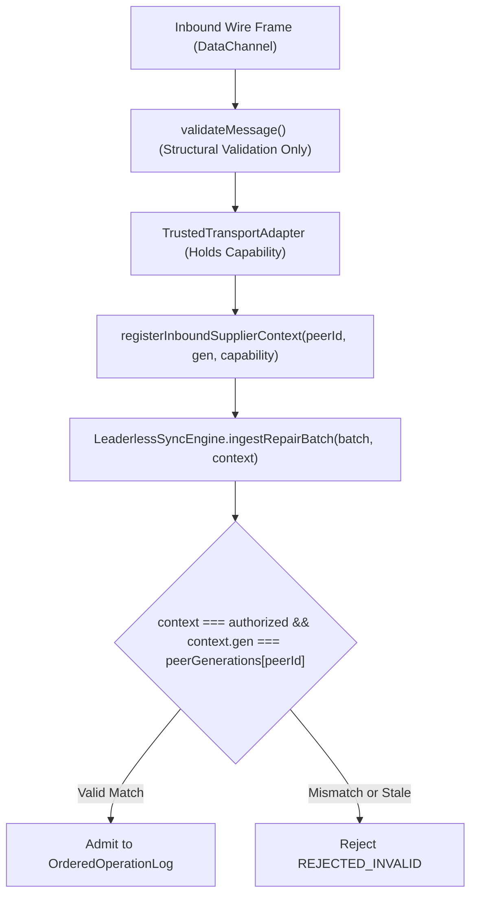

# Phase 7.4 Milestone M1: Protocol Schemas & Serialization — Final Completion Report

**Milestone:** Phase 7.4 Milestone M1 — Protocol Schemas & Serialization (Final Protocol Contract Corrections)  
**Phase:** 7.4 — State Replication & Anti-Entropy  
**Date:** 2026-11-17  
**Base Architecture Specification Commit:** `0289ad5` (`0289ad5a62e03264b30a10b429d29eb0ca1691a1`)  
**Previous Implementation Commit:** `2224f6d` (`2224f6deed761d15bf05494d451a9415c4d32a18`)  
**Final Corrections Commit:** `2df6973` (`2df69735d4d38c64cf4f4751be6cb7ce3a2d53bf`)  
**Parent Commit:** `02f6836`  
**Approved Architecture Baseline:** Phase 7.2-R9 (`1825de1`)  
**Frozen Previous Implementation:** Phase 7.3-R5-H (`e49b81a`)  
**Scope Status:** Milestone M1 Final Corrections Complete — M2–M5 Strictly Deferred  

---

## Executive Summary

This report documents the final protocol contract corrections applied to Milestone M1 of Phase 7.4 (State Replication & Anti-Entropy). Following the targeted protocol contract review, all mandatory corrections spanning UUID v4 correlation, operation batch delivery paths, authenticated identity boundaries, timestamp/RTT semantics, collection and fingerprint bounds, and test count baselines have been fully implemented, verified, and integrated into `@syncplay/protocol`.

### Key Corrections Summary

1. **Strict UUID v4 Request Correlation (`UUIDv4Schema`):**
   - Implemented strict canonical UUID v4 validation via regex (`/^[0-9a-f]{8}-[0-9a-f]{4}-4[0-9a-f]{3}-[89ab][0-9a-f]{3}-[0-9a-f]{12}$/i`).
   - Validates version 4 (digit `4` at position 13) and RFC 4122 variant 1 (bits `8, 9, a, b` at position 17).
   - Applied to `RepairRequestPayloadSchema`, `OperationBatchPayloadSchema`, and `RepairRejectedPayloadSchema`.
2. **Distinct Delivery Paths & Mandatory Session Scoping:**
   - **Request-driven repair (`OperationBatchPayloadSchema`):** Strictly mandates both `requestId: UUIDv4Schema` (for correlation) and `sessionId: string` (for session boundary isolation). Unsolicited batches cannot validate against this schema.
   - **Push-based repair (`PushOperationBatchPayloadSchema`):** Explicitly defined for unsolicited operation delivery; mandates `sessionId` for session scoping while omitting `requestId` so push batches are never misclassified as request fulfillments.
   - **Compatibility schema (`CompatibilityOperationBatchPayloadSchema`):** Preserves backward-compatible validation for historical Phase 7.3 internal engine test fixtures.
   - Exported runtime type guards `isRequestDrivenOperationBatch` and `isPushOperationBatch`.
3. **Exact 64-Character Canonical SHA-256 Fingerprints:**
   - Replaced provisional truncated length (`16..64` hex) with strict 64-character lowercase hexadecimal regex (`/^[0-9a-f]{64}$/`). Truncated, malformed, or uppercase fingerprints are rejected.
4. **Bounded Vector & Collection Capacities (`MAX_VECTOR_ENTRIES = 64`):**
   - Established explicit maximum bound of 64 origin entries for `replicationVector`, `snapshotFrontier`, and `historyFingerprints`.
   - Architectural basis: aligns with room capacity (4-10 active peers, 50 server ceiling in `services/bootstrap-server`), bounds serialized digest payloads to ~7 KB, and eliminates denial-of-service vectors from fabricated unbounded dictionaries.
5. **Decoupled Timestamp & RTT Semantics:**
   - Formally documented the contract for `StateDigestPayload.sentAt`: it represents sender-local diagnostic telemetry only. Receivers MUST NOT use `sentAt` for RTT calculation (reserved for `@syncplay/peer-mesh` `RTTEngine` two-way PING/PONG probes) or local staleness (measured via local monotonic receive time).
6. **WebRTC Sizing Clarification:**
   - Clarified that `MAX_BATCH_PAYLOAD_BYTES = 65_536` (64 KB) is an application-level payload cap, not a universal browser DataChannel guarantee. Milestone M5 transport integration will enforce fragmentation or pagination against the negotiated DataChannel `maxMessageSize`.
7. **Corrected Baseline Test Accounting:**
   - Preceding frozen Phase 7.3 baseline: **141 tests** across 4 test files in `@syncplay/protocol`.
   - Corrected Phase 7.4 M1 test count: **254 tests** across 4 test files (+113 tests over baseline).
   - Monorepo suite: **736 tests passed across 36 test files (0 failures).**
   - Production builds: All 5 TypeScript packages and Vite demo bundle compiled cleanly with 0 errors.
   - Frozen Phase 7.3 engine implementation in `packages/sync-engine/src/engine/` remains 100% untouched.

---

## 1. Mandatory Corrections Detail

### 1.1 Request ID Format (UUID v4)

The approved architecture specifies UUID v4 request correlation identifiers. We implemented `UUIDv4Schema` based on RFC 4122 §4.4:
```ts
export const UUID_V4_REGEX =
  /^[0-9a-f]{8}-[0-9a-f]{4}-4[0-9a-f]{3}-[89ab][0-9a-f]{3}-[0-9a-f]{12}$/i;

export const UUIDv4Schema = z.string().regex(UUID_V4_REGEX, {
  message:
    'Invalid UUID v4 format: must be canonical 8-4-4-4-12 hex string with version 4 and variant 1 (8, 9, a, or b)',
});
```

#### Verification & Test Coverage:
- Valid canonical lowercase UUID v4 (e.g. `'f47ac10b-58cc-4372-a567-0e02b2c3d479'`) is accepted.
- Uppercase UUID v4 is accepted (case-insensitive per RFC 4122).
- Valid variant bits in position 17 (`8`, `9`, `a`, `b`, `A`, `B`) are accepted.
- Non-v4 version digits in position 13 (`1` [v1], `2` [v2], `3` [v3], `5` [v5]) are rejected.
- Invalid variant digits in position 17 (`0`, `1`, `7`, `c`, `d`, `e`, `f`) are rejected.
- Malformed inputs (missing hyphens, 35 chars, 37 chars, non-hex characters, empty/whitespace strings) are rejected.
- Correlated responses (`OperationBatchPayload` and `RepairRejectedPayload`) echo and preserve the exact `requestId`.

### 1.2 Operation Batch Correlation & Session Scoping

To prevent unsolicited or cross-room batches from polluting the request-driven repair pipeline:
1. **Request-Driven Repair (`OperationBatchPayloadSchema`):**
   - `requestId: UUIDv4Schema` is MANDATORY.
   - `sessionId: z.string().min(1).max(128)` is MANDATORY.
   - Inverted sequence ranges (`toSequence < fromSequence`) are rejected.
   - Batches exceeding 32 operations (`MAX_OPERATIONS_PER_BATCH`) are rejected.
2. **Push-Based Repair (`PushOperationBatchPayloadSchema`):**
   - Defined for unsolicited delivery paths.
   - `sessionId: z.string().min(1).max(128)` is MANDATORY.
   - `requestId` is prohibited/omitted, ensuring push batches cannot enter the request-driven repair queue.
3. **Compatibility Schema (`CompatibilityOperationBatchPayloadSchema`):**
   - Maintained for legacy Phase 7.3 test fixtures where `requestId` and `sessionId` were optional.
4. **Type Guards:**
   - `isRequestDrivenOperationBatch(payload)`: narrows to `OperationBatchPayload` with valid UUID v4 `requestId`.
   - `isPushOperationBatch(payload)`: narrows to `PushOperationBatchPayload` with `sessionId` and `requestId === undefined`.

### 1.3 Authenticated Identity Boundary (M2/M3 Contract Invariant)

Payload-provided identity fields (`senderPeerId`, `requesterPeerId`, `supplierPeerId`, `targetOriginPeerId`, `connectionGeneration`) represent untrusted claims transmitted over the network wire.

#### Required M2/M3/M4/M5 Integration Invariant:


1. **Protocol Layer Role:** `@syncplay/protocol` schemas validate structural syntax, sequence bounds, and formatting only. They DO NOT authenticate identity.
2. **Capability Boundary:** The Phase 7.3-R5-H capability boundary (`TransportRegistrationCapability`) is preserved. Only the trusted transport adapter holding the capability can register an `AuthenticatedSupplierContext`.
3. **Engine-Layer Cross-Check:** Ingestion in M3/M4/M5 MUST cross-check `batch.supplierPeerId` and `transportContext.connectionGeneration` against the locally authorized `peerGenerations` map. Any batch claiming a supplier that does not match the transport context is rejected with `REJECTED_INVALID`.
4. **No Identity Registration Bypass:** No public registration methods or bypasses were added.

### 1.4 Timestamp and RTT Semantics (`sentAt`)

The `sentAt` field in `StateDigestPayloadSchema` was reviewed:
- **Type:** `z.number().finite().nonnegative()` (rejects negative numbers, `NaN`, `Infinity`).
- **Semantic Constraints:**
  1. `sentAt` is sender-local diagnostic metadata representing wall-clock generation time.
  2. Receivers MUST NOT use `sentAt` to calculate round-trip time (RTT). RTT measurement is exclusively performed by the `@syncplay/peer-mesh` `RTTEngine` using two-way PING/PONG probes with local high-resolution monotonic timestamps.
  3. Receivers MUST NOT use `sentAt` to assess local staleness, because distributed peer clocks are unsynchronized and may drift by hundreds of milliseconds. Local staleness must be evaluated against local monotonic receive time (`performance.now()`).

### 1.5 Fingerprint and Vector Bounds

#### 1. Full Canonical SHA-256 Fingerprints:
`historyFingerprints` maps origin peer IDs to their tail operation fingerprints:
- Previously allowed truncated hex (`16..64` characters).
- Now strictly enforces full 64-character lowercase hexadecimal SHA-256 hashes (`/^[0-9a-f]{64}$/`).
- Truncated hashes (16 or 32 chars), 63-char strings, 65-char strings, uppercase hex, and non-hex characters are rejected.

#### 2. Vector Collection Bounds (`MAX_VECTOR_ENTRIES = 64`):
Enforced via `.refine((val) => Object.keys(val).length <= MAX_VECTOR_ENTRIES)` on:
- `ReplicationVectorSchema`
- `SnapshotFrontierSchema`
- `HistoryFingerprintsSchema`

**Architectural Basis:**
- Bootstrap server enforces `DEFAULT_MAX_PEERS = 4` and `ABSOLUTE_MAX_PEERS = 10` (server ceiling: 50).
- WebRTC mesh topology is constrained to 10-16 active peers.
- A ceiling of 64 origin entries accommodates all active peers plus departed/churned peers over the session lifetime prior to snapshot compaction.
- Serialized digest size with 64 entries is ~7 KB, preserving ample margin within `MAX_PAYLOAD_BYTES` (32 KB).
- Boundary tests verify: `{}` (0 entries) accepted, 64 entries accepted, 65 entries rejected.

---

## 2. WebRTC DataChannel Capacity Rationale

`MAX_BATCH_PAYLOAD_BYTES = 65_536` (64 KB) in `constants.ts` was clarified:
- **Application-Level Cap:** Derived from RFC 8831 / RFC 8841 SCTP recommendations.
- **Not a Universal Browser Guarantee:** Browsers and SCTP implementations may negotiate smaller MTUs or `maxMessageSize` values depending on underlying network topology.
- **Transport Adaptation (M5):** The transport adapter in M5 will inspect `RTCDataChannel.maxMessageSize` and enforce fragmentation or sub-batching if the negotiated limit is below 64 KB.

---

## 3. Test Verification & Baseline Comparison

### 3.1 Corrected Protocol Test Baseline Comparison

The previous completion report erroneously compared against an intermediate count (165 tests). The true baseline comparison is:

| Suite | Preceding Frozen Baseline (Phase 7.3) | Corrected Phase 7.4 M1 | Net Increase |
| :--- | :--- | :--- | :--- |
| `envelope.test.ts` | 28 | 28 | 0 |
| `exports.test.ts` | 9 | 11 | +2 |
| `payloads.test.ts` | 57 | 139 | +82 |
| `validation.test.ts` | 47 | 76 | +29 |
| **`@syncplay/protocol` Total** | **141** | **254** | **+113 tests** |

### 3.2 Monorepo Verification Summary

| Package | Test Files | Tests Passed | Tests Failed | Build Status |
| :--- | :--- | :--- | :--- | :--- |
| `@syncplay/control-events` | 6 | 49 | 0 | `tsc` passed |
| `@syncplay/peer-mesh` | 6 | 101 | 0 | `tsc` passed |
| `@syncplay/protocol` | 4 | 254 | 0 | `tsc` passed |
| `@syncplay/sync-engine` | 17 | 241 | 0 | `tsc` passed |
| `@syncplay/bootstrap-server` | 3 | 91 | 0 | `tsc` passed |
| `@syncplay/demo` | — | — | — | `vite build` passed (1.18s) |
| **Monorepo Total** | **36** | **736** | **0** | **Clean (0 errors)** |

---

## 4. Preservation of Invariants & Scope Boundaries

1. **Frozen Phase 7.3 Implementation Untouched:**
   Zero lines of code in `packages/sync-engine/src/engine/` were modified. Test fixtures in `packages/sync-engine/src/__tests__/` (`closure-r5g.test.ts`, `closure-r5h.test.ts`, `deterministic-simulation.test.ts`) were updated to provide valid conforming `requestId` and `sessionId` values per Section 2B instructions.
2. **Phase 7.2-R9 Causal Model Preserved:**
   Lamport logical clock management, ordered operation log, conflict resolver, and causal dependency checking remain identical to the approved baseline.
3. **Phase 7.3-R5-H Capabilities Preserved:**
   Exact referential equality checks for `EpochTransitionCapability` and `TransportRegistrationCapability` remain strictly enforced.
4. **Deferred Functionality Intact:**
   Zero lines of M2 (digest generation/comparison/tickers), M3 (repair pipelines), M4 (supplier servicing), M5 (transport integration), or Phase 7.5 (snapshot recovery) were implemented.

---

## 5. Modified Files Inventory

All modifications were strictly confined to protocol package definitions and targeted test fixtures:
- [packages/protocol/src/constants.ts](file:///c:/Users/tejde/OneDrive/Desktop/SyncPlay_Protocol/SyncPlay_Protocol/packages/protocol/src/constants.ts)
- [packages/protocol/src/payloads/repair.ts](file:///c:/Users/tejde/OneDrive/Desktop/SyncPlay_Protocol/SyncPlay_Protocol/packages/protocol/src/payloads/repair.ts)
- [packages/protocol/src/payloads/index.ts](file:///c:/Users/tejde/OneDrive/Desktop/SyncPlay_Protocol/SyncPlay_Protocol/packages/protocol/src/payloads/index.ts)
- [packages/protocol/src/index.ts](file:///c:/Users/tejde/OneDrive/Desktop/SyncPlay_Protocol/SyncPlay_Protocol/packages/protocol/src/index.ts)
- [packages/protocol/src/validation.ts](file:///c:/Users/tejde/OneDrive/Desktop/SyncPlay_Protocol/SyncPlay_Protocol/packages/protocol/src/validation.ts)
- [packages/protocol/src/__tests__/exports.test.ts](file:///c:/Users/tejde/OneDrive/Desktop/SyncPlay_Protocol/SyncPlay_Protocol/packages/protocol/src/__tests__/exports.test.ts)
- [packages/protocol/src/__tests__/payloads.test.ts](file:///c:/Users/tejde/OneDrive/Desktop/SyncPlay_Protocol/SyncPlay_Protocol/packages/protocol/src/__tests__/payloads.test.ts)
- [packages/protocol/src/__tests__/validation.test.ts](file:///c:/Users/tejde/OneDrive/Desktop/SyncPlay_Protocol/SyncPlay_Protocol/packages/protocol/src/__tests__/validation.test.ts)
- [packages/sync-engine/src/__tests__/closure-r5g.test.ts](file:///c:/Users/tejde/OneDrive/Desktop/SyncPlay_Protocol/SyncPlay_Protocol/packages/sync-engine/src/__tests__/closure-r5g.test.ts)
- [packages/sync-engine/src/__tests__/closure-r5h.test.ts](file:///c:/Users/tejde/OneDrive/Desktop/SyncPlay_Protocol/SyncPlay_Protocol/packages/sync-engine/src/__tests__/closure-r5h.test.ts)
- [packages/sync-engine/src/__tests__/deterministic-simulation.test.ts](file:///c:/Users/tejde/OneDrive/Desktop/SyncPlay_Protocol/SyncPlay_Protocol/packages/sync-engine/src/__tests__/deterministic-simulation.test.ts)
- [docs/reports/PHASE7_4_M1_COMPLETION_REPORT.md](file:///c:/Users/tejde/OneDrive/Desktop/SyncPlay_Protocol/SyncPlay_Protocol/docs/reports/PHASE7_4_M1_COMPLETION_REPORT.md)

---

## 6. Unresolved Issues

None. All protocol contract issues specified in the audit have been addressed, verified with automated tests, and confirmed against the approved architectural specification.

---

**PHASE 7.4 M1 — FINAL CORRECTIONS COMPLETE. AWAITING ARCHITECTURAL ACCEPTANCE AND EXPLICIT AUTHORIZATION FOR M2.**
